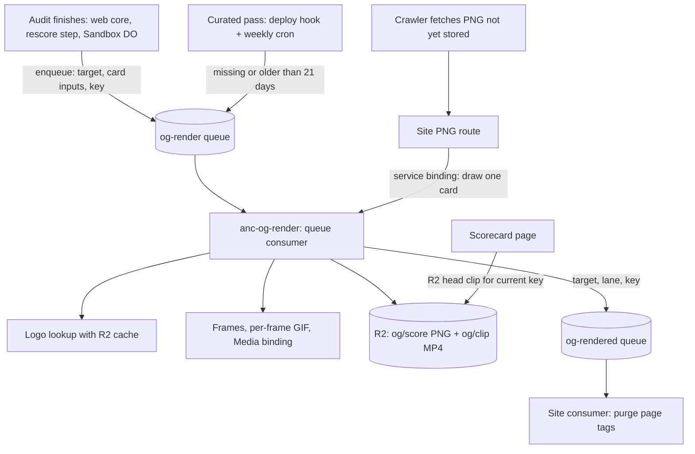
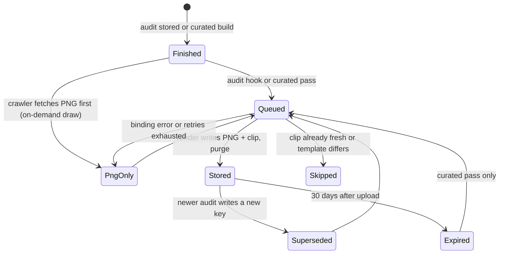

# Scorecard og:video - Plan

## Goal Capsule

- **Objective:** A scorecard link shared in iMessage or Discord plays a short clip that counts up to the real score and ends on the same card every other platform shows as the still image.
- **Means:** a separate render Worker, fed by a queue, draws every card PNG and clip with the Cloudflare Media Transformations binding (KTD1, KTD2).
- **Authority:** Product Contract requirements win on behavior, Key Technical Decisions win on mechanism, and units override neither.
- **Execution profile:** code. Card-face and storage fixes (U1, U2) land inside PR #461. Everything else lands in one PR stacked on #461. #461 does not merge before that stacked PR. Both merge to `dev` only after Brett approves the batch.
- **Stop conditions:**
  - On staging, the Media binding refuses per-frame-palette GIF input or 1200x630 output. Stop and report: the encoder choice is void.
  - The design shortlist needs a card face the key grammar cannot express (KTD4). Stop and amend KTD4 before building on it.
  - Render CPU measured on staging exceeds the render Worker's `limits.cpu_ms` at the default motion. Stop and re-size before enabling the switch.
- **Who finishes:** the agentnative-site session builds, verifies on staging, and hands both PRs to Brett for merge approval. No agentnative-cli change is needed.

---

## Product Contract

### Summary

Every finished scorecard gets a ~3.5 s MP4 that holds the final card, drains the score to zero, climbs back with an ease-out, and holds. Scorecard pages name the clip in `og:video` once it exists. A standalone render Worker draws both the PNG card and the clip from a queue, so no clip ever renders on a page or crawler request. Website cards show the audit date and CLI cards the tool version, and every visible change mints a new card URL.

### Problem Frame

PR #461 gives every scorecard a 1200x630 PNG card, but a shared link still reads as a static image. The score is the result someone shares, and motion is what makes it register in a chat thread. Of the six priority platforms, only iMessage autoplays `og:video` and only Discord plays it on click. X, LinkedIn, Slack, and Bluesky read `og:image` only, so the PNG stays the card everywhere else. A device test on 2026-10-26 confirmed that a Media Transformations MP4 autoplays in iMessage and plays in Discord with `og:type` `article` and the `og:video` tag set.

Two constraints shape the work. A cold render takes 10 to 12 s, above Discord's 10 s fetch budget, so clips must exist before anyone fetches them. The binding is billed per output second after its beta, so a render must never be something a request can trigger.

### Requirements

**Coverage**

- R1. Every finished scorecard gets a clip: live website and CLI audits, the curated CLI registry, and the curated (seeded) websites. Pending, unscored, and missing targets get none.
- R2. The clip holds the final card, drains the score to zero, climbs back with an ease-out to the real score, and holds. It runs about 3.5 s at 1200x630 with no audio. Its first and last frames show the same card as the PNG; equality is visual, since H.264 is lossy.

**Triggers and cost**

- R3. A clip renders when its audit finishes. Curated cards also render after each deploy and each weekly rescore when their clip is missing or more than 21 days old.
- R4. No clip render or Media binding call starts from a page view, a crawler fetch, or any public request. A crawler fetch of a card that is not yet stored draws that one PNG on demand through the render Worker.
- R5. An operator switch stops new renders without a deploy. Existing clips keep being named and served while it is off.
- R6. Clips expire with the `og/` 30-day lifecycle rule. A live-audited site nobody re-audits loses its clip after 30 days, and its page falls back to the still card.

**Pages and serving**

- R7. A scorecard page names its clip (`og:video`, `og:video:secure_url`, `og:video:type`, `og:video:width`, `og:video:height`) only when the clip for the page's current card exists. `og:image` and `og:type` stay as they are.
- R8. When a clip lands, the scorecard page's edge copy is cleared so the next fetch names it. This includes curated CLI pages.
- R9. The clip URL answers `GET`, `HEAD`, and byte-range requests with `206`, and is cached immutable.

**Card face**

- R10. Website cards show the audit date (`YYYY-MM-DD`, UTC) and CLI cards show the tool version where the spec version is today. The spec version moves to the image description.
- R11. Any change to what a card shows produces a new card URL: score, date or tool version, spec version, or template version.
- R12. Card layout and the motion's color and digit treatment stay swappable pending the design shortlist. Until it lands: the #461 layout, color locked to the final score band, and fixed digit slots.

### Key Decisions

- **One pipeline for every clip, on the Media Transformations binding.** (session-settled: user-directed, chosen over ffmpeg libx264 in CI for curated clips: card logos are found only at runtime, so a CI encoder would rebuild the lookup with a CI secret and a cache.) Governs R1, R3.
- **The binding's MP4 ships as returned.** (session-settled: user-directed, chosen over an ffmpeg faststart encode: both files played in iMessage and Discord in the 2026-10-26 device test.) Governs R2, R9.
- **Curated websites are in scope.** (session-settled: user-directed, added to the confirmed scope.) Governs R1.
- **Date on website cards, tool version on CLI cards.** (session-settled: user-approved, chosen over keeping the spec version on the face, with the weekly re-render of every seeded site shown as the cost.) Governs R10, R11.
- **No sweep over all stored audits.** (session-settled: user-approved, chosen over re-rendering every stored audit before expiry.) Governs R6.
- **www and apex fold at the audit, in a separate plan.** (session-settled: user-directed, chosen over a render-time display check: `www.python.org` should become `python.org` for the whole audit, so boards never carry both.) Cards draw whatever target the audit stored.

### Scope Boundaries

- X player card (`twitter:player`): needs per-domain approval and an iframe page. Not built.
- Audio, animated GIF previews, and an animated `og:image`: no platform in the priority list plays them. Not built.
- Clips on pages other than scorecards. Not built.
- Considered and not built: a dead-letter queue. A failed render recovers on the next audit (live) or the next pass (curated), and every failure is logged. A sustained failure rate in the `og.render` logs would change this call.
- Considered and not built: queue-level dedupe. The render checks for a fresh clip before any binding call, so a duplicate message costs one R2 `head`.

#### Deferred to Follow-Up Work

- www/apex fold at audit level, with the matching change in the agentnative-cli web-audit port.
- Applying the design shortlist (layout, motion color, digits): a template-version bump under KTD4 plus the visual review the repo requires.

### Success Criteria

- A link to a site audited a minute earlier, pasted into iMessage, autoplays the clip. The same link in Discord plays it on click.
- The live `og-cards` smoke passes on staging with its clip assertions, and the curated pass leaves no curated scorecard without a fresh clip.

---

## Planning Contract

### Key Technical Decisions

- KTD1. **A separate render Worker owns all drawing.** `anc-og-render` (staging `anc-og-render-staging`) draws the PNG, looks up the logo, renders frames, encodes the GIF, and calls the binding. The site Worker keeps data loading, card keys, public routes, page tags, and queue jobs. (session-settled: user-directed, chosen over a queue consumer inside the site Worker. One isolate serves concurrent requests on a single thread and shares 128 MB, so seconds of rendering there would stall page requests: https://developers.cloudflare.com/workers/reference/how-workers-works/ and https://developers.cloudflare.com/workers/platform/limits/#memory.) The `CONTEXT_DEV_API_KEY` secret, resvg-wasm, and the card fonts leave the site Worker.
- KTD2. **Two queues and one service binding, with no cycle.**
  - The site produces to `og-render`, and the render Worker consumes it.
  - The render Worker produces to `og-rendered`, and the site consumes it to purge page tags. Purge only works inside the site's `Cached` entrypoint (`src/worker/audit-web/hit-min-purge.ts`).
  - The site calls the render Worker over a service binding only to draw an on-demand PNG. That RPC applies the same template-version check as the queue: on a mismatch it returns a typed skew outcome, which the PNG route serves as its existing `503` without storing.

  Deploy order: create the queues once, deploy the render Worker, then deploy the site Worker (https://developers.cloudflare.com/workers/runtime-apis/bindings/service-bindings/#deployment).
- KTD3. **Card inputs travel in the message.** The site builds them with `loadScoreOgSubject` at enqueue time, because it holds `ASSETS`, the registry, and the records. The message carries the target, lane, card key, card fields, logo pages, and scored-at instant. The render Worker never reads site records.
- KTD4. **Card key grammar: `s<pct>-v<spec>-<edition>-r<template>`.**
  - The edition is `d<YYYYMMDD>` for web (UTC, from `scored_at`).
  - For CLI it is `t<tool version>`, sanitized to the key alphabet and hashed when it does not fit.
  - For a branch target it is `g<short source sha>`.
  - `r<template>` is one constant in `src/shared/score-og.ts`, bumped on any layout or motion change.

  One shared function computes the key, and the page, both routes, the render pass, and the build all call it. This replaces #461's `s<pct>-v<spec>`. #461 is unreleased, so only staging objects carry old keys, and the lifecycle rule clears them.
- KTD5. **Clips get their own prefix, and pruning never deletes newer work.**
  - PNGs stay at `og/score/<sha256(target)>/<key>.png`. Clips go to `og/clip/<sha256(target)>/<key>.mp4`.
  - Both carry `customMetadata` `{target, key, scored_at, template}`.
  - A store prunes only siblings whose `scored_at` is older than its own. Two renders finishing out of order then cannot delete the newer card (#461's `storeCard` deletes every other key).
  - One render job writes the PNG and the clip together.
- KTD6. **A logo lookup that timed out is not stored as a miss.** Only a definitive miss is stored. Otherwise a slow homepage locks the fallback tile in for 30 days (`src/worker/og/find-logo.ts`). The render path also gets a longer budget than #461's crawler path, since it is off the request path. An on-demand PNG whose logo lookup timed out is served with the short `hit-min` cache class and is not stored. Only a PNG drawn after a definitive logo outcome is stored and served immutable, so a crawler can never pin the tile under a URL the clip draws with a logo.
- KTD7. **Frames come from one pure function; encoding follows the spike's settings.**
  - `scoreOgFrames(card, motion)` returns per-frame card states, and the card renderer draws a state.
  - `motion` holds the frame counts, the easing, the color mode, and the digit mode, so the shortlist swaps values, not code (R12).
  - Frame 0 and the last frame are exactly the final card's SVG.
  - The GIF uses a per-frame palette. One palette from the final card renders mid-climb bands grey.
  - The binding call is `transform({width: 1200, height: 630})` then `output({mode: 'video', audio: false})`; without explicit size the binding returns 686x360.
  - `gifenc` is the encoder (MIT, no dependencies; the spike used 1.0.3).
  - The frame loop yields to the event loop after each frame, so an on-demand PNG request that lands in the same isolate waits about one frame instead of the whole render.
- KTD8. **Live renders hook where each scorecard is written; curated renders get their own pass.**
  - Live triggers:
    - web requests: after `cachePut` writes in `src/worker/audit-web/core.ts`, through a queue-then-flush helper shaped like `queueHitMinPurge`;
    - the rescore Workflow: a step after each saved audit;
    - live CLI: after `writeCacheBestEffort` writes in `src/worker/score/do.ts`.
  - The curated pass is its own secret-authed endpoint, called by `deploy.yml` after each deploy and by the weekly cron. It is not a step of the rescore Workflow, because a deploy that joins a running rescore instance would skip the new deploy's keys.
  - The pass reads the registry and the seeds itself. It runs one R2 `head` per curated target, about 150 per pass. It enqueues when the clip is missing or was uploaded more than 21 days ago, in `sendBatch` calls of at most 100 messages and 256 KB each (the Queues per-call cap).
- KTD9. **The switch is the `OG_VIDEO_ENABLED` secret on the site Worker in both environments.** It is read as `=== 'true'`, so unset means off and the feature ships dark. Off stops every enqueue: audit hooks and the curated pass. Pages keep naming existing clips. It must be a secret, never a var (CF API 10053; `tests/wrangler-config.test.ts` guards the shape).
- KTD10. **Pages check for the clip with one R2 `head` per page miss.** The page computes the current key with the shared function and emits the `og:video` block only when the head succeeds.
  - Worker-rendered pages get the block through the live shell's placeholders.
  - Curated CLI pages are static assets. The Worker injects the block when serving them, and they gain a `Cache-Tag: cli:<slug>` so the `og-rendered` consumer can purge them.
  - The clip URL uses the same base as `og:image` (`CANONICAL_SITE_URL`).
- KTD11. **The clip route serves R2 directly and never renders.** `/og/clip/<target>/<key>.mp4` answers `GET` and `HEAD` with the whole object as a `200`. It sends `content-type: video/mp4`, `accept-ranges: bytes`, `x-robots-tag: noindex`, and the PNG's immutable cache class. A missing clip is a `404`. A stale key gets a `301` to the current key only when that clip exists. Range requests are answered by Workers Caching on the `Cached` entrypoint: it strips `Range`, stores the full `200`, and returns `206` or `416` itself, cold cache included. A `206` built by the Worker would be uncacheable (https://developers.cloudflare.com/workers/cache/configuration/#range-requests). An MP4 whose `moov` box sits after `mdat` needs that `206`, which the live smoke asserts.
- KTD12. **Telemetry goes through the emitter.** The render Worker logs through `src/worker/telemetry/log.ts` under a new `og.render` scope: outcome, lane, logo source, duration bucket, and binding error code. Nothing render-related enters the scorecard.

### High-Level Technical Design

Components and data flow:



Lifecycle per target and key:



Render job, in order (directional):

```text
on og-render message:
  if message.key template != this Worker's template: ack, skip   # deploy skew
  if clip(message.key) exists and uploaded < 21 days ago: ack, skip
  logo  = stored logo, else homepage icon, else brand logo (longer budget; no stored miss on timeout)
  png   = draw(final card)
  gif   = for each frame state in scoreOgFrames(card, motion): draw, quantize, append
  mp4   = media.input(gif).transform(1200x630).output(video, no audio)
  store png and mp4 with scored_at metadata; prune only older siblings
  send og-rendered {target, lane, key}
```

### Implementation Constraints

- No TypeScript `any`, including in the render Worker and in tests.
- Every structured log goes through `emitLog`, and a new scope is added to the `LogScope` union.
- Each env block of the render Worker's config declares its own bindings. The staging block sets `routes: []` and `triggers: { crons: [] }` explicitly, because those keys inherit and a custom domain moves silently.
- New code comments carry no plan or KTD identifiers.
- Card visuals change only through `/typeset` and `/design-review`, with a light/dark browser check of every page that shows a card (`AGENTS.md` Visual fidelity).

### Risks & Dependencies

| Risk | Mitigation |
| --- | --- |
| The Media binding is in open beta, and its docs list GIF input as "may work but untested" in one place | The spike converted per-frame GIFs in a deployed Worker on 2026-10-26. The staging smoke (U9) asserts a playable MP4 on every run, and the switch ships dark. |
| Billing starts after the beta: $0.50 per 1,000 output seconds, about $0.002 per clip | Renders come only from audits (already rate limited) and the curated pass (about 150 targets). The switch stops all of them. |
| A share in the first seconds after an audit gets the still card, and iMessage keeps that preview | Accepted. The page names the clip as soon as the `og-rendered` purge lands, about 10 to 20 s after the audit. |
| Deploy skew between the render Worker and the site Worker | The render skips a message whose template version differs from its own, and the next audit or pass re-enqueues it. The on-demand RPC returns a skew outcome the PNG route serves as `503` without storing. Template skips log under their own outcome, so a stuck skew shows. |
| Measured render cost: warm 5.7 to 7.1 s wall (4.2 to 5.3 s CPU), cold 10 to 12 s | The render Worker sets `limits.cpu_ms` from the staging measurement. The consumer caps batch size and concurrency. |

### Deferred to Implementation

- Queue batch size, concurrency, retry count, and retry delay, from staging measurements.
- The exact hash used when a tool version does not fit the key alphabet.
- Whether the on-demand PNG RPC passes card inputs or a target the render Worker resolves; it should pass inputs, per KTD3.

---

## Implementation Units

### U1. Card key grammar and card edition

- **Goal:** The card face shows the date or tool version, and every visible change mints a new key.
- **Requirements:** R10, R11, R12; KTD4.
- **Dependencies:** none. Lands inside PR #461.
- **Files:**
  - `src/shared/score-og.ts`
  - `src/worker/og/subject.ts`
  - `src/worker/og/route.ts`
  - `src/worker/audit/result.ts`
  - `src/build/08-scorecards-emit.mjs`
  - `src/build/registry-index.mjs`
  - `tests/score-og.test.ts`
  - `tests/score-og-route.test.ts`
  - `tests/audit-result-route.test.ts`
  - `tests/build.test.ts`
- **Approach:**
  1. Add an edition field to the card: a date, a tool version, or a branch SHA. Draw it in the footer where the spec version is today, and move the spec version into the image description.
  2. Replace `scoreOgKey` with one function over the subject that emits the KTD4 grammar. Extend `KEY_RE` and the path parser to match.
  3. Feed the edition from each lane's record: web `scored_at`, live CLI `tool_version`, curated scorecard version, branch `source_sha`.
  4. Add the template-version constant.
- **Patterns to follow:** `scoreOgKey` and `parseScoreOgPath` in `src/shared/score-og.ts`. `shortDate` in `src/shared/result-spine.ts` for the UTC date.
- **Test scenarios:**
  - A web subject scored 2026-10-26T23:30Z at 80% under spec 0.6.0 keys to `s80-v0.6.0-d20261026-r<template>`, and its footer reads the date.
  - A curated CLI at version 15.1.0 keys with `t15.1.0`, and its footer reads the version.
  - A tool version containing `+` or spaces is sanitized or hashed into the key alphabet and still parses back.
  - Key agreement across the page, the PNG route, and the build for each lane fixture: web, seed, live CLI, curated, alias, branch, pending, unscored.
  - A same-score re-audit on a later date produces a different key.
  - Pending and unscored keys are unchanged and never immutable.
  - The image description names the spec version.
- **Verification:** For every lane, the page's `og:image` URL, the route's canonical key, and the build's key are equal. A footer showing a date or version is confirmed in a light/dark browser check.

### U2. Logo timeouts and safe pruning

- **Goal:** A slow homepage cannot lock in the fallback tile, and an out-of-order store cannot delete a newer card.
- **Requirements:** R11; KTD5, KTD6.
- **Dependencies:** none. Lands inside PR #461.
- **Files:**
  - `src/worker/og/find-logo.ts`
  - `src/worker/og/logo.ts`
  - `src/worker/og/brand-logo.ts`
  - `src/worker/og/store.ts`
  - `tests/score-og-find-logo.test.ts`
  - `tests/score-og-route.test.ts`
- **Approach:**
  1. Return a distinct "timed out" outcome from the homepage and brand lookups, and store a miss only for a definitive outcome.
  2. Stamp `scored_at` in stored card metadata.
  3. Prune only siblings whose `scored_at` is older than the stored one's.
- **Execution note:** Write the out-of-order store test first and watch it fail against #461's prune before changing it.
- **Test scenarios:**
  - A homepage fetch that exceeds the budget yields the tile and stores nothing under `og/logo/`.
  - A definitive miss (no icon, brand returns nothing) is stored with `miss: '1'`.
  - Storing key k1 (older `scored_at`) after key k2 leaves k2 in place.
  - Storing k2 after k1 removes k1.
- **Verification:** The new store test fails on #461's `storeCard` and passes after the change.

### U3. Motion frames

- **Goal:** One pure function yields the clip's frame states, with the final card at both ends.
- **Requirements:** R2, R12; KTD7.
- **Dependencies:** U1.
- **Files:**
  - `src/shared/score-og-motion.ts`
  - `src/shared/score-og.ts`
  - `tests/score-og-motion.test.ts`
- **Approach:**
  1. Define a motion value: hold, drain, climb, and hold frame counts, plus easing, color mode, and digit mode.
  2. `scoreOgFrames(card, motion)` maps it to per-frame display states.
  3. The card renderer accepts a frame state and draws the displayed number, meter, and band.
  4. The default motion is the spike's: 15 hold, 9 linear drain, 66 ease-out-cubic climb, 15 hold, at 30 fps. Color is locked to the final band, and digits sit in fixed slots.
- **Test scenarios:**
  - Frame 0 and the last frame render byte-identical SVG to the final card.
  - The climb is monotonic and decelerates (each step no larger than the one before).
  - The frame count equals the motion's total.
  - With color locked, every frame uses the final band's color.
  - Pending and unscored cards yield no frames.
  - A 0% card holds at zero without a drain.
- **Verification:** The motion tests pass and the default motion yields 105 frames.

### U4. Render Worker

- **Goal:** `anc-og-render` turns queued card inputs into a stored PNG and clip, and draws one PNG on request.
- **Requirements:** R1, R2, R4; KTD1, KTD2, KTD3, KTD5, KTD6, KTD7, KTD12.
- **Dependencies:** U1, U2, U3.
- **Files:**
  - `src/og-render/index.ts` (queue handler and RPC entrypoint)
  - `src/og-render/render-job.ts`
  - `src/og-render/gif.ts`
  - `src/og-render/wrangler.jsonc`
  - `src/worker/og/render.ts`, `src/worker/og/fonts.ts`, `src/worker/og/logo.ts`, `src/worker/og/brand-logo.ts`, `src/worker/og/find-logo.ts`, `src/worker/og/resvg-wasm-module.ts`, `src/worker/og/fonts/*` (moved into the render Worker's module graph)
  - `src/worker/telemetry/log.ts`
  - `package.json`
  - `tests/og-render-job.test.ts`
  - `tests/og-render-gif.test.ts`
- **Approach:**
  1. Queue handler, per message:
     - skip on a template-version mismatch;
     - skip when a fresh clip exists;
     - find the logo;
     - draw the PNG and the frames;
     - encode the GIF;
     - call the binding;
     - store both objects with metadata;
     - send `og-rendered`.
  2. Ack each message on success or skip. Let the queue retry on a binding or R2 error.
  3. The RPC entrypoint draws one PNG from card inputs and returns its bytes with its logo outcome. It stores the PNG only after a definitive logo outcome, and it returns a typed skew outcome when the inputs' template version differs from its own.
  4. Fonts and resvg-wasm bundle into this Worker and leave the site's.
- **Patterns to follow:**
  - #461's `findLogo` / `storeCard` for R2 access.
  - The og-cards fixture Worker's config for a second Worker in this repo.
  - The spike's encode loop: per-frame `quantize`/`applyPalette`, and a frame delay pattern that averages 30 fps.
- **Test scenarios:**
  - A message for a scored web target stores a PNG and an MP4 under the KTD5 keys, with `scored_at` metadata, and sends one `og-rendered` message. Uses a fake Media binding that records its input stream and options.
  - The binding receives `transform({width: 1200, height: 630})` and `output({mode: 'video', audio: false})`.
  - A message whose clip already exists and is 3 days old is acked without a binding call.
  - A message whose clip is 25 days old renders again.
  - A message with a different template version is acked without rendering.
  - A binding error leaves the PNG stored, sends no `og-rendered`, and retries the message.
  - A logo-lookup timeout renders with the tile and stores no logo miss.
  - The GIF encoder emits 105 frames with per-frame palettes, and the first frame decodes to the final card's pixels.
  - The RPC entrypoint returns PNG bytes for card inputs and stores them under the card key.
  - The RPC entrypoint does not store a PNG whose logo lookup timed out, and reports that outcome.
  - The RPC entrypoint returns the skew outcome for inputs carrying another template version, and logs it under its own `og.render` outcome.
  - Every outcome emits one `og.render` record through the emitter.
- **Verification:** Unit tests pass with fakes, and `wrangler deploy --dry-run` succeeds for both environments of the render Worker's config.

### U5. Site Worker wiring

- **Goal:** The site produces render jobs, serves clips, purges pages when clips land, and draws no images itself.
- **Requirements:** R4, R5, R8, R9; KTD2, KTD9, KTD11.
- **Dependencies:** U4.
- **Files:**
  - `src/worker/og/route.ts`
  - `src/worker/og/clip-route.ts`
  - `src/worker/og/enqueue.ts`
  - `src/worker/og/rendered-consumer.ts`
  - `src/worker/index.ts`
  - `src/worker/headers.ts`
  - `wrangler.jsonc`
  - `tests/score-og-route.test.ts`
  - `tests/score-og-clip-route.test.ts`
  - `tests/og-enqueue.test.ts`
  - `tests/wrangler-config.test.ts`
- **Approach:**
  1. The PNG route reads the stored card, else calls the render Worker's RPC. The 301, 404, and 503 behaviour is unchanged.
  2. The clip route follows KTD11.
  3. The enqueue helper builds the message from `loadScoreOgSubject` and sends it only for finished keys with the switch on.
  4. The `queue()` handler purges the target's page tag through the `Cached` entrypoint.
  5. Add to `wrangler.jsonc` in both environments: the `og-render` producer, the `og-rendered` consumer, and the `RENDER` service binding. Remove `CONTEXT_DEV_API_KEY` from the site's types.
- **Test scenarios:**
  - The PNG route serves a stored card without an RPC call.
  - A missing card calls the RPC once, and the response is immutable.
  - An RPC failure yields 500 with the existing log outcome.
  - An RPC skew outcome yields 503 and stores nothing.
  - An on-demand draw whose logo lookup timed out is served `hit-min` and is not stored.
  - A clip `GET` returns 200 `video/mp4` with `accept-ranges: bytes` and the full body, including when the request carries `Range`.
  - A clip `HEAD` returns headers without a body.
  - A missing clip returns 404 and is not edge-cached.
  - A stale key returns 301 when the current key's clip exists, and 404 otherwise.
  - With `OG_VIDEO_ENABLED` unset, no message is sent. With `'true'`, one message is sent for a finished key and none for a pending one.
  - An `og-rendered` message purges `web:<host>` for a web target and `cli:<slug>` for a CLI target.
  - Config parity: both envs declare the queues and the service binding. `OG_VIDEO_ENABLED` appears in no `vars` block.
- **Verification:** The site bundle no longer contains resvg-wasm or the card fonts. The route and config tests pass.

### U6. Render triggers

- **Goal:** Every finished scorecard enqueues once, and curated cards stay fresh.
- **Requirements:** R1, R3, R4, R5; KTD8.
- **Dependencies:** U5.
- **Files:**
  - `src/worker/audit-web/core.ts`
  - `src/worker/audit-web/hit-min-purge.ts`
  - `src/worker/audit-web/rescore-workflow.ts`
  - `src/worker/score/do.ts`
  - `src/worker/og/curated-pass.ts`
  - `src/worker/index.ts`
  - `.github/workflows/deploy.yml`
  - `tests/web-audit-rescore-workflow.test.ts`
  - `tests/score-do-cache-write.test.ts`
  - `tests/og-curated-pass.test.ts`
- **Approach:**
  1. Request-time web audits queue a render beside `queueHitMinPurge` and flush it with the purge.
  2. The rescore Workflow adds a step after a saved audit.
  3. The Sandbox DO enqueues after `wrote`; its env type gains the producer binding.
  4. The curated pass reads `registry-index.json` and the seeds, computes each key, and heads each clip. It sends the missing and stale ones in `sendBatch` calls of at most 100 messages and 256 KB each.
  5. The pass is served at a secret-authed endpoint reusing `requireRescoreAuth`. It is called from `scheduled()` on the weekly cron and from a new `deploy.yml` step after the rescore trigger in both jobs, with the same retry and Access-header shape.
- **Test scenarios:**
  - A completed web audit through the endpoint enqueues once. A held or incomplete run enqueues nothing.
  - MCP `audit_website` enqueues through the same hook.
  - The rescore step enqueues for a `saved` outcome and not for `skipped`.
  - The DO enqueues after a successful write and not after a failed one.
  - The pass enqueues a curated target with no clip and one with a 22-day-old clip, but not one with a 2-day-old clip.
  - The pass sends nothing with the switch off.
  - 151 stale targets produce two `sendBatch` calls, neither over 100 messages, and all 151 are enqueued.
  - The pass endpoint rejects a missing or wrong secret.
- **Verification:** Trigger tests pass. On staging, a deploy enqueues every curated target on the first pass and nearly none on an immediate second pass.

### U7. Page tags

- **Goal:** Pages name the clip exactly when it exists.
- **Requirements:** R7, R8; KTD10.
- **Dependencies:** U5.
- **Files:**
  - `src/build/shell.mjs`
  - `src/worker/shell-template.ts`
  - `src/worker/audit/result.ts`
  - `src/worker/headers.ts`
  - `tests/audit-result-route.test.ts`
  - `tests/build.test.ts`
- **Approach:**
  1. Add `og:video` placeholders to the live shell, filled only when the clip head succeeds.
  2. For curated pages, inject the same block into the asset HTML after the head, and add `Cache-Tag: cli:<slug>` to their responses.
  3. R2 trouble during the head omits the block and never fails the page.
- **Test scenarios:**
  - A web page with a stored clip emits all five `og:video` tags with the clip URL on the canonical base. Without the clip it emits none and keeps `og:image`.
  - A curated page gains the block when the clip exists, and its response carries `Cache-Tag: cli:<slug>`.
  - Pending and unscored pages never emit the block.
  - An R2 error during the head yields a 200 page with no block.
  - `og:type` stays `article`.
- **Verification:** Page tests pass. A staging fetch with `Accept: text/html` shows the block once the clip renders.

### U8. Deploy, config, and docs

- **Goal:** Both Workers deploy in the right order with the right bindings, and the docs describe the result.
- **Requirements:** R5, R6; KTD1, KTD2, KTD9.
- **Dependencies:** U4, U5, U6.
- **Files:**
  - `.github/workflows/deploy.yml`
  - `src/og-render/wrangler.jsonc`
  - `RELEASES.md`
  - `AGENTS.md`
  - `DESIGN.md`
  - `knip.json`
  - `package.json`
  - `scripts/og/smoke.sh`
  - `tests/wrangler-config.test.ts`
- **Approach:**
  1. `deploy.yml` deploys the render Worker before the site in both jobs.
  2. `RELEASES.md` gains:
     - the one-time `wrangler queues create` commands for both environments;
     - the one-time secret commands: `wrangler secret put CONTEXT_DEV_API_KEY` against the render Worker's config for production and `--env staging`, sourced from the 1Password item `Context.dev API Key` and run after the render Worker's first deploy, then `wrangler secret delete CONTEXT_DEV_API_KEY` on the site Worker in both environments;
    - the existing line that calls the key a secret on both Workers, rewritten to name the render Worker only;
     - the switch flip;
     - a note that the `og/` lifecycle rule now also covers clips.
  3. `AGENTS.md` lists six kill switches.
  4. `DESIGN.md` §4.13 covers the clip, the key grammar, and the render Worker.
  5. `knip.json` lists the render Worker entry.
  6. The `dev` script in `package.json` runs both configs in one session (`wrangler dev -c wrangler.jsonc -c src/og-render/wrangler.jsonc --env staging --local --port 8787`), so the site's service binding resolves locally. The local `CONTEXT_DEV_API_KEY` moves to the render Worker's staging `.dev.vars`, and `scripts/og/smoke.sh` and the Local dev section of `AGENTS.md` say so.
- **Test scenarios:**
  - The render Worker config's staging block sets `routes: []`, `triggers.crons: []`, and `workers_dev: false`.
  - Both blocks declare `media`, `SCORE_CACHE`, and both queues.
  - The site config's `RENDER` binding names the matching render Worker per environment.
- **Verification:** Config tests pass. A staging deploy from `dev` shows both Workers' `triggers` blocks with no custom domains on the render Worker.

### U9. Live verification

- **Goal:** The release preflight proves a real clip renders, serves, and is named, end to end on staging.
- **Requirements:** R1, R2, R7, R8, R9; success criteria.
- **Dependencies:** U4 to U8.
- **Files:**
  - `tests/e2e/og-cards.e2e.ts`
  - `scripts/og/smoke.sh`
  - `RELEASES-PREFLIGHT.md`
- **Approach:**
  1. After the PNG assertions, poll the page (`Accept: text/html`, at most 60 s) until `og:video` appears.
  2. Then fetch the clip by path from the base under test. Staging pages advertise anc.dev URLs, so the path is taken from the tag and the host from the base.
  3. Local runs skip the clip assertions, because the binding has no local mode.
  4. Record two staging measurements in the PR: on-demand PNG latency for a request issued while a render is in flight, and the render Worker's memory per invocation from Workers metrics.
- **Test scenarios:**
  - The page names `og:video` within 60 s of the audit.
  - The clip returns 200 `video/mp4`.
  - The clip's `ftyp` box is present and its track header reads 1200x630.
  - `Range: bytes=-1000` returns 206 with the matching `Content-Range`.
  - A second fetch returns identical bytes.
- **Verification:** `scripts/release/preflight.sh e2e` passes against staging with the switch on. A freshly audited link plays in iMessage and in Discord.

---

## Verification Contract

| Gate | Command or check | Applies to |
| --- | --- | --- |
| Lint | `bun run lint` (biome, markdownlint, knip) | every unit |
| Types | `bun run typecheck` | every unit |
| Build then tests | `bun run build` before `bun test` (`tests/regression.test.ts` reads `dist/`) | every unit |
| Config dry run | `bunx wrangler deploy --dry-run` for the site config and the render Worker config, both environments | U4, U5, U8 |
| Visual | light and dark browser check of a website card and a CLI card through `bun run dev` | U1 |
| Live | `scripts/release/preflight.sh e2e` against staging with `OG_VIDEO_ENABLED` set | U9 |
| Device | paste a freshly audited scorecard link into iMessage and Discord | U9 |

## Definition of Done

- Every unit's verification holds, and the gates above pass.
- `OG_VIDEO_ENABLED` is set on staging, and the staging smoke passes with the clip assertions. Production enables only with the release that ships the stacked PR.
- The site bundle carries no resvg-wasm or card fonts.
- `wrangler secret list` shows `CONTEXT_DEV_API_KEY` on both render Worker environments and on neither site Worker environment.
- PR #461 carries U1 and U2. The stacked PR carries U3 to U9. Neither body leaves follow-up items.
- No experimental or abandoned code from the build remains in either diff.
