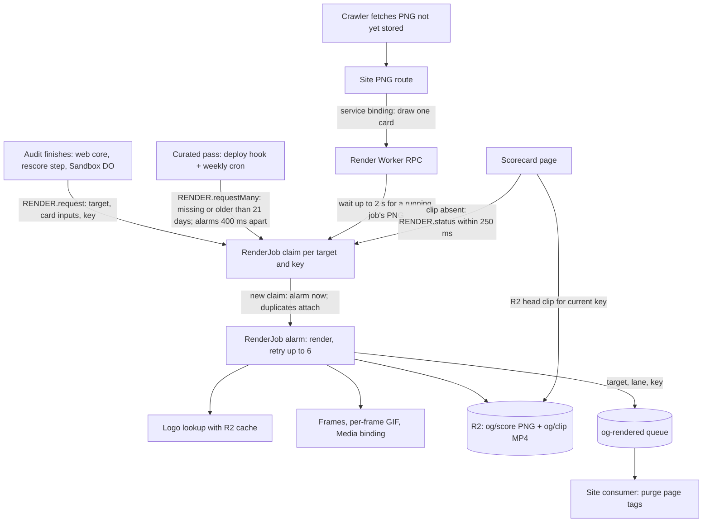
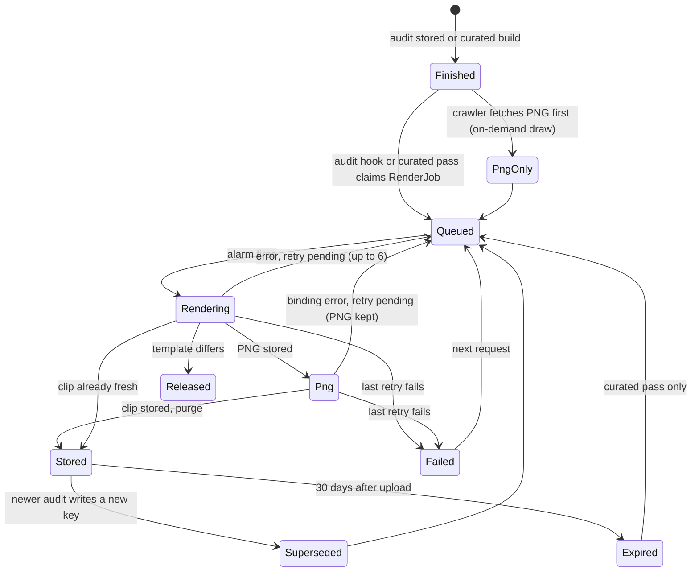

# Scorecard og:video - Plan

## Goal Capsule

- **Objective:** A scorecard link shared in iMessage or Discord plays a short clip that counts up to the real score and ends on the same card every other platform shows as the still image.
- **Means:** a separate render Worker draws every card PNG and clip with the Cloudflare Media Transformations binding, and one `RenderJob` Durable Object per card runs each render once (KTD1, KTD2, KTD13).
- **Authority:** Product Contract requirements win on behavior, Key Technical Decisions win on mechanism, and units override neither.
- **Execution profile:** code. Card-face and storage fixes (U1, U2) land inside PR #461. Everything else lands in one PR stacked on #461. #461 does not merge before that stacked PR. Both merge to `dev` only after Brett approves the batch.
- **Stop conditions:**
  - On staging, the Media binding refuses per-frame-palette GIF input or 1200x630 output. Stop and report: the encoder choice is void.
  - On staging, the Media binding refuses a call made from `RenderJob`'s alarm. Stop and move the render into an `og-render` queue consumer, with the rules that keep it in step with `RenderJob` (the original arrangement in D6).
  - The design shortlist needs a card face the key grammar cannot express (KTD4). Stop and amend KTD4 before building on it.
  - Render CPU measured on staging exceeds the render Worker's `limits.cpu_ms` at the default motion. Stop and re-size before enabling the switch.
- **Who finishes:** the agentnative-site session builds, verifies on staging, and hands both PRs to Brett for merge approval. No agentnative-cli change is needed.

---

## Product Contract

### Summary

Every finished scorecard gets a ~3.5 s MP4 that holds the final card, drains the score to zero, climbs back with an ease-out, and holds. Scorecard pages name the clip in `og:video` once it exists. A standalone render Worker draws both the PNG card and the clip. Each card's render runs once, in its own `RenderJob` Durable Object, and no clip ever renders on a page or crawler request. Website cards show the audit date and CLI cards the tool version, and every visible change mints a new card URL.

### Problem Frame

PR #461 gives every scorecard a 1200x630 PNG card, but a shared link still reads as a static image. The score is the result someone shares, and motion is what makes it register in a chat thread. Of the six priority platforms, only iMessage autoplays `og:video` and only Discord plays it on click. X, LinkedIn, Slack, and Bluesky read `og:image` only, so the PNG stays the card everywhere else. A device test on 2026-10-26 confirmed that a Media Transformations MP4 autoplays in iMessage and plays in Discord with `og:type` `article` and the `og:video` tag set.

Two constraints shape the work. A cold render takes 10 to 12 s, above Discord's 10 s fetch budget, so clips must exist before anyone fetches them. The binding is billed per output second after its beta, so a render must never be something a request can trigger.

### Requirements

**Coverage**

- R1. Every finished scorecard gets a clip: live website and CLI audits, the curated CLI registry, and the curated (seeded) websites. Pending, unscored, and missing targets get none.
- R2. The clip holds the final card, drains the score to zero, climbs back with an ease-out to the real score, and holds. It runs about 3.5 s at 1200x630 with no audio. Its first and last frames show the same card as the PNG; equality is visual, since H.264 is lossy.

**Triggers and cost**

- R3. A clip renders when its audit finishes. Curated cards also render after each deploy and each weekly rescore when their clip is missing or more than 21 days old.
- R4. No clip render or Media binding call starts from a page view, a crawler fetch, or any public request. A crawler fetch of a card that is not yet stored draws that one PNG on demand through the render Worker.
- R5. An operator switch stops new renders without a deploy. Existing clips keep being named and served while it is off.
- R6. Clips expire with the `og/` 30-day lifecycle rule. A live-audited site nobody re-audits loses its clip after 30 days, and its page falls back to the still card.

**Pages and serving**

- R7. A scorecard page names its clip (`og:video`, `og:video:secure_url`, `og:video:type`, `og:video:width`, `og:video:height`) only when the clip for the page's current card exists. `og:image` and `og:type` stay as they are.
- R8. When a clip lands, the scorecard page's edge copy is cleared so the next fetch names it. This includes curated CLI pages.
- R9. The clip URL answers `GET`, `HEAD`, and byte-range requests with `206`, and is cached immutable.

**Card face**

- R10. Website cards show the audit date (`YYYY-MM-DD`, UTC) and CLI cards show the tool version where the spec version is today. The spec version moves to the image description.
- R11. Any change to what a card shows produces a new card URL: score, date or tool version, spec version, or template version.
- R12. Card layout and the motion's color and digit treatment stay swappable pending the design shortlist. Until it lands: the #461 layout, color locked to the final score band, and fixed digit slots.

### Key Decisions

- **One pipeline for every clip, on the Media Transformations binding.** (session-settled: user-directed, chosen over ffmpeg libx264 in CI for curated clips: card logos are found only at runtime, so a CI encoder would rebuild the lookup with a CI secret and a cache.) Governs R1, R3.
- **The binding's MP4 ships as returned.** (session-settled: user-directed, chosen over an ffmpeg faststart encode: both files played in iMessage and Discord in the 2026-10-26 device test.) Governs R2, R9.
- **Curated websites are in scope.** (session-settled: user-directed, added to the confirmed scope.) Governs R1.
- **Date on website cards, tool version on CLI cards.** (session-settled: user-approved, chosen over keeping the spec version on the face, with the weekly re-render of every seeded site shown as the cost.) Governs R10, R11.
- **No sweep over all stored audits.** (session-settled: user-approved, chosen over re-rendering every stored audit before expiry.) Governs R6.
- **www and apex fold at the audit, in a separate plan.** (session-settled: user-directed, chosen over a render-time display check: `www.python.org` should become `python.org` for the whole audit, so boards never carry both.) Cards draw whatever target the audit stored.

### Scope Boundaries

- X player card (`twitter:player`): needs per-domain approval and an iframe page. Not built.
- Audio, animated GIF previews, and an animated `og:image`: no platform in the priority list plays them. Not built.
- Clips on pages other than scorecards. Not built.
- Considered and not built: a dead-letter queue. A failed render recovers on the next audit (live) or the next pass (curated), and every failure is logged. A sustained failure rate in the `og.render` logs would change this call.
- Considered and not built: re-rendering live-audited sites when the template version changes (DX D14 kept R6). Curated cards re-render through the curated pass the same day; a live site gets a clip in the new design on its next audit. A spread of live links losing video after a design change would revisit this.
- Considered and not built: an `og-render` queue between `RenderJob`'s claim and the render (D6 in the eng re-review). The object's alarm runs and retries the render and reports each attempt, so one owner holds each card's job state. A Media binding that refuses calls from a Durable Object would move the render into a queue consumer.

#### Deferred to Follow-Up Work

- www/apex fold at audit level, with the matching change in the agentnative-cli web-audit port.
- Applying the design shortlist (layout, motion color, digits): a template-version bump under KTD4 plus the visual review the repo requires.

### Success Criteria

- A link to a site audited a minute earlier, pasted into iMessage, autoplays the clip. The same link in Discord plays it on click.
- The live `og-cards` smoke passes on staging with its clip assertions, and the curated pass leaves no curated scorecard without a fresh clip.

---

## Planning Contract

### Key Technical Decisions

- KTD1. **A separate render Worker owns all drawing.** `anc-og-render` (staging `anc-og-render-staging`) draws the PNG, looks up the logo, renders frames, encodes the GIF, and calls the binding. The site Worker keeps data loading, card keys, public routes, page tags, render requests, and the `og-rendered` consumer. (session-settled: user-directed, chosen over a queue consumer inside the site Worker. One isolate serves concurrent requests on a single thread and shares 128 MB, so seconds of rendering there would stall page requests: https://developers.cloudflare.com/workers/reference/how-workers-works/ and https://developers.cloudflare.com/workers/platform/limits/#memory.) The `CONTEXT_DEV_API_KEY` secret, resvg-wasm, and the card fonts leave the site Worker.
- KTD2. **One queue and one service binding, with no cycle.** (D6 in the eng re-review: user-directed, the render runs on `RenderJob`'s alarm, chosen over an `og-render` queue between the claim and the render, which split each job's state between the queue and the object.)
  - The site asks for a render with `RENDER.request(target, inputs)` over the service binding. The render Worker claims the card's `RenderJob` (KTD13), and the object runs the render from its own alarm. Each card has its own object, so different cards render in parallel and one card renders once.
  - The render Worker produces to `og-rendered`, and the site consumes it to purge page tags. Purge only works inside the site's `Cached` entrypoint (`src/worker/audit-web/hit-min-purge.ts`). The consumer takes batches of up to 100 messages (`max_batch_timeout` 5 s) and purges each batch's deduplicated tags in one call per 100 tags, because Workers Cache purges always run at the Free-tier limit of 5 requests per minute with a burst of 25, shared with the audit flow's own purges. A refused purge retries its messages after 60 s times the attempt (`max_retries` 5, about 15 minutes); the last refusal acknowledges the message and writes an `og_rendered_gave_up` hit-min-purge record, and the page names its clip when its cached copy expires.
  - Queues are account-wide and named once, so staging uses `og-rendered-staging` and production uses `og-rendered`. The per-environment render Workers (`anc-og-render`, `anc-og-render-staging`) do not isolate a queue they both name.
  - The site also calls the render Worker to draw an on-demand PNG. That RPC applies the same template-version check as `RenderJob`: on a mismatch it returns a typed skew outcome, which the PNG route serves as its existing `503` without storing.

  Deploy order: create the queue once (`scripts/og/setup.sh`, KTD14), deploy the render Worker, then deploy the site Worker (https://developers.cloudflare.com/workers/runtime-apis/bindings/service-bindings/#deployment).
- KTD3. **Card inputs travel with the request.** The site builds them with `loadScoreOgSubject` when it requests a render, because it holds `ASSETS`, the registry, and the records. The request carries the target, lane, card key, card fields, logo pages, and scored-at instant, and `RenderJob` stores them with its claim. The render Worker never reads site records.
- KTD4. **Card key grammar: `s<pct>-v<spec>-<edition>-r<template>`.**
  - The edition is `d<YYYYMMDD>` for web (UTC, from `scored_at`).
  - For CLI it is `t<version>`: the version number in the tool's `--version` line (anc records the whole line), hyphens keyed as underscores, hashed to `h<8 hex>` when it does not fit the key alphabet, and absent when the line holds no version number.
  - For a branch target it is `g<short source sha>`.
  - `r<template>` is one constant in `src/shared/score-og.ts`, bumped on any change to the pixels a card draws; a fingerprint test over rendered cards fails until it is.

  One shared function computes the key, and the page, both routes, the render pass, and the build all call it. This replaces #461's `s<pct>-v<spec>`. #461 is unreleased, so only staging objects carry old keys, and the lifecycle rule clears them.
- KTD5. **Clips get their own prefix, and pruning never deletes newer work.**
  - PNGs stay at `og/score/<sha256(target)>/<key>.png`. Clips go to `og/clip/<sha256(target)>/<key>.mp4`.
  - Both carry `customMetadata` `{target, key, scored_at, template, logo}`, where `logo` is the logo source (`homepage`, `brand`, or `tile`). A stored-card response emits it as `x-anc-card-logo`, so a stored card says where its logo came from.
  - A store prunes only siblings whose `scored_at` is older than its own. Two renders finishing out of order then cannot delete the newer card (#461's `storeCard` deletes every other key).
  - One render stores the PNG as soon as it is drawn and the clip after the binding returns, so a binding failure still leaves the card stored.
- KTD6. **A logo lookup that timed out is not stored as a miss.** Only a definitive miss is stored. Otherwise a slow homepage locks the fallback tile in for 30 days (`src/worker/og/find-logo.ts`). The render path also gets a longer budget than #461's crawler path, since it is off the request path. An on-demand PNG whose logo lookup timed out is served with the short `hit-min` cache class and is not stored. Only a PNG drawn after a definitive logo outcome is stored and served immutable, so a crawler can never pin the tile under a URL the clip draws with a logo.
- KTD7. **Frames come from one pure function; encoding follows the spike's settings.**
  - `scoreOgFrames(card, motion)` returns per-frame card states, and the card renderer draws a state.
  - `motion` holds the frame counts, the easing, the color mode, and the digit mode, so the shortlist swaps values, not code (R12).
  - Frame 0 and the last frame are exactly the final card's SVG.
  - The GIF uses a per-frame palette. One palette from the final card renders mid-climb bands grey.
  - The binding call is `transform({width: 1200, height: 630})` then `output({mode: 'video', audio: false})`; without explicit size the binding returns 686x360.
  - `gifenc` is the encoder (MIT, no dependencies; the spike used 1.0.3).
  - The frame loop yields to the event loop after each frame, so a `status` or `wait` call to the same `RenderJob`, or an on-demand PNG request in the same isolate, waits about one frame instead of the whole render.
- KTD8. **Live renders hook where each scorecard is written; curated renders get their own pass.**
  - Live triggers:
    - web requests: after `cachePut` writes in `src/worker/audit-web/core.ts`, through a queue-then-flush helper shaped like `queueHitMinPurge`;
    - the rescore Workflow: a step after each saved audit;
    - live CLI: after `writeCacheBestEffort` writes in `src/worker/score/do.ts`.
  - The curated pass is its own secret-authed endpoint, called by `deploy.yml` after each deploy and by the weekly cron. It is not a step of the rescore Workflow, because a deploy that joins a running rescore instance would skip the new deploy's keys.
  - The pass reads the registry and the seeds itself. It runs one R2 `head` per curated target, about 150 per pass. It requests a render when the clip is missing or was uploaded more than 21 days ago, through one `RENDER.requestMany` call that claims each card's `RenderJob` and sets their alarms 400 ms apart, so a 151-card pass starts its renders over about a minute instead of all at once.
- KTD9. **The switch is the `OG_VIDEO_ENABLED` secret on the site Worker in both environments.** It is read as `=== 'true'`, so unset means off and the feature ships dark. Off stops every render request: audit hooks and the curated pass. Pages keep naming existing clips. It must be a secret, never a var (CF API 10053; `tests/wrangler-config.test.ts` guards the shape).
- KTD10. **Pages check for the clip with one R2 `head` per page miss.** The page computes the current key with the shared function and emits the `og:video` block only when the head succeeds.
  - Worker-rendered pages get the block through the live shell's placeholders.
  - Curated CLI pages are static assets. The Worker injects the block when serving them. Their HTML and markdown gain `Cache-Tag: cli:<slug>` so the `og-rendered` consumer can purge them (D7), and curated JSON keeps the short class with no tag. `applyHeaders` is the only writer of `Cache-Tag` (`src/worker/headers.ts`), so the tag comes from `resultCacheClass`, and the HIT-1d class writes a tag when it has one (F8).
  - The clip URL uses the same base as `og:image` (`CANONICAL_SITE_URL`).
- KTD11. **The clip route serves R2 directly and never renders.** `/og/clip/<target>/<key>.mp4` answers `GET` and `HEAD` with the whole object as a `200`. It sends `content-type: video/mp4`, `accept-ranges: bytes`, `x-robots-tag: noindex`, and the PNG's immutable cache class. A missing clip is a `404`. A stale key gets a `301` to the current key only when that clip exists. Range requests are answered by Workers Caching on the `Cached` entrypoint: it strips `Range`, stores the full `200`, and returns `206` or `416` itself, cold cache included. A `206` built by the Worker would be uncacheable (https://developers.cloudflare.com/workers/cache/configuration/#range-requests). An MP4 whose `moov` box sits after `mdat` needs that `206`, which the live smoke asserts.
- KTD12. **Telemetry goes through the emitter.** The render Worker logs through `src/worker/telemetry/log.ts` under a new `og.render` scope: outcome, lane, logo source, duration bucket, binding error code, the `RenderJob` run id and attempt, and the card key (which carries no host name). The same run id rides `x-anc-clip-run` on scorecard responses whose `x-anc-clip` is `queued`, `rendering` or `failed`, and `status.sh` prints it (`value.run_id` in `--json`), so a failure matches its log line directly (DX D16). Nothing render-related enters the scorecard.
- KTD13. **A `RenderJob` Durable Object claims, runs and tracks each card's render, the way `AuditJob` single-flights each audit.** (session-settled: user-directed, chosen over a KV in-flight flag: KV lags across locations, so duplicate renders would slip through and nothing could attach. D6 in the eng re-review: user-directed, the render runs on the object's own alarm.) It lives in the render Worker under `idFromName('<target>:<key>')`.
  - `request(inputs)` claims the job when there is none, when it `failed`, or when a `queued` or `rendering` job is past its 10-minute deadline. A claim gets a new run id, stores the inputs, and sets the alarm to now. A live job returns its state (`queued`, `rendering`, `png`) and run id instead, and a `done` job returns `done`.
  - `alarm(info)` runs the render. It marks `rendering` with the attempt number, stores the PNG and marks `png`, stores the clip, marks `done`, and sends `og-rendered`. A template-version mismatch releases the claim (deletes the job) and logs the skew; a fresh clip marks `done` without a binding call.
  - On an error the alarm throws, so Cloudflare retries it with a 2 s backoff, up to 6 retries (https://developers.cloudflare.com/durable-objects/api/base/#alarm); between attempts the job reads `queued`. When `info.retryCount` is 6, the alarm marks `failed` instead of throwing. Every write checks the run id, so a run that was taken over cannot write into the new one.
  - A render killed on every attempt (CPU or memory) leaves the job `rendering` with no alarm. `status()` reports a `rendering` job past its deadline as `failed`, and the next `request()` takes it over.
  - `status()` returns the state, run id and attempt. `wait(deadline, until)` resolves when the job reaches `until` (`png`, or a terminal state) or the deadline passes. The on-demand PNG RPC waits at most 2 s for `png` on a running job before drawing its own.
  - After `done` the alarm is reset to delete the job's storage 60 s later, and after `failed` 24 hours later, so status checks can still read a failure and its run id; no state outlives its alarm.
  - Different cards claim different objects, so they render in parallel; one card renders once however many triggers ask for it.
- KTD14. **One idempotent command sets og:video up and checks it.** (session-settled: user-directed, chosen over a hand-run RELEASES.md command list.) `scripts/og/setup.sh <staging|production>` creates the `og-rendered` queue when it is missing, sets `CONTEXT_DEV_API_KEY` on the render Worker from the 1Password item `Context.dev API Key` without echoing it, deletes the key from the site Worker, then verifies queues, secrets and the switch and prints what is left. `--check` verifies without changing anything, and the release preflight runs it before the og-cards smoke. Before the render Worker's first deploy, the secret steps cannot run: the script reports them as pending with the instruction to rerun after the deploy and exits non-zero, and `--check` reports the same, so a half-finished setup never reads as done.
- KTD15. **The og scripts speak the agent-ready error contract.** (session-settled: user-directed, chosen over prose-only output with `--help`.) `scripts/og/setup.sh` and `scripts/og/status.sh` print prose by default and, with `--json`, one object `{reason, exit_code, message, value, next_step: {action, command, docs}}`. `reason` comes from a closed set (`ok`, `render-worker-missing`, `queue-missing`, `secret-missing`, `site-secret-present`, `switch-off`, `clip-missing`, `clip-rendering`, `clip-failed`, `card-fallback`), each failure class has its own non-zero exit, `next_step.command` is safe to run unattended, and no secret value appears in either form. Both scripts carry a `--help` usage header.
- KTD16. **Local dev runs the whole clip pipeline with a stand-in for the binding.** (session-settled: user-directed, chosen over staging-only clips.) The video binding has no local simulation, so when `LOCAL_MEDIA_STANDIN` is `'true'` the render job skips the binding and stores a committed sample MP4; `RenderJob` and its alarm, R2 writes, the `og-rendered` queue, purge, page tag, `x-anc-clip` and `status.sh` all run as in production. The var lives only in the render Worker's local `src/og-render/.dev.vars.staging`, which `.gitignore` keeps untracked (F5), never in a `vars` block, and a config test fails if any deployed environment declares it. Real encoding is proven by the staging smoke.

### High-Level Technical Design

Components and data flow:



Lifecycle per target and key:



Render job, in order (directional):

```text
on RenderJob alarm(info) (set by a new claim, by a retry, or for cleanup):
  if the job is done or failed: delete its storage, return              # cleanup alarm
  mark rendering (run id, attempt = info.retryCount + 1)
  if inputs.key template != this Worker's template: release the claim, log skew, return
  if clip(key) exists and uploaded < 21 days ago: mark done, return
  logo  = stored logo, else homepage icon, else brand logo (longer budget; no stored miss on timeout)
  png   = draw(final card); store png with scored_at metadata; mark png
  gif   = for each frame state in scoreOgFrames(card, motion): draw, quantize, append, yield
  mp4   = media.input(gif).transform(1200x630).output(video, no audio)
  store mp4 with scored_at metadata; prune only older siblings
  mark done; send og-rendered {target, lane, key}; alarm at now + 60 s
  on error: info.retryCount < 6 ? throw (Cloudflare retries) : mark failed, alarm at now + 24 h
```

### Implementation Constraints

- No TypeScript `any`, including in the render Worker and in tests.
- Every structured log goes through `emitLog`, and a new scope is added to the `LogScope` union.
- Each env block of the render Worker's config declares its own bindings. The staging block sets `routes: []` and `triggers: { crons: [] }` explicitly, because those keys inherit and a custom domain moves silently.
- New code comments carry no plan or KTD identifiers.
- `.dev.vars` files under `src/` stay untracked: `.gitignore` re-ignores `**/.dev.vars` and `**/.dev.vars.*` after its `!src/**` line, as it already does for `.DS_Store` (F5).
- The render Worker's `migrations` list is append-only in both environments from its first deploy, a staging dispatch of the stacked branch included (F7).
- Nothing under `src/worker/` imports from `src/og-render/`, and a test enforces it (F14).
- Card visuals change only through `/typeset` and `/design-review`, with a light/dark browser check of every page that shows a card (`AGENTS.md` Visual fidelity).

### Risks & Dependencies

| Risk | Mitigation |
| --- | --- |
| The Media binding is in open beta, and its docs list GIF input as "may work but untested" in one place | The spike converted per-frame GIFs in a deployed Worker on 2026-10-26. The staging smoke (U9) asserts a playable MP4 on every run, and the switch ships dark. |
| Billing starts after the beta: $0.50 per 1,000 output seconds, about $0.002 per clip | Renders come only from audits (already rate limited) and the curated pass (about 150 targets). The switch stops all of them. |
| A share in the first seconds after an audit gets the still card, and iMessage keeps that preview | Accepted. The page names the clip as soon as the `og-rendered` purge lands, about 10 to 20 s after the audit. |
| Deploy skew between the render Worker and the site Worker | `RenderJob` releases a claim whose template version differs from its own, and the next audit or pass requests it again. The on-demand RPC returns a skew outcome the PNG route serves as `503` without storing. Template skips log under their own outcome, so a stuck skew shows. |
| Measured render cost: warm 5.7 to 7.1 s wall (4.2 to 5.3 s CPU), cold 10 to 12 s | The render Worker sets `limits.cpu_ms` from the staging measurement, and the curated pass sets its alarms 400 ms apart. |
| The Media binding docs show calls from Worker handlers only; a call from a Durable Object alarm is unverified | The first staging dispatch exercises it through the smoke. A refusal is a stop condition, with a queue consumer as the fallback (D6). |
| Several `RenderJob` objects can share one isolate's 128 MB | U9 records memory per render on staging, and the alarm spacing keeps a curated pass from stacking renders. |

### Deferred to Implementation

- Defaults to confirm against the U9 staging measurements: the `RenderJob` deadline (10 minutes), the on-demand PNG wait (2 s), the curated alarm spacing (400 ms), the page's `RENDER.status` bound (250 ms), and the `og-rendered` consumer's retry count and delay.
- The exact hash used when a tool version does not fit the key alphabet.
- Whether the on-demand PNG RPC passes card inputs or a target the render Worker resolves; it should pass inputs, per KTD3.

---

## Implementation Units

### U1. Card key grammar and card edition

- [x] Built in #461.
- **Goal:** The card face shows the date or tool version, and every visible change mints a new key.
- **Requirements:** R10, R11, R12; KTD4.
- **Dependencies:** none. Lands inside PR #461.
- **Files:**
  - `src/shared/score-og.ts`
  - `src/worker/og/subject.ts`
  - `src/worker/og/route.ts`
  - `src/worker/audit/result.ts`
  - `src/build/08-scorecards-emit.mjs`
  - `src/worker/og/store.ts`
  - `scripts/og/score-samples.ts`
  - `tests/score-og.test.ts`
  - `tests/score-og-route.test.ts`
  - `tests/score-og-store.test.ts`
  - `tests/score-og-agreement.test.ts`
  - `tests/audit-result-route.test.ts`
  - `tests/build.test.ts`
  - `tests/e2e/og-cards.e2e.ts`
  - `tests/e2e/score-og.e2e.ts`
- **Approach:**
  1. Add an edition field to the card: a date, a tool version, or a branch SHA. Draw it in the footer where the spec version is today, and move the spec version into the image description.
  2. Replace `scoreOgKey` with one function over the subject that emits the KTD4 grammar. Extend `KEY_RE` and the path parser to match.
  3. Feed the edition from each lane's record: web `scored_at`, live CLI `tool_version`, curated registry version, branch `source_sha`.
  4. Add the template-version constant.
- **Patterns to follow:** `scoreOgKey` and `parseScoreOgPath` in `src/shared/score-og.ts`. `shortDate` in `src/shared/result-spine.ts` for the UTC date.
- **Test scenarios:**
  - A web subject scored 2026-10-26T23:30Z at 80% under spec 0.6.0 keys to `s80-v0.6.0-d20261026-r<template>`, and its footer reads the date.
  - A curated CLI at version 15.1.0 keys with `t15.1.0`, and its footer reads the version.
  - A tool version containing `+` or spaces is sanitized or hashed into the key alphabet and still parses back.
  - Key agreement across the page, the PNG route, and the build for each lane fixture: web, seed, live CLI, curated, alias, branch, pending, unscored.
  - A same-score re-audit on a later date produces a different key.
  - Pending and unscored keys are unchanged and never immutable.
  - The image description names the spec version.
- **Verification:** For every lane, the page's `og:image` URL, the route's canonical key, and the build's key are equal. A footer showing a date or version is confirmed in a light/dark browser check.

### U2. Logo timeouts and safe pruning

- [x] Built in #461.
- **Goal:** A slow homepage cannot lock in the fallback tile, and an out-of-order store cannot delete a newer card.
- **Requirements:** R11; KTD5, KTD6.
- **Dependencies:** none. Lands inside PR #461.
- **Files:**
  - `src/worker/og/find-logo.ts`
  - `src/worker/og/logo.ts`
  - `src/worker/og/brand-logo.ts`
  - `src/worker/og/store.ts`
  - `tests/score-og-find-logo.test.ts`
  - `tests/score-og-route.test.ts`
- **Approach:**
  1. Return a distinct "timed out" outcome from the homepage and brand lookups, and store a miss only for a definitive outcome.
  2. Stamp `scored_at` in stored card metadata.
  3. Prune only siblings whose `scored_at` is older than the stored one's.
- **Execution note:** Write the out-of-order store test first and watch it fail against #461's prune before changing it.
- **Test scenarios:**
  - A homepage fetch that exceeds the budget yields the tile and stores nothing under `og/logo/`.
  - A definitive miss (no icon, brand returns nothing) is stored with `miss: '1'`.
  - Storing key k1 (older `scored_at`) after key k2 leaves k2 in place.
  - Storing k2 after k1 removes k1.
- **Verification:** The new store test fails on #461's `storeCard` and passes after the change.

### U3. Motion frames

- [x] Built in #482.
- **Goal:** One pure function yields the clip's frame states, with the final card at both ends.
- **Requirements:** R2, R12; KTD7.
- **Dependencies:** U1.
- **Files:**
  - `src/shared/score-og-motion.ts`
  - `src/shared/score-og.ts`
  - `tests/score-og-motion.test.ts`
- **Approach:**
  1. Define a motion value: hold, drain, climb, and hold frame counts, plus easing, color mode, and digit mode.
  2. `scoreOgFrames(card, motion)` maps it to per-frame display states.
  3. The card renderer accepts a frame state and draws the displayed number, meter, and band.
  4. The default motion is the spike's: 15 hold, 9 linear drain, 66 ease-out-cubic climb, 15 hold, at 30 fps. Color is locked to the final band, and digits sit in fixed slots.
- **Test scenarios:**
  - Frame 0 and the last frame render byte-identical SVG to the final card.
  - The climb is monotonic and decelerates (each step no larger than the one before).
  - The frame count equals the motion's total.
  - With color locked, every frame uses the final band's color.
  - Pending and unscored cards yield no frames.
  - A 0% card holds at zero without a drain.
- **Verification:** The motion tests pass and the default motion yields 105 frames.

### U4. Render Worker

- [x] Built in #482.
- **Goal:** `anc-og-render` turns requested card inputs into a stored PNG and clip, and draws one PNG on request.
- **Requirements:** R1, R2, R4; KTD1, KTD2, KTD3, KTD5, KTD6, KTD7, KTD12, KTD13.
- **Dependencies:** U1, U2, U3.
- **Files:**
  - `src/og-render/index.ts` (RPC entrypoint: `request`, `requestMany`, `status`, `drawCard`)
  - `src/og-render/render-job.ts`
  - `src/og-render/gif.ts`
  - `src/og-render/render-job-do.ts`
  - `src/og-render/wrangler.jsonc`
  - `tsconfig.worker.json` (include `src/og-render/**/*.ts`, which the current `src/worker` and `src/shared` globs miss)
  - `src/worker/og/render.ts`, `src/worker/og/fonts.ts`, `src/worker/og/logo.ts`, `src/worker/og/brand-logo.ts`, `src/worker/og/find-logo.ts`, `src/worker/og/resvg-wasm-module.ts`, `src/worker/og/fonts/*` (moved under `src/og-render/`; nothing under `src/worker/` imports them afterwards, F14)
  - `src/worker/telemetry/log.ts`
  - `package.json`
  - `tests/og-render-job.test.ts`
  - `tests/og-render-gif.test.ts`
  - `tests/og-render-job-do.test.ts`
  - `src/og-render/fixtures/standin.mp4`
- **Approach:**
  1. `RenderJob` (KTD13) with its `request`, `status` and `wait` RPCs and an `alarm()` that runs the render:
     - release the claim on a template-version mismatch;
     - mark `done` when a fresh clip exists;
     - find the logo;
     - draw the PNG, store it, and mark `png`;
     - draw the frames and encode the GIF;
     - call the binding;
     - store the clip with metadata;
     - mark `done` and send `og-rendered`.
  2. On an error the alarm throws so Cloudflare retries it, until `info.retryCount` is 6, when it marks the job `failed`. A Durable Object migration (`new_sqlite_classes`) declares `RenderJob` in both environments of the render Worker's config.
  3. The RPC entrypoint forwards `request` and `requestMany` to each card's `RenderJob`; `requestMany` sets each claimed job's alarm 400 ms after the previous one.
  4. The RPC entrypoint draws one PNG from card inputs and returns its bytes with its logo outcome, after waiting at most 2 s for a running job's PNG. It stores the PNG only after a definitive logo outcome, and it returns a typed skew outcome when the inputs' template version differs from its own.
  5. Fonts and resvg-wasm bundle into this Worker and leave the site's. Under `LOCAL_MEDIA_STANDIN` (KTD16) the job stores `src/og-render/fixtures/standin.mp4` instead of calling the binding.
  6. Its config carries `compatibility_flags` `nodejs_compat` (the log emitter's request context imports `node:async_hooks`) and `global_fetch_strictly_public` (the logo fetches run under it in the site today).
- **Patterns to follow:**
  - #461's `findLogo` / `storeCard` for R2 access.
  - The og-cards fixture Worker's config for a second Worker in this repo.
  - The spike's encode loop: per-frame `quantize`/`applyPalette`, and a frame delay pattern that averages 30 fps.
- **Test scenarios:**
  - A claimed job for a scored web target stores a PNG and an MP4 under the KTD5 keys, with `scored_at` metadata, and sends one `og-rendered` message. Uses a fake Media binding that records its input stream and options.
  - The binding receives `transform({width: 1200, height: 630})` and `output({mode: 'video', audio: false})`.
  - A job whose clip already exists and is 3 days old ends `done` without a binding call.
  - A job whose clip is 25 days old renders again.
  - A job with a different template version releases its claim without rendering and logs the skew outcome.
  - The PNG is stored and the job marked `png` before the first frame renders.
  - A binding error leaves the PNG stored, sends no `og-rendered`, and rethrows, and the job reads `queued` until the next attempt. The same error at `retryCount` 6 marks the job `failed` without throwing.
  - A logo-lookup timeout renders with the tile and stores no logo miss.
  - The GIF encoder emits 105 frames with per-frame palettes, and the first frame decodes to the final card's pixels.
  - The RPC entrypoint returns PNG bytes for card inputs and stores them under the card key.
  - The RPC entrypoint does not store a PNG whose logo lookup timed out, and reports that outcome.
  - The RPC entrypoint returns the skew outcome for inputs carrying another template version, and logs it under its own `og.render` outcome.
  - Every outcome emits one `og.render` record through the emitter, carrying the run id, attempt and card key and no host name.
  - With `LOCAL_MEDIA_STANDIN` set, the job stores the stand-in MP4 and never calls the binding; without it, the stand-in path never runs.
  - Two `request()` calls for the same target and key set one alarm; the second returns `queued`, `rendering` or `png` with the same run id.
  - Requests for two different cards both claim and set alarms.
  - `requestMany` with 151 cards claims 151 jobs and sets their alarms 400 ms apart.
  - A claim past the 10-minute deadline takes over with a new run id, and the stale run cannot write into the new run. `status()` reports a `rendering` job past its deadline as `failed`.
  - `wait(deadline, 'png')` resolves once the PNG is stored, `wait(deadline, 'terminal')` on `done` or `failed`, and both on their deadline. The cleanup alarm deletes a `done` job after 60 s and a `failed` job after 24 hours.
  - The on-demand PNG RPC returns the running job's PNG when it lands within 2 s, and draws its own otherwise.
- **Verification:** Unit tests pass with fakes, and `wrangler deploy --dry-run` succeeds for both environments of the render Worker's config.

### U5. Site Worker wiring

- [x] Built in #482.
- **Goal:** The site produces render jobs, serves clips, purges pages when clips land, and draws no images itself.
- **Requirements:** R4, R5, R8, R9; KTD2, KTD9, KTD11.
- **Dependencies:** U4.
- **Files:**
  - `src/worker/og/route.ts`
  - `src/worker/og/clip-route.ts`
  - `src/worker/og/render-request.ts`
  - `src/worker/og/rendered-consumer.ts`
  - `src/worker/index.ts`
  - `src/worker/headers.ts`
  - `wrangler.jsonc`
  - `tests/score-og-route.test.ts`
  - `tests/score-og-clip-route.test.ts`
  - `tests/og-render-request.test.ts`
  - `tests/wrangler-config.test.ts`
  - `tests/og-render-boundary.test.ts`
- **Approach:**
  1. The PNG route reads the stored card, else calls the render Worker's RPC. Preserved behaviour: 301 to the canonical key, alias target, and query-free path; 404 on a malformed path, unknown key grammar, or missing subject; 503 with `retry-after: 30` when R2 cannot be read; pending and unscored served `hit-min` and never stored; finished keys immutable; `x-robots-tag: noindex` on every PNG; `x-anc-card` on every PNG response, with `x-anc-card-logo` on drawn and stored cards alike. When the RPC fails or times out, the route serves the site default card (`/og-image.png` from `ASSETS`) with the `hit-min` cache class and `x-anc-card: fallback`, stores nothing, and logs a distinct `score.og` outcome.
  2. The clip route follows KTD11.
  3. The request helper builds the card inputs from `loadScoreOgSubject` and calls `RENDER.request` only for finished keys with the switch on.
  4. The `queue()` handler purges each batch's page tags through the `Cached` entrypoint in one call per 100 tags, and retries the batch's messages with a growing delay when the purge is refused (KTD2).
  5. Add to `wrangler.jsonc` in both environments: the `og-rendered` consumer and the `RENDER` service binding. Remove `CONTEXT_DEV_API_KEY` from the site's types.
- **Test scenarios:**
  - The PNG route serves a stored card without an RPC call, with `x-anc-card: stored` and `x-anc-card-logo` read from its metadata.
  - Every preserved behaviour in step 1 keeps a test, rewritten against an RPC fake: the 301 cases, the 404 cases, the 503 with `retry-after`, pending and unscored never stored, and immutable finished keys.
  - A missing card calls the RPC once, and the response is immutable.
  - An RPC failure or timeout serves the default card from `ASSETS` with `hit-min` and `x-anc-card: fallback`, stores nothing, and logs the fallback outcome.
  - An RPC skew outcome yields 503 and stores nothing.
  - An on-demand draw whose logo lookup timed out is served `hit-min` and is not stored.
  - A clip `GET` returns 200 `video/mp4` with `accept-ranges: bytes` and the full body, including when the request carries `Range`.
  - A clip `HEAD` returns headers without a body.
  - A missing clip returns 404 and is not edge-cached.
  - A stale key returns 301 when the current key's clip exists, and 404 otherwise.
  - With `OG_VIDEO_ENABLED` unset, no render is requested. With `'true'`, one `RENDER.request` call goes out for a finished key and none for a pending one.
  - An `og-rendered` message purges `web:<host>` for a web target and `cli:<slug>` for a CLI target.
  - Config parity: both envs declare the `og-rendered` consumer and the service binding. `OG_VIDEO_ENABLED` appears in no `vars` block.
  - No module under `src/worker/` imports from `src/og-render/` (`tests/og-render-boundary.test.ts`, F14).
- **Verification:** The site bundle no longer contains resvg-wasm or the card fonts. The route, config and import-boundary tests pass.

### U6. Render triggers

- [x] Built in #482.
- **Goal:** Every finished scorecard requests one render, and curated cards stay fresh.
- **Requirements:** R1, R3, R4, R5; KTD8.
- **Dependencies:** U5.
- **Files:**
  - `src/worker/audit-web/core.ts`
  - `src/worker/audit-web/hit-min-purge.ts`
  - `src/worker/audit-web/rescore-workflow.ts`
  - `src/worker/audit-web/rescore-trigger.ts`
  - `src/worker/score/do.ts`
  - `src/worker/og/curated-pass.ts`
  - `src/worker/index.ts`
  - `.github/workflows/deploy.yml`
  - `tests/web-audit-rescore-workflow.test.ts`
  - `tests/score-do-cache-write.test.ts`
  - `tests/og-curated-pass.test.ts`
- **Approach:**
  1. Request-time web audits collect a render request beside `queueHitMinPurge` and send it when the purge flushes.
  2. The rescore Workflow adds a step after a saved audit.
  3. The Sandbox DO requests a render after `wrote`; `ScoreSandboxEnv` (`src/worker/score/do.ts`) gains `RENDER` (F6).
  4. The curated pass reads `registry-index.json` and the seeds, computes each key, and heads each clip. It passes the missing and stale ones to `RENDER.requestMany`, which claims each card's `RenderJob` and sets their alarms 400 ms apart.
  5. The pass is served at a secret-authed endpoint reusing `requireRescoreAuth`, which `src/worker/audit-web/rescore-trigger.ts` exports for it (it is module-private today). It is called from `scheduled()` on the weekly cron and from a new `deploy.yml` step after the rescore trigger in both jobs, with the same retry and Access-header shape.
- **Test scenarios:**
  - A completed web audit through the endpoint requests one render. A held or incomplete run requests nothing.
  - MCP `audit_website` requests through the same hook.
  - The rescore step requests a render for a `saved` outcome and not for `skipped`.
  - The Sandbox DO requests a render after a successful write and not after a failed one.
  - The pass requests a curated target with no clip and one with a 22-day-old clip, but not one with a 2-day-old clip.
  - The pass requests nothing with the switch off.
  - 151 stale targets go out in one `RENDER.requestMany` call carrying all 151.
  - The pass endpoint rejects a missing or wrong secret.
- **Verification:** Trigger tests pass. On staging, a deploy requests every curated target on the first pass and nearly none on an immediate second pass.

### U7. Page tags

- [x] Built in #482.
- **Goal:** Pages name the clip exactly when it exists.
- **Requirements:** R7, R8; KTD10.
- **Dependencies:** U5.
- **Files:**
  - `src/build/shell.mjs`
  - `src/worker/shell-template.ts`
  - `src/worker/audit/result.ts`
  - `src/worker/headers.ts`
  - `tests/worker.test.ts`
  - `tests/audit-result-route.test.ts`
  - `tests/build.test.ts`
- **Approach:**
  1. Add `og:video` placeholders to the live shell, filled only when the clip head succeeds.
  2. For curated pages, inject the same block into the asset HTML after the head. `resultCacheClass` returns `{ klass: 'hit-1d', tag: 'cli:<slug>' }` for curated HTML and markdown and keeps curated JSON `short` with no tag, and `applyCacheClass` writes the tag for `hit-1d` (D7, F8).
  3. R2 trouble during the head omits the block and never fails the page.
  4. Scorecard pages send `x-anc-clip`: `present` when the clip exists; otherwise the RenderJob's state (`queued`, `rendering`, `failed`, with `png` read as `rendering`), `off` when `OG_VIDEO_ENABLED` is not `'true'`, `none` when no job exists, or `unknown` when the status call fails, misses its 250 ms bound, or has no binding. The `RENDER.status` call runs only when the clip is absent, so the page cache limits how often it runs (F13).
- **Test scenarios:**
  - A web page with a stored clip emits all five `og:video` tags with the clip URL on the canonical base. Without the clip it emits none and keeps `og:image`.
  - A curated page gains the block when the clip exists, and the response that leaves `applyHeaders` carries `Cache-Tag: cli:<slug>`.
  - The curated case in `tests/worker.test.ts` changes on purpose (D7): HTML and markdown carry `cli:<slug>` and keep `Cache-Control: public, max-age=300, stale-while-revalidate=60` and `Cloudflare-CDN-Cache-Control: public, max-age=86400`; JSON stays `short` with no tag; a `?v=` fetch stays uncached.
  - Pending and unscored pages never emit the block.
  - An R2 error during the head yields a 200 page with no block.
  - `og:type` stays `article`.
  - `x-anc-clip` reads `present` with a stored clip, the job state when one exists, `off` with the switch unset, and `none` when no job exists; a `RENDER.status` failure or a call slower than 250 ms yields `unknown` and never fails the page.
  - A `?v=` fetch of a scorecard page is served uncached, and its `x-anc-clip` reflects the job's state at that moment.
  - A `queued`, `rendering` or `failed` state also sends `x-anc-clip-run` with the job's run id.
- **Verification:** Page tests pass. A staging fetch with `Accept: text/html` shows the block once the clip renders.

### U8. Deploy, config, and docs

- [x] Built in #482.
- **Goal:** Both Workers deploy in the right order with the right bindings, and the docs describe the result.
- **Requirements:** R5, R6; KTD1, KTD2, KTD9, KTD14.
- **Dependencies:** U4, U5, U6.
- **Files:**
  - `.gitignore`
  - `.github/workflows/deploy.yml`
  - `src/og-render/wrangler.jsonc`
  - `RELEASES.md`
  - `AGENTS.md`
  - `DESIGN.md`
  - `knip.json`
  - `package.json`
  - `scripts/og/smoke.sh`
  - `scripts/og/setup.sh`
  - `tests/og-setup-script.test.ts`
  - `scripts/release/preflight.sh`
  - `tests/wrangler-config.test.ts`
- **Approach:**
  1. `deploy.yml` deploys the render Worker before the site in both jobs.
  2. `scripts/og/setup.sh <staging|production> [--check]` (KTD14), with a `bun test` (`tests/og-setup-script.test.ts`, stubbing `wrangler` and the 1Password reader on `PATH`, as `tests/workflow-gates.test.ts` drives shell) for its create, verify, pending and check-only paths, in prose and `--json` (KTD15). `scripts/release/preflight.sh e2e` runs it with `--check` before the og-cards smoke.
  3. `RELEASES.md` gains:
     - `scripts/og/setup.sh staging` and `scripts/og/setup.sh production` as the one-time setup, run before the stacked branch first deploys to that environment (a staging dispatch or the merge), since that deploy fails without the `og-rendered` queue; the script sets the render Worker's key after its first deploy and deletes the site's copy;
    - the existing line that calls the key a secret on both Workers, rewritten to name the render Worker only;
     - the switch flip;
     - a note that the `og/` lifecycle rule now also covers clips;
     - a line in the cost-watch hand-off: render volume is the count of `og.render` records with a `rendered` outcome in Workers Logs, about $0.002 each once the binding's beta ends.
  4. `AGENTS.md` lists six kill switches and gains a short og:video section in the shape of its MCP section: the two Workers and what each owns, the `og-rendered` queue per environment, `RenderJob` and its alarm, the switch, the `x-anc-card` and `x-anc-clip` headers, and the setup, smoke and status commands. Its Local dev section says the video binding has no local simulation and `--local` turns remote bindings off, so local runs set `OG_VIDEO_ENABLED` and `LOCAL_MEDIA_STANDIN` in `.dev.vars` and get the sample clip (KTD16); real encoding is checked on staging.
  5. `DESIGN.md` §4.13 covers the clip, the key grammar, and the render Worker, and states the bump rule: any change to the card face or the motion bumps the template version, the curated pass re-renders curated cards the same day, and live sites re-render on their next audit (DX D14).
  6. `knip.json` lists the render Worker entry.
  7. The `dev` script in `package.json` runs both configs in one session (`wrangler dev -c wrangler.jsonc -c src/og-render/wrangler.jsonc --env staging --local --port 8787`), so the site's service binding resolves locally. The local `CONTEXT_DEV_API_KEY` moves to `src/og-render/.dev.vars.staging`, which `.gitignore` re-ignores after `!src/**` (F5), and `scripts/og/smoke.sh` and the Local dev section of `AGENTS.md` say so.
- **Test scenarios:**
  - The render Worker config's staging block sets `routes: []`, `triggers.crons: []`, and `workers_dev: false`.
  - Both blocks declare `media`, `SCORE_CACHE`, the `RenderJob` binding and its migration, and the `og-rendered` producer.
  - The site config's `RENDER` binding names the matching render Worker per environment.
  - Staging and production name different `og-rendered` queues in both configs, each has exactly one consumer, and `setup.sh` creates the same names (F12).
  - `git check-ignore` matches `src/og-render/.dev.vars` and `src/og-render/.dev.vars.staging` (F5).
  - `LOCAL_MEDIA_STANDIN` appears in no `vars` block of either Worker's config, in any environment.
- **Verification:** Config tests pass. A staging deploy from `dev` shows both Workers' `triggers` blocks with no custom domains on the render Worker.

### U9. Live verification

- [x] Built in #482.
- **Goal:** The release preflight proves a real clip renders, serves, and is named, end to end on staging.
- **Requirements:** R1, R2, R7, R8, R9; success criteria.
- **Dependencies:** U4 to U8.
- **Files:**
  - `tests/e2e/og-cards.e2e.ts`
  - `scripts/og/smoke.sh`
  - `scripts/og/status.sh`
  - `tests/og-status-script.test.ts`
  - `RELEASES-PREFLIGHT.md` (a reason-code table for KTD15, the anchor `next_step.docs` links to)
- **Approach:**
  1. The stacked branch reaches staging before merge: `scripts/og/setup.sh staging`, then `gh workflow run deploy.yml -f ref=<stacked branch> -f environment=staging` (F7); a `dev` push in between redeploys staging from `dev`, so the dispatch runs again before the smoke. The first card fetch accepts `x-anc-card` `drawn` or `stored` and still asserts the fixture's logo tier through `x-anc-card-logo`. After the PNG assertions, poll the page (`Accept: text/html`, at most 60 s) until `og:video` appears.
  2. Then fetch the clip by path from the base under test. Staging pages advertise anc.dev URLs, so the path is taken from the tag and the host from the base.
  3. Local runs assert `og:video`, `x-anc-clip` and the clip route against the stand-in clip (KTD16) and skip only the Range and track-size checks, which depend on the edge cache and real encoding.
  4. Record four staging measurements in the PR: on-demand PNG latency for a request issued while a render is in flight, the same latency for the first on-demand draw after the render Worker deploys (cold start), the render Worker's memory per invocation from Workers metrics, and the first-run wall clock from the first `scripts/og/setup.sh staging` to the green `preflight.sh e2e`, split into setup, deploy wait, rerun and preflight, against the about-5-minute target (DX D6, D18).
  5. The smoke ends with one result line per fixture: host, logo tier, `x-anc-card` (`drawn` or `stored`), seconds from audit finish to `og:video` named, Range `206` ok, and the clip URL. These are the numbers step 4 records in the PR.
  6. When `og:video` does not appear within 60 s, the smoke fetches the page once more with `?v=<run>`, which is served uncached (`src/worker/audit/result.ts`), and fails with that response's `x-anc-clip` value and its next command (F9): `off` names `scripts/og/setup.sh <env> --check`; `failed` names `bunx wrangler tail anc-og-render-staging --format json` and the `og.render` outcome to look for; `queued` or `rendering` names `scripts/og/status.sh` and the `x-anc-clip-run` id to follow in `wrangler tail`, whose `og.render` records carry each attempt; `none` names the `score.og` request log; `unknown` names `scripts/og/status.sh` again, since the job did not answer in time.
  7. `scripts/og/status.sh <base-url> <target>` prints one line for any scorecard from public routes (Access headers when set): card key, `x-anc-card` and logo tier, `x-anc-clip` and `x-anc-clip-run` from a `?v=` fetch, whether the page names `og:video`, and the next command when something is missing. It maps each `x-anc-clip` value to the same cause and next command as the smoke, and `tests/og-status-script.test.ts` asserts that the smoke's exported map, `status.sh` and the `RELEASES-PREFLIGHT.md` table agree (F12). `RELEASES-PREFLIGHT.md` names it for debugging a missing clip.
- **Test scenarios:**
  - The page names `og:video` within 60 s of the audit.
  - The clip returns 200 `video/mp4`.
  - The clip's `ftyp` box is present and its track header reads 1200x630.
  - `Range: bytes=-1000` returns 206 with the matching `Content-Range`.
  - A second fetch returns identical bytes.
- **Verification:** `scripts/release/preflight.sh e2e` passes against staging with the switch on, including during a full curated pass. Playback in iMessage (autoplay) and Discord (click to play) is a manual `RELEASES-POSTFLIGHT.md` step on anc.dev for the release that ships og:video and for any `SCORE_OG_TEMPLATE` bump, because staging sits behind Access and neither app's crawler can fetch it.

---

## Verification Contract

| Gate | Command or check | Applies to |
| --- | --- | --- |
| Lint | `bun run lint` (biome, markdownlint, knip) | every unit |
| Types | `bun run typecheck` | every unit |
| Build then tests | `bun run build` before `bun test` (`tests/regression.test.ts` reads `dist/`) | every unit |
| Config dry run | `bunx wrangler deploy --dry-run` for the site config and the render Worker config, both environments | U4, U5, U8 |
| Visual | light and dark browser check of a website card and a CLI card through `bun run dev` | U1 |
| Live | `scripts/release/preflight.sh e2e` against staging with `OG_VIDEO_ENABLED` set | U9 |
| Device | paste a freshly audited scorecard link into iMessage and Discord | U9 |

## Definition of Done

- Every unit's verification holds, and the gates above pass.
- `OG_VIDEO_ENABLED` is set on staging, and the staging smoke passes with the clip assertions. Production enables only with the release that ships the stacked PR.
- The site bundle carries no resvg-wasm or card fonts.
- `wrangler secret list` shows `CONTEXT_DEV_API_KEY` on both render Worker environments and on neither site Worker environment.
- PR #461 carries U1 and U2. The stacked PR carries U3 to U9. Neither body leaves follow-up items.
- No experimental or abandoned code from the build remains in either diff.

---

## Eng review (2026-10-27)

Target: this plan at `7d92626` on `dev`, checked against the PR #461 branch (`unverified/scorecard-og-images-bb05`, `63d71f4`).

### Scope record

feature answers: none proposed, every unit maps to a settled requirement; structure: A, Original arrangement (D1, answered 2026-10-27); accepted scope: U1 to U9 as written; pending remedies: none.

## Decision ledger

### F1: `requireRescoreAuth` is module-private

Finding: 1, INFORMATIONAL, confidence 9/10, `src/worker/audit-web/rescore-trigger.ts:77` (`async function requireRescoreAuth(request: Request, secret: string | undefined)`), eng review.
Plan baseline: U6 step 5 reused `requireRescoreAuth` with no export step.
Runtime evidence: the function is declared without `export`.
Correction: U6 step 5 now says the module exports it, and U6 lists `src/worker/audit-web/rescore-trigger.ts`. Factual correction, no behavior change, so no question.
State: approved
Actual answer: none needed (factual correction)
Accepted scope: export `requireRescoreAuth` for the curated-pass endpoint.
History: none.

### F3: queue creation precedes the stacked PR's merge

Finding: 3, INFORMATIONAL, confidence 7/10, plan KTD2 ("Deploy order: create the queues once, deploy the render Worker, then deploy the site Worker"), eng review.
Plan baseline: U8 listed the queue-create commands without saying when they run.
Runtime evidence: `wrangler deploy` rejects a config whose queue binding names a queue that does not exist (consumer and producer bindings resolve at deploy).
Correction: U8 now says the commands run before the stacked PR merges. Ordering clarification of KTD2, no behavior change, so no question.
State: approved
Actual answer: none needed (factual correction)
Accepted scope: run the one-time queue creation before merging the stacked PR.
History: none.

### R2: per-environment queue names

Finding: 1, CRITICAL, confidence 9/10, plan KTD2 (`og-render`, `og-rendered`) and U8 ("the one-time `wrangler queues create` commands for both environments"), eng review.
Plan baseline: KTD2 names two queues with no environment suffix; U8 creates queues "for both environments".
Runtime evidence: a Cloudflare queue has exactly one consumer Worker (https://developers.cloudflare.com/queues/get-started/); `wrangler.jsonc` keeps staging bindings in `env.staging` with suffixed resource names (`anc-score-cache-staging`).
Comparison grid:

| Choice | Current | A | B |
| --- | --- | --- | --- |
| R2 staging queue names | unspecified | `og-render-staging`, `og-rendered-staging`; config test asserts the two envs differ | unchanged (unsuffixed names in both envs) |
| R3 on-demand PNG fallback | pending | pending | pending |
| R4 PNG route and smoke regression contract | pending | pending | pending |

Question D2:
D2 (eng review): give staging its own queue names
Project/branch/task: agentnative-site og:video plan (dev), stacked on #461.
ELI10: The plan names two queues, og-render and og-rendered, but never says staging gets its own. A queue has exactly one consumer Worker. If staging and production share a queue name, staging audits would be rendered by production's Worker, or the deploys would fight over who consumes it. Every other staging resource in wrangler.jsonc already carries a -staging suffix.
Stakes if we pick wrong: staging renders leak into production storage and logs, or a deploy fails with a consumer conflict.
Recommendation: A because it matches the existing -staging convention and a config test keeps the two apart.
Completeness: A=10/10, B=3/10
Pros / cons:
A) Suffixed staging queues (recommended)
  ✅ og-render-staging and og-rendered-staging mirror anc-score-cache-staging
  ✅ A wrangler-config test fails if the two environments ever share a queue
  ❌ Four queues to create once instead of two (two extra wrangler commands)
B) Leave as written
  ✅ No change to the plan text or the config tests
  ❌ Leaves the cross-environment collision to whoever writes the config
Net: two extra one-time commands buy hard separation between staging and production.
Header: Queue names
Options:
A) Suffixed staging queues (Recommended)
Staging uses og-render-staging and og-rendered-staging, production og-render and og-rendered. tests/wrangler-config.test.ts asserts the two environments name different queues. (human: ~10 min / CC: ~2 min)
B) Leave as written
Keep the unsuffixed names in KTD2 and U8 and leave per-environment naming to implementation. (human: none / CC: none)

State: approved
Actual answer: A, Suffixed staging queues (D2, answered 2026-10-27, "1"; asked whether per-environment render Workers already isolate the queues: they do not, because queues are account-wide and named once)
Accepted scope: KTD2 names `og-render-staging` and `og-rendered-staging` for staging and `og-render` and `og-rendered` for production; U8 adds a config test that the environments name different queues with one consumer each.
History: D6 in the eng re-review removed the `og-render` queue, so this accepted scope applies to `og-rendered` and `og-rendered-staging`.

### R3: on-demand PNG when the render Worker fails

Finding: 2, INFORMATIONAL, confidence 8/10, plan U5 test scenario ("An RPC failure yields 500 with the existing log outcome") and `src/worker/og/route.ts:131` (`return text(request, 500, 'scorecard image failed\n');`), eng review.
Plan baseline: U5 keeps #461's 500 on a drawing failure, but drawing moves out of the site into the render Worker (KTD1).
Runtime evidence: #461 draws in the site isolate, so its 500 only follows a local render error. After KTD1 the same 500 follows any render Worker outage or RPC error, for every card that is not yet stored. The site already ships a default card at `/og-image.png` (`src/shared/og-card.ts:5`, `public/og-image.png`).
Comparison grid:

| Choice | Current | A | B |
| --- | --- | --- | --- |
| R2 staging queue names | approved (D2: A) | approved (D2: A) | approved (D2: A) |
| R3 PNG route on RPC failure | 500, not stored | serve the site default card from `ASSETS` with `hit-min`, not stored, logged as its own outcome | 500, not stored (as planned) |
| R4 PNG route and smoke regression contract | pending | pending | pending |

Question D3:
D3 (eng review): what a crawler gets when the render Worker is down
Project/branch/task: agentnative-site og:video plan (dev), stacked on #461.
ELI10: Today #461 draws cards inside the site, so a missing card only fails if drawing itself breaks. The plan moves drawing to the render Worker. If that Worker is down or errors, every scorecard whose card is not stored yet returns a 500 for its og:image, and the link preview shows no picture. The site already has a default card image it could serve instead, with a short cache, so the real card replaces it once drawing works again.
Stakes if we pick wrong: during a render Worker outage, shared links show a broken or missing image instead of the generic anc.dev card.
Recommendation: A because a short-cached default card keeps previews intact during an outage and never pins a wrong image.
Completeness: A=9/10, B=6/10
Pros / cons:
A) Default card fallback (recommended)
  ✅ Link previews still show the anc.dev card while the render Worker is unavailable
  ✅ hit-min caching and no store mean the real card takes over within five minutes of recovery
  ❌ One more branch in the PNG route plus its test and log outcome
B) Keep the 500
  ✅ No new code path; failures stay loud in the route's error log
  ❌ Previews shared during an outage have no image, and crawlers cache that miss their own way
Net: a small fallback trades a few lines for previews that degrade to a generic card instead of breaking.
Header: PNG fallback
Options:
A) Default card fallback (Recommended)
On an RPC failure or timeout, the PNG route serves /og-image.png from ASSETS with the hit-min cache class, stores nothing, and logs a distinct score.og outcome. U5 gains a test for it. (human: ~1 hour / CC: ~10 min)
B) Keep the 500
Leave U5 as written: an RPC failure returns 500 and stores nothing. (human: none / CC: none)

State: approved
Actual answer: A, Default card fallback (D3, answered 2026-10-27)
Accepted scope: U5 step 1 serves `/og-image.png` from `ASSETS` with `hit-min`, stores nothing, and logs a distinct `score.og` outcome when the render RPC fails or times out; the U5 test scenario covers it.
History: none.

### F4: render Worker compatibility flags

Finding: 4, INFORMATIONAL, confidence 9/10, `src/worker/telemetry/request-context.ts:7` (`import { AsyncLocalStorage } from 'node:async_hooks';`) and `wrangler.jsonc:21` (`"compatibility_flags": ["nodejs_compat", "global_fetch_strictly_public", "enable_request_signal"]`), eng review.
Plan baseline: U4 named the render Worker's config file without its compatibility flags.
Runtime evidence: the emitter the render Worker imports needs `nodejs_compat`; the logo fetches it takes over run under `global_fetch_strictly_public` in the site.
Correction: U4 step 5 sets both flags. Factual correction, no behavior choice, so no question.
State: approved
Actual answer: none needed (factual correction)
Accepted scope: the render Worker config carries `nodejs_compat` and `global_fetch_strictly_public`.
History: none.

### R4: PNG route and live smoke regression contract

Finding: 5, CRITICAL (regression rule), confidence 9/10, `tests/e2e/og-cards.e2e.ts:70-71` (`expect(first.headers()['x-anc-card']).toBe('drawn');` and `expect(first.headers()['x-anc-card-logo']).toBe(EXPECTED_LOGO[kind]);`) with `src/worker/og/store.ts:26` (`customMetadata: { target, key }`), eng review.
Plan baseline: U5 keeps the route's 301, 404 and 503 behaviour; U9 extends the og-cards smoke with clip assertions. Neither says what happens to the smoke's first-fetch assertions.
Runtime evidence: once the render job stores the PNG right after an audit (U4, U6), the smoke's first card fetch usually reads `x-anc-card: stored`, and stored responses carry no `x-anc-card-logo`, so the D17 logo-tier check fails or can no longer run.
Comparison grid:

| Choice | Current | A | B |
| --- | --- | --- | --- |
| R2 staging queue names | approved (D2: A) | approved (D2: A) | approved (D2: A) |
| R3 PNG route on RPC failure | approved (D3: A) | approved (D3: A) | approved (D3: A) |
| R4 logo tier on stored cards | absent | stored card metadata records the logo source and stored responses emit `x-anc-card-logo` | absent |
| R4 smoke first-fetch assertion | `drawn` only | `drawn` or `stored`, logo tier still asserted | `drawn` or `stored`, logo tier assertion dropped |
| R4 preserved route behaviour | U5 partial list | full list below, tests rewritten against an RPC fake | full list below, tests rewritten against an RPC fake |

Preserved route behaviour in both options: 301 to the canonical key, alias target, and query-free path; 404 on a malformed path, unknown key grammar, or missing subject; 503 with `retry-after: 30` when R2 cannot be read; pending and unscored served `hit-min` and never stored; finished keys immutable; `x-robots-tag: noindex` on every PNG; `x-anc-card` on every PNG response.

Question D4:
D4 (eng review): keep the live smoke's logo check working after pre-rendering
Project/branch/task: agentnative-site og:video plan (dev), stacked on #461.
ELI10: The live smoke you approved (D17) checks that the first card fetch was freshly drawn and names the logo it used: the homepage icon, context.dev's brand logo, or the tile. With og:video, the render job draws and stores the card seconds after the audit, so the smoke's first fetch usually gets the stored copy. Stored copies don't say which logo they used, so the logo check would fail or have to go. Recording the logo source on the stored card keeps the check alive.
Stakes if we pick wrong: the release preflight goes red on every run, or the check that proves the logo fallback works quietly disappears.
Recommendation: A because one metadata field keeps the D17 logo proof and makes stored cards self-describing.
Completeness: A=10/10, B=6/10
Pros / cons:
A) Logo source on stored cards (recommended)
  ✅ The smoke still proves the homepage, brand and tile tiers on every release
  ✅ Any stored card can be inspected for where its logo came from via one response header
  ❌ One more metadata field written at store time and read on the stored path
B) Drop the logo-tier check
  ✅ No change to stored metadata or response headers
  ❌ The live proof that the brand fallback works is gone, leaving only unit tests with fakes
Net: one metadata field preserves the only live proof of the logo fallback.
Header: Smoke contract
Options:
A) Logo source on stored cards (Recommended)
Stored PNGs record the logo source in customMetadata and stored responses emit x-anc-card-logo. The smoke accepts drawn or stored on the first fetch and still asserts the tier. Route tests are rewritten against an RPC fake for the full preserved behaviour list. (human: ~2 hours / CC: ~15 min)
B) Drop the logo-tier check
The smoke accepts drawn or stored and no longer asserts the logo tier. Route tests are rewritten against an RPC fake for the same preserved behaviour list. (human: ~1 hour / CC: ~10 min)

State: approved
Actual answer: A, Logo source on stored cards (D4, answered 2026-10-27)
Accepted scope: KTD5 stored metadata adds `logo`; stored responses emit `x-anc-card-logo`; U5 step 1 lists the preserved route behaviour and its tests are rewritten against an RPC fake; U9's first fetch accepts `drawn` or `stored` and still asserts the logo tier.
History: none.

### R5: measure on-demand PNG latency from a cold render Worker

Finding: 6, INFORMATIONAL, confidence 8/10, plan U9 step 4 ("on-demand PNG latency for a request issued while a render is in flight") and the spike's measured cold cost (wasm on a fresh isolate adds 3 to 4 s of CPU on the first one or two requests), eng review.
Plan baseline: U9 measures on-demand latency only while a render is in flight.
Runtime evidence: #461 draws in the site's warm isolates; after KTD1 the on-demand draw lands on render Worker isolates, which carry less traffic and start cold more often. Cold latency is unmeasured.
Comparison grid:

| Choice | Current | A | B |
| --- | --- | --- | --- |
| R2 staging queue names | approved (D2: A) | approved (D2: A) | approved (D2: A) |
| R3 PNG route on RPC failure | approved (D3: A) | approved (D3: A) | approved (D3: A) |
| R4 PNG route and smoke contract | approved (D4: A) | approved (D4: A) | approved (D4: A) |
| R5 on-demand latency measurement | during a render only | during a render, plus the first on-demand draw after a render Worker deploy | during a render only |

Question D5:
D5 (eng review): also measure the on-demand card from a cold render Worker
Project/branch/task: agentnative-site og:video plan (dev), stacked on #461.
ELI10: When a crawler asks for a card that isn't stored yet, the site asks the render Worker to draw it. The render Worker gets little traffic, so it often starts cold, and the spike measured 3 to 4 s of extra work on a cold start to load the image renderer. Discord gives a whole preview about 10 s. The plan measures this path only while another render is running. One more fetch right after a deploy would show the cold case.
Stakes if we pick wrong: a slow cold path goes unnoticed until crawlers time out on cards that were not pre-rendered.
Recommendation: A because one extra timed fetch after the staging deploy settles the cold-start question with real numbers.
Completeness: A=9/10, B=7/10
Pros / cons:
A) Measure the cold case too (recommended)
  ✅ The PR records cold and warm on-demand latency side by side, from staging
  ✅ If the cold case nears the crawler budget, it shows before production enables
  ❌ One more measurement step in U9 and one more number in the PR body
B) Warm case only
  ✅ U9 stays as written, with one latency number to record
  ❌ The likeliest slow case, a cold render Worker, stays unmeasured
Net: one extra fetch after a deploy turns an estimate into a measurement.
Header: Cold start
Options:
A) Measure the cold case too (Recommended)
U9 step 4 also records the first on-demand draw after the render Worker deploys to staging, next to the in-flight-render number. (human: ~15 min / CC: ~2 min)
B) Warm case only
Keep U9 step 4 as written: measure on-demand latency only while a render is in flight. (human: none / CC: none)

State: approved
Actual answer: A, Measure the cold case too (D5, answered 2026-10-27)
Accepted scope: U9 step 4 records the first on-demand draw after a render Worker deploy alongside the in-flight-render latency and memory.
History: none.

Approval readiness: PASS. Checked F1, F3, F4 (factual corrections, no question needed), R2 (D2: A), R3 (D3: A), R4 (D4: A), R5 (D5: A); structure D1: A.

## Eng review output

### NOT in scope

- X player card (`twitter:player`): needs per-domain approval and an iframe page; no priority platform plays `og:video` through it.
- Audio, animated GIF previews, an animated `og:image`: no priority platform plays them.
- Clips on pages other than scorecards: the request covers scorecards only.
- A dead-letter queue: failed renders recover on the next audit or curated pass and every failure is logged.
- An `og-render` queue between the claim and the render: `RenderJob`'s alarm runs and retries each render (D6).
- A sweep that re-renders every stored audit before expiry: settled by the owner (R6).
- The www and apex fold: its own plan, coordinated with the CLI port (owner decision D25).
- Applying the design shortlist: arrives as a template-version bump once the owner picks layout, color and digits.

### What already exists

| Need | Existing piece | Reuse or rebuild |
| --- | --- | --- |
| Card drawing, fonts, resvg-wasm | PR #461 `src/worker/og/render.ts`, `fonts.ts`, `resvg-wasm-module.ts` | Reused; moved into the render Worker's module graph |
| Logo lookup and its R2 cache | PR #461 `find-logo.ts`, `logo.ts`, `brand-logo.ts` | Reused; timeout handling fixed (U2) |
| Card store and prune | PR #461 `store.ts` | Reused; prune narrowed to older `scored_at` (U2) |
| Subject loading per lane | PR #461 `subject.ts` | Reused by the render-request helper (KTD3) |
| Page cache purge | `src/worker/audit-web/hit-min-purge.ts` through the `Cached` entrypoint | Reused by the `og-rendered` consumer |
| Post-deploy hook and weekly cron | `deploy.yml` rescore step, `scheduled()` in `src/worker/index.ts` | Pattern reused for the curated pass; not coupled to the rescore Workflow (KTD8) |
| Secret-authed trigger | `requireRescoreAuth` in `rescore-trigger.ts` | Reused once exported (F1) |
| Default card | `public/og-image.png` (`SITE_OG_IMAGE_PATH`) | Reused as the RPC failure fallback (D3) |
| Live card smoke | `scripts/og/smoke.sh`, `tests/e2e/og-cards.e2e.ts`, `preflight.sh e2e` | Extended with clip assertions (U9, D4) |
| Range requests | Workers Caching on the `Cached` entrypoint | Reused instead of Worker-built 206s (KTD11) |
| Single-flight job object | `AuditJob` (`src/worker/audit/job.ts`) | `RenderJob` mirrors its claim, run id and cleanup alarm, and also runs the work on its alarm (D6) |
| Uncached result fetch | `?v=` on `/score/<target>` (`src/worker/audit/result.ts:587`) | Reused by the smoke's failure path and `status.sh` (F9) |
| Branch deploy to staging | `deploy.yml` `workflow_dispatch` with `ref` and `environment` | Puts the stacked branch on staging before merge (F7) |

### Diagrams

```text
audit finishes ─────┐                      ┌──────────── deploy hook + weekly cron
 (web core, rescore │                      │              curated pass: R2 head per target,
  step, Sandbox DO) │                      │              missing or older than 21 days
                    ▼                      ▼
        RENDER.request             RENDER.requestMany (alarms 400 ms apart)
        (site: subject, key, switch)       │
                    └──────────┬───────────┘
                               ▼
              RenderJob per target:key (claim; duplicates attach to the live run)
              alarm()
              ├─ release: template differs | done: clip fresh
              ├─ logo: stored > homepage > brand (no timeout miss)
              ├─ PNG stored, mark png   <── on-demand RPC waits up to 2 s for it
              ├─ 105 frames (yield per frame) > GIF > Media binding
              ├─ R2: og/clip MP4 {scored_at, template, logo}; mark done
              └─ error: throw, retry (2 s backoff, 6 max); the last retry marks failed
                               │
                               ▼
              [ og-rendered(-staging) queue ] ─► site consumer: purge page tag

crawler ─► /og/score/.../<key>.png ─► stored? ─yes─► 200 immutable, x-anc-card: stored, x-anc-card-logo
                                        │no
                                        ▼
                                   RPC drawCard ─ok, logo definitive─► store + 200 immutable (drawn)
                                        ├─ logo timed out ─► 200 hit-min, not stored
                                        ├─ template skew ─► 503, not stored
                                        └─ RPC fails ─► /og-image.png, hit-min, not stored

page ─► R2 head og/clip/<sha>/<key>.mp4 ─found─► og:video block, x-anc-clip: present
          └─ absent ─► RENDER.status (250 ms) ─► x-anc-clip: queued | rendering | failed | none | unknown | off
clip route ─► 200 full; edge slices Range to 206
```

Per target and key: `finished -> queued -> rendering -> png -> stored -> superseded (new key) | expired (30 days, curated pass re-renders)`, with `rendering -> queued` between retries, `failed` after the last retry, and a release on template skew. Inline diagram worth adding in code: the alarm's state order in `src/og-render/render-job-do.ts`, in the style of `AuditJob`'s header (`src/worker/audit/job.ts:1-32`).

### Failure modes

| New path | Realistic failure | Handling and test | User sees |
| --- | --- | --- | --- |
| `RenderJob` alarm | Media binding error or beta outage | PNG stored, alarm retried (2 s backoff, 6 max), each attempt logged `og.render` (U4 test) | Still card, no error |
| `RenderJob` alarm | Last retry fails | Job `failed` for 24 hours, `x-anc-clip: failed`; the next audit or pass claims again (U4 test) | Still card |
| `RenderJob` alarm | Isolate killed on every attempt (CPU, memory) | Job reads `failed` past its 10-minute deadline, and the next request takes it over (U4 test) | Still card |
| `RenderJob` alarm | Media binding refuses calls from a Durable Object | Smoke fails on the first staging dispatch; stop condition, queue consumer fallback (D6) | Nothing ships |
| On-demand PNG | Render Worker down | Default card, `hit-min`, not stored (D3, U5 test) | Generic anc.dev card |
| On-demand PNG | Logo lookup timeout | `hit-min`, not stored (U2/U5 tests) | Tile card briefly |
| Deploy skew | Template versions differ | Job skipped, RPC 503 not stored, logged (U4/U5 tests) | Still card or no image briefly |
| Clip-ready purge | Purge refused at the rate limit | Batch retried after 60 s times the attempt, up to 5 retries; then acknowledged with an `og_rendered_gave_up` record and the page refreshes at its TTL (300 s live, 1 day curated) (U5 tests) | `og:video` appears late |
| Curated pass | 151 renders requested at once | Alarms 400 ms apart (U4 test) | none |
| Curated pass | Endpoint fails in CI | `curl -sSf --retry` fails the deploy step | Red deploy run |
| Clip route | Cold-cache Range | Edge cache slices the full 200 (U9 e2e) | none |
| Queue | Staging and production share the `og-rendered` name | Suffixed names, config test (D2, U8) | none |
| Page | `RENDER.status` slow or down | 250 ms bound, `x-anc-clip: unknown`, page renders (U7 test) | Page unaffected |
| Smoke diagnosis | The cached page carries a stale `x-anc-clip` | Diagnosis reads a `?v=` fetch (U9, F9) | The right cause is named |
| Local dev | `git add -A` stages a `.dev.vars` file under `src/` | Re-ignored, `git check-ignore` test (F5) | Nothing committed |

Critical gaps (no test, no handling, silent): 0.

### Worktree parallelization strategy

| Step | Modules touched | Depends on |
| --- | --- | --- |
| U1 card key and edition | `src/shared`, `src/worker/og`, `src/build`, `src/worker/audit` | none |
| U2 logo timeout, safe prune | `src/worker/og` | U1 |
| U3 motion frames | `src/shared` | U1 |
| U4 render Worker | `src/og-render`, `src/worker/og` (moved), `src/worker/telemetry` | U1, U2, U3 |
| U5 site wiring | `src/worker/og`, `src/worker`, config | U4 |
| U6 triggers | `src/worker/audit-web`, `src/worker/score`, `src/worker/og`, `.github/workflows` | U5 |
| U7 page tags | `src/build`, `src/worker/audit`, `src/worker` | U5 |
| U8 deploy, config, docs | config, `.github/workflows`, docs | U4, U5, U6 |
| U9 live verification | `tests/e2e`, `scripts/og`, docs | U4 to U8 |

Lane A: U1 then U2 (PR #461). Lane B: U3, parallel with U2 after U1. Lane C: U4, U5, then U6 and U7 in parallel, then U8, then U9 (stacked PR). Execution order: U1; launch U2 and U3; merge; U4; U5; launch U6 and U7; merge; U8; U9. Conflict flags: `src/worker/og` is shared by U2, U4 and U5, so those run in sequence; U6 and U7 both touch `src/worker/index.ts` and need a coordinated merge.

## Implementation Tasks

Synthesized from this review's findings. Each task derives from a specific finding above.

- [x] **T1 (P1, human: ~1h / CC: ~5min)**: config: name the staging queue `og-rendered-staging`, assert env separation
  - Surfaced by: Architecture, finding 1 (R2, D2)
  - Files: `wrangler.jsonc`, `src/og-render/wrangler.jsonc`, `tests/wrangler-config.test.ts`
  - Verify: `bun test tests/wrangler-config.test.ts`
- [x] **T2 (P1, human: ~3h / CC: ~15min)**: og store and route: record the logo source on stored cards, emit it on stored responses, rewrite route tests on an RPC fake, keep the smoke's tier check
  - Surfaced by: Tests, regression rule (R4, D4)
  - Files: `src/worker/og/store.ts`, `src/worker/og/route.ts`, `src/og-render/render-job.ts`, `tests/score-og-route.test.ts`, `tests/e2e/og-cards.e2e.ts`
  - Verify: `bun test tests/score-og-route.test.ts`; `scripts/release/preflight.sh e2e` on staging
- [x] **T3 (P2, human: ~1h / CC: ~10min)**: PNG route: serve the default card on RPC failure
  - Surfaced by: Architecture, finding 2 (R3, D3)
  - Files: `src/worker/og/route.ts`, `tests/score-og-route.test.ts`
  - Verify: `bun test tests/score-og-route.test.ts`
- [x] **T4 (P2, human: ~20min / CC: ~2min)**: live verification: record cold-start on-demand latency
  - Surfaced by: Performance, finding 1 (R5, D5)
  - Files: `tests/e2e/og-cards.e2e.ts`, PR body
  - Verify: the PR records cold and warm latency from staging
- [x] **T5 (P2, human: ~10min / CC: ~1min)**: audit-web: export `requireRescoreAuth`
  - Surfaced by: Scope Challenge (F1)
  - Files: `src/worker/audit-web/rescore-trigger.ts`
  - Verify: `bun run typecheck`
- [x] **T6 (P2, human: ~10min / CC: ~1min)**: render Worker config: `nodejs_compat` and `global_fetch_strictly_public`
  - Surfaced by: Code Quality, finding 1 (F4)
  - Files: `src/og-render/wrangler.jsonc`
  - Verify: `bunx wrangler deploy --dry-run --config src/og-render/wrangler.jsonc`
- [x] **T7 (P2, human: ~10min / CC: ~1min)**: RELEASES.md: create the `og-rendered` queue before the stacked branch first deploys
  - Surfaced by: Architecture, finding 3 (F3)
  - Files: `RELEASES.md`
  - Verify: the setup step precedes the first staging dispatch and the merge in the release notes

Effort assumption: features about 30x and tests about 50x faster with CC than a human team.

### Unresolved decisions

None.

### Completion summary

- Step 0: Scope Challenge: scope accepted as-is (no cuts proposed; structure D1: A)
- Reality rows: 7/7 applicable rows emitted (`PLAN_REALITY: phase=eng rows=7/7 missing=none unverified=1 verdict=complete`), 1 unverified premise (binding GIF input and 1200x630 output, proven by the spike and asserted live in U9)
- Architecture Review: 3 issues found
- Code Quality Review: 2 issues found
- Test Review: diagram produced, 1 gap identified (regression contract, resolved by D4)
- Performance Review: 3 issues found
- NOT in scope: written
- What already exists: written
- TODOS.md updates: 0 items proposed (the two follow-ups are the www/apex plan and the design shortlist, both already tracked)
- Failure modes: 0 critical gaps flagged
- Unresolved decisions: 0 in this review
- Outside voice: codex, disabled (`codex_reviews` is disabled in gstack config)
- Parallelization: 3 lanes, 2 parallel points (U2 with U3, U6 with U7) / 6 sequential steps
- Lake Score: 2/4 (D2 and D4 picked the 10/10 option; D3 and D5 picked 9/10 options, the highest offered)

### Suppressed findings

- (confidence 4/10) A permanently failing binding input is retried up to the queue's retry count. Bounded by the deferred retry setting; failed operations are likely unbilled. No change.

---

## DX review (2026-10-27)

Target: this plan at `85b9c52` on `dev`. Product type: Platform, operator and contributor audience (DX D1). Mode: DX expansion (DX D8).

### Target developer persona

```text
TARGET DEVELOPER PERSONA
========================
Who:       an AI coding agent operating releases (DX D2)
Context:   opens the repo fresh to ship or debug og:video; follows AGENTS.md, RELEASES.md and preflight.sh literally
Tolerance: cannot ask mid-run; retries blindly; every unexplained failure costs a full re-run and tokens
Expects:   one command per step, a check after each, and errors that name the next command
```

### Developer perspective

I'm an agent opening agentnative-site to ship og:video. AGENTS.md tells me `bun run dev` is the only valid preview and lists the kill switches; the plan adds `OG_VIDEO_ENABLED` as the sixth. I run `bun run dev`, which now starts both Workers. If I set `OG_VIDEO_ENABLED=true` locally to see a clip, the render Worker's video binding errors, because Cloudflare documents no local simulation for it and `--local` turns remote bindings off. For the first deploy, RELEASES.md gives me queue-create, secret put, secret delete and lifecycle notes as a list, and nothing tells me how to confirm each worked. On staging I set the switch, audit a site and run `preflight.sh e2e`. If `og:video` never appears, the smoke fails after 60 s without saying whether the switch is off, the queue is stuck or the binding failed, so I have to already know to tail `anc-og-render-staging` and fetch the clip route myself. (Confirmed by the owner, DX D3.)

### Competitive benchmark

Clock: an agent opening the repo with the task "ship og:video to staging", ending when the release preflight is green with a clip named on the page.

| Tool | Start to result | Time and evidence | DX choice | Source |
| --- | --- | --- | --- | --- |
| Vercel OG | install to a PNG at `localhost:3000/api/og` | minutes, reported | local preview of the card at a URL, same code path as production | https://vercel.com/docs/og-image-generation |
| Remotion Lambda | install to first cloud video render | about 30 min, reported by a third-party guide | one CLI command per setup step, `policies validate`, deploy safe to re-run | https://www.remotion.dev/docs/lambda/setup |
| This plan, as written | fresh repo to green staging smoke with a clip | about 20 to 30 min, estimated | about 10 hand-run one-time steps with no checks; smoke failure is a bare 60 s timeout | this plan |
| This plan, after the DX review | same clock | about 5 min, estimated until measured (DX D18) | `setup.sh` with `--check`, smoke result lines, named failure causes, `status.sh`, local stand-in | this plan |

Times are not measured the same way; the comparison is about the DX choices.

Target (DX D6, after D4 was re-asked with the clock clarified): about 5 minutes for an agent's first verified run on staging, less for repeats.

Curated rendering stays in the render Worker (DX D5 kept D22): after the beta a full curated re-render costs about $0.30 (151 clips at about $0.002 each), nothing during the beta, and Cloudflare's 5,000 free monthly transforms cover about 1,250 clips.

### DX decision ledger

| ID | Decision | Answer | Plan change |
| --- | --- | --- | --- |
| DX D1 | Product type | Platform, operator and contributor | none |
| DX D2 | Persona | AI coding agent operator | none |
| DX D3 | Empathy narrative | accurate | Developer perspective section |
| DX D4, D6 | Setup time target | about 5 minutes (D4 re-asked as D6 once the clock was clarified) | none yet; remedies decided below |
| DX D5 | Curated rendering in CI | keep D22: render Worker | none |
| DX D7 | Magical moment vehicle | smoke prints a result line per fixture | U9 step 5 |
| DX D8 | Review mode | DX expansion | none |
| DX D9 | One-time setup | `scripts/og/setup.sh` with `--check` | KTD14, U8 steps 2 and 3 |
| DX D10 | Single-flight and parallel renders (owner requirement) | `RenderJob` Durable Object, like `AuditJob` | KTD2, KTD13, U4, U5, U6 |
| DX D11 | Render start latency | resolved by D10: `max_batch_size` 1 delivers each message at once | KTD2 |
| DX D12 | Smoke failure causes | `x-anc-clip` header and a named cause with its next command | U7 step 4, U9 step 6 |
| DX D13 | Per-target debugging | `scripts/og/status.sh <base> <target>` | U9 step 7 |
| DX D14 | Live clips after a template bump | keep R6: re-render on next audit | Scope Boundaries (considered, not built) |
| DX D15 | Script output for agents | `--json` with a closed reason set and next_step | KTD15 |
| DX D16 | Correlating a failed clip with its log | run id and card key on `og.render`, `x-anc-clip-run`, `status.sh` | KTD12, U4 and U7 tests |
| DX D17 | Local pipeline iteration | stand-in MP4 under `LOCAL_MEDIA_STANDIN` | KTD16, U4, U8, U9 step 3 |
| DX D18 | Measuring the setup clock | record the first-run time once in the stacked PR | U9 step 4 |
| routine | Discover, local dev, cost watch | docs within U8's existing scope | U8 steps 3 and 4 |
| routine | Typecheck coverage, script tests, fallback header, bump rule | factual corrections and D4 follow-through | U4 files, U8, U5 step 1, U8 step 5 |

### Developer journey

```text
STAGE           | AGENT DOES                                        | FRICTION POINTS                            | STATUS
----------------|---------------------------------------------------|--------------------------------------------|--------
1. Discover     | reads AGENTS.md og:video section                  | no pipeline overview (routine fix)         | fixed
2. Install      | scripts/og/setup.sh staging, then --check         | 10 hand-run steps, no checks (D9)          | fixed
3. Hello World  | preflight.sh e2e -> result line per fixture       | bare 60 s timeout, no numbers (D7, D12)    | fixed
4. Real Usage   | audits request renders; RenderJob gates duplicates| batching delay, duplicate renders (D10)    | fixed
5. Debug        | scripts/og/status.sh <base> <target>              | five manual requests per target (D13)      | fixed
6. Upgrade      | template bump re-renders curated via the pass     | live sites wait for re-audit (D14 kept R6) | ok, by decision
   Local dev    | bun run dev, both Workers, switch unset           | binding errors under --local (routine)     | fixed
```

### First-time developer report

```text
Persona: AI coding agent operator
T+0:00  Reads the AGENTS.md og:video section; knows the two Workers, the queues, the switch and the commands.
T+0:30  Runs scripts/og/setup.sh staging before merging: queues created; the render Worker does not exist yet,
        so the secret steps report pending with the rerun instruction and the script exits non-zero.
T+2:00  Dispatches the stacked branch to staging (deploy.yml): the render Worker deploys, then the site.
T+3:00  Reruns setup.sh staging: key set on the render Worker, site copy deleted, switch reported off with
        the exact flip command. Flips it.
T+4:00  preflight.sh e2e: setup --check passes; the smoke prints a result line per fixture.
T+5:00  Pastes the result lines and the measurements into the PR. Near the about-5-minute target.
```

### Magical moment

Vehicle (DX D7): the og-cards smoke ends with one line per fixture, for example `og-hires-<run>.anc.dev  logo=homepage  card=drawn  clip=named 8.4s after audit  range=206  https://<base>/og/clip/<target>/<key>.mp4`. Requirements: the line prints on success and on failure; on failure it names the `x-anc-clip` value and the next command (DX D12); the numbers are the ones U9 step 4 records in the PR.

### NOT in scope (DX)

- A recurring TTHW measurement or a telemetry pipeline for setup time: one recorded first run (DX D18) is the baseline; a later `/devex-review` re-measures.
- Re-rendering live audits after a template bump: DX D14 kept R6.
- CI pre-rendering of curated cards: DX D5 kept D22 (about $0.30 a month after the beta).
- Community channels: private, single-maintainer repo with no public extension surface.

### What already exists (DX)

| Need | Existing piece | Reuse |
| --- | --- | --- |
| Single-flight with attach | `AuditJob` Durable Object and KV in-flight hints (`src/worker/audit/job.ts`, `inflight.ts`) | `RenderJob` mirrors it per target and key (DX D10) |
| Diagnostic headers | `x-anc-card`, `x-anc-card-logo` from PR #461 | `x-anc-clip` and `x-anc-clip-run` follow the same `x-anc-*` naming |
| Release gate | `scripts/release/preflight.sh e2e` with the og-cards smoke | runs `setup.sh --check` first and prints the result lines |
| Secret reads | the 1Password skill's `read_field.sh` | `setup.sh` pipes the key without echoing it |
| Shell script tests | `bun test` driving shell (`tests/workflow-gates.test.ts`) | `tests/og-setup-script.test.ts`, `tests/og-status-script.test.ts` |
| Error contract | the global agent-ready contract (`reason`, `exit_code`, `message`, `value`, `next_step`) | KTD15 |

### First-time developer report, addressed

- Setup looked complete before the render Worker existed: addressed (KTD14 pending step, non-zero exit, `--check`).
- Smoke timeout without a cause: addressed (DX D12).
- Local clip errors: addressed (DX D17 stand-in).
- No per-target view: addressed (DX D13).

### DX implementation checklist

```text
DX IMPLEMENTATION CHECKLIST
============================
[ ] First verified staging run in about 5 minutes, measured once (D6, D18)
[ ] One-time setup is one idempotent command with --check (D9, KTD14)
[ ] The smoke prints a result line per fixture (D7)
[ ] Every og error path meets the agent-ready contract: setup.sh, status.sh, smoke, PNG fallback, render job (Pass 3)
[ ] x-anc-card on every PNG response, including fallback; x-anc-clip and x-anc-clip-run on scorecard pages
[ ] --json with a closed reason set and next_step for setup.sh and status.sh (D15)
[ ] RenderJob single-flights each card; different cards render in parallel (D10)
[ ] Local dev runs the full pipeline with the stand-in clip; LOCAL_MEDIA_STANDIN in no deployed env (D17)
[ ] AGENTS.md og:video section, RELEASES.md setup and cost watch, RELEASES-PREFLIGHT.md reason codes, DESIGN.md bump rule
[ ] tsconfig.worker.json covers src/og-render
[ ] Changelog and community items: not applicable (private repo; changelog comes from the PR body)
```

## DX Review Scorecard

```text
+====================================================================+
|              DX PLAN REVIEW - SCORECARD                             |
+====================================================================+
| Dimension            | Score  | Prior  | Trend  |
|----------------------|--------|--------|--------|
| Getting Started      |  8/10  |  3/10  |  up    |
| API/CLI/SDK          |  8/10  |  5/10  |  up    |
| Error Messages       |  9/10  |  4/10  |  up    |
| Documentation        |  8/10  |  5/10  |  up    |
| Upgrade Path         |  8/10  |  6/10  |  up    |
| Dev Environment      |  9/10  |  4/10  |  up    |
| Community            |  n/a   |  n/a   |  -     |
| DX Measurement       |  8/10  |  2/10  |  up    |
+--------------------------------------------------------------------+
| TTHW                 | ~5 min | 20-30  |  down  |
| Competitive Rank     | Competitive (estimated; measured by D18)     |
| Magical Moment       | designed via smoke result lines (D7)         |
| Product Type         | Platform, operator and contributor audience  |
| Mode                 | EXPANSION                                    |
| Overall DX           |  8/10  |  4/10  |  up    |
+====================================================================+
| DX PRINCIPLE COVERAGE                                               |
| Zero Friction      | covered (setup.sh, two-phase by deploy order)  |
| Learn by Doing     | covered (status.sh, local stand-in)            |
| Fight Uncertainty  | covered (x-anc-clip causes, --json)            |
| Opinionated + Escape Hatches | covered (switch, --check, stand-in) |
| Code in Context    | covered (AGENTS.md og:video section)           |
| Magical Moments    | covered (result lines)                         |
| Agents Are Users   | covered (agent-ready contract, run ids)        |
+====================================================================+
```

Every scored pass is at 8 or above: the DX plan is solid for an agent operator. The scores are planned, not measured; DX D18 records the first measured run.

Note: the eng re-review at `a823cbd` covers DX D10 (RenderJob), D12, D16 and D17.

### Unresolved decisions (DX)

None.

## Implementation Tasks (DX review)

- [x] **T1 (P1, human: ~2 days / CC: ~1 hour)**: render Worker: `RenderJob` Durable Object with `request`, `status`, `wait`, the alarm that runs and retries the render, cleanup and migration; `og-rendered` with a batched consumer (B1)
  - Surfaced by: owner requirement (DX D10)
  - Files: `src/og-render/render-job-do.ts`, `src/og-render/index.ts`, `src/og-render/wrangler.jsonc`, `tests/og-render-job-do.test.ts`
  - Verify: `bun test tests/og-render-job-do.test.ts`; duplicate requests enqueue once on staging
- [x] **T2 (P1, human: ~3 hours / CC: ~20 min)**: `scripts/og/setup.sh` with `--check`, pending step and `--json`
  - Surfaced by: Install friction (DX D9, D15)
  - Files: `scripts/og/setup.sh`, `tests/og-setup-script.test.ts`, `scripts/release/preflight.sh`
  - Verify: `bun test tests/og-setup-script.test.ts`; `scripts/og/setup.sh staging --check`
- [x] **T3 (P1, human: ~3 hours / CC: ~15 min)**: `x-anc-clip` and `x-anc-clip-run` on scorecard pages; smoke failures name the cause
  - Surfaced by: Hello World friction, Pass 3 (DX D12, D16)
  - Files: `src/worker/audit/result.ts`, `tests/audit-result-route.test.ts`, `tests/e2e/og-cards.e2e.ts`
  - Verify: `bun test tests/audit-result-route.test.ts`; a smoke run with the switch off fails naming `setup.sh --check`
- [x] **T4 (P1, human: ~20 min / CC: ~2 min)**: `x-anc-card: fallback` on the default-card response; typecheck covers `src/og-render`
  - Surfaced by: Pass 3 CAP4:png-fallback:channel; Pass 6
  - Files: `src/worker/og/route.ts`, `tsconfig.worker.json`
  - Verify: `bun test tests/score-og-route.test.ts`; `bun run typecheck`
- [x] **T5 (P2, human: ~2 hours / CC: ~10 min)**: `scripts/og/status.sh` with `--json`
  - Surfaced by: Debug friction (DX D13, D15)
  - Files: `scripts/og/status.sh`, `tests/og-status-script.test.ts`
  - Verify: `bun test tests/og-status-script.test.ts`
- [x] **T6 (P2, human: ~1 hour / CC: ~5 min)**: smoke result line per fixture
  - Surfaced by: magical moment (DX D7)
  - Files: `tests/e2e/og-cards.e2e.ts`, `scripts/og/smoke.sh`
  - Verify: `scripts/release/preflight.sh e2e` prints three result lines
- [x] **T7 (P2, human: ~3 hours / CC: ~15 min)**: local stand-in clip under `LOCAL_MEDIA_STANDIN`, with its config guard
  - Surfaced by: Pass 6 (DX D17)
  - Files: `src/og-render/render-job.ts`, `src/og-render/fixtures/standin.mp4`, `tests/wrangler-config.test.ts`
  - Verify: `bun run dev` then the local og-cards smoke asserts `og:video`
- [x] **T8 (P2, human: ~2 hours / CC: ~10 min)**: docs: `AGENTS.md` og:video section and local dev, `RELEASES.md` setup and cost watch, `RELEASES-PREFLIGHT.md` reason codes, `DESIGN.md` bump rule
  - Surfaced by: Discover, Upgrade, Pass 4
  - Files: `AGENTS.md`, `RELEASES.md`, `RELEASES-PREFLIGHT.md`, `DESIGN.md`
  - Verify: `bun run lint` (markdownlint)
- [x] **T9 (P3, human: ~10 min / CC: ~1 min)**: record the first-run wall clock in the stacked PR
  - Surfaced by: Pass 8 (DX D18)
  - Files: PR body
  - Verify: the PR shows setup, deploy wait, rerun and preflight times

## Eng re-review (2026-10-27)

Target: this plan at `a823cbd` on `dev`, after the DX review, checked against the PR #461 branch (`unverified/scorecard-og-images-bb05`, `63d71f4`). Focus: what the DX review added (`RenderJob`, `x-anc-clip`, `x-anc-clip-run`, `setup.sh`, `status.sh`, `--json`, the local stand-in).

### Scope record (re-review)

feature answers: none proposed, every unit maps to a settled requirement or DX decision; structure: A, Smaller arrangement (D6, answered 2026-10-27): `RenderJob`'s alarm runs the render and the `og-render` queue is removed, which reopens the queue half of D23 (decided before `RenderJob` existed); accepted scope: U1 to U9 with the `og-render` queue removed; pending remedies: none.


## Decision ledger (re-review)

D6 (structure) is recorded in the scope record above and as D26 in the triage decision log.

### F5: `.dev.vars` files under `src/` are tracked

Finding: Scope Challenge S1, CRITICAL, confidence 9/10, `.gitignore:29` (`!src/**`), with `git check-ignore` matching neither `src/og-render/.dev.vars` nor `src/og-render/.dev.vars.staging`; eng re-review.
Plan baseline: KTD16 and U8 step 7 put `LOCAL_MEDIA_STANDIN` and the local `CONTEXT_DEV_API_KEY` in the render Worker's `.dev.vars` (DX D17).
Runtime evidence: `.gitignore:8-9` ignore `.dev.vars` and `.dev.vars.*`, line 29 re-includes everything under `src/`, and line 32 already re-ignores `**/.DS_Store` after it for the same reason.
Correction: `.gitignore` re-ignores `**/.dev.vars` and `**/.dev.vars.*` after `!src/**`, and `tests/wrangler-config.test.ts` asserts `git check-ignore` matches both render Worker files. This carries out DX D17, so no question.
State: approved
Actual answer: none needed (carries out DX D17)
Accepted scope: the re-ignore and its test (U8, Implementation Constraints).
History: none.

### F6: the live CLI hook's env type

Finding: Scope Challenge S2, INFORMATIONAL, confidence 9/10, plan U6 step 3 ("its env type gains the producer binding") against U5 step 5 (the site binds `RENDER`, not a render queue) and `src/worker/score/do.ts:55` (`export type ScoreSandboxEnv = {`); eng re-review.
Plan baseline: U6 step 3 as quoted.
Runtime evidence: the Sandbox DO's env type is `ScoreSandboxEnv`, and after DX D10 the site requests renders over `RENDER`.
Correction: `ScoreSandboxEnv` gains `RENDER`. Carries out DX D10.
State: approved
Actual answer: none needed (carries out DX D10)
Accepted scope: U6 step 3 text.
History: none.

### F7: the stacked branch reaches staging before merge

Finding: Scope Challenge S3, INFORMATIONAL, confidence 8/10, Goal Capsule ("builds, verifies on staging, and hands both PRs to Brett for merge approval") and U9 step 4 ("Record four staging measurements in the PR") against `AGENTS.md` Environments (a `dev` merge deploys staging) and `.github/workflows/deploy.yml:39-51` (`workflow_dispatch` with `ref` and `environment` inputs); eng re-review.
Plan baseline: no step put the stacked branch on staging before merge, and F3 ran queue creation "before the stacked PR merges".
Runtime evidence: the dispatch deploys any ref to staging; a later `dev` push redeploys staging from `dev`.
Correction: U9 starts with `scripts/og/setup.sh staging` and `gh workflow run deploy.yml -f ref=<stacked branch> -f environment=staging`, repeated after any `dev` push in between. Queue creation runs before the branch's first deploy to each environment, dispatch or merge. The render Worker's `migrations` list is append-only from that first dispatch. Carries out the Goal Capsule and F3.
State: approved
Actual answer: none needed (carries out the Goal Capsule and F3)
Accepted scope: U8 step 3, U9 step 1, Implementation Constraints.
History: none.

### F8: the curated `Cache-Tag` goes through `resultCacheClass`

Finding: Section 1, INFORMATIONAL, confidence 9/10, `src/worker/headers.ts:33-35` ("applyHeaders is the only writer of Cache-Tag and class TTL. Upstream Cache-Tag is discarded."), `:202` (`if (result.curated) return { klass: result.representation === 'json' ? 'short' : 'hit-1d' };`) and `:309-311` (the `hit-1d` case sets no tag); eng re-review.
Plan baseline: U7 step 2 ("add `Cache-Tag: cli:<slug>` to their responses"), carrying out R8 and KTD10.
Runtime evidence: `applyCacheClass` deletes a tag set on the response, and `tests/worker.test.ts:584-596` asserts curated HTML carries no tag.
Correction: the tag comes from `resultCacheClass` and `applyCacheClass` writes it for `hit-1d`. Which curated representations carry it, and what the changed test still pins, is R7 (D7). Carries out R8.
State: approved
Actual answer: none needed for the mechanism (carries out R8); the regression contract is R7
Accepted scope: KTD10 and U7 step 2 route the tag through `resultCacheClass`.
History: none.

### F9: clip diagnosis reads an uncached fetch

Finding: Section 1, INFORMATIONAL, confidence 8/10, `src/worker/headers.ts:103` (`const HIT_MIN_CDN = 'public, max-age=300';`), the HIT-1d edge TTL of 86400 s (`headers.ts:44-45`), and plan U4's test that a binding error sends no `og-rendered`; eng re-review.
Plan baseline: U9 step 6 fails "with the page's last `x-anc-clip` value", and U9 step 7 reads public routes (DX D12, D13).
Runtime evidence: `x-anc-clip` is cached with the page for 5 minutes (live) or a day (curated), and only a stored clip purges it; `src/worker/audit/result.ts:587` serves a `?v=` fetch uncached (`{ klass: 'miss' }`).
Correction: the smoke's failure path and `status.sh` read `x-anc-clip` and `x-anc-clip-run` from a `?v=<run>` fetch; `og:video` polling stays on the plain URL a crawler sees. Carries out DX D12 and D13.
State: approved
Actual answer: none needed (carries out DX D12 and D13)
Accepted scope: U9 steps 6 and 7, the U7 `?v=` test.
History: none.

### F10: `RenderJob` states under alarm retries

Finding: Section 1, INFORMATIONAL, confidence 8/10, plan KTD13 at `a823cbd` (states `queued`, `rendering`, `done`, `failed`; "A claim past the deadline takes over"), against `src/worker/audit/job.ts:59-79` (the claimer runs the work, so `AuditJob` has no wait between claim and run) and the alarm retry contract (2 s backoff, up to 6 retries, `alarmInfo.retryCount`: https://developers.cloudflare.com/durable-objects/api/base/#alarm); eng re-review.
Plan baseline: KTD13 as written, with the render on an `og-render` queue consumer.
Runtime evidence: under D6 the alarm both runs and retries the render; an isolate killed by CPU or memory on every attempt leaves no alarm behind.
Correction: KTD13 states the claim rules, the attempt-aware alarm, `failed` on the last retry, a 10-minute deadline after which `status()` reads a `rendering` job as `failed` and `request()` takes it over, the skew release, the run-id check on every write, and cleanup 60 s after `done` and 24 hours after `failed`. Carries out DX D10 and D6.
State: approved
Actual answer: none needed (carries out DX D10 and D6)
Accepted scope: KTD13, the render-job pseudo-code, U4 steps 1 to 3 and their tests.
History: none.

### F11: the on-demand PNG waits for the PNG, not the whole render

Finding: Section 1, INFORMATIONAL, confidence 8/10, the plan's render-job pseudo-code ("store png and mp4 with scored_at metadata" after the binding call), U4's test "A binding error leaves the PNG stored", and KTD13 ("`wait(deadline)` resolves when the job reaches a terminal state or the deadline passes. The on-demand PNG RPC waits briefly on a running job's PNG"); eng re-review.
Plan baseline: as quoted.
Runtime evidence: none for the proposed code; the spike's warm render takes 5.7 to 7.1 s, so waiting for a terminal state would hold a crawler's request most of that time.
Correction: the render stores the PNG right after drawing it and marks `png`; `wait(deadline, until)` resolves at `png` or at a terminal state; the on-demand RPC waits at most 2 s for `png`. Carries out DX D10 (KTD13's attach wording).
State: approved
Actual answer: none needed (carries out DX D10)
Accepted scope: KTD5, KTD13, U4 step 4 and its tests.
History: none.

### F12: one cause map, checked where it is copied

Finding: Section 2, INFORMATIONAL, confidence 7/10, plan U9 step 7 ("It shares the header parsing the smoke uses"): `status.sh` is bash and the smoke is TypeScript (`tests/e2e/og-cards.e2e.ts`); KTD15's closed reason set also appears in `setup.sh` and the `RELEASES-PREFLIGHT.md` table, and the `og-rendered` queue names appear in both configs and `setup.sh`; eng re-review.
Plan baseline: as quoted (DX D12, D13, D15).
Runtime evidence: no module can be shared between bash and TypeScript.
Correction: the smoke exports its `x-anc-clip` cause map; `tests/og-status-script.test.ts` asserts `status.sh` and the `RELEASES-PREFLIGHT.md` table agree with it and that both scripts emit only reasons in the closed set; the config tests assert `setup.sh` creates the queue names both configs declare. Carries out DX D12, D13 and D15.
State: approved
Actual answer: none needed (carries out DX D12, D13 and D15)
Accepted scope: U8 tests, U9 step 7.
History: none.

### F13: the page's status call is bounded

Finding: Section 4, INFORMATIONAL, confidence 6/10 (medium confidence: verify against staging latency), plan U7 step 4 ("The `RENDER.status` call runs only when the clip is absent") with no time limit, and its test "a `RENDER.status` failure yields `none` and never fails the page"; eng re-review.
Plan baseline: as quoted (DX D12).
Runtime evidence: unknown; a Durable Object runs in one location, so a page served far from it pays a cross-region round trip.
Correction: the call is bounded at 250 ms, and a timeout counts as a failure (`none`). Carries out DX D12.
State: approved
Actual answer: none needed (carries out DX D12)
Accepted scope: U7 step 4 and its test.
History: none.

### F14: drawing code stays out of the site

Finding: Section 2, INFORMATIONAL, confidence 7/10, plan U4 Files ("`src/worker/og/render.ts`, ... (moved into the render Worker's module graph)") and U5 verification ("The site bundle no longer contains resvg-wasm or the card fonts"), a manual check with no test; eng re-review.
Plan baseline: as quoted (KTD1, triage D24).
Runtime evidence: no module under `src/worker/` outside `src/worker/og/` imports the drawing code today (`rg` over `src/worker`).
Correction: the drawing modules move under `src/og-render/`, and `tests/og-render-boundary.test.ts` fails when a module under `src/worker/` imports from `src/og-render/`. Carries out KTD1.
State: approved
Actual answer: none needed (carries out KTD1)
Accepted scope: U4 files, U5 tests and verification, Implementation Constraints.
History: none.

### R7: curated cache-tag regression contract

Finding: Section 3, CRITICAL (regression rule), confidence 9/10, `tests/worker.test.ts:584-596` ("a curated slug is HIT-1d with no tag", `expect(html.headers.get('Cache-Tag')).toBeNull();`) against R8 (curated CLI pages purge when their clip lands); eng re-review.
Plan baseline: R8 and KTD10 approve a `cli:<slug>` tag on curated pages; no regression contract says what else the changed test keeps.
Runtime evidence: `resultCacheClass` returns `{ klass: 'hit-1d' }` for curated HTML and markdown and `{ klass: 'short' }` for curated JSON; live results tag all three representations (`headers.ts:203`).
Comparison grid:

| Choice | Current | A | B |
| --- | --- | --- | --- |
| D6 structure | approved (D6: Smaller arrangement) | approved (D6) | approved (D6) |
| F8 tag mechanism | approved (via `resultCacheClass`) | approved (F8) | approved (F8) |
| R7 curated HTML tag | none | `cli:<slug>` | `cli:<slug>` |
| R7 curated markdown tag | none | `cli:<slug>` | none |
| R7 curated JSON | `short`, no tag | unchanged | unchanged |
| R7 curated HTML and markdown cache headers | `public, max-age=300, stale-while-revalidate=60` and CDN `public, max-age=86400` | unchanged, asserted | unchanged, asserted |

Question D7:
D7 (eng re-review): which curated representations carry the purge tag
Project/branch/task: agentnative-site og:video plan on dev; R8 requires curated CLI pages to refresh when their clip lands.
ELI10: Curated CLI pages are cached at the edge for a day with no purge tag, and a test (tests/worker.test.ts:584) pins that. For og:video to show up when a clip lands, the page needs a cli:<slug> tag. Live results already put one tag on the page, its markdown twin and its JSON alike. Curated JSON is a fixed file with its own short cache, so the choice is whether the markdown twin gets the tag too. Every other curated header stays as the test pins it today.
Stakes if we pick wrong: little either way; the real risk is changing the curated header test without saying exactly what must stay the same.
Recommendation: HTML and markdown, because it matches the live lanes' one-tag-per-page rule and keeps the resolver free of a representation branch.
Note: options differ in kind, not coverage — no completeness score.
Pros / cons:
A) HTML and markdown (recommended)
  ✅ Same rule as live results: every cached representation of the page shares one tag
  ✅ resultCacheClass returns one value for curated HTML and markdown, with no new branch
  ❌ A clip landing also evicts the markdown twin, which re-renders on its next fetch
B) HTML only
  ✅ Only the representation that names og:video is evicted when a clip lands
  ✅ The markdown twin keeps its day-long edge copy untouched by clip purges
  ❌ Adds a representation branch for curated pages that live results do not have
Net: a uniform tag rule versus sparing the markdown twin one extra re-render per clip.
Preserved in both: curated HTML and markdown keep Cache-Control public, max-age=300, stale-while-revalidate=60 and Cloudflare-CDN-Cache-Control public, max-age=86400; curated JSON stays the short class with no tag; a ?v= fetch stays uncached.
Header: Curated tag
Options:
A) HTML and markdown (Recommended)
resultCacheClass returns { klass: 'hit-1d', tag: 'cli:<slug>' } for curated HTML and markdown, and curated JSON stays short with no tag. tests/worker.test.ts:584 changes on purpose: HTML and markdown assert the tag and keep their Cache-Control and CDN values; JSON asserts no tag. (human: ~30 min / CC: ~5 min)
B) HTML only
resultCacheClass tags curated HTML only; markdown stays hit-1d with no tag, and JSON stays short with no tag. The same test asserts the tag on HTML only and keeps every other value. (human: ~30 min / CC: ~5 min)

State: approved
Actual answer: A, HTML and markdown (D7, answered 2026-10-27)
Accepted scope: `resultCacheClass` returns `{ klass: 'hit-1d', tag: 'cli:<slug>' }` for curated HTML and markdown; curated JSON stays `short` with no tag; the curated case in `tests/worker.test.ts` (line 584) changes on purpose to assert the tag on HTML and markdown, the unchanged `Cache-Control` and CDN values, and no tag on JSON; a `?v=` fetch stays uncached (KTD10, U7 step 2, U7 tests).
History: none.

Approval readiness (re-review): PASS. Checked D6 (structure, scope record above), R7 (D7: A), and F5 to F14, each of which carries out a cited approval (DX D10, D12, D13, D15, D17, KTD1, R8, F3, the Goal Capsule).

### B1: the og-rendered purge rate (build, #482)

Finding: the staging curated pass requested 150 renders; 123 og-rendered purges and the audit flow's purges in the same minute failed with code 1134. Workers Cache purges always run at the Free-tier limit (5 requests per minute, burst 25, 100 tags per request), per account.
Plan baseline: KTD2's `max_batch_size` 1 and the failure table's acknowledge-on-failure row.
Correction: batches of up to 100 messages, one purge per 100 deduplicated tags, retry after 60 s times the attempt up to 5 retries, then acknowledge with an `og_rendered_gave_up` record (KTD2, U5, failure table).
State: approved
Actual answer: user, 2026-10-28: batch and retry (D34 in the triage decision log).
Accepted scope: the consumer change, its tests, and the docs in #482.
History: replaces the `max_batch_size` 1 choice recorded under DX D11.

### B2: `x-anc-clip` during a slow status call (build, #482)

Finding: a page polled through one render read `rendering` when `RenderJob` answered within 250 ms and `none` when it answered later, so `none` pointed at the wrong log.
Plan baseline: U7 step 4, `none` for any status failure.
Correction: a failed, slow, or unbound status call reads `unknown`; `none` means no job holds the card (U7, U9, failure table).
State: approved
Actual answer: user, 2026-10-28: add `unknown` (D35).
Accepted scope: the header value, `status.sh`'s `clip-unknown` reason, the smoke's cause map, and the RELEASES-PREFLIGHT.md table in #482.
History: none.

### B3: real-app playback (build, #482)

Finding: staging sits behind Access, so neither iMessage's nor Discord's crawler can fetch a staging scorecard.
Plan baseline: U9 verification, "A freshly audited link plays in iMessage and in Discord."
Correction: a manual RELEASES-POSTFLIGHT.md step on anc.dev for the release that ships og:video and for any `SCORE_OG_TEMPLATE` bump (U9 verification).
State: approved
Actual answer: user, 2026-10-28: postflight step (D36).
Accepted scope: the RELEASES-POSTFLIGHT.md step in #482.
History: none.

## Eng re-review output

### Reality rows (re-review)

| premise | claim | file:line receipt | verdict |
| --- | --- | --- | --- |
| P1 | `AuditJob` gates the job and the claimer runs the work | `src/worker/audit/job.ts:1-24`, `:59-79` | true |
| P2 | A Durable Object alarm retries on an uncaught exception, 2 s backoff, up to 6 retries, with `retryCount` | https://developers.cloudflare.com/durable-objects/api/base/#alarm | true |
| P3 | An alarm handler has 15 minutes of wall time; CPU defaults to 30 s and rises to 5 minutes with `limits.cpu_ms` | https://developers.cloudflare.com/workers/platform/limits/ | true |
| P4 | A `?v=` result fetch is served uncached | `src/worker/audit/result.ts:587` | true |
| P5 | Curated pages are HIT-1d with no tag, and `applyHeaders` is the only `Cache-Tag` writer | `src/worker/headers.ts:33-35`, `:202`, `:309-311`; `tests/worker.test.ts:584-596` | true |
| P6 | `!src/**` re-includes `src/og-render/.dev.vars*` | `.gitignore:29`; `git check-ignore` exit 1 for both paths | true |
| P7 | `deploy.yml` dispatch takes `ref` and `environment` | `.github/workflows/deploy.yml:39-51` | true |
| P8 | `wrangler dev` runs several configs in one session, extra configs as auxiliary Workers | https://developers.cloudflare.com/workers/local-development/multi-workers/ | true |
| P9 | The Sandbox DO's env type is `ScoreSandboxEnv` | `src/worker/score/do.ts:55` | true |
| P10 | The Media binding can be called from a Durable Object alarm | no receipt; docs show Worker handlers only (https://developers.cloudflare.com/stream/transform-videos/bindings/) | unverified |
| P11 | With several configs, each Worker reads `.dev.vars.<env>` from its own config directory | `wrangler dev --help` (`--env` selects .dev.vars files); the per-directory lookup has no receipt | unverified |

unverified=2

REALITY: premise-table pass 11 premises, 9 true, 2 unverified (P10 is a stop condition, P11 is checked by the local smoke) .gitignore:29
REALITY: already-done pass origin/dev has no og-render or RenderJob code since 2026-10-26 (git log and git grep empty) src/worker/og/route.ts:1
REALITY: surface-check pass `wrangler dev -c` (string[]), `--env`, `gh workflow run deploy.yml -f ref -f environment`, and the `?v=` route verified .github/workflows/deploy.yml:39
REALITY: binding-decisions finding D6 reopens the queue half of triage D23, recorded as D26 with the stop condition; D10, D12 to D17, D22, D24 hold src/worker/audit/job.ts:59
REALITY: numbers pass alarm backoff 2 s [measured: CF alarm docs, cited at docs/plans/2026-10-26-2253-feat-scorecard-og-video-plan.md:149]; alarm retries 6 [measured: docs/plans/2026-10-26-2253-feat-scorecard-og-video-plan.md:149]; live edge TTL 300 s [measured: src/worker/headers.ts:103]; curated edge TTL 86400 s [measured: src/worker/headers.ts:98]; PNG wait 2 s [estimated: docs/plans/2026-10-26-2253-feat-scorecard-og-video-plan.md:245]; status bound 250 ms [estimated: docs/plans/2026-10-26-2253-feat-scorecard-og-video-plan.md:245]; alarm spacing 400 ms [estimated: docs/plans/2026-10-26-2253-feat-scorecard-og-video-plan.md:245]; deadline 10 min [estimated: docs/plans/2026-10-26-2253-feat-scorecard-og-video-plan.md:245]
REALITY: deferred-asks pass no linked issue; the design shortlist and the www/apex fold stay deferred with owners docs/plans/2026-10-26-2253-feat-scorecard-og-video-plan.md:86
REALITY: pr-count pass one PR per wave by default (no ship-policy.json); #461 plus one stacked PR, unchanged from the first eng review docs/plans/2026-10-26-2253-feat-scorecard-og-video-plan.md:20

### Architecture (re-review)

Two shapes for the render path:

- Original: `RenderJob` claims, an `og-render` queue delivers and retries, a consumer renders and writes the job's state back. Interface: `request`, `status`, `wait`, plus a queue handler and two send paths (`request` in the object, `requestMany` batched from the entrypoint).
- Smaller (picked, D6): `RenderJob` claims, runs and retries the render on its own alarm. Interface: `request`, `requestMany`, `status`, `wait`, `drawCard`; scheduling, retries and state sit behind the object.

The smaller shape hides more behind fewer entry points and clears two red flags of the original: split ownership (the queue held the attempts while the object held the state) and two ways to send a render. The entrypoint's `request` forwards to the object, but it holds the object-naming rule in one place, so it stays. Other findings: F8 (curated `Cache-Tag` through `resultCacheClass`), F9 (diagnosis from a `?v=` fetch), F10 (states under alarm retries), F11 (PNG first, 2 s on-demand wait). All accepted under existing approvals.

### Code quality (re-review)

F12 (one cause map, checked where it is copied), F14 (drawing code under `src/og-render/`, with an import-boundary test), and the stale Sandbox DO env type (F6, a Scope Challenge finding). The `enqueue` file names became `render-request`. All accepted.

### Tests (re-review)

```text
CODE PATHS (proposed)                                    OPERATOR / USER FLOWS
[+] RenderJob                                            [+] Audit -> clip named
  ├── request: duplicate -> one alarm     [planned ★★★]     ├── page names og:video < 60 s   [→E2E U9]
  │   past deadline -> takeover; failed -> re-claim         └── iMessage / Discord           [manual U9]
  ├── alarm: skew -> release; fresh -> done [planned ★★★]  [+] Debug a missing clip
  │   PNG stored + png before frames     [planned ★★★ F11]   ├── smoke cause from ?v= fetch [planned ★★★ F9]
  │   error -> throw; retry 6 -> failed  [planned ★★★ F10]   ├── status.sh line + --json    [planned ★★ F12]
  │   killed every attempt -> failed past deadline [★★]     └── setup.sh --check paths      [planned ★★]
  ├── wait(png | terminal), cleanup 60 s / 24 h [planned ★★★]
  └── requestMany: 151 claims, 400 ms apart [planned ★★]
[+] Page x-anc-clip: present | state | off | none [★★★]; status > 250 ms -> none [★★ F13]
[+] .gitignore re-ignore [★★ F5]   import boundary [★★ F14]   cause map agreement [★★ F12]
[+] Curated Cache-Tag: tests/worker.test.ts:584 changes on purpose (D7)
LIVE: [→E2E] Media binding called from a DO alarm (first staging dispatch; stop condition)
```

Eight gaps, all now planned test scenarios; the curated header test changes under the D7 regression contract. Test plan artifact: `~/.gstack/projects/brettdavies-agentnative-site/brett-dev-eng-review-test-plan-20261027-154229.md`.

### Performance (re-review)

F13 (the page's `RENDER.status` call bounded at 250 ms). Memory: several `RenderJob` objects can share one isolate's 128 MB, now a listed risk measured in U9. Cost: an alarm holds its object about 10 s at 128 MB per render, about 190 GB-s for a 151-card pass [estimated], negligible next to the binding's $0.002 per clip.

NOT in scope, What already exists, Diagrams, Failure modes and the parallelization plan are kept current in `## Eng review output` above.

## Implementation Tasks (eng re-review)

Synthesized from this review's findings. Each task derives from a specific finding above.

- [x] **T1 (P1, human: ~0.5 day / CC: ~15 min)**: render Worker: `RenderJob`'s alarm runs and retries the render; no `og-render` queue (with DX T1)
  - Surfaced by: Scope Challenge structure (D6), Architecture F10
  - Files: `src/og-render/render-job-do.ts`, `src/og-render/index.ts`, `src/og-render/wrangler.jsonc`, `tests/og-render-job-do.test.ts`
  - Verify: `bun test tests/og-render-job-do.test.ts`; the first staging dispatch renders a real clip
- [x] **T2 (P1, human: ~20 min / CC: ~3 min)**: `.gitignore`: re-ignore `.dev.vars*` after `!src/**`, with a `git check-ignore` test
  - Surfaced by: Scope Challenge S1 (F5)
  - Files: `.gitignore`, `tests/wrangler-config.test.ts`
  - Verify: `git check-ignore src/og-render/.dev.vars.staging` exits 0; `bun test tests/wrangler-config.test.ts`
- [x] **T3 (P1, human: ~45 min / CC: ~5 min)**: headers: curated HTML and markdown carry `cli:<slug>`; curated JSON unchanged
  - Surfaced by: Architecture F8, Tests R7 (D7)
  - Files: `src/worker/headers.ts`, `tests/worker.test.ts`
  - Verify: `bun test tests/worker.test.ts`
- [x] **T4 (P2, human: ~1 h / CC: ~10 min)**: render: store the PNG first, mark `png`, `wait(deadline, until)`, on-demand wait at most 2 s
  - Surfaced by: Architecture F11
  - Files: `src/og-render/render-job-do.ts`, `src/og-render/index.ts`, `tests/og-render-job-do.test.ts`
  - Verify: `bun test tests/og-render-job-do.test.ts`
- [x] **T5 (P2, human: ~1 h / CC: ~10 min)**: smoke and `status.sh` read `x-anc-clip` from a `?v=` fetch
  - Surfaced by: Architecture F9
  - Files: `tests/e2e/og-cards.e2e.ts`, `scripts/og/status.sh`, `tests/og-status-script.test.ts`
  - Verify: a staging smoke run with the switch off fails naming `scripts/og/setup.sh staging --check`
- [x] **T6 (P2, human: ~1 h / CC: ~10 min)**: one cause map: the smoke exports it; tests check `status.sh`, the `RELEASES-PREFLIGHT.md` table and the `setup.sh` queue names
  - Surfaced by: Code quality F12
  - Files: `tests/e2e/og-cards.e2e.ts`, `tests/og-status-script.test.ts`, `tests/og-setup-script.test.ts`, `tests/wrangler-config.test.ts`
  - Verify: `bun test tests/og-status-script.test.ts tests/og-setup-script.test.ts tests/wrangler-config.test.ts`
- [x] **T7 (P2, human: ~30 min / CC: ~5 min)**: page: bound `RENDER.status` at 250 ms
  - Surfaced by: Performance F13
  - Files: `src/worker/audit/result.ts`, `tests/audit-result-route.test.ts`
  - Verify: `bun test tests/audit-result-route.test.ts`
- [x] **T8 (P2, human: ~1 h / CC: ~10 min)**: move the drawing modules under `src/og-render/`, with an import-boundary test
  - Surfaced by: Code quality F14
  - Files: `src/og-render/`, `tests/og-render-boundary.test.ts`
  - Verify: `bun test tests/og-render-boundary.test.ts`; `bun run build` shows no resvg-wasm in the site bundle
- [x] **T9 (P2, human: ~20 min / CC: ~3 min)**: staging before merge, and `RENDER` on the Sandbox DO's env type
  - Surfaced by: Scope Challenge S2 and S3 (F6, F7)
  - Files: `src/worker/score/do.ts`, `RELEASES.md`
  - Verify: `bun run typecheck`; the stacked branch's staging dispatch precedes the merge

Effort assumption: features about 30x, tests about 50x and a bug fix with its regression test about 20x faster with CC than a human team.

### Unresolved decisions (re-review)

None.

### Completion summary (re-review)

- Step 0: Scope Challenge: scope accepted as-is (structure D6: Smaller arrangement, which keeps every approved feature; no cuts)
- Reality rows: 7/7 applicable rows emitted (`PLAN_REALITY: phase=eng rows=7/7 missing=none verdict=complete`), 2 unverified premises (the Media binding called from a Durable Object alarm, a stop condition; the per-config `.dev.vars` lookup, checked by the local smoke)
- Architecture Review: 4 issues found (F8 to F11)
- Code Quality Review: 2 issues found (F12, F14)
- Test Review: diagram produced, 8 gaps identified (one regression contract, resolved by D7)
- Performance Review: 1 issue found (F13)
- NOT in scope: written
- What already exists: written
- TODOS.md updates: 0 items proposed (the design shortlist and the www/apex fold are already tracked)
- Failure modes: 0 critical gaps flagged
- Unresolved decisions: 0 in this review
- Outside voice: codex, disabled (`codex_reviews` is disabled in gstack config)
- Parallelization: 3 lanes, 2 parallel points / 6 sequential steps (unchanged)
- Lake Score: N/A (D6 and D7 differ in kind, so neither carried a completeness score)

### Suppressed findings (re-review)

- (confidence 4/10) A `?v=` fetch is public, and on a page without a clip it now also costs one R2 `head` and one `RENDER.status` call. `?v=` already bypasses the cache for a full page render, so the added cost per request is small. No change.
- (confidence 4/10) A `LOCAL_MEDIA_STANDIN` secret set by hand on a deployed render Worker would skip real encoding, and the config test cannot see secrets. Setting it takes a deliberate `wrangler secret put`. No change.

## GSTACK REVIEW REPORT

| Review | Trigger | Why | Runs | Status | Findings |
|--------|---------|-----|------|--------|----------|
| CEO Review | `/plan-ceo-review` | Scope & strategy | 0 | not run | none |
| Outside Review | codex via `/plan-eng-review` and `/plan-devex-review` | Independent 2nd opinion | 3 | disabled | none (`codex_reviews` disabled) |
| Eng Review | `/plan-eng-review` | Architecture & tests (required) | 7 | issues_open | 15 issues, 0 critical gaps, all resolved in the plan (re-review at `a823cbd`, after the DX review) |
| Design Review | `/plan-design-review` | UI/UX gaps | 2 | stale (other plans, 2026-09) | none for this plan |
| DX Review | `/plan-devex-review` | Developer experience gaps | 1 | clean | score: 4/10 to 8/10, TTHW: 20-30 min to ~5 min |

- **OUTSIDE COVERAGE:** codex, plan-review phase, disabled by gstack config for the eng review, the DX review and this re-review; no outside findings.
- **VERDICT:** DX CLEARED. Eng review ISSUES OPEN, eng review required by the dashboard rule: the re-review found 15 issues and resolved every one into the plan (D6 removed the `og-render` queue, D7 settled the curated cache tag, F5 to F14 are corrections), so the open status is mapped implementation work in the task lists, with 0 unresolved decisions and 0 critical gaps.

NO UNRESOLVED DECISIONS
