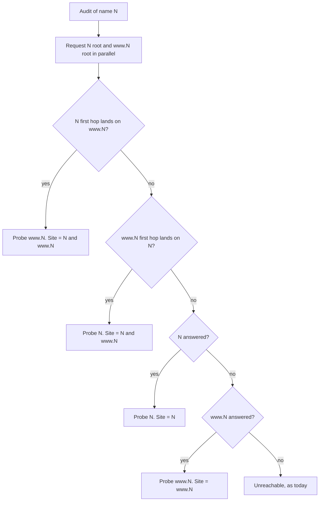

# Fold www and apex into one site at the start of every web audit - Plan

## Goal Capsule

- **Objective:** a website reached at both `<apex>` and `www.<apex>` has one scorecard, under the apex name, on every surface an agent or a person reads, and its audit never reports its own www or apex host as a third party.
- **Means:** the target classifier folds the name before the cache read (KTD1); the engine resolves the www/apex pair as its first step and audits the pair as one site (KTD2, KTD3).
- **Authority:** Product Contract requirements win on behavior, Key Technical Decisions win on mechanism, and units override neither. Owner decisions D1 to D8 (Open Questions) gate the merge, not the build.
- **Execution profile:** code. One PR from a `feat/` branch to `dev`, holding U1 to U7; U8 runs on staging after the `dev` deploy. The agentnative-cli port follows in its own repo (Deferred to Follow-Up Work).
- **Stop conditions:**
  - The fold needs a change to how any check scores beyond which host it probes and which hosts count as the site. Stop and report: that is a scoring-rule change outside this plan.
  - The pair resolution cannot run inside the per-audit deadline on staging without starving later probes. Stop and re-size.
  - A curated site's score moves on staging for a reason U8 cannot attribute to the fold. Stop and report before release.
- **Who finishes:** an agentnative-site session builds the PR, runs `ce-code-review` and `/devex-review` (it changes MCP output and the scorecard JSON), verifies on staging (U8), and hands the PR to Brett for merge approval.

---

## Product Contract

### Summary

A web target written `www.<host>` becomes the site `<host>` the moment it is classified, so one name keys the cache, the result URL, both boards, the og card and clip, and every MCP answer. Every web audit then starts by asking whether `<host>` and `www.<host>` redirect to each other; when they do, the audit probes the host the redirect lands on and treats both hosts as the audited site for every check.

### Problem Frame

A production audit of `cnn.com` lists `www.cnn.com` under "Declared hosts", as "redirect from /mcp" and "redirect from /sse", each "not confirmed by www.cnn.com". The site's own www host is reported as a third party that failed to consent, and the MCP rows never reach the server that answers at `www.cnn.com/mcp`. The cause is that every same-origin decision in the engine compares against the exact origin typed (`declaresHost` in `src/worker/audit-web/follow-trail.ts` is `!sameOrigin(url, base)`), while the root fetch follows the apex-to-www redirect silently.

The same split shows in naming: `prepareWebTarget` (`src/worker/audit-web/core.ts`) and `canonicalTargetOf` (`src/worker/audit-web/cache.ts`) key the target by the host as typed, so `www.x` and `x` are two scorecards, two result pages, and two possible board rows for one site. The only `www.` handling that ships is the og card's wordmark initials (`src/shared/score-og.ts`).

Thirteen of the 53 curated board sites redirect apex to www (firecrawl.dev, twilio.com, intercom.com, anthropic.com, hubspot.com, notion.so, paypal.com, openapis.org, shopify.com, prisma.io, postman.com, microsoft.com, mintlify.com; root redirects read 2026-11-10). Their stored scorecards carry the same false declared host: production's `hubspot.com` scorecard lists `www.hubspot.com` for `/mcp` and `/sse` (reciprocity refused) and `/message` (budget exceeded). The board research that chose apex names for these entries treated the redirect as cosmetic; the engine does not.

Brett decided the fold in the og:video planning session (D24, D25 in `docs/plans/2026-10-26-2253-feat-scorecard-og-video-plan.md`, Key Decisions and Deferred to Follow-Up Work) and confirmed the design on 2026-11-10.

### Requirements

**Name and key**

- R1. A web target written `www.<host>`, where `<host>` is itself a dotted hostname and not an IP literal, is the site `<host>` on every surface: the homepage form, `POST /api/score`, `/scoring`, `/score/<target>` and its `.md` and `/json` forms, both boards, the og card and clip, every web MCP tool's input and output, the cache key, purge tags, the in-flight lock, and every rate-limit and listing-flip key.
- R2. A request for `/score/www.<host>` (any representation) answers 301 to the same representation of `/score/<host>`.
- R3. No board, and no `list_website_audits` answer, lists a `www.` name.

**The audit**

- R4. Every web audit starts by resolving the pair `<name>` and `www.<name>`. The pair folds when the root of either host answers its first request with a redirect whose target is on the other host.
- R5. A folded audit probes the host the redirect lands on. Both hosts count as the audited site for every check: discovery, endpoint resolution, redirect hops, API targets, and the declared-hosts trail. Neither host is ever a declared host of the other.
- R6. When the name's root gets no answer from the target and `www.<name>` answers, the audit probes `www.<name>` under the name. When neither answers, the audit ends unreachable, as today.
- R7. A redirect from either host to a third host does not fold the pair; the root fetch follows it as today.
- R8. The fold applies whatever the follow switch (`WEB_AUDIT_FOLLOW_ENABLED`) or the caller's `follow_declarations` says.

**What the scorecard says**

- R9. The scorecard names the site by its name (`tool.name`, `tool.url`), records the origin its checks ran against in `target_url`, and, when the pair folded, lists both hosts in an optional `site_hosts` field. `schema_version` stays `0.5`.
- R10. A folded scorecard's page and markdown twin name the site and say, in the existing website line, which host it was audited at.
- R11. Every web MCP tool's description, and the client skill, state that a `www.` host reads as the site without it.

**Parity**

- R12. The conformance corpus has one scenario per pair outcome (R4 to R7), so the CLI port can reproduce the fold byte for byte.

### Acceptance Examples

- AE1. Covers R1, R4, R5, R9. **Given** `cnn.com` answers `/` with a 301 to `https://www.cnn.com/`, **when** anyone audits `cnn.com` or `www.cnn.com`, **then** the checks run against `https://www.cnn.com/`, the declared-hosts trail never names `www.cnn.com`, the scorecard says `tool.name: "cnn.com"`, `target_url: "https://www.cnn.com/"`, `site_hosts: ["cnn.com", "www.cnn.com"]`, and it is stored once, under `cnn.com`.
- AE2. Covers R1, R2, R4. **Given** `www.stripe.com` answers `/` with a 301 to `https://stripe.com/`, **when** a visitor opens `/score/www.stripe.com`, **then** they get a 301 to `/score/stripe.com`, whose scorecard was probed at `https://stripe.com/` and lists `site_hosts: ["stripe.com", "www.stripe.com"]`.
- AE3. Covers R7. **Given** `www.twitter.com` redirects to `twitter.com`, which redirects to `x.com`, **when** anyone audits `www.twitter.com`, **then** the site is `twitter.com`, the pair folds through the www-to-apex hop, and the root fetch follows `twitter.com` on to `x.com` exactly as an audit of `twitter.com` does today.
- AE4. Covers R6. **Given** `example.org` does not resolve and `www.example.org` answers 200, **when** anyone audits `example.org`, **then** the checks run against `https://www.example.org/` and the scorecard is stored under `example.org`.

### Key Decisions

- **The fold happens at the audit, for the whole audit.** (session-settled: user-directed, chosen over a render-time display check on the og card: `www.python.org` becomes `python.org` from the first step, so boards never carry both names.) Governs R1, R4, R5.
- **The apex is the site's name everywhere it is shown or keyed.** (session-settled: user-directed, chosen over keeping each typed host as its own scorecard: no board or store carries both names.) Governs R1, R2, R3, R9.
- **The fold gets its own plan, coordinated with the agentnative-cli web-audit port.** (session-settled: user-directed, chosen over folding it into the og:video work.) Governs R12.
- **A redirect, in either direction, is what makes two hosts one site.** Content comparison without a redirect is not used. Owner decision D1. Governs R4.
- **A www-only site is audited at www under the apex name; a third-host redirect is not a fold.** Owner decision D2. Governs R6, R7.
- **Any leading `www.` folds, not only one in front of a registrable domain.** No public-suffix list reaches the browser bundle or the CLI. Owner decision D3. Governs R1.
- **Names are the apex; provenance stays the host actually requested.** Row hosts, evidence URLs, `remediation.host`, and the scorecard's `target_url` name the probed host, because a fix belongs where the content is served. Owner decisions D4 and D8. Governs R9.
- **`site_hosts` records the fold, and the website line says where the audit ran.** Owner decision D5. Governs R9, R10.
- **No data migration.** Old `www.` records stay in R2 unread. Owner decision D6. Governs R2, R3.

### Scope Boundaries

- Hosts other than the www sibling (`m.`, `www2.`, `docs.` aliases, `edition.cnn.com`) do not fold. The board's own alias choices stay curated in the seed.
- A root that redirects to a third host keeps today's behavior: the root fetch follows it and the content is scored under the typed name (R7). Changing that is a scoring-rule change, outside this plan.
- Considered and not built: deciding sameness by comparing the two roots' content. Pages differ per request (timestamps, nonces, A/B variants), so the rule would flake; a redirect is the operator's own statement. A site that serves both hosts without a redirect and is misjudged would change this call.
- Considered and not built: a sweep that deletes or re-audits stored `www.` records. The production web board lists no `www.` row (55 rows read on 2026-11-10), and nothing reads an old record once the name folds (KTD5). Storage growth from orphans large enough to matter would change this call.
- Considered and not built: a field on MCP answers echoing the input host that was folded. The envelope's `target` and `scorecard_url` already name the site, and the tool descriptions state the rule (R11). Agents re-asking for the www host in a loop would change this call.
- Considered and not built: removing the `www.` strip in `wordmarkInitials` (`src/shared/score-og.ts`). It is unreachable for audited names after the fold and harmless; deleting it is cleanup outside the brief.

#### Deferred to Follow-Up Work

- **The agentnative-cli web-audit port** (`brettdavies/agentnative-cli`, its own plan and PR). It bumps `src/web_audit/vendored/SITE_SHA` to the commit that lands this plan, then mirrors: the name fold in its target normalization (`anc www.cnn.com` reports `cnn.com`); the pair resolution in `src/web_audit/engine/waves.rs` before the root fetch; the on-site set in place of `same_origin` at its call sites (`follow_trail.rs`, `discovery_posts.rs`, `discovery.rs`, `discovery_documents.rs`, `api_targets.rs`, `handlers/api_probe_url.rs`, `handlers/shared.rs`); the redirect-hop rule in its fetch layer; and `site_hosts` in the strict scorecard mirror (`src/web_audit/scorecard.rs`) and its committed JSON Schema. The fold scenarios from U6 must pass with no divergence-ledger entry. Owner decision D7 sets the order.

### Success Criteria

- A fresh staging audit of `cnn.com` shows no declared host, and its MCP rows report what `https://www.cnn.com/mcp` answers.
- `/score/www.cnn.com`, `get_website_audit("www.cnn.com")`, and `audit_website("https://www.cnn.com/")` all answer with the site `cnn.com`.
- Every curated score move after the staging rescore is attributed in U8's table to a row the fold changed.

---

## Planning Contract

### Key Technical Decisions

- KTD1. **The name folds in the shared classifier; the probe host is decided in the engine.** The cache read (`readWebTier`) runs before any audit, so the key must be known from the input alone. `classifyTarget` in `src/shared/audit-routes.ts` is the one function the browser form, `/api/score`, the result route, the retired `/web/` redirect, and the og subject all call, and the result route already 301s any form the classifier normalizes (`serveResult` in `src/worker/audit/result.ts`). Folding there gives R1 and R2 at every one of those surfaces. The engine, which alone can make requests, decides which host of the pair to probe (KTD2). MCP enters through `coerceUrl` and `prepareWebTarget`, not the classifier, so `prepareWebTarget` applies the same exported fold.
- KTD2. **Pair resolution reads both roots at the start, concurrently.** The name's root fetch already runs first and doubles as the reachability probe; it now records its first hop. The sibling's root is requested once with redirects not followed, in parallel, so the audit's wall clock does not grow. Rules, in order: the name's first hop lands on the sibling, so probe the sibling, folded; the sibling's first hop lands on the name, so probe the name, folded; the name got no answer from the target and the sibling answered, so probe the sibling, not folded by redirect; otherwise probe the name, not folded. A redirect is any status in `REDIRECT_STATUSES` (`src/worker/audit-web/ssrf.ts`): mintlify.com's temporary 307 folds like a 301, because the question is where the content lives, not whether the move is permanent. "No answer from the target" uses the engine's existing test (`answeredByTarget` and `isEdgeErrorStatus` in `src/worker/audit-web/engine.ts`), so a Cloudflare 530 counts as no answer. Every request goes through `guardedFetch`, so the SSRF guard and the https-only rule apply to the sibling as to any probe.
- KTD3. **One on-site predicate replaces exact-origin comparison at every site the audit's own origin is compared.** The audit carries a site: the probe origin plus, when folded, the sibling's origin. The comparisons at `discovery-documents.ts` (endpoint resolution), `discovery.ts` (card fetch and catalog entries), `discovery-posts.ts` (`offOriginRedirect`), `follow-trail.ts` (`declaresHost`), `api-targets.ts` (audited-origin and declared grouping), and `handlers/api-description.ts` (`off_origin`) ask "on site?" instead of "same origin as base?". `guardedFetch` (`src/worker/audit-web/ssrf.ts`) gains a site-origins entry in its options, read where it decides a hop is off-origin, so a POST that the apex redirects to www is followed under `crossOriginRedirects: 'refuse'` and `'return'` like any same-origin hop; `validatePublicUrl` still runs on every hop. Comparisons against a declared host's own origin (reciprocity, the follow slice) are untouched.
- KTD4. **The record, the envelope, and the cache key carry the name; the scorecard records where the checks ran.** `CachedWebAudit.target_url` stays the key URL, because `patchStoredPublicListing` rebuilds the key from it and the board metadata and listing backfill read the domain from it (`src/worker/audit-web/cache.ts`). The scorecard's `tool` comes from the name, its `target_url` from the probe origin, and `site_hosts` (name first) is emitted only when the pair folded. The row-provenance code keeps reading the entry host from `target_url`, so rows probed at the sibling read as the audited host with no change; a row whose evidence names the other host of a folded pair also reads as the audited host. Precedent for an optional field without a schema bump: `follow_declarations` (#395) under `0.5`. Owner decisions D4, D5, D8.
- KTD5. **No migration; a listing guard and the redirect cover old records.** `listAllWebAudits` (`src/worker/audit-web/cache.ts`), which both the board (`src/worker/audit-web/board.ts`) and `list_website_audits` call, drops any row whose stored domain the fold would change. Old og cards and clips under a `www.` target stay where they are; no page names them. Owner decision D6.
- KTD6. **The fold is not following.** `effectiveFollow` and the declared-domain budget gate requests to hosts a site declares. The sibling is the site, so neither gates it, no budget unit is drawn for it, and a run with following off still folds (R8).
- KTD7. **Corpus scenarios name every request.** Each new fold scenario lists its sibling-root exchange. The four existing scenarios with `allow_unmatched: false` gain an explicit sibling exchange answering 404, which is what the other 134 already receive from their unmatched policy; their goldens do not change, because `site_hosts` is emitted only on a fold.
- KTD8. **The seed stays fold-stable.** `loadWebSeed` in `src/build/14-web-scorecards-emit.mjs` treats a domain the fold would change like any other invalid entry, so a `www.` row cannot reach the board under a name the audit never stores.

### High-Level Technical Design

Pair resolution, the engine's first step (KTD2):

A first hop that lands on a third host fails both redirect tests and falls through to "N answered?", so a third-host redirect never folds (R7). The F4 branch probes the sibling without a fold, so `site_hosts` is absent and only the probe host is on site.

Which field carries which host after a fold of `cnn.com` (KTD4):

| Field | Value | Role |
| --- | --- | --- |
| envelope `target`, `scorecard_url` | `cnn.com`, `/score/cnn.com` | name |
| record `target_url`, cache key | `https://cnn.com/` | name |
| scorecard `tool.name`, `tool.url` | `cnn.com`, `https://cnn.com/` | name |
| scorecard `target_url` | `https://www.cnn.com/` | where the checks ran |
| scorecard `site_hosts` | `["cnn.com", "www.cnn.com"]` | the fold |
| row hosts, evidence URLs, `remediation.host` | `www.cnn.com` | where each answer came from |
| purge tags, in-flight lock, limiter keys, og card and clip | `cnn.com` | name |

### Assumptions

- `isWebHostname` and the classifier's other rules already reject IP literals and single-label hosts, so the fold only needs to test that the remainder after `www.` still has a dot.
- No caller outside `src/worker/audit-web/` compares an audit's origin for same-site meaning; the call-site list in KTD3 is complete. U4 confirms it with a repository search before changing the predicate.
- The CLI's drift workflow checks the vendored files against the pinned `SITE_SHA` only, so landing this plan does not break agentnative-cli CI before it bumps the pin.

### Risks & Dependencies

| Risk | Mitigation |
| --- | --- |
| Curated scores move for the 13 apex-to-www sites at their next rescore. | U8 records before and after per row on staging and attributes every move before release. |
| A `www.` host and its apex are different sites with no redirect, and the user wanted the www one. | The name is still the apex and the probe goes to the apex (F3). Accepted as the cost of one name per site; the Scope Boundaries row records what would revisit it. |
| Following a POST across the pair re-sends its body to the sibling host. | Same treatment as a same-origin hop today, on a host the site's own redirect named; `validatePublicUrl` runs on the hop. |
| The sibling request adds one request per audit against the per-audit deadline. | It runs in parallel with the existing root fetch, under the same per-check timeout. Stop condition if staging shows starvation. |
| The CLI port lags the site. | The site is the reference; the CLI's pinned corpus keeps it green until it bumps (D7). |

### Deferred to Implementation

- Whether the first-hop observation comes from a `guardedFetch` option that returns the hop chain or from a non-following first request whose redirect the engine then follows. Either satisfies KTD2; pick the one the request memo dedupes cleanly.
- The exact name and home of the fold function exported from `src/shared/audit-routes.ts`.
- Whether the root response for a folded audit reuses the name's followed fetch when it landed on the sibling's root, or refetches through the memo.

---

## Implementation Units

### U1. Name fold in the shared classifier

**Goal:** every surface that classifies a web target sees the folded name (R1, R2).

**Requirements:** R1, R2. KTD1.

**Dependencies:** none.

**Files:**
- `src/shared/audit-routes.ts`
- `tests/audit-routes.test.ts`
- `tests/audit-result-route.test.ts`

**Approach:**
1. Add an exported pure fold: strip one leading `www.` label when the remainder is still a dotted web hostname; return the host unchanged otherwise. Case-insensitive, port preserved.
2. Apply it inside the web branch of `classifyTarget` (`webHostOf`), so the scheme form, the bare-host form, and the `host/path` form all fold.
3. Leave the GitHub branch alone; `www.github.com/<owner>/<repo>` keeps classifying as a CLI repository.

**Patterns to follow:** the existing port normalization in `webHostOf`; the result route's normalize-redirect in `serveResult`.

**Test scenarios:**
- `www.cnn.com`, `https://www.cnn.com/path`, `WWW.CNN.COM`, and `http://www.cnn.com` classify as web target `cnn.com`.
- `www.cnn.com:8443` classifies as `cnn.com:8443`.
- `www.co` (one label after the strip), `www`, and `www.` do not fold.
- `www.1.2.3.4`-style and bracketed IPv6 inputs keep their current classification.
- `cnn.com` is unchanged (the fold is idempotent).
- `www.github.com/brettdavies/agentnative-cli` still classifies as the CLI repository.
- `/score/www.cnn.com`, `/score/www.cnn.com/md`, and `/score/www.cnn.com/json` answer 301 to the matching `/score/cnn.com` path.
- `/web/www.cnn.com` (retired path) redirects to `/score/cnn.com`.

**Verification:** the classifier and result-route suites pass, and a local `bun run dev` request for `/score/www.cnn.com` returns 301 to `/score/cnn.com`.

### U2. Worker entry points, listing guard, and seed guard

**Goal:** the MCP path folds like the classifier path, and no stored or seeded `www.` name reaches a board (R1, R3).

**Requirements:** R1, R3. KTD1, KTD5, KTD8.

**Dependencies:** U1.

**Files:**
- `src/worker/audit-web/core.ts`
- `src/worker/audit-web/cache.ts`
- `src/build/14-web-scorecards-emit.mjs`
- `src/worker/mcp/tools/web-audit.ts`
- `tests/web-audit-mcp-tools.test.ts`
- `tests/web-audit-cache.test.ts`
- `tests/audit-api.test.ts`
- `tests/build.test.ts`

**Approach:**
1. `prepareWebTarget` passes its host through the U1 fold before building `host` and `canonical`, so `siteTarget` in the MCP tools gets the name for `get_website_audit`, `audit_website`, and the in-flight check.
2. `listAllWebAudits` drops a listed row whose `domain` the fold would change (KTD5).
3. The seed loader rejects a domain the fold would change, with the same warning shape as other invalid entries (KTD8).
4. Confirm by reading, not by new code, that the session limiter key, `MCP_AUDIT_LIMITER`, `WEB_AUDIT_LIMITER_IP`, the listing-flip budget, the in-flight lock, `webDomainTag`, and `requestRender` all derive from the folded `target.host` or the classified target.

**Patterns to follow:** the existing invalid-entry warnings in `loadWebSeed`; `isBoardListable` as the shape of a listing predicate.

**Test scenarios:**
- `get_website_audit({ url: "https://www.cnn.com/" })` reads the `cnn.com` record and answers with `target: "cnn.com"`.
- `get_website_audit({ url: "www.cnn.com" })` on a miss answers `found: false` naming `cnn.com` in its message.
- `POST /api/score` with target `www.cnn.com` reads and writes under the `cnn.com` key, and the session limiter is called with the `cnn.com` target hash.
- A listed R2 row with `domain: www.example.com` is absent from `listAllWebAudits`; a row with `domain: example.com` is present.
- A seed entry `www.example.com` is skipped with a warning; `example.com` loads.

**Verification:** the MCP, cache, API, and build suites pass.

### U3. Pair resolution as the engine's first step

**Goal:** the engine decides the probe origin and the site's origins before discovery (R4, R6, R7, R8).

**Requirements:** R4, R6, R7, R8. KTD2, KTD6.

**Dependencies:** U1.

**Files:**
- `src/worker/audit-web/engine.ts`
- `src/worker/audit-web/site-pair.ts` (new; name per Deferred to Implementation)
- `src/worker/audit-web/ssrf.ts`
- `tests/web-audit-site-pair.test.ts` (new)
- `tests/web-audit-antecedents-engine.test.ts`

**Approach:**
1. Before `readDiscoveryDocuments`, resolve the pair from the name's root fetch (first hop recorded) and the sibling's root (one request, redirects not followed), in parallel.
2. Apply the rules in KTD2 and the HTD flowchart; return the probe origin and the site's origin set.
3. Set `base`, `host`, and the root response from the probe origin; hand the origin set to the U4 predicate and to `fetchOptions`.
4. The unreachable test keeps its current wording, naming the name's origin when neither host answered.
5. The fold reads no follow switch and draws no domain-budget unit (KTD6).

**Execution note:** write the pair-resolution tests against a stub fetch first; they are the contract U6 records into the corpus.

**Patterns to follow:** the existing root fetch in `auditWith`; stub-fetch tests in `tests/web-audit-antecedents-engine.test.ts`.

**Test scenarios:**
- Covers AE1. The name's root answers 301 to `https://www.n.test/`: probe origin is the sibling, site has both origins.
- Covers AE2. The sibling's root answers 301 to `https://n.test/` and the name's root answers 200: probe origin is the name, site has both origins.
- The name's root redirects to `https://www.n.test/en-us/` (a path on the sibling): folded, probe origin is the sibling's root origin.
- Covers AE3. The name's root redirects to a third host and the sibling's root redirects to the name: folded through the sibling, probe origin is the name, and the root fetch still follows to the third host.
- The name's root redirects to a third host and the sibling's root answers 404: not folded, probe origin is the name.
- Covers AE4. The name's root gets a transport failure or a 530 and the sibling's root answers 200: probe origin is the sibling, not folded.
- Both roots fail: the audit yields `unreachable`.
- Both roots answer 200 with no redirect: not folded, probe origin is the name.
- The name's root redirects to `http://www.n.test/`: the existing insecure-scheme refusal fires; no fold.
- With `followDeclarations: false`, a folded pair still folds and the declared-domain budget's `reserve` is never called for the sibling.

**Verification:** the new suite passes, and an engine run over each stub yields the expected `base` in its scorecard's `target_url`.

### U4. On-site comparisons and redirect hops

**Goal:** both hosts of a folded pair are the audited site at every comparison (R5).

**Requirements:** R5. KTD3.

**Dependencies:** U3.

**Files:**
- `src/worker/audit-web/discovery-documents.ts`
- `src/worker/audit-web/discovery.ts`
- `src/worker/audit-web/discovery-posts.ts`
- `src/worker/audit-web/follow-trail.ts`
- `src/worker/audit-web/api-targets.ts`
- `src/worker/audit-web/handlers/api-description.ts`
- `src/worker/audit-web/handlers/shared.ts`
- `src/worker/audit-web/ssrf.ts`
- `tests/web-audit-discovery.test.ts`
- `tests/web-audit-follow.test.ts`
- `tests/web-audit-ssrf.test.ts`
- `tests/web-audit-api-anchors.test.ts`

**Approach:**
1. Search the repository for `sameOrigin(` and `.origin ===` / `.origin !==` comparisons against the audit's base and list each one; KTD3 names the expected set.
2. Replace each with the on-site predicate over the site's origin set; a site with one origin behaves exactly as today.
3. In `guardedFetch`, a hop whose origin is in the site-origin option counts as on-origin for `crossOriginRedirects`.
4. Leave reciprocity, the follow slice, and comparisons against a declared host's origin unchanged.

**Patterns to follow:** `sameOrigin` in `discovery-documents.ts` as the shape of the predicate; the `crossOriginRedirects` handling in `guardedFetch`.

**Test scenarios:**
- Covers AE1. A folded site probed at `www.n.test` whose server card names `https://n.test/mcp`: the endpoint resolves as the site's own endpoint, not a declaration.
- A folded site probed at `www.n.test` whose common-path POST to `/mcp` redirects to `https://n.test/mcp`: no redirect declaration is recorded and the POST is followed.
- An unfolded site whose POST to `/mcp` redirects to `https://www.n.test/mcp`: recorded as a declaration exactly as today.
- `declaresHost` for a URL on the folded sibling returns false; for a third host returns true.
- An api-catalog anchor on the sibling of a folded site groups as `audited-origin`.
- `guardedFetch` with site origins `{n.test, www.n.test}` follows a 308 from `n.test` to `www.n.test` under `crossOriginRedirects: 'refuse'`, and still refuses a hop to `evil.test`.
- A hop from `n.test` to `www.n.test` that resolves to a blocked address is still refused by `validatePublicUrl`.

**Verification:** the discovery, follow, ssrf, and api-anchor suites pass; the declared-hosts trail of a folded stub audit never names the sibling.

### U5. Scorecard fields, page line, and schema doc

**Goal:** the scorecard and both page representations name the site and say where it was audited (R9, R10).

**Requirements:** R9, R10. KTD4.

**Dependencies:** U3.

**Files:**
- `src/worker/audit-web/scorecard.ts`
- `src/worker/audit-web/engine.ts`
- `src/worker/audit-web/core.ts`
- `src/worker/audit-web/provenance.ts`
- `src/worker/audit-web/summary-model.ts`
- `src/worker/audit-web/summary-render.ts`
- `src/worker/audit-web/summary-markdown.ts`
- `content/web-scorecard-schema.md`
- `tests/web-audit-scorecard-format.test.ts`
- `tests/web-audit-provenance-render.test.ts`
- `tests/web-audit-transient-summary.test.ts`

**Approach:**
1. The engine's scorecard build takes the name for `tool.name` and `tool.url`, the probe origin for `target_url`, and `site_hosts` (name first) only on a fold.
2. `runWebAuditStream` keeps writing the record under `target.canonical`, which is the name (KTD4).
3. Row provenance treats a host in `site_hosts` as the audited host.
4. The website line in `summary-render.ts` and its twin in `summary-markdown.ts` add the audited-at clause only when `site_hosts` is present and `target_url`'s host differs from `tool.name`.
5. The schema doc's top-level table gains `site_hosts`, and its `tool.url` row states that it matches `target_url` except when www and apex folded.

**Patterns to follow:** the optional `follow_declarations` and `declared_hosts` fields in `WebScorecard`; the existing "Website" clause in `summary-render.ts`.

**Test scenarios:**
- A folded apex-to-www scorecard serializes `tool.name` as the name, `target_url` as the www origin, and `site_hosts` with the name first.
- A folded www-to-apex scorecard has `target_url` equal to `tool.url` and still carries `site_hosts`.
- An unfolded scorecard has no `site_hosts` key, and its JSON is byte-identical to a pre-change scorecard for the same exchanges.
- The HTML page of a folded apex-to-www scorecard shows the name and the audited-at clause; the markdown twin carries the same clause.
- A row whose evidence came from the other host of a folded pair renders as evaluated at the audited host.

**Verification:** the scorecard, provenance, and transient-summary suites pass; the page is checked in a browser per U8.

### U6. Conformance corpus scenarios

**Goal:** the corpus pins every pair outcome for the CLI port (R12).

**Requirements:** R12. KTD7.

**Dependencies:** U3, U4, U5.

**Files:**
- `scripts/web-audit/conformance-scenarios.ts`
- `tests/fixtures/web-audit-conformance/scenarios/` (new scenario directories, plus sibling exchanges in the four strict scenarios)
- `tests/fixtures/web-audit-conformance/scores.json`
- `tests/fixtures/web-audit-conformance/README.md`
- `tests/web-audit-conformance-corpus.test.ts`

**Approach:**
1. Add scenarios for: apex-to-www fold with an MCP endpoint on www; www-to-apex fold; apex unreachable with www answering; third-host redirect, not folded; both 200, not folded; a folded site whose common-path POST redirects across the pair.
2. Give the four `allow_unmatched: false` scenarios an explicit sibling-root exchange answering 404 (KTD7).
3. Regenerate with `scripts/web-audit/gen-fixtures.ts`; existing goldens must not change.
4. The README's scenario section notes that every run requests the sibling root.

**Patterns to follow:** existing scenarios such as `alias-redirect-pass` and the discovery scenarios.

**Test scenarios:**
- Each new scenario's golden carries the probe origin in `target_url` and `site_hosts` exactly when the fold applies.
- Every pre-existing golden `scorecard.json` is byte-identical after regeneration.
- The completeness gate still passes.

**Verification:** `tests/web-audit-conformance-corpus.test.ts` passes with the regenerated corpus.

### U7. MCP descriptions and agent-facing docs

**Goal:** an agent learns the fold from the surfaces it reads (R11).

**Requirements:** R11.

**Dependencies:** U2, U5.

**Files:**
- `src/worker/mcp/tools/web-audit.ts`
- `content/mcp-skill.md`
- `content/_audit-web.md`
- `CONCEPTS.md`
- `tests/web-audit-mcp-tools.test.ts`

**Approach:**
1. The `url` input description on `get_website_audit` and `audit_website` states that a `www.` host reads as the site without it.
2. `list_website_audits` states that names are apex names.
3. `content/mcp-skill.md` and `content/_audit-web.md` state the rule once each, with the `target_url` / `tool.url` distinction (KTD4).
4. `CONCEPTS.md` gains an entry for the site fold if no existing entry carries it.

**Test scenarios:**
- The registered tool descriptions for `get_website_audit` and `audit_website` contain the fold sentence.

**Verification:** the MCP tools suite passes; `bun run build` regenerates `llms-full.txt` with the new skill text.

### U8. Staging verification and score attribution

**Goal:** prove the fold on the deployed staging Worker and attribute every curated score move (Success Criteria).

**Requirements:** R1 to R10.

**Dependencies:** U1 to U7 merged to `dev` and deployed to staging.

**Files:**
- none in the repository; the attribution table goes in the PR description.

**Approach:**
1. Before the merge, record the staging scorecards of the 13 apex-to-www curated sites named in the Problem Frame.
2. After the `dev` deploy, trigger the staging rescore for those sites per `docs/runbooks/web-audit-operations.md`.
3. For each site, list every row whose status changed and the fold behavior that changed it (a declared host gone, an MCP probe now reaching www).
4. Check `/score/www.cnn.com` (301), the `cnn.com` page in both themes, and `get_website_audit("www.cnn.com")` through the staging MCP endpoint, using the Cloudflare Access service-token headers.

**Test expectation:** none -- live verification of deployed behavior; the unit suites carry the logic.

**Verification:** the PR description holds the before-and-after table with every move attributed, and the four checks in step 4 pass.

---

## Verification Contract

| Gate | Command or check | Proves |
| --- | --- | --- |
| Lint | `bun run lint` | style and types across touched files |
| Build first | `bun run build` | `dist/` matches the branch before tests read it (AGENTS.md gate order) |
| Unit and corpus | `bun test` | U1 to U7 scenarios, the regenerated corpus, and unchanged goldens |
| Local Worker | `bun run dev`, then `/score/www.cnn.com` and an MCP `get_website_audit` for `www.cnn.com` | the redirect and the MCP fold through the real Worker |
| Browser | the folded scorecard page in light and dark themes | R10's clause renders legibly (AGENTS.md "Browser-verify before declaring done") |
| Staging | U8 | live fold, redirect, MCP answer, attributed score moves |
| Reviews | `ce-code-review`, `/devex-review` | code and agent-facing output |

## Definition of Done

- R1 to R12 hold, each covered by a U1 to U7 test scenario or by U8.
- Every pre-existing conformance golden is byte-identical; the new scenarios pass.
- The PR carries U8's attribution table, with no unexplained curated score move.
- Owner decisions D1 to D8 are answered and reflected in Key Decisions.
- The agentnative-cli follow-up is filed as its own plan or brief, naming the commit this PR lands as the pin.
- No dead-end code from abandoned approaches remains in the diff.

## Open Questions

Owner decisions sent to the coordinating session on 2026-11-10. Each gates the merge; the plan is written to the recommended option.

| ID | Question | Recommended |
| --- | --- | --- |
| D1 | What makes www and apex one site? | A redirect either way, read from both roots at the start. Not content comparison. |
| D2 | One host dead, or a redirect to a third host? | Apex dead and www alive: audit www under the apex name. Third host: no fold, today's behavior. |
| D3 | Which names fold? | Any leading `www.` with a dotted remainder; no public-suffix list. |
| D4 | Name versus provenance? | Names and keys are the apex; row hosts, evidence URLs, and `remediation.host` stay the host requested. |
| D5 | The fold's field and page copy? | `site_hosts`, name first, optional, schema `0.5`; one audited-at clause in the website line. |
| D6 | Existing `www.` records? | No migration: redirect, listing guard, orphans unread. |
| D7 | CLI sequencing? | Site first; the CLI implements the fold in its pin-bump PR with no ledger entries. |
| D8 | Where the probed origin appears in the JSON? | Scorecard `target_url` is the probed origin; envelope `target_url` and `tool.url` are the name. |

---

## Review log

- 2026-11-10: plan written at 96549a9.
- 2026-11-10: `/plan-eng-review` round 1 started (Opus, effort high), on the plan as written, with D1 to D8 still with the owner.
