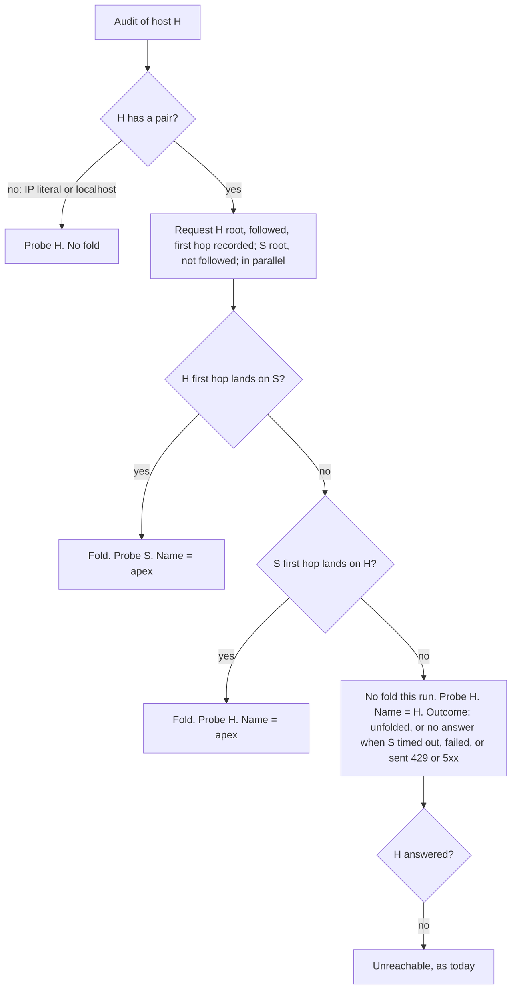
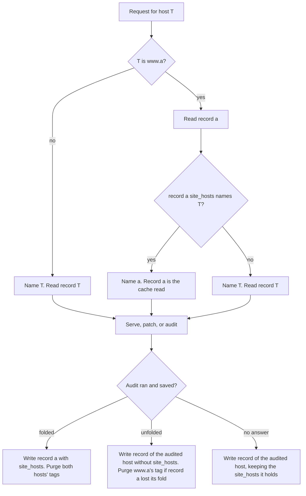

# Fold www and apex into one site at the start of every web audit - Plan

## Goal Capsule

- **Objective:** a website whose `www.` host and apex redirect to each other has one scorecard, under the apex name, on every surface an agent or a person reads, and its audit never reports its own www or apex host as a third party. A `www.` host that does not redirect to or from its apex stays a site of its own.
- **Means:** each audit observes the www/apex redirect as its first step and records the fold in the apex's stored scorecard (KTD1, KTD3); every entry point reads that record before its cache read to choose the name (KTD2).
- **Authority:** Product Contract requirements win on behavior, Key Technical Decisions win on mechanism, and units override neither.
- **Execution profile:** code. One PR from a `feat/` branch to `dev`, holding U1 to U7; U8 runs on staging after the `dev` deploy. The agentnative-cli port follows in its own repo (Deferred to Follow-Up Work).
- **Stop conditions:**
  - The fold needs a change to how any check scores beyond which host it probes and which hosts count as the site. Stop and report: that is a scoring-rule change outside this plan.
  - The pair resolution cannot run inside the per-audit deadline on staging without starving later probes. Stop and re-size.
  - A curated site's score moves on staging for a reason U8 cannot attribute to the fold. Stop and report before release.
- **Who finishes:** an agentnative-site session builds the PR, runs `ce-code-review` and `/devex-review` (it changes MCP output and the scorecard JSON), verifies on staging (U8), and hands the PR to Brett for merge approval.

---

## Product Contract

### Summary

Every web audit starts by asking whether the audited host and its www sibling redirect to each other. When they do, the pair is one site named by its apex: the checks probe the host the redirect lands on, both hosts count as the audited site, and the apex's stored scorecard records the fold. Every entry point reads that record before its cache read, so `www.<apex>` resolves to the apex's scorecard, page, board row, og card, and MCP answer. When they do not, the two hosts are separate sites with separate scorecards.

### Problem Frame

A production audit of `cnn.com` lists `www.cnn.com` under "Declared hosts", as "redirect from /mcp" and "redirect from /sse", each "not confirmed by www.cnn.com". The site's own www host is reported as a third party that failed to consent, and the MCP rows never reach the server that answers at `www.cnn.com/mcp`. The cause is that every same-origin decision in the engine compares against the exact origin typed (`declaresHost` in `src/worker/audit-web/follow-trail.ts` is `!sameOrigin(url, base)`), while the root fetch follows the apex-to-www redirect silently.

The same split shows in naming: `prepareWebTarget` (`src/worker/audit-web/core.ts`) and `canonicalTargetOf` (`src/worker/audit-web/cache.ts`) key the target by the host as typed, so `www.x` and `x` are two scorecards, two result pages, and two possible board rows for one site. The only `www.` handling that ships is the og card's wordmark initials (`src/shared/score-og.ts`).

Thirteen of the 53 curated board sites redirect apex to www (firecrawl.dev, twilio.com, intercom.com, anthropic.com, hubspot.com, notion.so, paypal.com, openapis.org, shopify.com, prisma.io, postman.com, microsoft.com, mintlify.com; root redirects read 2026-11-10). Their stored scorecards carry the same false declared host: production's `hubspot.com` scorecard lists `www.hubspot.com` for `/mcp` and `/sse` (reciprocity refused) and `/message` (budget exceeded). The board research that chose apex names for these entries treated the redirect as cosmetic; the engine does not.

Brett decided the fold in the og:video planning session (D24, D25 in `docs/plans/2026-10-26-2253-feat-scorecard-og-video-plan.md`, Key Decisions and Deferred to Follow-Up Work), confirmed the design on 2026-11-10, and answered this plan's decisions D1 to D8 the same day.

### Requirements

**Observing and recording the fold**

- R1. Every web audit starts by resolving its pair. For an audited host `www.<a>`, where `<a>` is a dotted domain name, the pair is `<a>` and `www.<a>`; for any other domain name `<h>`, it is `<h>` and `www.<h>`. IP literals and `localhost` have no pair. The pair folds when the root of either host answers its first request with a redirect to a URL on the other host.
- R2. A folded audit's site is the apex. The scorecard is stored under the apex, the checks probe the host the redirect lands on, and both hosts count as the audited site for every check: discovery, endpoint resolution, redirect hops, API targets, and the declared-hosts trail.
- R3. An unfolded pair is two sites. An audit of either host probes that host alone, is stored under that host, and treats the other host like any other host. An apex that does not answer leaves the apex unreachable, and `www.<a>` is still audited as itself.
- R4. A redirect from either host to a third host does not fold: `www.twitter.com` to `twitter.com` folds, while `twitter.com` to `x.com` does not (both redirects observed 2026-11-10). The root fetch follows a third-host redirect as it does today.
- R5. The apex's stored scorecard records the fold. A saved audit that folds, from either host, writes the fold into the apex's scorecard; a saved audit of the apex writes it without one only when the other root answered with no redirect to the apex. When the other root gave no answer (a timeout, a transport failure, a 429, or a 5xx), the saved audit keeps the fold the record holds. While a fold is recorded, every request for either host reaches the apex, so a fold that appears or disappears takes effect at the next saved audit of the pair.
- R6. The fold applies whatever the follow switch (`WEB_AUDIT_FOLLOW_ENABLED`) or the caller's `follow_declarations` says.

**Naming and routing**

- R7. Before its cache read, every entry point that reads a web target resolves `www.<a>` to `<a>` when the apex's record shows the pair folded, and keeps `www.<a>` otherwise: `POST /api/score`, `/score/<target>` in every representation, and the web MCP tools. The progress page at `/scoring` names the target as typed; the result forwards to the site's page.
- R8. While the pair is folded, `/score/www.<a>` answers 301 to the same representation of `/score/<a>`. Otherwise it serves `www.<a>`'s own scorecard, or its missing page.
- R9. While the pair is folded, no board and no `list_website_audits` answer lists `www.<a>`.

**What the scorecard says**

- R10. The scorecard names the site by its name (`tool.name`, `tool.url`), records the origin its checks ran against in `target_url`, and, when the pair folded, lists both hosts in an optional `site_hosts` field, apex first. `schema_version` stays `0.5`.
- R11. A folded scorecard's page and markdown twin name the site and say, in the existing website line, which host it was audited at.
- R12. Every web MCP tool that takes or lists a site, the MCP session instructions, and the client skill state that `www.<a>` reads as `<a>` when the two redirect to each other, and as its own site otherwise.

**Parity**

- R13. The conformance corpus has one scenario per pair outcome (R1 to R4), so the CLI port can reproduce the fold byte for byte.

### Acceptance Examples

- AE1. Covers R1, R2, R5, R8, R10. **Given** `cnn.com` answers `/` with a 301 to `https://www.cnn.com/`, **when** anyone audits `cnn.com`, **then** the checks run against `https://www.cnn.com/`, the declared-hosts trail never names `www.cnn.com`, and the stored `cnn.com` scorecard says `tool.name: "cnn.com"`, `target_url: "https://www.cnn.com/"`, `site_hosts: ["cnn.com", "www.cnn.com"]`. A later request for `/score/www.cnn.com` gets a 301 to `/score/cnn.com`.
- AE2. Covers R1, R2, R7. **Given** no record of `stripe.com` yet and `www.stripe.com` answers `/` with a 301 to `https://stripe.com/`, **when** a visitor audits `www.stripe.com` from the homepage form, **then** the audit folds, the scorecard is stored under `stripe.com`, the terminal envelope names `stripe.com` with `scorecard_url` `/score/stripe.com`, and the progress page forwards there.
- AE3. Covers R4. **Given** `www.twitter.com` redirects to `twitter.com`, which redirects to `x.com`, **when** anyone audits `www.twitter.com`, **then** the pair folds through the www-to-apex hop, the scorecard is stored under `twitter.com`, and the root fetch follows `twitter.com` on to `x.com` exactly as an audit of `twitter.com` does today.
- AE4. Covers R3. **Given** `a.test` does not answer and `www.a.test` answers 200 with no redirect, **when** anyone audits `a.test`, **then** the audit ends unreachable; **when** anyone audits `www.a.test`, **then** it is audited and stored as `www.a.test`, a site of its own.
- AE5. Covers R5, R8. **Given** the stored `a.test` scorecard lists `site_hosts: ["a.test", "www.a.test"]`, **when** a later audit of `a.test` gets an answer from both roots with no redirect between them, **then** `a.test` is stored without `site_hosts`, and `/score/www.a.test` serves `www.a.test`'s own scorecard or its missing page once the cached redirect expires.
- AE6. Covers R5. **Given** the stored `a.test` scorecard lists `site_hosts: ["a.test", "www.a.test"]`, **when** a later audit of `a.test` gets a 503 from `www.a.test`'s root, **then** `a.test` is stored with `site_hosts` kept and `/score/www.a.test` still answers 301.

### Key Decisions

- **The fold happens at the audit, for the whole audit.** (session-settled: user-directed, chosen over a render-time display check on the og card: `www.python.org` becomes `python.org` from the first step, so boards never carry both names.) Governs R1, R2.
- **The apex is the folded site's name everywhere it is shown or keyed.** (session-settled: user-directed, chosen over keeping each typed host as its own scorecard: no board or store carries both names of one site.) Governs R7, R8, R9, R10.
- **The fold gets its own plan, coordinated with the agentnative-cli web-audit port.** (session-settled: user-directed, chosen over folding it into the og:video work.) Governs R13.
- **A redirect, in either direction, is what makes two hosts one site, and a redirect to a third host is not a fold.** (session-settled: user-directed, chosen over also folding hosts that serve matching content without a redirect. Brett: "Foldings are limited to redirects.") Governs R1, R4.
- **No redirect, no fold: an unfolded `www.` host is its own site, and the system records which pairs folded.** (session-settled: user-directed, chosen over renaming every `www.` host to its apex by a text rule. Brett: "if `www.x.com` does not redirect to `x.com` then they must be two separate sites in our system.") Governs R3, R5, R7.
- **Names are the apex; provenance stays the host actually requested; `site_hosts` records the fold; the website line says where the audit ran.** (session-settled: user-approved, chosen over rewriting row hosts, evidence URLs, `remediation.host`, and `target_url` to the apex, which would point fix prompts at a host that only redirects.) Governs R10, R11.
- **No data migration: an existing `www.` scorecard is a separate site unless a fold is recorded for its pair.** (session-settled: user-directed, chosen over deleting or re-auditing stored `www.` records.) Governs R8, R9.
- **The site ships first; the CLI follows in its pin-bump PR.** (session-settled: user-approved, chosen over lockstep PRs.) Governs R13.
- **A recorded fold survives a sibling that gives no answer.** (session-settled: user-directed, chosen over dropping the fold on any run that does not observe it.) No answer means a timeout, a transport failure, a 429, or a 5xx; only an observed answer with no redirect drops the fold. Governs R5.
- **The pair rule reads the first hop only.** (session-settled: user-directed, chosen over the first hop that leaves the audited host, which would also fold a chain such as `a/` to `a/en` to `www.a/en`.) Governs R1.

### Scope Boundaries

- Only the www sibling folds. A third host that a root redirects to stays a separate site (`twitter.com` to `x.com`, `square.com` to `squareup.com`, both observed 2026-11-10), and the board's own alias choices stay curated in the seed.
- Considered and not built: deciding sameness by comparing the two roots' content. Pages differ per request (timestamps, nonces, A/B variants), so the rule would flake; a redirect is the operator's own statement.
- Considered and not built: a fold store of its own (a KV key or an R2 object per pair). The apex's stored scorecard already holds the observation (KTD1), and a second store could disagree with it. A need to know a fold for a site whose apex has no stored scorecard would change this call.
- Considered and not built: a guard rejecting `www.` domains in `src/data/web-audit/seed.yaml`. No seed row starts with `www.`, rows land by reviewed PR, and the seed's own header requires each row to name the host an agent reaches. A `www.` seed row that folds would show as a missing curated row after the next rescore.
- Considered and not built: a field on MCP answers echoing the input host that was folded. The envelope's `target` and `scorecard_url` already name the site, and the tool descriptions state the rule (R12). Agents re-asking for the www host in a loop would change this call.
- Considered and not built: a hint on the unreachable error naming the sibling that answered (`www.a.test answered; audit https://www.a.test/ instead.`). It would change the error wording and the corpus goldens; the error keeps its current wording (U3).
- Considered and not built: resolving the fold in the og card route. `/og/score/www.<a>/…` still reads `www.<a>`'s record (`src/worker/og/subject.ts`); no page links to it once `/score/www.<a>` answers 301.
- Considered and not built: removing the `www.` strip in `wordmarkInitials` (`src/shared/score-og.ts`). It is harmless; deleting it is cleanup outside the brief.

#### Deferred to Follow-Up Work

- **The agentnative-cli web-audit port** (`brettdavies/agentnative-cli`, its own plan and PR). It bumps `src/web_audit/vendored/SITE_SHA` to the commit that lands this plan, then mirrors the engine half: the pair resolution in `src/web_audit/engine/waves.rs` before the root fetch, naming the site by the apex when the pair folds (`anc www.cnn.com` reports `cnn.com`; `anc www.x.test` with no redirect reports `www.x.test`), with the text header (`render/text.rs`) naming `tool.url` and adding `(audited at <target_url host>)` when `site_hosts` is present and the hosts differ, as R11 does on the page; the on-site set in place of `same_origin` at its call sites (`follow_trail.rs`, `discovery_posts.rs`, `discovery.rs`, `discovery_documents.rs`, `api_targets.rs`, `handlers/api_description.rs`, `handlers/api_probe_url.rs`, `handlers/content_without_js.rs`, `handlers/scoped_llms.rs`, `handlers/shared.rs`, and the hand-written redirect loop `same_origin_get` in `handlers/api_hygiene.rs`; `rg -n same_origin src/web_audit` lists them); the redirect-hop rule in its fetch layer (`fetch/redirect.rs`), where `hop_headers` keeps the credential exact-origin, so a token presented to one host of the pair is never forwarded to the other; and `site_hosts` in the strict scorecard mirror (`src/web_audit/scorecard.rs`) and its committed JSON Schema. The CLI keeps no record across runs, so it needs nothing from U2. The fold scenarios from U6 must pass with no divergence-ledger entry.

### Success Criteria

- A fresh staging audit of `cnn.com` names no `www.cnn.com` declared host, and its MCP rows report what `https://www.cnn.com/mcp` answers.
- After that audit, `/score/www.cnn.com`, `get_website_audit("www.cnn.com")`, and `audit_website("https://www.cnn.com/")` all answer with the site `cnn.com`.
- A staging audit of a `www.` host that does not redirect to or from its apex is stored and shown under its `www.` name.
- Every curated score move after the staging rescore is attributed in U8's table to a row the fold changed.

### Outstanding Questions

#### Resolve Before Implementation

These are written into the plan as recommended and wait for the owner's confirmation.

- **Does a `www.<a>` opt-in carry to `<a>` when `<a>` has no record?** Recommended: yes, as KTD5 reads, because the `audit_website` description promises that a blank never erases a prior opt-in. The other option is that whoever opted in asks again under `<a>`.
- **Does `schema_version` stay `0.5`?** Recommended: yes, as R10 reads. `site_hosts` is an optional field, as `follow_declarations` was under `0.5` (#395), and it marks every scorecard whose `tool.url` and `target_url` differ. The other option is a minor bump for the loosened `tool.url` invariant.
- **Does the unreachable error name a sibling that answered?** Written as not built (Scope Boundaries). Building it would end the reason with `www.a.test answered; audit https://www.a.test/ instead.`, give an agent that typed a dead apex its next step, and change the error wording and the U6 golden the CLI reproduces.

---

## Planning Contract

### Key Technical Decisions

- KTD1. **The fold record is the apex's stored scorecard.** A folded audit stores `site_hosts` in the apex's scorecard, and `boardMetadataOf` (`src/worker/audit-web/cache.ts`) mirrors it into the record's R2 custom metadata, so the board listing sees it without reading bodies. A saved audit of the apex writes its scorecard without it only when the sibling answered with no redirect; when the sibling gave no answer, the stored `site_hosts` is kept (R5). No new store or binding: R2 reads are strongly consistent after a write, a `www.<a>` request needs the apex's record anyway when the pair folded, and the scorecard and the record of the fold cannot disagree. A transient run (follow opt-out, held run) saves nothing and records nothing, as it does today.
- KTD2. **Each entry point resolves the name before its cache read.** A new resolver in `src/worker/audit-web/core.ts` takes a classified web host. For a host that is not `www.<a>` with a dotted `<a>`, the name is the host and nothing extra is read. For `www.<a>`, it reads the stored record of `<a>`; when that record's `site_hosts` contains `www.<a>`, the name is `<a>` and that record is the cache read. Otherwise the name is `www.<a>` and the usual read of its own record follows, so an unfolded `www.` target costs one extra R2 read. `handleWeb` (`src/worker/audit/api.ts`), `siteTarget` (`src/worker/mcp/tools/web-audit.ts`), and `serveWeb` (`src/worker/audit/result.ts`) call it; `serveWeb` answers a resolved `www.<a>` with the result route's existing 301 helper. `serveWeb` and `get_website_audit` read `<a>`'s record with the strict read (`getForRequest` in `src/worker/audit-web/cache.ts`). When it throws `WebCacheUnavailableError`, `serveWeb` answers its existing 503 `cache_unavailable`, and `get_website_audit` answers `isError: true` with `cache_unavailable: the stored scorecard for <a> could not be read right now; it has not been removed. Retry get_website_audit in 30 seconds.` Neither reads `www.<a>`'s record, so a read failure is never reported as a miss that sends the agent to a metered audit. `handleWeb` and `audit_website` keep the tolerant read (`get`): a failed read of `<a>` counts as no fold, and the audit that follows observes the fold itself and saves under `<a>` (KTD5). The classifier (`src/shared/audit-routes.ts`) stays syntactic and gains only the pair helper (U1).
- KTD3. **Pair resolution reads both roots at the start, concurrently.** The audited host's root fetch already runs first and doubles as the reachability probe; it now records its first hop. The other host's root is requested once with redirects not followed, in parallel. When the audited host's first hop lands on the other host, the fold is decided without waiting for the sibling; otherwise the sibling is awaited at most until the root fetch completes plus the engine's degraded per-check timeout (`DEGRADED_PER_CHECK_TIMEOUT_MS`, 2 s), then counts as not answering. The engine reports the pair outcome as folded, unfolded (the sibling answered with no redirect to the audited host), or no answer (a timeout, a transport failure, a 429, or a 5xx). The CLI keeps no record, so it treats no answer as unfolded. The pair folds when either first hop lands on a URL whose host is the other host of the pair. The probe origin is the host that hop lands on; with no fold it is the audited host. A redirect is any status in `REDIRECT_STATUSES` (`src/worker/audit-web/ssrf.ts`): mintlify.com's temporary 307 folds like a 301, because the question is where the content lives, not whether the move is permanent. Every request goes through `guardedFetch`, so the SSRF guard and the https-only rule apply to the sibling as to any probe.
- KTD4. **One on-site predicate replaces exact-origin comparison wherever the audit's own origin is compared.** The audit carries a site: the probe origin plus, when folded, the other host's origin. The comparisons at `discovery-documents.ts` (endpoint resolution), `discovery.ts` (card fetch and catalog entries), `discovery-posts.ts` (`offOriginRedirect`), `follow-trail.ts` (`declaresHost`), `api-targets.ts` (audited-origin and declared grouping), `handlers/api-description.ts` (`off_origin`), `handlers/api-probe-url.ts` (probe URL resolution), `handlers/content-without-js.ts` and `handlers/shared.ts` (`sameOriginRecoveryLink`, same-site links), and `handlers/scoped-llms.ts` (which llms.txt links are fetched) ask "on site?" instead of "same origin as base?". `guardedFetch` gains a site-origins entry in its options, read where it decides a hop is off-origin, so a POST that the apex redirects to www is followed under `crossOriginRedirects: 'refuse'` and `'return'` like any same-origin hop; `validatePublicUrl` still runs on every hop. Three comparisons stay exact, because they compare against a fixed URL or a declared host's own origin: the alias check against the canonical path (`assert.ts`), reciprocity (`reciprocity.ts`), and the follow slice.
- KTD5. **The site name is fixed when the audit completes.** The engine reports the fold and the site name. When an audit requested as `www.<a>` folds, `runWebAuditStream` writes under `<a>`: it resolves the listing as the caller's explicit choice, else `<a>`'s stored listing, else `www.<a>`'s stored listing, else unlisted, so a blank never erases an opt-in stored under either name (the `public_listing` contract in the `audit_website` description); it meters the listing-flip budget on `<a>`, and when that budget refuses an explicit change, it saves the scorecard with `<a>`'s standing listing and the envelope carries that listing; it runs `heldRun` against `<a>` and purges the domain tags of both hosts. When an audit of `<a>` reports unfolded where the stored record had a fold, the rewrite drops `site_hosts` and purges `www.<a>`'s domain tag, so `/score/www.<a>` stops redirecting. When it reports no answer, the rewrite keeps the stored `site_hosts` and purges nothing for `www.<a>`; the run's checks treat the sibling as any other host, because the engine consults no record. A request for `www.<a>` resolved to `<a>` whose audit finds the fold gone returns `<a>`'s scorecard once; the next request for `www.<a>` audits it as its own site. The rescore Workflow writes outside `runWebAuditStream` (`auditDomainToCache` in `src/worker/audit-web/rescore-workflow.ts`), so its cycle purge adds `www.<seed>`'s domain tag for each seed whose stored or new scorecard carries `site_hosts`.
- KTD6. **The record, the envelope, and the cache key carry the name; the scorecard records where the checks ran.** `CachedWebAudit.target_url` stays the key URL, because `patchStoredPublicListing` rebuilds the key from it and the board metadata and listing backfill read the domain from it. The scorecard's `tool` comes from the name, its `target_url` from the probe origin, and `site_hosts` appears only on a fold. Row provenance keeps reading the entry host from `target_url`, so rows probed at the sibling read as the audited host with no change; a row whose evidence names the other host of a folded pair also reads as the audited host. The envelope's `target_url` is copied from the scorecard's `target_url`, falling back to the record's, so one field name carries one meaning in a response; the record's own `target_url` stays the key URL. Precedent for an optional field without a schema bump: `follow_declarations` (#395) under `0.5`.
- KTD7. **No migration.** A stored `www.<a>` scorecard stays a valid separate site. `listAllWebAudits` (`src/worker/audit-web/cache.ts`), which both the board (`src/worker/audit-web/board.ts`) and `list_website_audits` call, first collects the `site_hosts` metadata of every per-domain object at the spec version, before its excluded-domain and display-age filters run, then drops any `www.<a>` row whose host appears in a collected `site_hosts`. The two filters apply after that, so a curated apex, or one past the display window, still hides its folded `www.` row. Records written before this change carry no `site_hosts`, so their pairs read as unfolded until the next saved audit of either host. The post-deploy rescore re-audits every seeded site whose saved scorecard is older than two hours and not held back by a domain budget, which in the usual case records the folds of the 13 curated apex-to-www sites on the deploy that ships this plan. A spec-version bump rotates every key, so recorded folds read as absent until the rescore re-audits.
- KTD8. **The fold is not following.** `effectiveFollow` and the declared-domain budget gate requests to hosts a site declares. The sibling is either the site or a host the pair rule ignores, so neither gate applies to the sibling's root request, no budget unit is drawn for it, and a run with following off still folds (R6).
- KTD9. **Rate-limit, in-flight, and job keys use the resolved name.** The cache read already comes before admission on both paths (`handleWeb` reads the tier before `admit`; `audit_website` reads before its limiter), so the resolver's read joins the unmetered read tier that precedes admission. Once a fold is recorded, `www.<a>` and `<a>` share one session-limiter bucket (`<sid>:<sha256(target)>`, `src/worker/audit/admit.ts`) and one in-flight run. A fold first observed mid-run keys on the name requested. The declared-domain budget keys on registrable domains and is unaffected.
- KTD10. **Corpus scenarios name every request.** Each new fold scenario lists its sibling-root exchange. The four existing scenarios with `allow_unmatched: false` gain an explicit sibling exchange answering 404. Of the other 134, 132 answer an unmatched request with a 404, one with a transport error, and one with a 530; none is a redirect, so no existing scenario folds and their goldens do not change.

### High-Level Technical Design

Pair resolution, the engine's first step (KTD3). `H` is the audited host and `S` the other host of its pair:

A first hop that lands on a third host fails both redirect tests, so a third-host redirect never folds (R4). The pair's apex is the shorter host; when `H` is `www.<a>` and the pair folds, the name is `<a>`.

Name resolution at an entry point, and the record write at completion (KTD2, KTD5):

Which field carries which host after a fold of `cnn.com` (KTD6):

| Field | Value | Role |
| --- | --- | --- |
| envelope `target`, `scorecard_url` | `cnn.com`, `/score/cnn.com` | name |
| envelope `target_url` | `https://www.cnn.com/` | where the checks ran (copied from the scorecard's `target_url`) |
| record `target_url`, cache key, board metadata `domain` | `https://cnn.com/`, `cnn.com` | name |
| board metadata `site_hosts` | `cnn.com www.cnn.com` | the fold, for the listing |
| scorecard `tool.name`, `tool.url` | `cnn.com`, `https://cnn.com/` | name |
| scorecard `target_url` | `https://www.cnn.com/` | where the checks ran |
| scorecard `site_hosts` | `["cnn.com", "www.cnn.com"]` | the fold |
| row hosts, evidence URLs, `remediation.host` | `www.cnn.com` | where each answer came from |
| purge tags, og card and clip | `cnn.com` | name |

### Assumptions

- `isWebHostname` (`src/shared/audit-routes.ts`) admits `localhost`, IPv4 literals, and bracketed IPv6 literals as website targets, so the pair helper checks the host itself: a host has a pair only when it contains a dot, passes the classifier's domain test (`DOMAIN_RE`), and is not an IPv4 literal, as `isWebHostname` checks; `DOMAIN_RE` alone matches `co`. A host such as `www.1.2.3.4` never reaches the helper, because the URL parser rejects it.
- No caller outside `src/worker/audit-web/` compares an audit's origin for same-site meaning; the call-site list in KTD4 is complete. U4 confirms it with a repository search before changing the predicate.
- The CLI's drift workflow checks the vendored files against the pinned `SITE_SHA` only, so landing this plan does not break agentnative-cli CI before it bumps the pin.

### Risks & Dependencies

| Risk | Mitigation |
| --- | --- |
| Curated scores move for the 13 apex-to-www sites at their next rescore. | U8 records before and after per row on staging and attributes every move before release. |
| A fold that disappears keeps `/score/www.<a>` redirecting for up to the redirect's cache lifetime (`max-age=300` today). | U2 purges `www.<a>`'s domain tag when the fold is dropped; Deferred to Implementation settles whether the 301 carries that tag. |
| A request for `www.<a>`, resolved to `<a>` by a recorded fold that has since disappeared, returns `<a>`'s fresh scorecard once. | Accepted: the same audit drops the fold, and the next request audits `www.<a>` as its own site (KTD5). |
| Following a POST across the pair re-sends its body to the other host. | Same treatment as a same-origin hop today, on a host the site's own redirect named; `validatePublicUrl` runs on the hop. |
| The sibling request adds one request per audit against the per-audit deadline. | It runs in parallel with the existing root fetch and is awaited at most 2 s past it (KTD3). Stop condition if staging shows starvation. |
| The CLI port lags the site. | The site is the reference; the CLI's pinned corpus keeps it green until it bumps. |

### Deferred to Implementation

- Whether the first-hop observation comes from a `guardedFetch` option that returns the hop chain or from a non-following first request whose redirect the engine then follows. Either satisfies KTD3; pick the one the request memo dedupes cleanly.
- Whether the fold's 301 from `serveWeb` is tagged with `www.<a>`'s domain tag or carries a shorter `max-age`, so a dropped fold stops redirecting promptly.
- The exact names of the pair helper and the resolver.

---

## Implementation Units

### U1. Pair helper in the shared hostname rules

**Goal:** one pure function names a host's www/apex pair, for the engine and the resolver (R1).

**Requirements:** R1. KTD2, KTD3.

**Dependencies:** none.

**Files:**
- `src/shared/audit-routes.ts`
- `tests/audit-routes.test.ts`

**Approach:**
1. Export a pure helper that returns a host's pair (apex, www) or null. `www.<a>` with `<a>` containing a dot, passing `DOMAIN_RE`, and not an IPv4 literal pairs as (`<a>`, `www.<a>`); any other host passing those tests pairs as (host, `www.` + host); everything else returns null. Case-insensitive; a non-default port is kept on both hosts.
2. `classifyTarget` and every existing classification stay unchanged.

**Patterns to follow:** `isWebHostname` and `webHostOf` in the same file.

**Test scenarios:**
- `www.cnn.com` pairs as (`cnn.com`, `www.cnn.com`); `cnn.com` pairs the same way.
- `docs.stripe.com` pairs as (`docs.stripe.com`, `www.docs.stripe.com`).
- `www.cnn.com:8443` pairs as (`cnn.com:8443`, `www.cnn.com:8443`).
- `localhost`, `1.2.3.4`, and `[::1]` have no pair.
- `www.co` pairs as (`www.co`, `www.www.co`), because `co` alone is not a dotted domain.
- `classifyTarget("www.cnn.com")` still returns web target `www.cnn.com`.

**Verification:** the classifier suite passes with no change to existing expectations.

### U2. Name resolution, record write, and listing guard

**Goal:** every entry point names a site from the recorded fold, and every saved audit keeps that record current (R5, R7, R8, R9).

**Requirements:** R5, R7, R8, R9. KTD1, KTD2, KTD5, KTD7, KTD9.

**Dependencies:** U1, U3, U5.

**Files:**
- `src/worker/audit-web/core.ts`
- `src/worker/audit-web/cache.ts`
- `src/worker/audit/api.ts`
- `src/worker/audit/result.ts`
- `src/worker/mcp/tools/web-audit.ts`
- `src/worker/audit-web/rescore-workflow.ts`
- `src/shared/audit-envelope.ts`
- `tests/audit-api.test.ts`
- `tests/audit-result-route.test.ts`
- `tests/web-audit-mcp-tools.test.ts`
- `tests/web-audit-cache.test.ts`
- `tests/web-audit-rescore-workflow.test.ts`

**Approach:**
1. Add the resolver to `core.ts` (KTD2) and call it from `handleWeb`, `siteTarget`, and `serveWeb`, before each one's cache read. On the follow opt-out path the resolver runs before `readStandingListing` (`handleWeb`'s transient branch and the opt-out branch of `audit_website`), and the transient envelope carries the engine's site name.
2. `serveWeb` answers a resolved `www.<a>` with a 301 to the same representation of `/score/<a>`. The `/json` 301 carries `Access-Control-Allow-Origin: *`, like every JSON response, because the Fetch standard applies the CORS check to the redirect itself.
3. `buildWebEnvelope` (`src/shared/audit-envelope.ts`) takes `target_url` from the scorecard's `target_url`, falling back to the record's (KTD6).
4. In `runWebAuditStream`, write under the site name the engine reports, with the listing, flip budget, held-run, purge, aggregate, and render steps keyed on it (KTD5).
5. `auditDomainToCache` reports whether the stored scorecard or the new one carries `site_hosts`; the rescore cycle's purge adds `webDomainTag('www.<seed>')` for each such seed (KTD5).
6. `boardMetadataOf` adds a `site_hosts` value when the scorecard carries one; `listAllWebAudits` drops a `www.<a>` row when an `<a>` row's `site_hosts` names it, collected before the excluded-domain and display-age filters (KTD7).
7. Key admission, the in-flight lock, and the job on the resolved name (KTD9).

**Patterns to follow:** `readStoredWebAudit` and `readWebTier` in `core.ts`; the `redirect` helper in `result.ts`; `isBoardListable` as the shape of a listing predicate.

**Test scenarios:**
- Covers AE1. With a stored `cnn.com` record whose `site_hosts` names `www.cnn.com`, `/score/www.cnn.com`, `/score/www.cnn.com/md`, and `/score/www.cnn.com/json` answer 301 to the matching `/score/cnn.com` path.
- With a stored `cnn.com` record lacking `site_hosts`, `/score/www.cnn.com` serves the stored `www.cnn.com` record, or the missing page when there is none.
- `get_website_audit({ url: "https://www.cnn.com/" })` with a folded `cnn.com` record answers `found: true`, `target: "cnn.com"`.
- `get_website_audit({ url: "www.x.test" })` with no `x.test` record and no `www.x.test` record answers `found: false` naming `www.x.test`.
- Covers AE2. `POST /api/score` for `www.stripe.com` with no stored records, whose stubbed audit folds, writes under `stripe.com`, ends on an envelope with `target: "stripe.com"`, and queues purges for both hosts' domain tags.
- Covers AE5. A saved audit of `a.test` whose engine reports unfolded, where the stored record had `site_hosts`, writes `a.test` without `site_hosts` and queues a purge of `www.a.test`'s domain tag.
- Covers AE6. A saved audit of `a.test` whose engine reports no answer from `www.a.test` (a 503), where the stored record had `site_hosts`, writes `a.test` with `site_hosts` kept and queues no purge of `www.a.test`'s domain tag.
- A listing holding `www.a.test` and an `a.test` row whose `site_hosts` metadata names it returns only `a.test`; with no such `a.test` row it returns both.
- With `excludeDomains` holding `a.test`, an `a.test` row whose `site_hosts` names `www.a.test`, and a listed `www.a.test` row, the listing returns no row. The same holds when the `a.test` row is past the display window.
- A blank-listing request for `www.a.test` whose audit folds, with no `a.test` record and an opted-in `www.a.test` record, writes `a.test` opted in.
- An explicit listing change on a folding `www.a.test` request whose `a.test` flip budget refuses saves `a.test` with its standing listing, and the envelope carries that listing.
- With a folded `a.test` record and an in-flight `a.test` run, a blank-listing request for `www.a.test` attaches to that run.
- A follow opt-out request for `www.a.test` whose audit folds answers a transient envelope naming `a.test`, through `POST /api/score` and through `audit_website`.
- When the read of `a.test`'s record throws `WebCacheUnavailableError`, `/score/www.a.test` answers 503 `cache_unavailable` and `get_website_audit` answers `isError: true` with `cache_unavailable`; neither reads `www.a.test`'s record.
- `audit_website` for `www.a.test` with an unreadable `a.test` record audits, folds, and writes `a.test`.
- The folded `/score/www.cnn.com/json` 301 carries `Access-Control-Allow-Origin: *`.
- The envelope for a folded apex-to-www audit has `target: "cnn.com"` and `target_url: "https://www.cnn.com/"`; an unfolded audit's envelope `target_url` is unchanged.
- A rescore whose run folds stores `site_hosts`, and its purge includes `web:www.<seed>`; a rescore that drops a stored fold includes it too.
- A listing-only patch on a folded record keeps `site_hosts` in its metadata.

**Verification:** the API, result-route, MCP, and cache suites pass, and a local `bun run dev` request for `/score/www.<a>` against a seeded local record returns 301.

### U3. Pair resolution as the engine's first step

**Goal:** the engine decides the fold, the probe origin, and the site name before discovery (R1 to R4, R6).

**Requirements:** R1, R2, R3, R4, R6. KTD3, KTD8.

**Dependencies:** U1.

**Files:**
- `src/worker/audit-web/engine.ts`
- `src/worker/audit-web/site-pair.ts` (new; name per Deferred to Implementation)
- `src/worker/audit-web/ssrf.ts`
- `src/worker/audit-web/audit-log.ts`
- `tests/web-audit-site-pair.test.ts` (new)
- `tests/web-audit-antecedents-engine.test.ts`

**Approach:**
1. Before `readDiscoveryDocuments`, resolve the pair from the audited host's root fetch (first hop recorded) and the other host's root (one request, redirects not followed), in parallel.
2. Apply KTD3 and the first HTD flowchart; return the pair outcome (folded, unfolded, or no answer), the probe origin, the site's origin set, and the site name.
3. Set the engine's three reads of the requested URL from the probe origin: `normalizeBase(input.url)`, `readDiscoveryDocuments(input.url, …)`, and the scorecard `domain`; take the root response from the probe origin; hand the origin set to the U4 predicate and to `fetchOptions`; carry the site name to the scorecard build (U5).
4. The unreachable test keeps its current wording, naming the audited host's origin.
5. The pair resolution reads no follow switch and draws no domain-budget unit (KTD8).
6. The audit's existing `web-audit.run` log record (`src/worker/audit-web/audit-log.ts`) carries the pair outcome (folded, unfolded, or no answer) and the first-hop status of each root, so a site that did not fold can be diagnosed from the logs.

**Execution note:** write the pair-resolution tests against a stub fetch first; they are the contract U6 records into the corpus.

**Patterns to follow:** the existing root fetch in `auditWith`; stub-fetch tests in `tests/web-audit-antecedents-engine.test.ts`.

**Test scenarios:**
- Covers AE1. Audit of `n.test` whose root answers 301 to `https://www.n.test/`: folded, probe origin `https://www.n.test/`, name `n.test`.
- Covers AE2. Audit of `www.n.test` whose root answers 301 to `https://n.test/`: folded, probe origin `https://n.test/`, name `n.test`.
- Audit of `n.test` whose root answers 200 while `www.n.test`'s root answers 301 to `https://n.test/`: folded, probe origin `https://n.test/`, name `n.test`.
- Audit of `n.test` whose root redirects to `https://www.n.test/en-us/`: folded, probe origin `https://www.n.test/`.
- Covers AE3. Audit of `www.n.test` whose root redirects to `https://n.test/`, which redirects to `https://third.test/`: folded, name `n.test`, and the root response is the one followed to `third.test`.
- Audit of `n.test` whose root redirects to `https://third.test/` while `www.n.test`'s root answers 404: not folded, name `n.test`.
- Covers AE4. Audit of `n.test` that gets a transport failure or a 530 while `www.n.test` answers 200: not folded, unreachable.
- Covers AE4. Audit of `www.n.test` answering 200 while `n.test` fails: not folded, name `www.n.test`, probe origin `https://www.n.test/`.
- Both roots answer 200 with no redirect: outcome unfolded, name is the audited host.
- `n.test` answers 200 while `www.n.test` answers 503, 429, or a transport failure: outcome no answer, probe origin `https://n.test/`, name `n.test`.
- `n.test` answers 200 while `www.n.test` answers 404: outcome unfolded.
- `n.test` answers 301 to `https://www.n.test/` while `www.n.test` stalls: folded, with no wait for the sibling.
- `n.test` answers 200 while `www.n.test` stalls past the bound: not folded, and the pair step ends at the bound.
- Audit of `n.test` whose root redirects to `http://www.n.test/`: the existing insecure-scheme refusal fires; no fold.
- With `followDeclarations: false`, a folding pair still folds and the declared-domain budget's `reserve` is never called for the sibling.

**Verification:** the new suite passes, and an engine run over each stub yields the expected `target_url` and `tool.name` in its scorecard.

### U4. On-site comparisons and redirect hops

**Goal:** both hosts of a folded pair are the audited site at every comparison (R2).

**Requirements:** R2. KTD4.

**Dependencies:** U3.

**Files:**
- `src/worker/audit-web/discovery-documents.ts`
- `src/worker/audit-web/discovery.ts`
- `src/worker/audit-web/discovery-posts.ts`
- `src/worker/audit-web/follow-trail.ts`
- `src/worker/audit-web/api-targets.ts`
- `src/worker/audit-web/handlers/api-description.ts`
- `src/worker/audit-web/handlers/api-probe-url.ts`
- `src/worker/audit-web/handlers/content-without-js.ts`
- `src/worker/audit-web/handlers/scoped-llms.ts`
- `src/worker/audit-web/handlers/shared.ts`
- `src/worker/audit-web/ssrf.ts`
- `tests/web-audit-discovery.test.ts`
- `tests/web-audit-follow.test.ts`
- `tests/web-audit-ssrf.test.ts`
- `tests/web-audit-api-anchors.test.ts`

**Approach:**
1. Search the repository for `sameOrigin(` and `.origin ===` / `.origin !==` comparisons against the audit's base, and list each one; KTD4 names the expected set.
2. Replace each with the on-site predicate over the site's origin set; a site with one origin behaves exactly as today.
3. In `guardedFetch`, a hop whose origin is in the site-origin option counts as on-origin for `crossOriginRedirects`.
4. Leave the alias check in `assert.ts`, reciprocity, the follow slice, and comparisons against a declared host's origin unchanged.

**Patterns to follow:** `sameOrigin` in `discovery-documents.ts` as the shape of the predicate; the `crossOriginRedirects` handling in `guardedFetch`.

**Test scenarios:**
- Covers AE1. A folded site probed at `www.n.test` whose server card names `https://n.test/mcp`: the endpoint resolves as the site's own endpoint, not a declaration.
- A folded site probed at `www.n.test` whose common-path POST to `/mcp` redirects to `https://n.test/mcp`: no redirect declaration is recorded and the POST is followed.
- An unfolded site whose POST to `/mcp` redirects to `https://www.n.test/mcp`: recorded as a declaration exactly as today.
- `declaresHost` for a URL on the other host of a folded pair returns false; for a third host it returns true.
- An api-catalog anchor on the other host of a folded pair groups as `audited-origin`.
- `guardedFetch` with site origins `{n.test, www.n.test}` follows a 308 from `n.test` to `www.n.test` under `crossOriginRedirects: 'refuse'`, and still refuses a hop to `evil.test`.
- A hop from `n.test` to `www.n.test` that resolves to a blocked address is still refused by `validatePublicUrl`.
- For a folded site probed at `www.n.test`, an llms.txt link to `https://n.test/docs.md` is fetched, and a root link to `https://n.test/about` counts for content-without-js.

**Verification:** the discovery, follow, ssrf, and api-anchor suites pass; the declared-hosts trail of a folded stub audit never names the other host.

### U5. Scorecard fields, page line, and schema doc

**Goal:** the scorecard and both page representations name the site and say where it was audited (R10, R11).

**Requirements:** R10, R11. KTD6.

**Dependencies:** U3.

**Files:**
- `src/worker/audit-web/scorecard.ts`
- `src/worker/audit-web/engine.ts`
- `src/worker/audit-web/provenance.ts`
- `src/worker/audit-web/summary-provenance.ts`
- `src/worker/audit-web/summary-model.ts`
- `src/worker/audit-web/summary-render.ts`
- `src/worker/audit-web/summary-markdown.ts`
- `content/web-scorecard-schema.md`
- `tests/web-audit-scorecard-format.test.ts`
- `tests/web-audit-provenance-render.test.ts`
- `tests/web-audit-transient-summary.test.ts`

**Approach:**
1. The engine's scorecard build takes the site name for `tool.name` and `tool.url`, the probe origin for `target_url`, and `site_hosts` (apex first) only on a fold.
2. Row provenance treats a host in `site_hosts` as the audited host, in `provenance.ts` and in the other-hosts split in `summary-provenance.ts`.
3. The website line in `summary-render.ts` and its twin in `summary-markdown.ts` add the audited-at clause only when `site_hosts` is present and `target_url`'s host differs from `tool.name`.
4. In `content/web-scorecard-schema.md`: the `target_url` row reads "The origin the checks ran against: scheme, host, trailing slash. On a folded site, the host the www/bare redirect lands on."; the `tool.name` row reads "The site's name: the audited host, or the bare domain when `site_hosts` is present."; the `tool.url` row reads "The site's URL. Equals `target_url` unless `site_hosts` is present and the checks ran at the www host."; a new `site_hosts` row reads "array of string, optional. Present only when the bare and www hosts redirect to each other: both hosts, bare first. Absent means no fold was recorded: the pair did not fold, or the scorecard predates the field." After the optional-fields paragraph, one sentence: "The audited host is `target_url`'s host; the audited site is every host in `site_hosts`, or the audited host alone." The rows that say "audited origin" for a site-level comparison say "audited site".

**Patterns to follow:** the optional `follow_declarations` and `declared_hosts` fields in `WebScorecard`; the existing website clause in `summary-render.ts`.

**Test scenarios:**
- A folded apex-to-www scorecard serializes `tool.name` as the apex, `target_url` as the www origin, and `site_hosts` with the apex first.
- A folded www-to-apex scorecard has `target_url` equal to `tool.url` and still carries `site_hosts`.
- An unfolded `www.n.test` scorecard names `www.n.test` in `tool` and has no `site_hosts` key.
- An unfolded scorecard's JSON is byte-identical to a pre-change scorecard for the same exchanges.
- The HTML page of a folded apex-to-www scorecard shows the apex and the audited-at clause; the markdown twin carries the same clause.
- A row whose evidence came from the other host of a folded pair renders as evaluated at the audited host.

**Verification:** the scorecard, provenance, and transient-summary suites pass; the page is checked in a browser per U8.

### U6. Conformance corpus scenarios

**Goal:** the corpus pins every pair outcome for the CLI port (R13).

**Requirements:** R13. KTD10.

**Dependencies:** U3, U4, U5.

**Files:**
- `scripts/web-audit/conformance-scenarios.ts`
- `tests/fixtures/web-audit-conformance/scenarios/` (new scenario directories, plus sibling exchanges in the four strict scenarios)
- `tests/fixtures/web-audit-conformance/scores.json`
- `tests/fixtures/web-audit-conformance/README.md`
- `tests/web-audit-conformance-corpus.test.ts`

**Approach:**
1. Add scenarios for: an apex-to-www fold with an MCP endpoint on www; a www-to-apex fold audited from the www host; an apex that does not answer, audited from the apex (unreachable) and from www (its own site); a third-host redirect, not folded; both roots 200, not folded; a folded site whose common-path POST redirects across the pair.
2. Give the four `allow_unmatched: false` scenarios an explicit sibling-root exchange answering 404 (KTD10).
3. Regenerate with `scripts/web-audit/gen-fixtures.ts`; existing goldens must not change.
4. The README's scenario section notes that every run with a pair requests the other host's root.

**Patterns to follow:** existing scenarios such as `alias-redirect-pass` and the discovery scenarios.

**Test scenarios:**
- Each new scenario's golden carries the expected `tool.name`, `target_url`, and `site_hosts` for its outcome.
- Every pre-existing golden `scorecard.json` is byte-identical after regeneration.
- The completeness gate still passes.

**Verification:** `tests/web-audit-conformance-corpus.test.ts` passes with the regenerated corpus.

### U7. MCP descriptions and agent-facing docs

**Goal:** an agent learns the fold from the surfaces it reads (R12).

**Requirements:** R12.

**Dependencies:** U2, U5.

**Files:**
- `src/worker/mcp/tools/web-audit.ts`
- `src/worker/mcp/instructions.ts`
- `content/mcp-skill.md`
- `content/_audit-web.md`
- `CONCEPTS.md`
- `tests/web-audit-mcp-tools.test.ts`

**Approach:**
1. `get_website_audit`'s `url` description appends: "`www.<domain>` reads the `<domain>` scorecard when that scorecard records the two hosts redirecting to each other (its `site_hosts` lists both); `target` and `scorecard_url` then name `<domain>`. Otherwise `www.<domain>` is its own site, and a miss there may mean the pair has not been audited since the fold was recorded."
2. `audit_website`'s `url` description appends: "The audit first checks whether `<domain>` and `www.<domain>` redirect to each other. If either redirects to the other, they are one site named `<domain>`: `target` and `scorecard_url` name `<domain>`, `scorecard.target_url` is the origin the checks ran at, and `scorecard.site_hosts` lists both hosts. A `www.` host with no such redirect is audited as its own site."
3. `list_website_audits`' description appends: "A site whose bare and `www.` hosts redirect to each other is listed once, under the bare domain." `get_web_remediation` takes no site and is unchanged.
4. `src/worker/mcp/instructions.ts` adds one clause to its web-tools summary: "a bare and www host that redirect to each other are one site, named by the bare host."
5. `content/mcp-skill.md` and `content/_audit-web.md` state the rule once each, with the `target_url` and `tool.url` distinction (KTD6). The skill's list of fields a read carries gains: "`site_hosts`: on a site whose bare and `www.` hosts redirect to each other, both hosts, bare first; `target` and `scorecard_url` name the bare host and `target_url` is where the checks ran ([top-level fields](/web-scorecard-schema#top-level-fields))." Its `host` bullet ends "...reads as the host the checks ran at (`target_url`'s host)."
6. `CONCEPTS.md` gains an entry for the site fold if no existing entry carries it.

**Test scenarios:**
- The registered tool descriptions for `get_website_audit`, `audit_website`, and `list_website_audits` each contain their fold sentence.

**Verification:** the MCP tools suite passes; `bun run build` regenerates `llms-full.txt` with the new skill text.

### U8. Staging verification and score attribution

**Goal:** prove the fold on the deployed staging Worker and attribute every curated score move (Success Criteria).

**Requirements:** R1 to R11.

**Dependencies:** U1 to U7 merged to `dev` and deployed to staging.

**Files:**
- none in the repository; the attribution table goes in the PR description.

**Approach:**
1. Before the merge, record the staging scorecards of the 13 apex-to-www curated sites named in the Problem Frame.
2. After the `dev` deploy, trigger the staging rescore per `docs/runbooks/web-audit-operations.md` (the og curated pass audits nothing), then confirm each of the 13 has an advanced `scored_at` and carries `site_hosts`.
3. For each site, list every row whose status changed and the fold behavior that changed it (a declared host gone, an MCP probe now reaching www). Note any of the 13 whose root redirect reaches the other host only at a later hop, which the first-hop rule leaves unfolded.
4. Check `/score/www.cnn.com` (301 after `cnn.com` is audited), the `cnn.com` page in both themes, `get_website_audit("www.cnn.com")` through the staging MCP endpoint, and an audit of a `www.` host with no redirect to or from its apex, using the Cloudflare Access service-token headers.

**Test expectation:** none -- live verification of deployed behavior; the unit suites carry the logic.

**Verification:** the PR description holds the before-and-after table with every move attributed, and the checks in step 4 pass.

---

## Verification Contract

| Gate | Command or check | Proves |
| --- | --- | --- |
| Lint and types | `bun run lint`, `bun run typecheck` | style and types across touched files |
| Build first | `bun run build` | `dist/` matches the branch before tests read it (AGENTS.md gate order) |
| Unit and corpus | `bun test` | U1 to U7 scenarios, the regenerated corpus, and unchanged goldens |
| Observed failing | each new U2 to U4 test run against the unfixed code, its failure output quoted in the PR | the tests detect the behavior they cover |
| Local Worker | `bun run dev` with `MCP_ENABLED="true"` in `.dev.vars.staging`; a local `audit_website` of one of the 13 apex-to-www sites makes the folded record; then `/score/www.<a>` and an MCP `get_website_audit` for it | the resolver, the redirect, and the MCP answer through the real Worker |
| Browser | the folded scorecard page in light and dark themes | R11's clause renders legibly (AGENTS.md "Browser-verify before declaring done") |
| Staging | U8 | live fold, redirect, MCP answer, an unfolded `www.` site, attributed score moves |
| Reviews | `ce-code-review`, `/devex-review` | code and agent-facing output |

## Definition of Done

- R1 to R13 hold, each covered by a U1 to U7 test scenario or by U8.
- Every pre-existing conformance golden is byte-identical; the new scenarios pass.
- The PR carries U8's attribution table, with no unexplained curated score move.
- The agentnative-cli follow-up is filed as its own plan or brief, naming the commit this PR lands as the pin.
- No dead-end code from abandoned approaches remains in the diff.
- The PR's `## Changelog` carries: "Added: web audits treat `www.<domain>` and `<domain>` as one site when either redirects to the other; the scorecard is stored and shown under `<domain>`, `/score/www.<domain>` answers 301, and scorecards gain an optional `site_hosts` field."

---

## Review log

- 2026-11-10: plan written at 96549a9.
- 2026-11-10: `/plan-eng-review` round 1 started at ccd44e6 and was stopped before it reported, because the owner's answer to D3 replaced the naming design it was reviewing.
- 2026-11-10: plan reworked to the owner's answers to D1 to D8: folding needs an observed redirect, and the apex's stored scorecard records it.
- 2026-11-10: `/plan-eng-review` round 1 started on the reworked plan at 5c62277 (Opus, effort high).
- 2026-11-10: `/plan-eng-review` round 1 ended on dbc0942: ship with fixes; 0 P0, 1 P1 (the board guard could not see a curated apex), 7 P2. All folded in. The `www.<a>` opt-in carry was settled from the `public_listing` contract; the unanswered-sibling and first-hop questions went to the owner (Outstanding Questions).
- 2026-11-10: `/plan-devex-review` round 1 started at 9030fcc (Opus, effort high).
- 2026-11-10: `/plan-devex-review` round 1 ended on e40f857: ship with fixes; 0 P0, 2 P1 (a cache read failure reported as a miss; the envelope `target_url` carrying a second meaning), 6 P2. All folded in except the sibling hint on the unreachable error, recorded under Scope Boundaries. `schema_version` stays `0.5` on the #395 precedent; the 429/5xx refinement went to the owner with Outstanding Question 1.
- 2026-11-10: `/compound-engineering:ce-doc-review` round 1 started at 93dd136 (Opus, effort high, depth full).
- 2026-11-10: owner answers folded in: a recorded fold survives a sibling that gives no answer (a timeout, a transport failure, a 429, or a 5xx), and the pair rule reads the first hop only. The opt-in carry, `schema_version` `0.5`, and the unreachable-error hint wait for the owner (Outstanding Questions).
