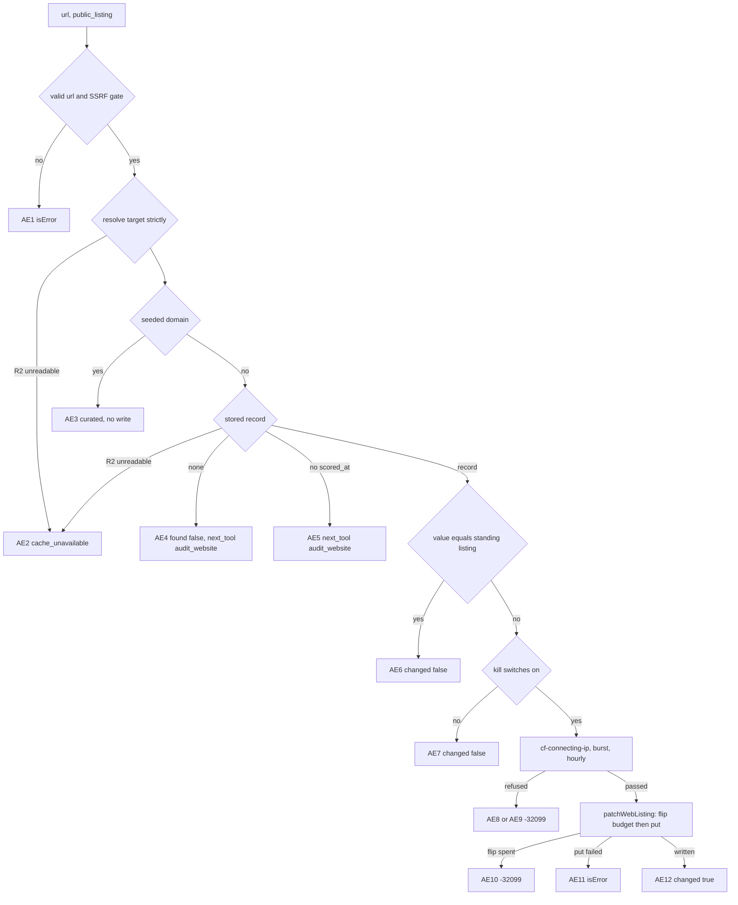
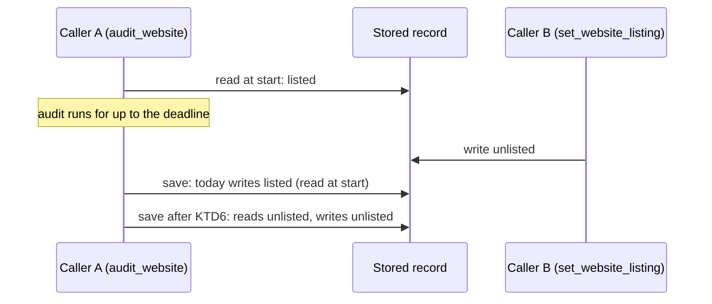

# Separate website audits from public-listing changes on the MCP server - Plan

## Goal Capsule

- **Objective:** an agent on anc.dev's MCP server can run or read a website audit without any way to change that site's public leaderboard listing as part of it. It changes a listing only through a tool whose name, input, description, and hints say that is all it does. When a user asks to list or unlist a site, the change lands and stays: an audit of the same site running at that moment does not undo it.
- **Means:** a new tool, `set_website_listing` (name pending D2), built on the existing listing-only write (KTD1 to KTD4, KTD7). `audit_website` drops `public_listing` and refuses a call that still sends it (KTD5, pending D3). An audit's save reads the stored listing when it writes rather than when it starts (KTD6).
- **Authority:** Product Contract requirements win on behavior, Key Technical Decisions win on mechanism, and units override neither. The owner decisions D2 to D5 bind both. Until the owner answers, each one's recommended option is the planning baseline, and the build does not start.
- **Execution profile:** code. One PR from a `feat/` branch cut from `dev` after #563 and the instructions-trim follow-up have merged. Units U1 to U5 land in that PR.
- **Stop conditions:**
  - #563 or the instructions trim lands with a different limit guard or instructions text than KTD8 and KTD10 assume. Re-measure the strings against what landed before building.
  - The write-time listing read (KTD6) cannot be placed without changing the listing an explicit browser request or the rescore writes. Stop and report.
  - The new tool's description cannot keep its purpose sentence and the explicit-request sentence inside the 2,048-byte window and the whole text inside #563's budget. Stop and report.
  - The owner picks an option for D2 to D5 that this plan does not describe. Re-plan the affected units before building.
- **Who finishes:** an agentnative-site session builds the PR, runs `ce-code-review`, `/devex-review`, and `/cso`, and hands it to Brett for merge approval to `dev`.

---

## Product Contract

### Summary

Add an MCP tool that changes one website's public leaderboard listing and does nothing else. Remove `public_listing` from `audit_website`, so an audit only runs or returns an audit and never changes the listing. Make an audit's save carry the listing stored when it writes, so a listing change made while an audit of the same site runs is not reverted. Update every surface that counts the tools or describes how the listing changes. The browser form and `POST /api/score` keep their listing checkbox unchanged.

### Problem Frame

`audit_website` combines two operations with different goals and safety boundaries. One is a live, open-world audit that contacts the site and the hosts it declares. The other is a persistent change to who appears on a public leaderboard, which the server takes from any caller without checking who owns the site (`src/worker/mcp/tools/web-audit.ts`, the flip-budget comment in the `audit_website` handler). A tool-design review flagged this against the published plugin guideline "Tool independence and exposure" (<https://developers.openai.com/plugins/plugin-guidelines#tool-independence-and-exposure>): "Expose each model-callable operation as a separate tool with a clear description, input schema, and annotations." Its fix: keep `audit_website` to running or retrieving the audit, and expose the opt-in and opt-out as a separate, narrowly scoped write tool that an agent calls only when the user explicitly asks to change a listing.

Today the combination also shapes when a listing can change. `decidePublicListingWrite` (`src/worker/audit-web/public-listing.ts`) applies a listing-only patch only while the stored audit is under `WEB_AUDIT_STALE_AFTER_MS` (60 seconds, `src/shared/audit-envelope.ts`). Past that, an explicit `public_listing` runs a full re-audit to change one boolean. The MCP patch path spends what an audit spends at the source: the `WEB_AUDIT_LIMITER_IP` burst unit and one unit of the shared 30-per-hour window, then one unit of the per-domain flip budget (5 per hour, `FLIP_CEILING` in `src/worker/audit-web/limiter.ts`).

Separating the write opens a race that the combination hid. While a stored audit is under 60 seconds old, a request with no listing choice is served from the cache, so no audit can be running when a patch lands. Once a listing change can land at any time, an audit that started earlier saves the listing it read when it started (`planSiteRecord`, `src/worker/audit-web/site-record.ts`) and silently undoes the change.

### Requirements

**The listing tool**

- R1. A new MCP tool changes one website's stored `public_listing` and nothing else: it runs no audit, sends no request to any host outside anc, and leaves the stored scorecard and its `scored_at` unchanged.
- R2. Its input is the site (`url`, read the way `get_website_audit` reads it, `www.` folds included) and the value (`public_listing`, a required boolean). It accepts no other argument.
- R3. It writes only over a stored audit that carries a `scored_at`. A site with no stored audit, or one without a stamp, gets an answer that points at `audit_website`, and nothing is written.
- R4. A value equal to the site's standing listing (the stored flag, or unlisted when none is stored) writes nothing and spends no limit unit.
- R5. A curated (seeded) site writes nothing and spends nothing; the answer says the site is always listed.
- R6. A change passes the gates today's MCP listing patch passes, in the same order: the kill switches, `cf-connecting-ip`, `WEB_AUDIT_LIMITER_IP`, the shared hourly window, then the per-domain flip budget (D5).
- R7. A change applies at any scorecard age. The answer gives the time the site's row leaves the board when it is listed, and points at `audit_website` when that time has passed.
- R8. Its description leads with what it does, then says to call it only when the user explicitly asks to change a site's listing. It also states the stored-audit precondition, what a change spends, and that anc does not check who owns the site (KTD8).
- R9. It declares `readOnlyHint: false`, `destructiveHint: true`, `idempotentHint: true`, and `openWorldHint: false` (KTD3).

**`audit_website` after the split**

- R10. `audit_website` never changes the stored listing. A first-ever audit saves the site unlisted, and every later audit it saves keeps the listing stored when it writes.
- R11. `audit_website` no longer accepts `public_listing`. A call that sends it is refused before any gate, audit, or limit spend, with an error that names the new tool (D3).
- R12. The `audit_website` description says an audit never changes the listing and names the new tool. The `follow_declarations` description drops its `public_listing` clause.

**Listing durability**

- R13. A save by any audit that carries no explicit listing choice keeps the listing stored at the moment it writes. This covers `audit_website` and the browser path's blank request, so a listing change is never undone by an audit that was already running.

**Surfaces**

- R14. Every surface that states the tool count or enumerates the tools states 14 and names the new tool: the server instructions, the build's `registered_tool_names`, `content/mcp-skill.md`, `content/_audit-web.md`, AGENTS.md, the release smoke and its runbooks, and the test pins (U4, U5).
- R15. Every surface that tells an agent how a listing changes points at the new tool, and none says `audit_website` takes `public_listing` (U5).
- R16. The browser path is unchanged: the form's listing checkbox, the `public_listing` field of `POST /api/score`, its `listing_requires_follow` refusal, and its listing patch.

### Key Decisions

- D1. **Split the listing change out of `audit_website` into its own tool.** (session-settled: user-directed: chosen over keeping `public_listing` on `audit_website`: the tool-design review found that the combined tool joins an open-world audit and a persistent public-listing write, which have different user goals and safety boundaries.) Governs R1, R10, R11.
- D2. **The tool's name.** Pending owner decision. Recommended: `set_website_listing`. It matches the website family's verb-first pattern (`get_website_audit`, `audit_website`, `list_website_audits`), and `set_` says it writes one stored value. The parameter keeps the scorecard's own field name, `public_listing`. Alternatives: `set_public_listing`, `update_website_listing`, `set_website_public_listing`. Governs R1, R11, R12, R14.
- D3. **What `audit_website` does with a caller that still sends `public_listing`.** Pending owner decision. Recommended: (b) refuse it with a tool error naming the new tool, with no transition window. Governs R11.
  - (a) Remove the parameter and do nothing else. The MCP SDK wraps a raw input shape in `z.object` (`normalizeRawShapeSchema` in `@modelcontextprotocol/server` 2.4.0), which strips unknown keys. A stale caller's opt-in would be dropped while its audit still runs and spends its budget, and the caller would believe it had opted in. Not recommended.
  - (b) Refuse it. A strict input object with a custom unknown-key message (KTD5) answers `isError: true` with text naming the new tool, before any gate runs. The advertised schema keeps `additionalProperties: false`, as today. Any other unknown key is refused too.
  - (c) Accept it for a stated window, then (b). The combined operation stays live for the window, and the window cannot be measured to its end: the `mcp.request` log carries no tool arguments, so nothing counts the callers still sending it.
- D4. **The published listing promises.** Pending owner decision. Recommended: accept these changes. Governs R3, R5, R7, R10.
  - "Omit to keep the current stored choice: a blank never erases a prior opt-in" (the `public_listing` parameter description) becomes "an audit never changes the site's leaderboard listing" on `audit_website`. This is stronger, since no `audit_website` call can change the listing.
  - "Defaults to off only on a domain's first-ever audit" holds as is and moves to the `audit_website` description.
  - One call no longer audits a site and lists it. A first listing takes `audit_website`, then the new tool.
  - A listing change applies at any scorecard age, where today it applies only within 60 seconds of an audit and otherwise re-audits.
  - On a curated site the tool writes nothing. Today `audit_website` writes the flag there, the board ignores it, and the next rescore resets it.
- D5. **No new rate limit, binding, or ownership rule.** Pending owner confirmation. Recommended: parity with today's MCP listing patch (R6). The tool takes no new binding, KV prefix, or kill switch, and it keeps the submitter-set model that `docs/plans/2026-08-07-001-feat-web-public-listing-opt-in-plan.md` (KD2) chose over ownership verification. Governs R6.
  - Parity holds the bound at the same level as today. The per-domain flip budget (5 per hour, keyed by the domain's hash) caps changes to any one site across all callers. One IP can change at most 30 sites an hour, through the shared hourly window. Today's re-audit route spends the same single hourly unit per change.
  - What changes is the server-side work per change: a patch instead of a full audit, and no request to the site's declared hosts.
  - Not recommended: a dedicated per-IP listing budget (a new KV prefix), a separate kill switch for listing changes (a new binding), or an ownership check, such as a DNS TXT record or a well-known file.

### Acceptance Examples

The new tool's answer in each state. "Spends" lists the units taken beyond `MCP_LIMITER`, which every call takes.

| ID | Given | Answer | `isError` | Writes | Spends |
| --- | --- | --- | --- | --- | --- |
| AE1 | invalid url, a scheme other than http(s), or a host the SSRF gate refuses | the reason text | true | nothing | nothing |
| AE2 | the site's record, or for `www.<domain>` the `<domain>` record, cannot be read | `cache_unavailable: ...; nothing was changed. Retry set_website_listing in 30 seconds.` | true | nothing | nothing |
| AE3 | curated site | `{ changed: false, curated: true, target, public_listing: true, board_url, scorecard_url, message }` | false | nothing | nothing |
| AE4 | no stored audit | `{ changed: false, found: false, next_tool: "audit_website", message }`, plus `in_progress: true, started_at` while an audit of the site runs | false | nothing | nothing |
| AE5 | stored audit with no `scored_at` | `{ changed: false, found: true, next_tool: "audit_website", message }` | false | nothing | nothing |
| AE6 | value equals the standing listing | the AE12 shape with `changed: false` | false | nothing | nothing |
| AE7 | `WEB_AUDIT_ENABLED` or `MCP_ENABLED` not `"true"` | `{ changed: false, target, public_listing: <standing>, message }` naming the operator switch | false | nothing | nothing |
| AE8 | no `cf-connecting-ip` | `-32099` text, the message `audit_website` uses | true | nothing | nothing |
| AE9 | burst limit refused, or hourly window full or contended | `-32099` text, the messages `audit_website` uses | true | nothing | the burst attempt; the burst unit for an hourly refusal |
| AE10 | flip budget spent for the domain | `-32099` text, `flip_rate_limited: ...` as today | true | nothing | burst and hourly units |
| AE11 | the R2 write fails | `failed to persist the public_listing change; nothing changed. Retry.` | true | nothing | burst, hourly, and flip units |
| AE12 | a change | `{ changed: true, target, public_listing, scored_at, listed_until, board_url, scorecard_url, message }`, plus `next_tool: "audit_website"` when `listed_until` has passed | false | the record body and its board metadata, one board-tag purge | burst, hourly, and flip units |

`target` is the resolved site (the bare domain for a folded `www.` host). `listed_until` is `scored_at` plus the board's display window (`WEB_ALL_BOARD_DISPLAY_MAX_AGE_MS`, 30 days) when `public_listing` is true, and null when it is false.

### Scope Boundaries

- Not changed: the browser path (R16), the rescore and the reflow (they derive the listing from the seed and pass it as an explicit choice), and the backfill.
- Not changed: the board predicate (`isBoardListable`), the board's display window, and the purge scope of a listing write. The write purges the board tag, as today's patch does. Neither per-site page renders the flag.
- Not changed: the WebMCP page tools. None mirrors `audit_website` or writes the listing. `get_page_state` reads the browser form's checkbox, which stays.
- Not changed: `CONCEPTS.md`. Its "Public listing" entry stays accurate.
- Not changed: the discovery cards and the AI catalog. Neither lists tools; the served cards carry only `capabilities.tools.listChanged: false`, read from `https://anc.dev/mcp/server-card` and `/.well-known/mcp/server-card.json` on 2026-11-11.
- Considered and not built: refusing a listing change while an audit of the site is in flight. The in-flight flag is a dedup hint on eventually consistent KV that `src/worker/audit/inflight.ts` declares "never a gate". It would refuse a change made right after `audit_website` returned, because the deleted flag can still read as present. KTD6 closes the race at the write instead. A report of a reverted change after KTD6 ships would reopen this.
- Considered and not built: a structured log record per listing change. Today's MCP patch writes none either, and the `mcp.request` line already records each call's outcome. A report of listing churn on one domain that the request log cannot explain would change this.
- Considered and not built: returning the whole scorecard envelope from the new tool. `get_website_audit` serves it, and the tool's answer carries `scorecard_url`.

### Findings on the other twelve tools

Each tool was checked against the same guideline for a second state-changing operation folded into it. These are findings only. None is in this plan's scope.

- `list_tools`, `get_tool`, `search_tools`, `list_principles`, `get_principle`, `list_spec_sections`, `get_spec_section`, and `get_web_remediation`: each reads anc's own data and writes nothing. No finding.
- `get_scorecard`, `get_website_audit`, and `list_website_audits`: each reads, and each may evict a cache entry that cannot be parsed. The eviction is not an operation a caller can ask for, and `docs/solutions/conventions/audit-every-callee-before-declaring-mcp-tool-behavior-hints.md` records it. No finding.
- `score_cli`: one operation, auditing a CLI and saving the result. Finding: `bypass_cache` is a release-smoke switch that only staging honors. Every client still sees it in the schema, and production ignores it silently. It changes no stored state, so it is not a second state-changing operation.
- `audit_website` after the split: one operation, auditing a site and saving the result. Saving also deletes a folded `www.` sibling's record, rebuilds the curated aggregates for a seeded site, purges page tags, and asks for a share clip. Each of these follows from saving one audit, and none has a goal of its own. Finding: the sibling delete is the one destructive effect under `destructiveHint: false`. The owner decided to keep `false` (recorded in the same convention doc).

### Success Criteria

- On staging, `tools/list` lists 14 tools. The new tool carries the R9 hints and `audit_website` has no `public_listing` property.
- A re-run of the tool-design review on staging reports no tool that combines an audit with a listing change.

---

## Planning Contract

### Key Technical Decisions

- KTD1. **The tool lives in its own module, `src/worker/mcp/tools/web-listing.ts`, registered right after the website audit tools.** `tools/list` order becomes `... list_website_audits, set_website_listing, get_web_remediation`, and that order is what `EXPECTED_TOOL_NAMES` pins. `web-audit.ts` is 491 lines and owns the audit; the listing write is a different responsibility.
- KTD2. **The write reuses `patchWebListing` (`src/worker/audit-web/core.ts`), the function the browser patch calls.** It meters the per-domain flip budget, rewrites the body and the board metadata in one `scored_at`-preserving put, and queues the board-tag purge. Both surfaces therefore keep one write and one budget. The tool builds the patch input itself (the standing listing differs from the request) instead of calling `decidePublicListingWrite`. That function's 60-second staleness rule chooses a re-audit, and this tool never audits. It compares against `standingPublicListing`, so a record with no stored flag and a request for `false` is a no-op, as the board already reads a missing flag as unlisted.
- KTD3. **Hints, argued from what the tool does** (definitions from `ToolAnnotations` in the MCP SDK's `spec.types.d.ts`):
  - `readOnlyHint: false`. A change rewrites the stored R2 object, both its body and its board metadata, and takes KV counter units.
  - `destructiveHint: true`. The spec reserves `false` for a tool that "performs only additive updates". This tool overwrites the stored choice in place, keeps no prior value, and can take a site off a public board. A client that asks before a destructive call then asks before this one, which fits R8. `audit_website` keeps `false` by an owner decision about its fold delete, which moves data into the bare record rather than replacing a choice.
  - `idempotentHint: true`. A repeat call with the same arguments finds the value already stored, writes nothing, and spends nothing (R4).
  - `openWorldHint: false`. Every callee reaches only anc's own bindings: R2 reads and the one put (`getForRequest`, `patchStoredScorecard`), KV (`readInFlight`, the hourly window, the flip budget), the rate-limit binding, the asset binding (`loadWebSeed`), and the purge RPC to anc's own cached entrypoint. `prepareWebTarget` validates synchronously, with no DNS lookup. No callee calls `fetch` to an outside host. The leaf check follows `docs/solutions/conventions/audit-every-callee-before-declaring-mcp-tool-behavior-hints.md`.
- KTD4. **Reads first, gates only for a change.** Order: validate the url, resolve the target strictly, check the seed, read the record strictly, answer a miss or a missing stamp, answer a no-op, then apply the gates in the R6 order and write. Every answer before the gates costs what `get_website_audit` costs. The record read uses `getForRequest`, so an R2 failure answers AE2 rather than a miss that would send the agent to run a needless audit. A seed that fails to load counts as not curated. A write on a seeded domain has no board effect and the next rescore resets it, so that fallback cannot list or unlist anything.
- KTD5. **`audit_website` takes a strict input object** (D3, recommended option). Its schema becomes a `z.strictObject` with an `error` callback that, for an `unrecognized_keys` issue naming `public_listing`, returns the message in U2. The SDK's `validateToolInput` turns the failure into `isError: true` with "Input validation error: Invalid arguments for tool audit_website: ..." before the handler runs, so nothing is spent. A probe with zod 4.6.7 confirmed the custom message on `public_listing`, the default message on another unknown key, and `additionalProperties: false` in the emitted JSON Schema. The new tool takes a strict object too, so its two-argument contract (R2) is enforced, not just advertised.
- KTD6. **`planSiteRecord` takes the listing from the stored record when the request carries no explicit choice** (R13). For `explicit === undefined`, the listing written is the one on the record being replaced, read when the save is planned, and `input.listing` applies only when no record exists then. The folded-pair branch already reads the bare host's record at save time; the plain branch and the unfolded-pair branch gain the same read, at one R2 GET per blank save. An explicit choice (the browser form, the rescore's seed-derived value) is written as given. The window left is the time between that read and the put, in milliseconds, against an audit-length window today.
- KTD7. **Answers follow the server's existing conventions.** Cache and store states, the no-op, the curated site, and the kill switch answer `isError: false` with data. A refused source or limit answers `isError: true` with `-32099` text, through the same helper and messages `audit_website` uses. A failed read or write answers `isError: true` with a retry. The result helpers, the `-32099` messages, `siteTarget`, and the `cache_unavailable` text are shared with `web-audit.ts`, not copied.
- KTD8. **Description and parameter text, as served at `https://anc.dev`.** Numbers come from constants: `HOURLY_AUDIT_CEILING` and `FLIP_CEILING` become exports of `limiter.ts`, the 30 days derive from `WEB_ALL_BOARD_DISPLAY_MAX_AGE_MS`, and the board path comes from `leaderboardPath({ lane: 'web', view: 'all' })`. The description is 1,093 bytes, all ASCII, with no origin interpolated. The purpose sentence ends at character 119 and the explicit-request sentence at 229, inside #563's 2,048-byte window and its 4,096-character budget.
  - Description: "Opt a website in to or out of the public website leaderboard at /scorecards?lane=web&view=all, and change nothing else. Call it only when the user explicitly asks to list or unlist a site; audit_website never changes the listing. The site needs a stored audit: on a miss the answer is { changed: false, found: false, next_tool: "audit_website" }. Sending the value already stored writes nothing and spends nothing. A change rewrites only the stored listing, keeping the scorecard and its scored_at, and spends the per-IP burst limit, one of the 30 fresh audits per 60 minutes per IP that audit_website also draws on, and one of 5 listing changes per hour per site across all callers; a breach, or a request without cf-connecting-ip, returns isError: true with a JSON-RPC -32099 error in the text. anc does not check who owns the site. A curated site is always listed and is not changed. The leaderboard shows an opted-in site while its scorecard is under 30 days old. When WEB_AUDIT_ENABLED or MCP_ENABLED is not "true" nothing is written, and the answer is isError: false with changed: false."
  - `url`: "The website URL or bare domain whose listing to change, e.g. "anc.dev"; read at its https origin. www.<domain> changes the <domain> listing when that scorecard records that one of the two hosts redirects to the other (its site_hosts lists both); otherwise www.<domain> is its own site."
  - `public_listing`: "true lists the site on the public website leaderboard; false removes it from the leaderboard. Required."
  - Title: "Set a website's public listing".
- KTD9. **The `audit_website` text.** One sentence goes directly after `FOLLOW_DISCLOSURE_SHORT`, which keeps #563's placement test true: "An audit never changes the site's leaderboard listing: a first audit saves the site unlisted, and later audits keep the stored choice; set_website_listing changes it." The description grows from 1,476 to 1,643 bytes at #563's head (`27ba6e3`). The `follow_declarations` description ends at "...and it carries no scorecard_url, markdown_url, or json_url."
- KTD10. **The server instructions name the new tool once, in the browse line,** after the instructions trim lands. That line is the instructions' routing index. One clause goes after `list_website_audits;` and keeps the pinned prefix "Browse the CLI registry with list_tools, search_tools, and get_tool, and the web leaderboard with list_website_audits" whole: "change a site's leaderboard listing with set_website_listing, only when the user asks;". The count reads 14 and the shared limit stays in paragraph 2. Measured on the trim text (`.context/triage/server-instructions-shared-guidance.md` in the prime checkout): 1,717 bytes at `https://anc.dev` and 1,811 at the longest origin (`https://agentnative-site-staging.brettdavies.workers.dev:65535`), against 1,630 and 1,724 without the change. The clause ends at 1,389 and 1,436, after the short disclosure (1,182 and 1,229).
- KTD11. **The test pins take one annotation map per tool.** `NON_READ_TOOL_NAMES` in `tests/helpers/mcp-tools.ts` encodes two shapes, and the new tool is a third (a write with no outside host). It becomes `EXPECTED_TOOL_ANNOTATIONS`, a record from tool name to the exact hints object, read by `tests/worker-mcp.test.ts` and `tests/e2e/mcp.e2e.ts`.

### High-Level Technical Design

The new tool's path. Reads come first; units are spent only on the way to a write.

The race KTD6 closes. Today the audit writes the listing it read at the start.

### Assumptions

- #563 merges with the limit records and guard as at `27ba6e3`, and the instructions-trim follow-up merges with the text in `.context/triage/server-instructions-shared-guidance.md` before this build starts.
- Few callers send `public_listing` to `audit_website`. Nothing measures this, since the request log carries no tool arguments.
- Clients cache the modern `tools/list` for up to an hour (`ttlMs` 3,600,000). A client holding the 13-tool list after deploy can still call the new tool by name, and an `audit_website` call carrying `public_listing` gets the D3 refusal that names it.

### Risks & Dependencies

- Depends on #563 for `src/worker/mcp/client-limits.ts` and `tests/mcp-client-limits.test.ts`, which hold the new description inside the recorded limits, and on the instructions trim for the browse line KTD10 edits.
- Breaking change for `audit_website` callers that send `public_listing` (D3). The refusal names the replacement, and the PR's changelog states it.
- Production lags staging until the next release, so `anc.dev` serves 13 tools after the `dev` merge. The production sweep in `.github/workflows/mcp-sweep.yml` checks out `main`'s `mcp-smoke.sh`, so it keeps expecting 13 until the release carries both.
- A listing change made while an explicit browser audit of the same site runs is still overwritten when that audit saves, because an explicit choice is written as given (KTD6). Both are explicit choices, the last save wins as it does today, and the flip budget bounds the churn.

### Deferred to Implementation

- Where the shared result helpers and `-32099` messages live (KTD7): exported from `web-audit.ts` or moved to a small sibling module.
- The exact message strings for AE3 to AE7 and AE12.
- Whether the existing listing tests in `tests/web-audit-mcp-tools.test.ts` convert in place or move with their helpers.

### Sources & Research

- `src/worker/mcp/tools/web-audit.ts` (the `audit_website` handler), `src/worker/audit-web/public-listing.ts`, `src/worker/audit-web/core.ts` (`readWebTier`, `patchWebListing`, `runWebAuditStream`), `src/worker/audit-web/site-record.ts` (`planSiteRecord`), `src/worker/audit-web/cache.ts` (`getForRequest`, `patchStoredScorecard`, `boardMetadataOf`, `isBoardListable`, `listAllWebAudits`), `src/worker/audit-web/limiter.ts`, `src/worker/audit-web/web-target.ts` (`resolveWebTarget`), `src/worker/audit/api.ts` (`handleWeb`), `src/worker/audit-web/rescore-workflow.ts` (`auditDomainToCache`), `src/worker/audit/inflight.ts`.
- #563 at `27ba6e3`: `src/worker/mcp/client-limits.ts`, `tests/mcp-client-limits.test.ts`, and the `audit_website` text.
- `docs/plans/2026-08-07-001-feat-web-public-listing-opt-in-plan.md`: KD2 (submitter-set, no ownership verification), KTD8 (the per-domain flip budget), R3 (the write semantics this plan replaces on the MCP surface).
- `docs/solutions/conventions/audit-every-callee-before-declaring-mcp-tool-behavior-hints.md`, `docs/solutions/best-practices/mcp-clients-cut-instructions-and-tool-descriptions-at-versioned-lengths.md`, `docs/solutions/design-patterns/carry-forward-stored-stateful-flags-through-a-rebuild-write-path.md` (the same class of revert, on the rescore path).
- MCP SDK 2.4.0: `normalizeRawShapeSchema` and `validateToolInput` in `@modelcontextprotocol/server`; `ToolAnnotations` in `@modelcontextprotocol/sdk`'s `spec.types.d.ts`.

---

## Implementation Units

### U1. The listing tool

- **Goal:** register the new tool with the R2 input, the KTD4 path, the AE1 to AE12 answers, the KTD8 text, and the KTD3 hints.
- **Requirements:** R1 to R9, D2, D5.
- **Dependencies:** none.
- **Files:**
  - Create `src/worker/mcp/tools/web-listing.ts`.
  - Modify `src/worker/mcp/tools/index.ts` (registration after `registerWebAuditTools`), `src/worker/audit-web/limiter.ts` (export `HOURLY_AUDIT_CEILING` and `FLIP_CEILING`), and `src/worker/mcp/tools/web-audit.ts` (the shared helpers, KTD7).
  - Test `tests/web-audit-mcp-tools.test.ts`. This seam drives the real MCP handler with in-memory R2, KV, and limiter fakes, so it catches gate order and stored bytes. It misses the deployed bindings, which the staging e2e covers.
- **Approach:**
  1. Resolve and read as KTD4 orders, reusing `siteTarget`, `resolveWebTarget(..., 'strict')`, `getForRequest`, `isSeededDomain`, and `readInFlight` (AE4's `in_progress`).
  2. Compare the request against `standingPublicListing` (KTD2).
  3. Apply the gates in the R6 order, with the same calls and messages as the `audit_website` handler.
  4. Write through `patchWebListing`, mapping `flip_rate_limited` to AE10 and `patch_failed` to AE11.
  5. Build AE12 from the patched record, with `listed_until` from `WEB_ALL_BOARD_DISPLAY_MAX_AGE_MS`.
- **Patterns to follow:** the `audit_website` handler's gate block and the `get_website_audit` handler's resolve and read (`src/worker/mcp/tools/web-audit.ts`). Today's `audit_website public_listing` and flip-budget describe blocks hold the seed and env helpers.
- **Test scenarios:**
  - Covers AE12. A record stored unlisted and 10 minutes old, request `true`: `changed: true`. The stored body and the board metadata both read listed, `scored_at` and every other scorecard byte are unchanged, one board-tag purge is queued, and no outbound request is made.
  - Covers AE12. A record 31 days old, request `true`: written, `listed_until` is in the past, and the answer carries `next_tool: "audit_website"`.
  - Covers AE6. Request equal to the stored value: `changed: false`, the store is untouched, and the burst limiter, the hourly window, and the flip budget each record zero takes.
  - Covers AE6. A record with no flag key, request `false`: no write.
  - Covers AE4. No record: `found: false` and `next_tool: "audit_website"`, with nothing written or spent. With an in-flight flag present, the answer also carries `in_progress: true` and `started_at`.
  - Covers AE5. A record without `scored_at`: `found: true`, `next_tool: "audit_website"`, and no write.
  - Covers AE3. A seeded domain: `curated: true` and no write or spend.
  - `www.example.com` with the fold recorded on `example.com`: the `example.com` record changes and `target` is `example.com`. A `www.` host with no fold and no record of its own answers AE4.
  - Covers AE2. The `<domain>` record behind a `www.` host, or the site's own record, fails to read: `cache_unavailable`, and nothing is written.
  - Covers AE7. `WEB_AUDIT_ENABLED` unset: `changed: false`, store untouched, and nothing spent.
  - Covers AE8, AE9. Missing `cf-connecting-ip`, a refused burst limiter, a full hourly window, and a contended hourly window each answer `-32099` with the message `audit_website` gives for the same refusal, and nothing is written.
  - Covers AE10. Five changes on one domain succeed and the sixth answers `flip_rate_limited` with no write. A flip budget spent through the shared meter (`enforcePublicListingFlipLimit`) blocks the tool for that domain.
  - Covers AE11. The R2 put fails: `isError: true`, the text says nothing changed, and no success fields appear.
  - Input: a missing `public_listing`, a non-boolean `public_listing`, and an extra key (`site_type`) are each refused by input validation, and nothing is written.
  - Two identical calls in a row: the second answers `changed: false` and takes no units (R4, the `idempotentHint` claim).
  - The served description starts with its purpose sentence followed by "Call it only when the user explicitly asks". Its numbers equal `HOURLY_AUDIT_CEILING`, `FLIP_CEILING`, and the display window in days.
- **Verification:** every scenario passes, and the #563 limit guard passes with the new tool in `EXPECTED_TOOL_NAMES`.

### U2. `audit_website` without the listing

- **Goal:** `audit_website` runs or returns an audit only (R10 to R12).
- **Requirements:** R10, R11, R12, D3, D4.
- **Dependencies:** U1, whose name the refusal and the description cite.
- **Files:**
  - Modify `src/worker/mcp/tools/web-audit.ts`.
  - Test `tests/web-audit-mcp-tools.test.ts`.
- **Approach:**
  1. Replace the raw input shape with the KTD5 strict object, without `public_listing`. Refusal message: "public_listing is not an audit_website argument: an audit never changes the leaderboard listing. To change it, call set_website_listing with the same url."
  2. Remove the listing branches from the handler: the `decidePublicListingWrite` call, the `follow_declarations: false` listing refusal, the flip-budget call, and the patch path. Every non-transient call may attach to a run in flight. A fresh audit carries `standingPublicListing(cached)` as its listing, with no explicit choice.
  3. Apply the KTD9 text.
  4. Update the file's header comment to the tool's present behavior.
- **Execution note:** write the refusal scenario first and record its failure against the unchanged handler. Today that call patches or audits, so the scenario fails on the stored bytes.
- **Patterns to follow:** the `site_type` input-validation test in the same file.
- **Test scenarios:**
  - `public_listing: true` on a fresh record stored unlisted: `isError: true`, the text names `set_website_listing`, the store is unchanged, and no limiter, hourly, or flip unit is taken.
  - `public_listing: false` on a stale record: the same refusal, and no outbound request is made.
  - An unknown key other than `public_listing` (`siteType`): refused by input validation.
  - A stale record stored listed, blank call: the saved scorecard is still listed and the board metadata reads `"true"`.
  - A first-ever audit: saved unlisted.
  - A fresh record: served from the cache, unchanged.
  - `follow_declarations: false`: a transient result, unsaved, as today.
  - `tools/list`: the `audit_website` input schema has no `public_listing` property and keeps `additionalProperties: false`. Its description contains the KTD9 sentence directly after the short disclosure.
  - The listing scenarios of today's `audit_website public_listing` and flip-budget blocks either move to U1 or are deleted when they assert `audit_website` patch behavior.
- **Verification:** the refusal scenario's failure on the unchanged handler is quoted in the PR, and every scenario passes on the change.

### U3. Write-time listing for audits with no explicit choice

- **Goal:** an audit's save keeps the listing stored when it writes (R13, KTD6).
- **Requirements:** R10, R13.
- **Dependencies:** none.
- **Files:**
  - Modify `src/worker/audit-web/site-record.ts`.
  - Test `tests/web-audit-site-fold-api.test.ts` for `planSiteRecord` (a direct call catches the planned listing but not the bytes `runWebAuditStream` saves), and `tests/web-audit-mcp-tools.test.ts` for the end-to-end save.
- **Approach:** in `planSiteRecord`, resolve the listing for `explicit === undefined` from the record being replaced, read when the save is planned, on every branch. The folded branch keeps its read order (the bare host, then the `www.` host, then unlisted).
- **Execution note:** test-first. Record the first scenario's failure against the unchanged `planSiteRecord` before the fix.
- **Test scenarios:**
  - `planSiteRecord` with `listing: true`, no explicit choice, and the store holding the same site unlisted: the planned listing is `false`.
  - The same with `explicit: true` and the store unlisted: the planned listing is `true`.
  - No stored record at save time: the planned listing is `input.listing`.
  - The existing folded-pair listing scenarios pass unchanged.
  - End to end: a stale record stored listed, then a blank `audit_website` whose stubbed fetch rewrites the stored record to unlisted on its first request. The saved scorecard and its board metadata read unlisted.
  - The rescore of a seeded domain still saves it listed.
- **Verification:** the first scenario's pre-fix failure is quoted in the PR, and all pass after.

### U4. Tool-surface pins and the release smoke

- **Goal:** every machine-checked statement of the tool surface names 14 tools and the new tool (R14).
- **Requirements:** R9, R14.
- **Dependencies:** U1.
- **Files:**
  - Modify `tests/helpers/mcp-tools.ts` (the name in `EXPECTED_TOOL_NAMES` after `list_website_audits`, its title, KTD11).
  - Modify `tests/worker-mcp.test.ts`, `tests/e2e/mcp.e2e.ts`, `src/build/11-mcp-catalog.mjs` (`registered_tool_names`), and `src/worker/mcp/instructions.ts` (`TOOL_COUNT`, KTD10).
  - Modify the web-tool lists in `tests/web-audit-mcp-tools.test.ts` and `tests/e2e/discoverability.e2e.ts`, and the `SUBMISSION_TOOLS` list in `tests/e2e/web-audit.e2e.ts`, which must never reach a WebMCP result page.
  - Modify `scripts/release/mcp-smoke.sh` (the header line and checks 3 and 5). Keep the script's own indentation; the editor's shell formatter rewrites it on save.
- **Approach:** update each pin to the new surface. The instructions test that pins the browse prefix keeps passing unchanged, and one new assertion pins the KTD10 clause.
- **Test scenarios:**
  - `tools/list` returns the 14 names in order, with titles and exact hints from the KTD11 map, on both protocol eras.
  - `tests/build-mcp-catalog.test.ts`: `registered_tool_names` equals the served names.
  - The instructions contain "14 tools" and the KTD10 clause, and #563's order tests still pass.
- **Verification:** `bun test` passes, and `scripts/release/mcp-smoke.sh --core-only` against the local Worker reports 14 tools.

### U5. Published and operator prose

- **Goal:** the published guide, the audit page, the schema page, AGENTS.md, and the runbooks describe the split (R14, R15).
- **Requirements:** R14, R15, D4.
- **Dependencies:** U1, U2.
- **Files:**
  - `content/mcp-skill.md`: the count in the intro, a bullet for the new tool under the website audit tools, the `audit_website` bullet without its `public_listing` clause, and the tool-metadata paragraph naming the new tool's hints.
  - `content/_audit-web.md`: "five web tools", and the `audit_website` signature without `public_listing`.
  - `content/web-scorecard-schema.md`: the `public_listing` field row says the audit form or the new tool sets it.
  - `AGENTS.md`: the tool count and list, the rate-limit paragraph, and the `WEB_AUDIT_ENABLED` line, which now also stops listing changes.
  - `docs/runbooks/mcp-operator.md` (the smoke expectation), `docs/runbooks/mcp-wire-protocol.md` (tools that return `-32099` inside a result), `docs/runbooks/web-audit-operations.md` (the `WEB_AUDIT_ENABLED` row), `RELEASES-PREFLIGHT.md`, and `RELEASES-POSTFLIGHT.md` (the tool count).
  - Source comments that name the tools keying `WEB_AUDIT_LIMITER_IP` or the listing's inbound surfaces: `src/worker/audit-web/public-listing.ts`, `src/worker/index.ts`, and `wrangler.jsonc`.
- **Approach:** state present behavior only, per the comment and doc rules in AGENTS.md.
- **Test expectation:** none beyond the drift pins U4 updates. `tests/e2e/discoverability.e2e.ts` checks that `mcp-skill.md` names every tool in `EXPECTED_TOOL_NAMES`.
- **Verification:** `rg -n "public_listing" content AGENTS.md docs/runbooks` shows no line telling an MCP caller to send it to `audit_website`. The repo's prose gate passes on each changed markdown file.

---

## Verification Contract

| Gate | Command or check | Proves |
| --- | --- | --- |
| Lint and types | `bun run lint`, `bun run typecheck` | style, types, and knip reachability of the new module and exports |
| Build first | `bun run build` | `dist/` and the catalog match the branch before tests read them (AGENTS.md gate order) |
| Unit | `bun test` | U1 to U4 scenarios, the #563 limit guard, and the moved pins |
| Observed failing | the U2 refusal scenario and the first U3 scenario against the unchanged code, with output quoted in the PR | the tests detect the behavior they exist for |
| Local Worker | `bun run dev` with `MCP_ENABLED="true"` in `.dev.vars.staging`; `tools/list`, then `audit_website` on a public site and `set_website_listing` on it, then `GET /scorecards?lane=web&view=all` with `Accept: text/html` | the served tool surface, a real listing change, and the board row it controls |
| Release smoke | `scripts/release/mcp-smoke.sh --core-only http://localhost:8787` | the smoke's count matches the served surface |
| Staging | `tests/e2e/mcp.e2e.ts`, `tests/e2e/discoverability.e2e.ts`, and the release smoke after the `dev` deploy | the deployed surface and the published guide |
| Reviews | `ce-code-review`, `/devex-review`, and `/cso`, one round each on Opus, verdicts in PR comments | code and prose; the new tool, its output, and the changed parameter; an unauthenticated write to public state |

## Definition of Done

- R1 to R16 hold, each covered by a U1 to U4 scenario, the local Worker run, or the U5 check.
- D2 to D5 carry the owner's answers, and the code matches them.
- The PR's `## Changelog` reads: "Added: the `set_website_listing` MCP tool, which opts a site in to or out of the public website leaderboard and does nothing else." and "Changed: `audit_website` no longer accepts `public_listing`; a call that sends it is refused with a pointer to `set_website_listing`, and an audit never changes a site's listing."
- No code from abandoned approaches remains in the diff, and no scratch file is left in the tree.

---

## Review log

- 2026-11-11: plan written.
