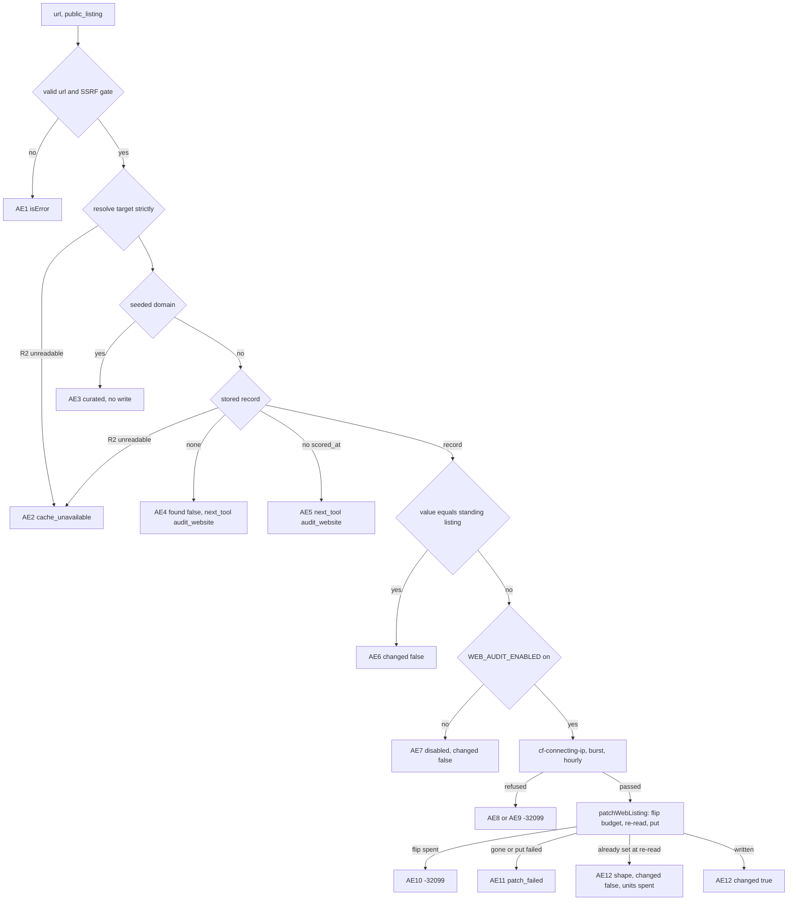
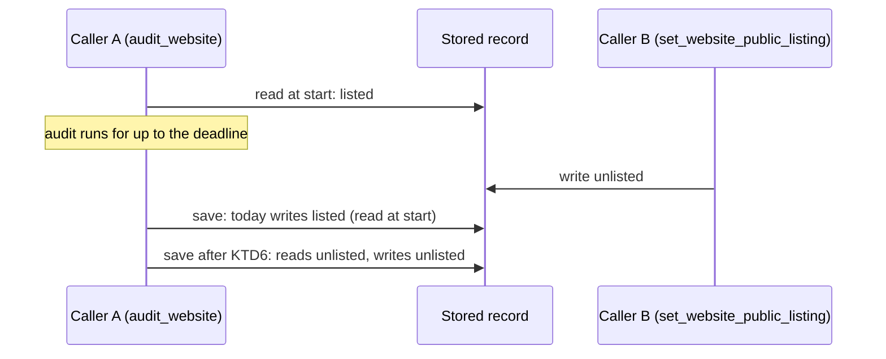
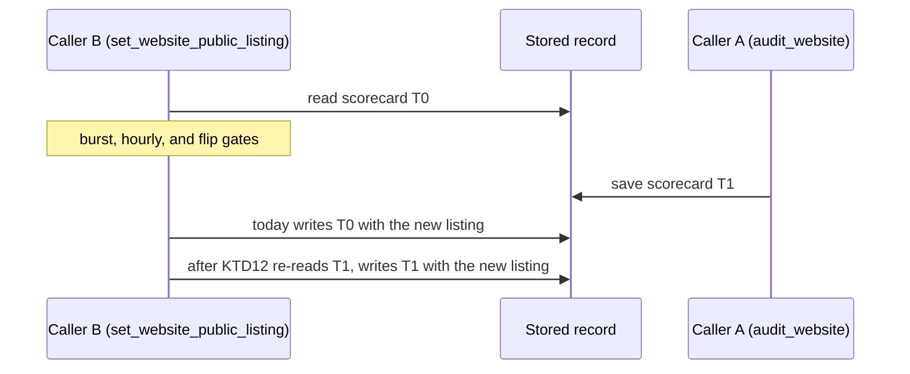

# Separate website audits from public-listing changes on the MCP server - Plan

## Goal Capsule

- **Objective:** an agent on anc.dev's MCP server can run or read a website audit without any way to change that site's public leaderboard listing as part of it. It changes a listing only through a tool whose name, input, description, and hints say that is all it does. When a user asks to list or unlist a site, the change lands and stays: an audit of the same site that carries no listing choice of its own does not undo it, and the change does not undo an audit saved while it waited on its rate limits.
- **Means:** a new tool, `set_website_public_listing` (D2), built on the existing listing-only write (KTD1 to KTD4, KTD7). `audit_website` drops `public_listing` and refuses a call that still sends it (KTD5, D3). An audit's save reads the stored listing when it writes rather than when it starts (KTD6), and the listing write patches the record as it stands after the rate limits pass (KTD12).
- **Authority:** Product Contract requirements win on behavior, Key Technical Decisions win on mechanism, and units override neither. The owner decisions D2 to D5 bind both.
- **Execution profile:** code. One PR from a `feat/` branch cut from `dev` after the instructions-trim follow-up to #563 has merged. #563 merged as `aa0537d`, and the trim as #564 (`e20fe17`). Units U1 to U5 land in that PR.
- **Stop conditions:**
  - The instructions trim lands with text other than what KTD10 measures. Re-measure KTD10 against what landed before building.
  - The instructions trim has not merged when the rest of the build is ready. Leave the KTD10 clause out and change only the count, which keeps the same length. On #563's merged text the clause brings the instructions to 2,069 characters at `https://anc.dev`, past the 2,048-character cut that `src/worker/mcp/client-limits.ts` records (`claude-code-all-2048`). The clause then waits for the trim.
  - The write-time listing read (KTD6) cannot be placed without changing the listing an explicit browser request or the rescore writes. Stop and report.
  - The new tool's description cannot keep its purpose sentence and the explicit-request sentence inside the 2,048-byte window and the whole text inside #563's budget. Stop and report.
  - The owner picks an option for D2 to D5 that this plan does not describe. Re-plan the affected units before building.
- **Who finishes:** an agentnative-site session builds the PR, runs `ce-code-review`, `/devex-review`, and `/cso`, and hands it to Brett for merge approval to `dev`.

---

## Product Contract

### Summary

Add an MCP tool that changes one website's public leaderboard listing and does nothing else. Remove `public_listing` from `audit_website`, so an audit only runs or returns an audit and never changes the listing. Make an audit's save carry the listing stored when it writes, so a listing change made while an audit of the same site runs is not reverted, and make the listing write patch the record as it stands after its rate limits, so an audit saved while the change waited is not reverted either. Update every surface that counts the tools or describes how the listing changes. The browser form and `POST /api/score` keep their listing checkbox unchanged.

### Problem Frame

`audit_website` combines two operations with different goals and safety boundaries. One is a live, open-world audit that contacts the site and the hosts it declares. The other is a persistent change to who appears on a public leaderboard, which the server takes from any caller without checking who owns the site (`src/worker/mcp/tools/web-audit.ts`, the flip-budget comment in the `audit_website` handler). A tool-design review flagged this against the published plugin guideline "Tool independence and exposure" (<https://developers.openai.com/plugins/plugin-guidelines#tool-independence-and-exposure>): "Expose each model-callable operation as a separate tool with a clear description, input schema, and annotations." Its fix: keep `audit_website` to running or retrieving the audit, and expose the opt-in and opt-out as a separate, narrowly scoped write tool that an agent calls only when the user explicitly asks to change a listing.

Today the combination also shapes when a listing can change. `decidePublicListingWrite` (`src/worker/audit-web/public-listing.ts`) applies a listing-only patch only while the stored audit is under `WEB_AUDIT_STALE_AFTER_MS` (60 seconds, `src/shared/audit-envelope.ts`). Past that, an explicit `public_listing` runs a full re-audit to change one boolean. The MCP patch path spends what an audit spends at the source: the `WEB_AUDIT_LIMITER_IP` burst unit and one unit of the shared 30-per-hour window, then one unit of the per-domain flip budget (5 per hour, `FLIP_CEILING` in `src/worker/audit-web/limiter.ts`).

Separating the write opens a race that the combination hid. While a stored audit is under 60 seconds old, a request with no listing choice is served from the cache, so no audit can be running when a patch lands. Once a listing change can land at any time, an audit that started earlier saves the listing it read when it started (`planSiteRecord`, `src/worker/audit-web/site-record.ts`) and silently undoes the change. The reverse case opens too. The listing write patches the record it read before its rate-limit gates, and two of those gates are KV read-then-write pairs that can wait 1.1 seconds on contention (`src/worker/audit-web/limiter.ts`). An audit saved in that gap would be replaced by the older scorecard and its older `scored_at`.

### Requirements

**The listing tool**

- R1. A new MCP tool changes one website's stored `public_listing` and nothing else: it runs no audit, sends no request to any host outside anc, and leaves the stored scorecard and its `scored_at` unchanged.
- R2. Its input is the site (`url`, read the way `get_website_audit` reads it, `www.` folds included) and the value (`public_listing`, a required boolean). It accepts no other argument.
- R3. It writes only over a stored audit that carries a `scored_at`. A site with no stored audit, or one without a stamp, gets an answer that points at `audit_website`, and nothing is written.
- R4. A value equal to the site's standing listing (the stored flag, or unlisted when none is stored) writes nothing and spends no limit unit.
- R5. A curated (seeded) site writes nothing and spends nothing; the answer says the site is always listed.
- R6. A change passes the gates today's MCP listing patch passes, in the same order: the kill switches, `cf-connecting-ip`, `WEB_AUDIT_LIMITER_IP`, the shared hourly window, then the per-domain flip budget (D5).
- R7. A change applies at any scorecard age. The answer gives the time the site's row leaves the board when it is listed, and points at `audit_website` when that time has passed.
- R8. Its description leads with what it does, then says to call it only when the user explicitly asks to change a site's listing. It also states the stored-audit precondition, what a change spends, and that anc does not check who owns the site (KTD8).
- R9. It declares `readOnlyHint: false`, `destructiveHint: true`, `idempotentHint: true`, and `openWorldHint: false` (KTD3).

**`audit_website` after the split**

- R10. `audit_website` never changes the stored listing. A first-ever audit saves the site unlisted, and every later audit it saves keeps the listing stored when it writes.
- R11. `audit_website` no longer accepts `public_listing`. A call that sends it is refused before any gate, audit, or limit spend, with an error that names the new tool and says how to run the audit without it (D3). Any other argument it does not declare is refused the same way.
- R12. The `audit_website` description says an audit never changes the listing and names the new tool. The `follow_declarations` description drops its `public_listing` clause.

**Listing durability**

- R13. A save by any audit that carries no explicit listing choice keeps the listing stored at the moment it writes, in the saved scorecard and its board metadata. This covers `audit_website` and the browser path's blank request, so a listing change is never undone by an audit that was already running.
- R17. A listing change patches the record as stored once its gates have passed, so an audit saved while the change waited keeps its scorecard and `scored_at`.

**Surfaces**

- R14. Every surface that states the tool count or enumerates the tools states 14 and names the new tool: the server instructions (which name it once the instructions trim has merged; until then they state the count only, per the stop conditions), the build's `registered_tool_names`, `content/mcp-skill.md`, `content/_audit-web.md`, AGENTS.md, the release smoke and its runbooks, and the test pins (U4, U5).
- R15. Every surface that tells an agent how a listing changes points at the new tool, and none says `audit_website` takes `public_listing` (U5).
- R16. The browser path is unchanged: the form's listing checkbox, the `public_listing` field of `POST /api/score`, its `listing_requires_follow` refusal, and its listing patch.

### Key Decisions

- D1. **Split the listing change out of `audit_website` into its own tool.** (session-settled: user-directed: chosen over keeping `public_listing` on `audit_website`: the tool-design review found that the combined tool joins an open-world audit and a persistent public-listing write, which have different user goals and safety boundaries.) Governs R1, R10, R11.
- D2. **The tool's name: `set_website_public_listing`.** (owner decision) It follows the website family's verb-first pattern (`get_website_audit`, `audit_website`, `list_website_audits`), `set_` says it writes one stored value, and the rest names the stored field it writes. The parameter keeps the scorecard's own field name, `public_listing`. Considered: `set_website_listing`, `set_public_listing`, `update_website_listing`. Governs R1, R11, R12, R14.
- D3. **What `audit_website` does with a caller that still sends `public_listing`.** (owner decision) (b): refuse it with a tool error naming the new tool, with no transition window. Governs R11.
  - (a) Remove the parameter and do nothing else. The MCP SDK wraps a raw input shape in `z.object` (`normalizeRawShapeSchema` in `@modelcontextprotocol/server` 2.4.0), which strips unknown keys. A stale caller's opt-in would be dropped while its audit still runs and spends its budget, and the caller would believe it had opted in. Not recommended.
  - (b) Refuse it. A strict input object with a custom unknown-key message (KTD5) answers `isError: true` with text naming the new tool, before any gate runs. The advertised schema gains `additionalProperties: false`: the SDK emits input-mode JSON Schema, where today's raw shape carries none, and it strips unknown keys. So any other undeclared key is refused too, where today it is dropped and the audit runs. That is a second change for callers, and the changelog states it.
  - (c) Accept it for a stated window, then (b). The combined operation stays live for the window, and the window cannot be measured to its end: the `mcp.request` log carries no tool arguments, so nothing counts the callers still sending it.
- D4. **The published listing promises.** (owner decision) Accept these changes. Governs R3, R5, R7, R10.
  - "Omit to keep the current stored choice: a blank never erases a prior opt-in" (the `public_listing` parameter description) becomes "an audit never changes the site's leaderboard listing" on `audit_website`. This is stronger, since no `audit_website` call can change the listing.
  - "Defaults to off only on a domain's first-ever audit" holds as is and moves to the `audit_website` description.
  - One call no longer audits a site and lists it. A first listing takes `audit_website`, then the new tool. Each spends one unit of the hourly window, so a first listing costs two units where it costs one today.
  - A listing change applies at any scorecard age, where today it applies only within 60 seconds of an audit and otherwise re-audits.
  - On a curated site the tool writes nothing. Today `audit_website` writes the flag there, the board ignores it, and the next rescore resets it.
  - The browser form's listing box starts unchecked and sends an explicit `false`, so a browser audit run with the box unchecked unlists a site the new tool listed. The browser path is unchanged (R16), and it behaves this way against today's MCP opt-in too.
- D5. **No new rate limit, binding, or ownership rule.** (owner decision) Parity with today's MCP listing patch (R6). The tool takes no new binding, KV prefix, or kill switch, and it keeps the submitter-set model that `docs/plans/2026-08-07-001-feat-web-public-listing-opt-in-plan.md` (KD2) chose over ownership verification. Governs R6.
  - Parity holds the bound at the same level as today. The per-domain flip budget (5 per hour, keyed by the domain's hash) caps changes to any one site across all callers. One IP can change at most 30 sites an hour, through the shared hourly window. Today's re-audit route spends the same single hourly unit per change.
  - What changes is the server-side work per change: a patch instead of a full audit, and no request to the site's declared hosts.
  - Not recommended: a dedicated per-IP listing budget (a new KV prefix), a separate kill switch for listing changes (a new binding), or an ownership check, such as a DNS TXT record or a well-known file.

### Acceptance Examples

The new tool's answer in each state. "Spends" lists the units taken beyond `MCP_LIMITER`, which every call takes.

| ID | Given | Answer | `isError` | Writes | Spends |
| --- | --- | --- | --- | --- | --- |
| AE1 | invalid url, a scheme other than http(s), or a host the SSRF gate refuses | the reason text | true | nothing | nothing |
| AE2 | the site's record, or for `www.<domain>` the `<domain>` record, cannot be read | `cache_unavailable: ...; nothing was changed. Retry set_website_public_listing in 30 seconds.` | true | nothing | nothing |
| AE3 | curated site | `{ changed: false, curated: true, target, public_listing: true, board_url, scorecard_url, message }` | false | nothing | nothing |
| AE4 | no stored audit | `{ changed: false, found: false, next_tool: "audit_website", message }` | false | nothing | nothing |
| AE5 | stored audit with no `scored_at` | `{ changed: false, found: true, next_tool: "audit_website", message }` | false | nothing | nothing |
| AE6 | value equals the standing listing | the AE12 shape with `changed: false` | false | nothing | nothing |
| AE7 | `WEB_AUDIT_ENABLED` not `"true"` | `{ changed: false, disabled: true, target, public_listing: <standing>, message }`, the message saying the operator has switched listing changes off and nothing was changed | false | nothing | nothing |
| AE8 | no `cf-connecting-ip` | `-32099` text, the message `audit_website` uses | true | nothing | nothing |
| AE9 | burst limit refused, or hourly window full or contended | `-32099` text, the messages `audit_website` uses | true | nothing | the burst attempt; the burst unit for an hourly refusal |
| AE10 | flip budget spent for the domain | `-32099` text: `flip_rate_limited: this site's listing changes for this hour are used up (5 per hour across all callers); nothing was changed. Retry after <end of the hour>.`, the time from `hourWindowEndsAt` | true | nothing | burst and hourly units |
| AE11 | the record is gone or unreadable when re-read after the gates, or the R2 write fails | `patch_failed: the listing change did not save; nothing was changed, and this attempt used one of the site's 5 listing changes this hour. Retry once; if it fails again, stop and report.` | true | nothing | burst, hourly, and flip units |
| AE12 | a change | `{ changed: true, target, public_listing, scored_at, listed_until, board_url, scorecard_url, message }`, plus `next_tool: "audit_website"` when `listed_until` has passed | false | the record body and its board metadata, one board-tag purge | burst, hourly, and flip units |
| AE13 | a KV counter throws on a failure other than contention | the SDK's `isError: true` text carrying the thrown message | true | nothing | the units taken before the throw |

`target` is the resolved site (the bare domain for a folded `www.` host). `listed_until` is `scored_at` plus the board's display window (`WEB_ALL_BOARD_DISPLAY_MAX_AGE_MS`, 30 days) when `public_listing` is true, and null when it is false. `MCP_ENABLED` off never reaches the tool, because the `/mcp` shell answers 503 first. AE6 and AE7 differ in `disabled`, so an agent branching on fields cannot read a refused change as a no-op.

### Scope Boundaries

- Not changed: the browser path's surface and answers (R16). Its blank-request save takes the save-time listing (R13), and its listing patch re-reads after the gates (R17). Also not changed: the rescore and the reflow (they derive the listing from the seed and pass it as an explicit choice), and the backfill.
- Not changed: the board predicate (`isBoardListable`), the board's display window, and the purge scope of a listing write. The write purges the board tag, as today's patch does. Neither per-site page renders the flag.
- Not changed: the WebMCP page tools. None mirrors `audit_website` or writes the listing. `get_page_state` reads the browser form's checkbox, which stays.
- Not changed: `CONCEPTS.md`. Its "Public listing" entry stays accurate.
- Not changed: the discovery cards and the AI catalog. Neither lists tools; the served cards carry only `capabilities.tools.listChanged: false`, read from `https://anc.dev/mcp/server-card` and `/.well-known/mcp/server-card.json` on 2026-11-11.
- Considered and not built: refusing a listing change while an audit of the site is in flight. The in-flight flag is a dedup hint on eventually consistent KV that `src/worker/audit/inflight.ts` declares "never a gate". It would refuse a change made right after `audit_website` returned, because the deleted flag can still read as present. KTD6 closes the race at the write instead. A report of a reverted change after KTD6 ships would reopen this.
- Considered and not built: a structured log record per listing change. Today a listing change that re-audits leaves its audit's record naming the target, while the listing-only patch writes none. After the split no listing change names its domain in the logs, and the `mcp.request` line records only each call's tool and outcome. The `/cso` review weighs this with the shared flip budget (Risks). A report of listing churn on one domain that the request log cannot explain would change this.
- Considered and not built: an in-progress hint on AE4. While an audit of the site runs, the agent's next call is still `audit_website` with the same url, which attaches to that run, so the hint would add a KV read and a message variant without changing what the agent does.
- Considered and not built: returning the whole scorecard envelope from the new tool. `get_website_audit` serves it, and the tool's answer carries `scorecard_url`.
- Considered and not built: an R2 `onlyIf` etag check on the listing write, which would make it a true compare-and-swap. KTD12's re-read leaves one GET-to-PUT gap, in milliseconds, and the swap needs the shared strict reader to return the etag. A report of a listing change replacing a newer audit after KTD12 ships would change this.
- Considered and not built: a retry time in the hourly-window refusal (AE9). Its text is shared with `audit_website`, so adding the time changes that tool's output as well.
- Not changed: the input schemas of the other twelve tools. Making them strict is a separate consistency choice that D1 does not need.

### Findings on the other twelve tools

Each tool was checked against the same guideline for a second state-changing operation folded into it. These are findings only. None is in this plan's scope.

- `list_tools`, `get_tool`, `search_tools`, `list_principles`, `get_principle`, `list_spec_sections`, `get_spec_section`, and `get_web_remediation`: each reads anc's own data and writes nothing. No finding.
- `get_scorecard`, `get_website_audit`, and `list_website_audits`: each reads, and each may evict a cache entry that cannot be parsed. The eviction is not an operation a caller can ask for, and `docs/solutions/conventions/audit-every-callee-before-declaring-mcp-tool-behavior-hints.md` records it. No finding.
- `score_cli`: one operation, auditing a CLI and saving the result. Finding: `bypass_cache` is a release-smoke switch that only staging honors. Every client still sees it in the schema, and production ignores it silently. It changes no stored state, so it is not a second state-changing operation.
- `audit_website` after the split: one operation, auditing a site and saving the result. Saving also deletes a folded `www.` sibling's record, rebuilds the curated aggregates for a seeded site, purges page tags, and asks for a share clip. Each of these follows from saving one audit, and none has a goal of its own. Finding: the sibling delete is the one destructive effect under `destructiveHint: false`. The owner decided to keep `false` (recorded in the same convention doc).

### Success Criteria

- On staging, `tools/list` lists 14 tools. The new tool carries the R9 hints and `audit_website` has no `public_listing` property.
- A re-run of the tool-design review on staging reports no tool that combines an audit with a listing change.

---

## Planning Contract

### Key Technical Decisions

- KTD1. **The tool lives in its own module, `src/worker/mcp/tools/web-listing.ts`, registered right after the website audit tools.** `tools/list` order becomes `... list_website_audits, set_website_public_listing, get_web_remediation`, and that order is what `EXPECTED_TOOL_NAMES` pins. `web-audit.ts` is 491 lines and owns the audit; the listing write is a different responsibility.
- KTD2. **The write reuses `patchWebListing` (`src/worker/audit-web/core.ts`), the function the browser patch calls.** It meters the per-domain flip budget, rewrites the body and the board metadata in one `scored_at`-preserving put, and queues the board-tag purge. Both surfaces therefore keep one write and one budget. Its signature narrows from the browser's read-tier object to `(env, target, value)`, so the new tool does not build a browser decision it never makes; the browser call site in `src/worker/audit/api.ts` passes `tier.write.value`. The tool decides a change itself instead of calling `decidePublicListingWrite`. That function's 60-second staleness rule chooses a re-audit, and this tool never audits. It compares against `standingPublicListing`, so a record with no stored flag and a request for `false` is a no-op, as the board already reads a missing flag as unlisted.
- KTD3. **Hints, argued from what the tool does** (definitions from `ToolAnnotations` in the MCP SDK's `spec.types.d.ts`):
  - `readOnlyHint: false`. A change rewrites the stored R2 object, both its body and its board metadata, and takes KV counter units.
  - `destructiveHint: true`. The spec reserves `false` for a tool that "performs only additive updates". This tool overwrites the stored choice in place, keeps no prior value, and can take a site off a public board. A client that asks before a destructive call then asks before this one, which fits R8. `audit_website` keeps `false` by an owner decision about its fold delete, which moves data into the bare record rather than replacing a choice.
  - `idempotentHint: true`. A repeat call with the same arguments finds the value already stored, writes nothing, and spends nothing (R4).
  - `openWorldHint: false`. Every callee reaches only anc's own bindings: R2 reads and the one put (`getForRequest`, `patchStoredScorecard`), KV (the hourly window, the flip budget), the rate-limit binding, the asset binding (`loadWebSeed`), and the purge RPC to anc's own cached entrypoint. `prepareWebTarget` validates synchronously, with no DNS lookup. No callee calls `fetch` to an outside host. The leaf check follows `docs/solutions/conventions/audit-every-callee-before-declaring-mcp-tool-behavior-hints.md`.
- KTD4. **Reads first, gates only for a change.** Order: validate the url, resolve the target strictly, check the seed, read the record strictly, answer a miss or a missing stamp, answer a no-op, then apply the gates in the R6 order and write. Every answer before the gates costs what `get_website_audit` costs. The record read uses `getForRequest`, so an R2 failure answers AE2 rather than a miss that would send the agent to run a needless audit. A seed that fails to load counts as not curated. A write on a seeded domain has no board effect and the next rescore resets it, so that fallback cannot list or unlist anything. A KV counter that throws on a failure other than contention fails the call before the put, so a throw anywhere before the write leaves nothing written (AE13).
- KTD5. **`audit_website` takes a strict input object** (D3, recommended option). Its schema becomes a `z.strictObject` with an `error` callback that, for an `unrecognized_keys` issue naming `public_listing`, returns the message in U2. The SDK's `validateToolInput` turns the failure into `isError: true` with "Input validation error: Invalid arguments for tool audit_website: ..." before the handler runs, so nothing is spent. A zod 4.6.7 probe in the SDK's input mode (`io: 'input'`) confirmed the custom message on `public_listing` and the default message on another unknown key. It also showed that the strict object adds `additionalProperties: false` to the emitted JSON Schema, which today's raw shape does not carry. A call that sends `public_listing` and another unknown key shows only the custom message. The new tool takes a strict object too, so its two-argument contract (R2) is enforced, not just advertised.
- KTD6. **`planSiteRecord` takes the listing from the stored record when the request carries no explicit choice** (R13). For `explicit === undefined`, the listing written is the one on the record being replaced, read when the save is planned, and `input.listing` applies only when no record exists then. One case differs: when the unfolded-pair branch saves a `www.` host that the request resolved to its bare host through a recorded fold, `input.listing` is the bare host's listing, so that save takes the `www.` host's own stored listing and is unlisted when that record is missing or its read fails, never `input.listing`. The existing fold test that saves `www.a.test` as its own site unlisted beside a listed `a.test` pins this, as R10's first-audit rule requires. The folded-pair branch already reads the bare host's record at save time; the plain, no-answer, and unfolded-pair branches gain the same read, at one R2 GET per blank save. Every branch applies the listing to the saved scorecard through `withListing`, not only to `SiteRecord.listing`: the engine stamps the body with the start-time listing, the body is what `cachePut` saves, and the board metadata derives from the body. The read uses the tolerant reader the folded branch uses, so an R2 failure there falls back to `input.listing` and a finished audit still saves. An explicit choice (the browser form, the rescore's seed-derived value) is written as given. The window left is the time between that read and the put, in milliseconds, against an audit-length window today.
- KTD7. **Answers follow the server's existing conventions.** Cache and store states, the no-op, the curated site, and the kill switch answer `isError: false` with data. A refused source or limit answers `isError: true` with `-32099` text, through the same helper and messages `audit_website` uses. A failed read or write answers `isError: true` with a retry. The result helpers, the `-32099` messages, `siteTarget`, and the `cache_unavailable` text move to a sibling module, `src/worker/mcp/tools/web-tool-results.ts`, which both web tool modules import, so neither tool module reaches into the other. `cacheUnavailable` takes the tool to retry, since its text names `get_website_audit` today.
- KTD8. **Description and parameter text, as served at `https://anc.dev`.** Numbers come from constants: `HOURLY_AUDIT_CEILING` and `FLIP_CEILING` become exports of `limiter.ts`, the 30 days derive from `WEB_ALL_BOARD_DISPLAY_MAX_AGE_MS`, and the board path comes from `leaderboardPath({ lane: 'web', view: 'all' })`. The description is 1,078 bytes, all ASCII, with no origin interpolated. It names only `WEB_AUDIT_ENABLED`, because with `MCP_ENABLED` off no call reaches the tool. The purpose sentence ends at character 119 and the explicit-request sentence at 229, inside #563's 2,048-byte window and its 4,096-character budget.
  - Description: "Opt a website in to or out of the public website leaderboard at /scorecards?lane=web&view=all, and change nothing else. Call it only when the user explicitly asks to list or unlist a site; audit_website never changes the listing. The site needs a stored audit: on a miss the answer is { changed: false, found: false, next_tool: "audit_website" }. Sending the value already stored writes nothing and spends nothing. A change rewrites only the stored listing, keeping the scorecard and its scored_at, and spends the per-IP burst limit, one of the 30 fresh audits per 60 minutes per IP that audit_website also draws on, and one of 5 listing changes per hour per site across all callers; a breach, or a request without cf-connecting-ip, returns isError: true with a JSON-RPC -32099 error in the text. anc does not check who owns the site. A curated site is always listed and is not changed. The leaderboard shows an opted-in site while its scorecard is under 30 days old. When WEB_AUDIT_ENABLED is not "true" nothing is written, and the answer is isError: false with changed: false."
  - `url`: "The website URL or bare domain whose listing to change, e.g. "anc.dev"; read at its https origin. www.<domain> changes the <domain> listing when that scorecard records that one of the two hosts redirects to the other (its site_hosts lists both); otherwise www.<domain> is its own site."
  - `public_listing`: "true lists the site on the public website leaderboard; false removes it from the leaderboard. Required."
  - Title: "Set a website's public listing".
- KTD9. **The `audit_website` text.** One sentence goes directly after `FOLLOW_DISCLOSURE_SHORT`, which keeps #563's placement test true: "An audit never changes the site's leaderboard listing: a first audit saves the site unlisted, and later audits keep the stored choice; set_website_public_listing changes it." The description grows from 1,476 to 1,643 bytes on #563 as merged (`aa0537d`). The `follow_declarations` description ends at "...and it carries no scorecard_url, markdown_url, or json_url."
- KTD10. **The server instructions name the new tool once, in the browse line,** after the instructions trim lands. That line is the instructions' routing index. One clause goes after `list_website_audits;` and keeps the pinned prefix "Browse the CLI registry with list_tools, search_tools, and get_tool, and the web leaderboard with list_website_audits" whole: "change a site's leaderboard listing with set_website_public_listing, only when the user asks;". The count reads 14 and the shared limit stays in paragraph 2. Measured on the trim as merged (#564, `e20fe17`): 1,747 characters, all ASCII, at `https://anc.dev` and 1,841 at the longest origin (`https://agentnative-site-staging.brettdavies.workers.dev:65535`), against 1,653 and 1,747 without the change. The clause ends at 1,426 and 1,473, after the short disclosure (1,213 and 1,260). The trim is required: on #563's merged text the clause gives 2,069 and 2,210 (stop conditions).
- KTD11. **The test pins take one annotation map per tool.** `NON_READ_TOOL_NAMES` in `tests/helpers/mcp-tools.ts` encodes two shapes, and the new tool is a third (a write with no outside host). It becomes `EXPECTED_TOOL_ANNOTATIONS`, a record from tool name to the exact hints object, read by `tests/worker-mcp.test.ts` and `tests/e2e/mcp.e2e.ts`.
- KTD12. **The listing write re-reads the record after its gates** (R17). `patchWebListing` spends the flip unit, then re-reads the record at the target's key with the tolerant reader and patches over what it read, not over the record the caller read before the gates. A record that is gone or unreadable at the re-read answers `patch_failed` with nothing written (AE11). A record that already holds the value is not written again, and that call answers the AE12 shape with `changed: false` while its burst, hourly, and flip units stay spent; the R4 no-op that spends nothing is the comparison before the gates. The gap left is one GET to one PUT, in milliseconds, against the 50 ms to about 2.5 s the gates can take. The browser patch gets the same re-read through the shared function, and none of its answers change.

### High-Level Technical Design

The new tool's path. Reads come first; units are spent only on the way to a write.

The race KTD6 closes. Today the audit writes the listing it read at the start.

The reverse case KTD12 closes. Today the listing write puts back the record it read before its gates.

### Assumptions

- #563 merged as `aa0537d`, identical in every measured file to the `27ba6e3` head the measurements ran on. The instructions-trim follow-up merges before this build starts; the stop conditions cover the case where it has not.
- Few callers send `public_listing` to `audit_website`. Nothing measures this, since the request log carries no tool arguments.
- Clients cache the modern `tools/list` for up to an hour (`ttlMs` 3,600,000, `src/worker/mcp/server.ts`), and nothing sends a list-changed notification when a deploy changes the tool list. The handshake advertises the SDK default `listChanged: true` for `tools: {}` (`src/worker/mcp/server.ts`), while the static discovery cards declare `listChanged: false`. A client holding the 13-tool list after deploy can still call the new tool by name at the protocol level, but a host that gives its model only listed tools cannot until it reconnects. The D3 refusal names the new tool and says to reconnect.

### Risks & Dependencies

- Depends on #563 for `src/worker/mcp/client-limits.ts` and `tests/mcp-client-limits.test.ts`, which hold the new description inside the recorded limits, and on the instructions trim for the browse line KTD10 edits.
- Breaking change for `audit_website` callers that send `public_listing` (D3). The refusal names the replacement, and the PR's changelog states it.
- Production lags staging until the next release, so `anc.dev` serves 13 tools after the `dev` merge. The production sweep in `.github/workflows/mcp-sweep.yml` checks out `main`'s `mcp-smoke.sh`, so it keeps expecting 13 until the release carries both.
- A listing change made while an explicit browser audit of the same site runs is still overwritten when that audit saves, because an explicit choice is written as given (KTD6). Both are explicit choices, the last save wins as it does today, and the flip budget bounds the churn.
- The flip meter refuses a contended take as well as a spent budget (`consumeWebAuditFlipBudget` in `limiter.ts`), so two changes to one site within a second can answer AE10 while the budget has room. This holds today; the new tool makes it more likely, since a change can land at any age. Mapping contention to the shared retry message would change the shared meter, so it stays.
- The per-domain flip budget is shared by every caller, so one party can unlist a site and spend the rest of the hour's changes, holding the owner off until the hour ends. The opt-in plan accepted this (KD2), and D5 keeps it. The new tool makes each change cheaper and leaves nothing in the site's own logs. The `/cso` brief names it.

### Deferred to Implementation

- The exact message strings for AE3, AE5, AE6, and AE12.
- The test file for U1: a new `tests/web-listing-mcp-tool.test.ts`, with the shared R2, KV, and limiter fakes moved to `tests/helpers/`, when they move cleanly; otherwise `tests/web-audit-mcp-tools.test.ts`.

### Sources & Research

- `src/worker/mcp/tools/web-audit.ts` (the `audit_website` handler), `src/worker/audit-web/public-listing.ts`, `src/worker/audit-web/core.ts` (`readWebTier`, `patchWebListing`, `runWebAuditStream`), `src/worker/audit-web/site-record.ts` (`planSiteRecord`), `src/worker/audit-web/cache.ts` (`getForRequest`, `patchStoredScorecard`, `boardMetadataOf`, `isBoardListable`, `listAllWebAudits`), `src/worker/audit-web/limiter.ts`, `src/worker/audit-web/web-target.ts` (`resolveWebTarget`), `src/worker/audit/api.ts` (`handleWeb`), `src/worker/audit-web/rescore-workflow.ts` (`auditDomainToCache`), `src/worker/audit/inflight.ts`.
- #563, merged as `aa0537d`: `src/worker/mcp/client-limits.ts`, `tests/mcp-client-limits.test.ts`, and the `audit_website` text.
- `docs/plans/2026-08-07-001-feat-web-public-listing-opt-in-plan.md`: KD2 (submitter-set, no ownership verification), KTD8 (the per-domain flip budget), R3 (the write semantics this plan replaces on the MCP surface).
- `docs/solutions/conventions/audit-every-callee-before-declaring-mcp-tool-behavior-hints.md`, `docs/solutions/best-practices/mcp-clients-cut-instructions-and-tool-descriptions-at-versioned-lengths.md`, `docs/solutions/design-patterns/carry-forward-stored-stateful-flags-through-a-rebuild-write-path.md` (the same class of revert, on the rescore path).
- MCP SDK 2.4.0: `normalizeRawShapeSchema` and `validateToolInput` in `@modelcontextprotocol/server`; `ToolAnnotations` in `@modelcontextprotocol/sdk`'s `spec.types.d.ts`.

---

## Implementation Units

### U1. The listing tool

- **Goal:** register the new tool with the R2 input, the KTD4 path, the AE1 to AE12 answers, the KTD8 text, and the KTD3 hints.
- **Requirements:** R1 to R9, R17, D2, D5.
- **Dependencies:** none.
- **Files:**
  - Create `src/worker/mcp/tools/web-listing.ts`.
  - Create `src/worker/mcp/tools/web-tool-results.ts` (KTD7).
  - Modify `src/worker/mcp/tools/index.ts` (registration after `registerWebAuditTools`), `src/worker/audit-web/limiter.ts` (export `HOURLY_AUDIT_CEILING` and `FLIP_CEILING`), `src/worker/mcp/tools/web-audit.ts` (imports the moved helpers), `src/worker/audit-web/core.ts` (`patchWebListing`'s signature and re-read, KTD2 and KTD12), and `src/worker/audit/api.ts` (its call site).
  - Test `tests/web-listing-mcp-tool.test.ts`, or `tests/web-audit-mcp-tools.test.ts` (Deferred to Implementation). This seam drives the real MCP handler with in-memory R2, KV, and limiter fakes, so it catches gate order and stored bytes. It misses the deployed bindings, which the staging e2e covers.
- **Approach:**
  1. Resolve and read as KTD4 orders, reusing `siteTarget`, `resolveWebTarget(..., 'strict')`, `getForRequest`, and `isSeededDomain`.
  2. Compare the request against `standingPublicListing` (KTD2).
  3. Apply the gates in the R6 order, with the same calls and messages as the `audit_website` handler.
  4. Write through `patchWebListing(env, target, value)`, mapping `flip_rate_limited` to AE10 (its time from `hourWindowEndsAt`) and `patch_failed` to AE11.
  5. Build AE12 from the patched record, with `listed_until` from `WEB_ALL_BOARD_DISPLAY_MAX_AGE_MS`.
- **Patterns to follow:** the `audit_website` handler's gate block and the `get_website_audit` handler's resolve and read (`src/worker/mcp/tools/web-audit.ts`). Today's `audit_website public_listing` and flip-budget describe blocks hold the seed and env helpers.
- **Test scenarios:**
  - Covers AE12. A record stored unlisted and 10 minutes old, request `true`: `changed: true`. The stored body and the board metadata both read listed, `scored_at` and every other scorecard byte are unchanged, one board-tag purge is queued, and no outbound request is made.
  - Covers AE12. A record 31 days old, request `true`: written, `listed_until` is in the past, and the answer carries `next_tool: "audit_website"`.
  - Covers AE6. Request equal to the stored value: `changed: false`, the store is untouched, and the burst limiter, the hourly window, and the flip budget each record zero takes.
  - Covers AE6. A record with no flag key, request `false`: no write.
  - Covers AE4. No record: `found: false` and `next_tool: "audit_website"`, with nothing written or spent.
  - Covers AE5. A record without `scored_at`: `found: true`, `next_tool: "audit_website"`, and no write.
  - Covers AE3. A seeded domain: `curated: true` and no write or spend.
  - `www.example.com` with the fold recorded on `example.com`: the `example.com` record changes and `target` is `example.com`. A `www.` host with no fold and no record of its own answers AE4.
  - Covers AE2. The `<domain>` record behind a `www.` host, or the site's own record, fails to read: `cache_unavailable`, and nothing is written.
  - Covers AE7. `WEB_AUDIT_ENABLED` unset: `changed: false`, store untouched, and nothing spent.
  - Covers AE8, AE9. Missing `cf-connecting-ip`, a refused burst limiter, a full hourly window, and a contended hourly window each answer `-32099` with the message `audit_website` gives for the same refusal, and nothing is written.
  - Covers AE10. Five changes on one domain succeed and the sixth answers `flip_rate_limited` with no write, and its text carries the end of the current hour. A flip budget spent through the shared meter (`enforcePublicListingFlipLimit`) blocks the tool for that domain.
  - Covers AE11. The R2 put fails: `isError: true`, the text says nothing changed, and no success fields appear.
  - Covers AE11. The record is deleted between the first read and the re-read: `patch_failed`, and nothing is written.
  - Covers R17. A KV hook writes a newer record (a later `scored_at` and different rows) for the site while the hourly window is taken. Afterwards the stored record has the newer `scored_at` and rows, with `public_listing` equal to the request.
  - Covers AE13. The flip counter's KV write throws: `isError: true`, and the store is unchanged.
  - Covers AE6 and AE7. With `WEB_AUDIT_ENABLED` unset the answer carries `disabled: true`, and the no-op answer does not.
  - The seed fails to load (`ASSETS` answers 500): the tool treats the site as not curated and writes.
  - The browser patch tests pass unchanged with the narrowed `patchWebListing` signature.
  - Input: a missing `public_listing`, a non-boolean `public_listing`, and an extra key (`site_type`) are each refused by input validation, and nothing is written. The listed input schema carries `additionalProperties: false`.
  - Two identical calls in a row: the second answers `changed: false` and takes no units (R4, the `idempotentHint` claim).
  - The served description starts with its purpose sentence followed by "Call it only when the user explicitly asks". Its numbers equal `HOURLY_AUDIT_CEILING`, `FLIP_CEILING`, and the display window in days.
- **Verification:** every scenario passes, and the #563 limit guard passes with the new tool in `EXPECTED_TOOL_NAMES`.

### U2. `audit_website` without the listing

- **Goal:** `audit_website` runs or returns an audit only (R10 to R12).
- **Requirements:** R10, R11, R12, D3, D4.
- **Dependencies:** U1, whose name the refusal and the description cite.
- **Files:**
  - Modify `src/worker/mcp/tools/web-audit.ts`.
  - Test `tests/web-audit-mcp-tools.test.ts`.
- **Approach:**
  1. Replace the raw input shape with the KTD5 strict object, without `public_listing`. Refusal message: "public_listing is not an audit_website argument: an audit never changes the leaderboard listing. Call audit_website again without public_listing to run the audit, then set_website_public_listing with the same url and public_listing to change the listing. If your client does not list set_website_public_listing, reconnect."
  2. Remove the listing branches from the handler: the `decidePublicListingWrite` call, the `follow_declarations: false` listing refusal, the flip-budget call, and the patch path. Every non-transient call may attach to a run in flight. A fresh audit carries `standingPublicListing(cached)` as its listing, with no explicit choice.
  3. Apply the KTD9 text.
  4. Update the file's header comment to the tool's present behavior.
- **Execution note:** write the refusal scenario first and record its failure against the unchanged handler. Today that call patches or audits, so the scenario fails on the stored bytes.
- **Patterns to follow:** the `site_type` input-validation test in the same file.
- **Test scenarios:**
  - `public_listing: true` on a fresh record stored unlisted: `isError: true`, the text names `set_website_public_listing`, the store is unchanged, and no limiter, hourly, or flip unit is taken.
  - `public_listing: false` on a stale record: the same refusal, and no outbound request is made.
  - An unknown key other than `public_listing` (`siteType`): refused by input validation.
  - A stale record stored listed, blank call: the saved scorecard is still listed and the board metadata reads `"true"`.
  - A first-ever audit: saved unlisted.
  - A fresh record: served from the cache, unchanged.
  - `follow_declarations: false`: a transient result, unsaved, as today.
  - `tools/list`: the `audit_website` input schema has no `public_listing` property and gains `additionalProperties: false`, which fails on the unchanged handler. Its description contains the KTD9 sentence directly after the short disclosure.
  - `public_listing` together with another unknown key: refused with the `public_listing` message.
  - Tests of removed behavior in `tests/web-audit-mcp-tools.test.ts` retire: the `audit_website public_listing` block except "both surface the stored public_listing", which becomes a `get_website_audit` and `set_website_public_listing` parity test; the explicit-listing in-flight test; and the `follow_declarations: false` listing pair. The `audit_website public_listing flip budget` block moves to U1.
- **Verification:** the refusal scenario's failure on the unchanged handler is quoted in the PR, and every scenario passes on the change.

### U3. Write-time listing for audits with no explicit choice

- **Goal:** an audit's save keeps the listing stored when it writes (R13, KTD6).
- **Requirements:** R10, R13.
- **Dependencies:** none.
- **Files:**
  - Modify `src/worker/audit-web/site-record.ts`.
  - Test `tests/web-audit-site-fold-api.test.ts` for `planSiteRecord` (a direct call catches the planned listing but not the bytes `runWebAuditStream` saves), and `tests/web-audit-mcp-tools.test.ts` for the end-to-end save.
- **Approach:** in `planSiteRecord`, resolve the listing for `explicit === undefined` from the record being replaced, read with the tolerant reader when the save is planned, on every branch, and apply it to the scorecard with `withListing` (KTD6). The folded branch keeps its read order (the bare host, then the `www.` host, then unlisted). The unfolded-pair save of a `www.` host whose request resolved to the bare host falls back to unlisted, not `input.listing` (KTD6).
- **Execution note:** test-first. Record the first scenario's failure against the unchanged `planSiteRecord` before the fix.
- **Test scenarios:**
  - `planSiteRecord` with `listing: true`, no explicit choice, and the store holding the same site unlisted: the planned listing and `site.scorecard.public_listing` are both `false`.
  - The same with `explicit: true` and the store unlisted: the planned listing is `true`.
  - No stored record at save time: the planned listing is `input.listing`.
  - The no-answer branch with the fold recorded: the planned listing and the scorecard carry the stored listing.
  - The save-time read fails: the planned listing is `input.listing`, and the save still lands.
  - The existing folded-pair listing scenarios pass unchanged.
  - A blank audit of `www.<domain>` with the fold recorded on a bare host stored listed, where both roots answer with no redirect: the `www.` record is saved unlisted, and the existing "stores www.a.test as its own site and ends the recorded fold" test passes unchanged.
  - End to end: a stale record stored listed, then a blank `audit_website` whose stubbed fetch rewrites the stored record to unlisted on its first request. The saved scorecard and its board metadata read unlisted.
  - The rescore of a seeded domain still saves it listed.
- **Verification:** the first scenario's pre-fix failure is quoted in the PR, and all pass after.

### U4. Tool-surface pins and the release smoke

- **Goal:** every machine-checked statement of the tool surface names 14 tools and the new tool (R14).
- **Requirements:** R9, R14.
- **Dependencies:** U1.
- **Files:**
  - Modify `tests/helpers/mcp-tools.ts` (the name in `EXPECTED_TOOL_NAMES` after `list_website_audits`, its title, KTD11).
  - Modify `tests/worker-mcp.test.ts`, `tests/e2e/mcp.e2e.ts`, `src/build/11-mcp-catalog.mjs` (`registered_tool_names`), `tests/build-mcp-catalog.test.ts` (its literal 13), and `src/worker/mcp/instructions.ts` (`TOOL_COUNT`, the count in its header comment, KTD10).
  - Modify the web-tool lists in `tests/web-audit-mcp-tools.test.ts` and `tests/e2e/discoverability.e2e.ts`, and the `SUBMISSION_TOOLS` list in `tests/e2e/web-audit.e2e.ts`, which must never reach a WebMCP result page.
  - Modify `scripts/release/mcp-smoke.sh` (the header line and checks 3 and 5). Keep the script's own indentation; the editor's shell formatter rewrites it on save.
- **Approach:** update each pin to the new surface. The instructions test that pins the browse prefix keeps passing unchanged, and one new assertion pins the KTD10 clause.
- **Test scenarios:**
  - `tools/list` returns the 14 names in order, with titles and exact hints from the KTD11 map, on both protocol eras.
  - `tests/build-mcp-catalog.test.ts`: `registered_tool_names` equals the served names.
  - The instructions contain "14 tools", and #563's order tests still pass. Once the instructions trim has merged, they also contain the KTD10 clause; under the stop condition for a trim that has not merged, that assertion lands with the clause.
- **Verification:** `bun test` passes, and `scripts/release/mcp-smoke.sh --core-only` against the local Worker reports 14 tools.

### U5. Published and operator prose

- **Goal:** the published guide, the audit page, the schema page, AGENTS.md, and the runbooks describe the split (R14, R15).
- **Requirements:** R14, R15, D4.
- **Dependencies:** U1, U2.
- **Files:**
  - `content/mcp-skill.md`: the count in the intro; the lead of the website section ("Four tools score a website"), which gains the listing tool; a bullet for the new tool, with a runnable call next to the `audit_website` one (`tools/call set_website_public_listing { "url": "example.com", "public_listing": true }`) and the miss answer that sends the agent to audit first; the `audit_website` bullet without its `public_listing` clause; the freshness paragraph without "or a listing-only flag patch", since no MCP tool returns a patched envelope; and the tool-metadata paragraph naming the new tool's hints.
  - `content/_audit-web.md`: "five web tools", and the `audit_website` signature without `public_listing`.
  - `content/web-scorecard-schema.md`: the `public_listing` field row says the audit form or the new tool sets it.
  - `AGENTS.md`: the tool count and list, the rate-limit paragraph, and the `WEB_AUDIT_ENABLED` line, which now also stops listing changes.
  - `docs/runbooks/mcp-operator.md` (the smoke expectation), `docs/runbooks/mcp-wire-protocol.md` (tools that return `-32099` inside a result), `docs/runbooks/web-audit-operations.md` (the `WEB_AUDIT_ENABLED` row), `RELEASES-PREFLIGHT.md`, and `RELEASES-POSTFLIGHT.md` (the tool count).
  - Source comments that name the tools keying `WEB_AUDIT_LIMITER_IP` or the listing's inbound surfaces: `src/worker/audit-web/public-listing.ts`, `src/worker/index.ts`, and `wrangler.jsonc`.
- **Approach:** state present behavior only, per the comment and doc rules in AGENTS.md.
- **Test expectation:** none beyond the drift pins U4 updates. `tests/e2e/discoverability.e2e.ts` checks that `mcp-skill.md` names every tool in `EXPECTED_TOOL_NAMES`.
- **Verification:** `rg -n "public_listing" content AGENTS.md docs/runbooks` shows no line telling an MCP caller to send it to `audit_website`. The repo's prose gate passes on each changed markdown file.

---

## Verification Contract

| Gate | Command or check | Proves |
| --- | --- | --- |
| Lint and types | `bun run lint`, `bun run typecheck` | style, types, and knip reachability of the new module and exports |
| Build first | `bun run build` | `dist/` and the catalog match the branch before tests read them (AGENTS.md gate order) |
| Unit | `bun test` | U1 to U4 scenarios, the #563 limit guard, and the moved pins |
| Observed failing | the U2 refusal scenario and the first U3 scenario against the unchanged code, with output quoted in the PR | the tests detect the behavior they exist for |
| Local Worker | `bun run dev` with `MCP_ENABLED="true"` in `.dev.vars.staging`; `tools/list`, then `audit_website` on a public site and `set_website_public_listing` on it, then `GET /scorecards?lane=web&view=all` with `Accept: text/html` | the served tool surface, a real listing change, and the board row it controls |
| Release smoke | `scripts/release/mcp-smoke.sh --core-only http://localhost:8787` | the smoke's count matches the served surface |
| Staging | `tests/e2e/mcp.e2e.ts`, `tests/e2e/discoverability.e2e.ts`, and the release smoke after the `dev` deploy | the deployed surface and the published guide |
| Reviews | `ce-code-review`, `/devex-review`, and `/cso`, one round each on Opus, verdicts in PR comments; the `/cso` brief names the shared flip budget, which lets one caller unlist a site and hold its owner off for the rest of the hour | code and prose; the new tool, its output, and the changed parameter; an unauthenticated write to public state |

## Definition of Done

- R1 to R17 hold, each covered by a U1 to U4 scenario, the local Worker run, or the U5 check.
- D2 to D5 carry the owner's answers, and the code matches them.
- When the instructions trim has not merged by the build, this PR states the count only, and the KTD10 clause and its assertion follow once the trim merges.
- The PR's `## Changelog` reads: "Added: the `set_website_public_listing` MCP tool, which opts a site in to or out of the public website leaderboard and does nothing else." and "Changed: `audit_website` no longer accepts `public_listing`; a call that sends it is refused with a pointer to `set_website_public_listing`, and an audit never changes a site's listing." and "Changed: `audit_website` refuses any argument it does not declare, where it ignored one before."
- No code from abandoned approaches remains in the diff, and no scratch file is left in the tree.

---

## Review decisions

Each plan-review finding and what the plan does with it. `eng` is `/plan-eng-review`, `devex` is `/plan-devex-review`.

- eng F1 (P2), the reverse race: accepted as R17 and KTD12, with the re-read after the gates. The etag swap is under Scope Boundaries. Evidence: `patchWebListing` in `src/worker/audit-web/core.ts` writes the record it was handed, and the KV counters in `limiter.ts` wait 1.1 s on contention.
- eng F2 (P2), the listing baked into the body: accepted into KTD6 and U3. Evidence: in `site-record.ts` the plain and no-answer branches return the engine's body, and `cache.ts` derives the board metadata from the body.
- eng F3 (P2) and devex F1 (P1), `additionalProperties`: accepted into D3, KTD5, U1, U2, and the changelog. Evidence: zod 4.6.7 `z.toJSONSchema(z.object(shape), { io: 'input' })` emits no `additionalProperties`, and the SDK converts tool input schemas in input mode (`@modelcontextprotocol/server` 2.4.0).
- eng F4 (P2), the dependencies: accepted. #563 is cited as merged (`aa0537d`, identical in the measured files), the local-file citation is gone, and a stop condition covers a trim that has not merged, with the measured 2,062 and 2,203.
- eng F5, F7, F8 (P3): accepted into U4, KTD2, and U2.
- eng F6 (P3), where the shared helpers live: accepted into KTD7, which settles the deferred item.
- eng F9 (P3) and devex OQ2, the hourly refusal's wording: AE9 keeps the shared text (Scope Boundaries). Changing it changes `audit_website` output, and the new tool's description already says a change draws on the audit window.
- eng F10 (P3): accepted into KTD6 and U3.
- eng F11 (P3), the shared flip budget: accepted into Risks and the `/cso` brief, with no mechanism (D5).
- eng F12 (P3) and devex F9 (P3): accepted into D4.
- eng F13 (P3): accepted; KTD10's offsets are corrected.
- eng OQ5, one PR: kept. The race U3 closes only opens when U1 lands.
- eng OQ6, the test file: in Deferred to Implementation, with the new file preferred.
- devex F2 (P1) and OQ1, how AE7 signals a refused change: option (a), `isError: false` with `disabled: true`. It follows the kill-switch-as-data convention in AGENTS.md and the plan's own `curated` flag.
- devex F3 and F4 (P2): accepted into the Assumptions and the U2 refusal text.
- devex F5 (P2): accepted into AE10, with the time from `hourWindowEndsAt`.
- devex F6 and F7 (P2): accepted into U5.
- devex F8 (P3): accepted. The description and AE7 drop `MCP_ENABLED`, and KTD8's size is 1,078 bytes.
- devex F10 (P3): accepted into AE11, with the `patch_failed` token from `src/shared/audit-events.ts`.
- devex F11 (P3): accepted as AE13, a KTD4 sentence, and a U1 scenario.
- devex F12 (P3), the in-progress message on AE4: AE4 carries no in-progress hint (Scope Boundaries), which settles the doc review's AE4 decision too.
- devex F13 (P3): accepted into Risks.
- doc review, applied fixes: the `www.` save under a recorded fold falls back to unlisted, not to the bare host's listing (KTD6, U3; evidence: the final branch of `planSiteRecord` writes `input.explicit ?? false` there today), and a re-read that finds the value already stored answers `changed: false` with its units spent (KTD12 and the flowchart).
- doc review, proposed fixes: both applied. R14, U4, and the Definition of Done follow the stop condition for a trim that has not merged, and the browser-path line in Scope Boundaries names R13 and R17.
- doc review, FYIs: "eleven" is now "twelve", U1 names the preferred test file, and the log-record rationale in Scope Boundaries is corrected.
- doc review, residual concern: a save-time read that fails falls back to the start-time listing (KTD6). This is accepted, as with eng F10, because a finished audit must still save.
- Out of scope, sent to the coordinating session: `docs/designs/webmcp-page-collaboration.md` lists a WebMCP `set_public_listing` page tool that is no longer registered.

---

## Review log

- 2026-11-11: plan written.
- 2026-11-11: `/plan-eng-review` round 1 started on `ac30f61`.
- 2026-11-11: `/plan-devex-review` round 1 started on `ac30f61`.
- 2026-11-11: `/plan-devex-review` round 1 ended: DONE_WITH_CONCERNS, 2 P1, 5 P2, 6 P3; all folded in (Review decisions).
- 2026-11-11: `/plan-eng-review` round 1 ended: no P0 or P1, 4 P2, 9 P3; all folded in (Review decisions).
- 2026-11-11: `/compound-engineering:ce-doc-review` round 1 started on `78f52c3`.
- 2026-11-11: `/compound-engineering:ce-doc-review` round 1 ended: 2 fixes applied, 2 proposed fixes and 1 decision settled, 3 FYIs folded in (Review decisions).
- 2026-11-12: `/compound-engineering:ce-code-review` round 1 started on `c289659` (PR #579).
- 2026-11-12: `/devex-review` round 1 started on `c289659` (PR #579).
- 2026-11-12: `/cso` round 1 started on `c289659` (PR #579).
- 2026-11-12: `/devex-review` round 1 ended: PASS_WITH_CONCERNS, no P0, P1, or P2, 3 P3; verdict posted on PR #579.
- 2026-11-12: `/cso` round 1 ended: PASS_WITH_CONCERNS, no P0, P1, or P2, 1 P3 (a success log record, outside the PR's paths); verdict posted on PR #579.
