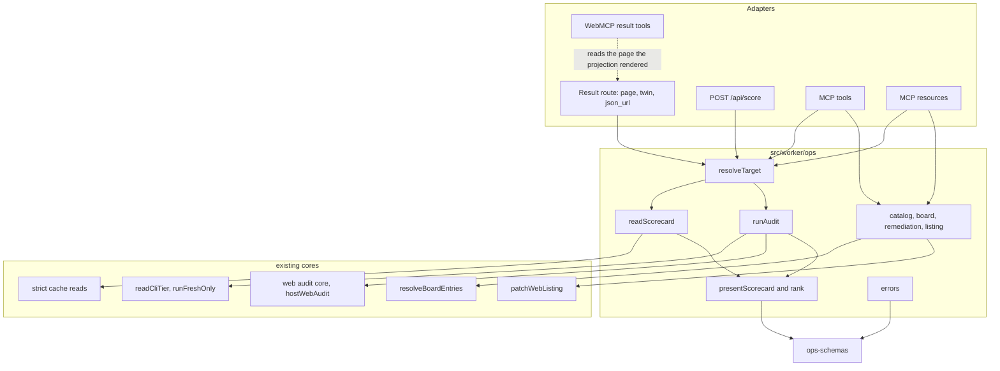
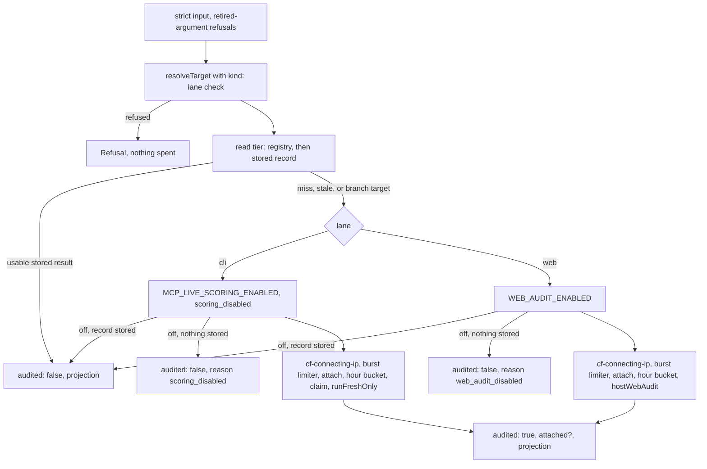
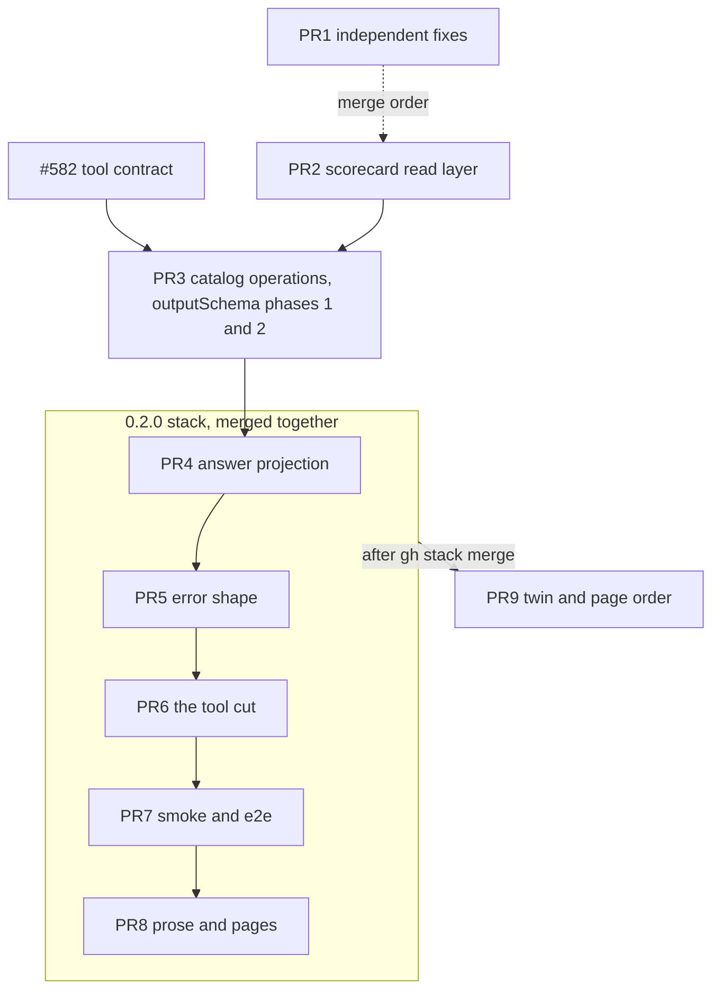

# One operation layer for every anc.dev entry point, and the 0.2.0 MCP release - Plan

## Goal Capsule

- **Objective:** an agent or a person who asks anc.dev about a CLI or a website gets the same answer from every entry point (the scorecard page and its twin, the JSON route, `POST /api/score`, the MCP tools and resources, WebMCP). Each answer leads with what the reader acts on: the score, the counts, and the fixes worth the most points. A store that cannot be read is reported as unavailable, never as "never audited", and no surface declares a capability the server does not have.
- **Means:** one operation module, `src/worker/ops/`, whose zod result schemas are also the MCP `outputSchema` and the JSON bodies, held by one parity test across every adapter (KTD1 to KTD4); the MCP scoring surface cut to `get_scorecard` and `run_audit` at server version `0.2.0` in one stacked set (KTD10).
- **Authority:** the Key Decisions (Brett's answers) bind. Requirements win on behavior, KTDs on mechanism, and units override neither. Each owner decision OD1 to OD17 binds once Brett answers it; until then the unit carries the recommended default and does not merge.
- **Execution profile:** code, nine PRs in four waves, each from a `feat/` or `fix/` branch cut from `dev` and squash-merged to `dev` (`RELEASES.md` § Daily development). PR4 to PR8 are one `gh stack`, merged together with `gh stack merge <top-pr> --squash --yes`. PR9 is cut from `dev` once the stack has merged. Under OD17's default, the release to `main` carries the stack and PR9 together, so agents meet one break.
- **Stop conditions:**
  - Brett answers an owner decision with an option this plan does not describe: re-plan the affected units before building.
  - #582 lands with a byte budget or a pending list other than the ones this plan measures against (36,864 bytes; all 14 tools pending): re-measure the byte table before PR3.
  - The compact `tools` array measures over 36,864 bytes at the longest allowed origin in any PR: stop and report. Do not raise `TOOLS_LIST_BYTE_BUDGET` without Brett.
  - A tool description or the server instructions exceed a `cut` record in `src/worker/mcp/client-limits.ts`, or a critical item ends past a `warn` record: stop and report.
  - A unit would change a rate limit's value, key, order, or anon posture, a kill switch's scope, or give any MCP call a way to skip a stored result: stop; that is an owner decision (R27).
  - Evidence shows a settled decision cannot work as stated: stop that part and report it with the evidence.
  - Production and staging stay read-only for every planning and build session: no crafted request and no audit against production.
- **Who finishes:** agentnative-site sessions build each PR and run the reviews its group names, then hand it to Brett, who approves every merge. The release from `dev` to `main` is the operator's (`RELEASES.md` § Releasing dev to main).

---

## Product Contract

### Summary

Every read, run, and presentation of a scorecard, and every catalog read (the CLI registry, the website board, principles, spec sections, web remediation, the public listing), goes through one module. Its zod schemas define each answer once; the MCP tools, the JSON route, `POST /api/score`, the twin, the HTML page, and WebMCP are adapters that map its outcomes onto their transport and nothing else. One parity test runs a table of inputs through every adapter of every operation. On top of the layer, the MCP scoring surface becomes two tools typed by `kind`, every scorecard answer leads with its score, counts, and top fixes, refusals and misses share one error shape, and the server stops declaring list-change notifications it never sends.

### Problem Frame

An audit of every entry point on `dev` at `028e403` found 17 drifts (D1 to D17) and 3 false capability or metadata claims (C1 to C3). They share one cause: where an adapter calls the shared function it agrees with the others, and where it re-implemented a step (the result route's resolver, the MCP board listing, the catalog-only scorecard resource, the hand-built MCP error text) it drifted. The cost lands on agents. A read through MCP misses targets the page serves (D1) and the page misses a target MCP serves (D2). During a storage outage, both MCP reads answer a miss that points at a metered audit (D4, reproduced in this plan's probes). The CLI answer carries its score at byte 19,755 of 19,827 and the website answer at byte 55,796 of 55,814, past where an agent reading the first bytes stops (#498). The handshake declares `listChanged: true` for tools and resources while nothing ever publishes a change (C1), and the SEP-1649 card declares `prompts`, which answers `-32601` (C2).

### Requirements

**One answer per operation**

- R1. For one input, every adapter of an operation returns the same outcome class and canonical target, and every scorecard adapter returns a byte-equal `scorecard` and `freshness`.
- R2. A scorecard read on any surface reaches every target the scorecard page serves: a registry slug, a registry binary alias (`rg`), a registry repository (`BurntSushi/ripgrep`), an install command, a stored live result by name (`figlet`), and a stored branch record (`owner/repo@branch`) (D1, D2, D3).
- R3. A store read failure answers "unavailable" on every read surface (the result route, the MCP reads, and the scorecard resource), never a miss and never a pointer to an audit (D4). `POST /api/score` and `run_audit` are transact paths, not read surfaces: there a failed read is a miss that proceeds to admission, because a fresh audit can still produce the answer.
- R4. A lookup by key reads only the table's own keys, so a key such as `constructor` is a miss or a refusal on every surface and never an error from inside the handler (D9).
- R5. The MCP website board answer is the board the page renders: same resolver, same rows, same fields (D10).
- R6. Every URL an answer carries is absolute: registry `scorecard_url` and the links inside a principle body are built from the request origin (D12, D14).
- R7. Scorecard pages name each principle with its principle page's title (D13).
- R8. A curated CLI answer carries `freshness.scored_at` from its scorecard's `run.started_at`; its `refresh_after` stays `null` (D7).

**Answer order**

- R9. Every representation of a scorecard on both lanes is produced by one serve-time projection, in this order: identity (`kind`, `tier`, `target`), `score_pct` (website: plus `score`), `summary`, `coverage`, `top_fixes` and `fixes_total`, the three URLs, `freshness`, the versions, then `scorecard` last with its inner keys re-ordered. Stored records and the published scorecard schemas are unchanged.
- R10. `top_fixes` holds up to 5 rows ranked by the score points each fix recovers under the lane's own score model, then RFC 2119 tier, then the producer's row order.
- R11. The markdown twin and the HTML page open with the same headline, counts, and a "Fix first" list, then the per-principle or per-category detail, with not-applicable rows collapsed to one line each at the end of their group.

**Errors and in-progress state**

- R12. Every refusal and miss carries `{ reason, message, value, suggestions?, next_step: { action, command, docs } }`, where `reason` comes from one closed set and `command` is a verbatim call safe to run headless. On HTTP it is added beside the keys served today; on MCP it replaces the bare refusal in `0.2.0`. Two refusals keep their own shape (KTD9): the SDK's input-validation text for an undeclared or retired argument, and the `-32099` budget refusals.
- R13. During a re-audit, `json_url` serves the stored scorecard with `in_progress: { started_at }`, and answers 202 only when nothing is stored (D5).

**Capabilities and discovery**

- R14. Both lanes declare `listChanged: false` for tools and resources from one constant that the SEP-1649 card also reads; the card declares no `prompts`; a `subscriptions/listen` request gets an empty acknowledgement and a closed stream (C1, C2).
- R15. The `tools/list`, `resources/list`, and `resources/templates/list` cache hints are 5 minutes in `0.2.0`.
- R16. `llms.txt` lists the curated website scorecards from the seed at build time, as it lists the CLI ones (D11).
- R17. The client guide's example answers carry the spec version the server sends (C3).

**MCP 0.2.0 scoring tools**

- R18. `get_scorecard { kind, target }` reads a stored scorecard of either lane and never audits; it is read-only and idempotent.
- R19. `run_audit { kind, target, site_type?, follow_declarations? }` returns a stored scorecard inline when a usable one exists and audits only otherwise; `site_type` and `follow_declarations` apply to `kind: "web"` only and are refused on `kind: "cli"`, naming the field. A branch-scoped target (`owner/repo@branch`) is never usable on the run path: `run_audit` and `POST /api/score` audit it fresh, as every run path does today, and only `get_scorecard` and the page read its stored record. While a lane's audit switch is off, a stored record of the target is served with `audited: false` whatever its age (R21 on the CLI lane; the web lane does this today).
- R20. A target whose shape names the other lane is refused before any gate and spends nothing (D16); `kind: "web"` with an explicit `http(s)://` URL is always a website.
- R21. While live CLI scoring is off, `run_audit` serves a stored CLI scorecard, and answers `audited: false` with a message only when nothing is stored (D17).
- R22. `bypass_cache` and `MCP_CACHE_BYPASS_ALLOWED` are removed; the release smoke deletes the staging record before its fresh-audit call.
- R23. The cut is hard: `score_cli`, `get_website_audit`, and `audit_website` are removed in the same release that changes `get_scorecard`'s input and sets `MCP_SERVER_VERSION` to `0.2.0`; a retired argument is refused with a message naming the call to send instead.
- R24. `next_tool` appears only on a read miss (`get_scorecard`, and `set_website_public_listing`'s miss), with the value `"run_audit"`; `source` is removed.

**Output schemas**

- R25. Every tool declares an `outputSchema` taken from its operation's zod schema, with loose objects, the text block kept, and the three list tools keeping their bare arrays.
- R26. The compact `tools` array stays within #582's 36,864-byte budget at the longest allowed origin after every PR.

**Cost and limits**

- R27. Every rate limit, kill switch, and the cost gate keep their value, key, order, and anon posture through the layer. The changes are R21's position of the CLI kill switch on MCP (after the read tier, as on the web lane), R22's removal of the staging-only bypass, and R20's lane refusal, which runs before any gate and spends nothing. Nothing else moves.

### Key Decisions

- **Scope B: a full operation layer, with a parity test across every operation.** (session-settled: user-directed; chosen over A, a thin layer for the scorecard operations only: 5 of the 20 findings, D9, D10, D12, D13, D14, sit in the operations A would leave in place.) Governs R1, R4, R5, R6, R7, R25.
- **Two scoring tools typed by a required `kind`.** (session-settled: user-approved; chosen over C, today's four tools simplified, and B, one tool per lane that reads and audits: B loses the read-only hint, C keeps four names for one act.) Governs R18, R19, R20.
- **Hard cut at server version `0.2.0`.** (session-settled: user-approved; chosen over keeping the three old names as aliases for one release: traffic on the old names is minimal.) Governs R23.
- **`get_scorecard` reads every target its page serves; a stored CLI scorecard is served while scoring is off; `bypass_cache` goes.** (session-settled: user-approved; chosen over today's narrower read, the disabled redirect, and the staging-only bypass: the redirects cost round trips and the bypass made the cost gate untrue on staging.) Governs R2, R21, R22.
- **`listChanged: false` from one shared constant, `prompts` dropped from the card, list hints to 5 minutes in `0.2.0`, no push.** (session-settled: user-approved; chosen over a Durable Object hub that holds every listen stream: the list changes once per release, and the hint reaches clients within 5 minutes.) Governs R14, R15.
- **One answer order for every representation, with up to 5 top fixes and `fixes_total`.** (session-settled: user-directed; Brett added the top fixes and the re-order himself, over deferring the top fixes and over #498's top 3.) Governs R9, R10, R11.
- **Re-order at serve time in the site; the `agentnative-cli` struct order stays out of scope.** (session-settled: user-approved; chosen over a producer change, which needs a CLI release and leaves stored records in the old order.) Governs R9.
- **`json_url` serves the stored scorecard during a re-audit.** (session-settled: user-approved; chosen over keeping the 202: nothing on the site polls it.) Governs R13.
- **One error shape, additive on HTTP, replacing the bare MCP refusal in `0.2.0`.** (session-settled: user-approved; chosen over today's three vocabularies.) Governs R12.
- **`llms.txt` lists the curated website scorecards.** (session-settled: user-approved; chosen over a CLI-only index.) Governs R16.
- **`outputSchema` on every tool in phases, bare arrays kept, one test-enforced budget on the `tools` array.** (session-settled: user-directed; chosen over wrapping the arrays in objects and over no budget.) Governs R25, R26.
- **`summary` and `coverage` are copied up from the inner scorecard.** Default the plan carries; the alternative is OD1. Governs R9.

### Scope Boundaries

- The stored records (R2 objects, KV keys), the published scorecard schemas (`scorecard.schema.json`, `web-scorecard.schema.json`), and the `anc` and `anc web` output order are unchanged.
- No new tool, verb, flag, config key, kill switch, or rate limit; the layer composes the cores that exist (`readCliTier`, `runFreshOnly`, the web audit core, `hostWebAudit`, `resolveBoardEntries`, `patchWebListing`).
- No `force`, `refresh`, or `detail` input on any MCP tool; the browser path's metered `refresh` stays the browser's own.
- The SEP-2127 card, the AI catalog, and the discovery documents keep their shape; only the version and capabilities they already read change.
- `content/changelog.md` entries that name the old tools stay: that page is the change record.

#### Deferred to Follow-Up Work

- The `agentnative-cli` struct-order change, so `anc audit --output json` leads with the summary (a CLI-repo call).
- WebMCP result tools on CLI scorecard pages, if Brett picks that over the default in OD9.
- Follow-ups not reached by any unit here: the `anc-mcp` entry in the agent-skills index (another repo), the `/mcp-skill` literals and icon paths that do not read the shared constants, the WebMCP design doc's retired page tool, the browser path's listing log row, and the held-run listing patch read.

### Outstanding Questions

#### Resolve before building (owner decisions)

The full table is in the Planning Contract, `### Owner decisions`. Each unit it touches names the OD it waits on.

---

## Planning Contract

### Key Technical Decisions

- KTD1. **The layer is `src/worker/ops/`, one file per operation, with schemas in `src/shared/ops-schemas/`.** Files: `resolve.ts` (both lanes), `read.ts`, `run.ts`, `present.ts` (ranks the lane's fixes, then calls the shared projection), `rank-web.ts`, `errors.ts`, `catalog.ts` (registry, principles, spec sections), `board.ts`, `remediation.ts`, `listing.ts`. Shared, because the build bakes the curated CLI pages from them and the client reads them: `src/shared/ops-schemas/{scorecard,catalog,errors}.ts`, `src/shared/present-scorecard.ts` (the pure projection, which takes the ranked fixes as an argument), and `src/shared/rank-cli.ts`. One projection function feeds the Worker's answers and the build-time curated pages, and nothing under `src/shared/` imports from `src/worker/`. Each file stays under the 200-line review trigger; the cores they compose stay where they are. Covers R1, R25.
- KTD2. **One zod schema per answer is the source for the MCP `outputSchema`, the JSON bodies, and the TypeScript types.** Every object is `z.looseObject`, `scorecard` stays an open object, and types come from `z.infer`, per `docs/solutions/best-practices/mcp-sdk-v2-enforces-a-declared-output-schema-on-every-successful-tool-call.md`. HTTP adapters serialize the same built value MCP returns; they do not parse it at runtime. The parity test parses every adapter's output with the schema, so drift fails the PR gate on every lane. Covers R1, R25.
- KTD3. **Adapters map outcomes onto their transport and do nothing else.** No adapter resolves, reads, ranks, or shapes an answer. The outcome map is the table in High-Level Technical Design. A new entry point is a new column in the parity test. Covers R1.
- KTD4. **Reads are strict; transact paths stay tolerant.** `readScorecard` uses the strict reads that exist (`score/cache.ts#getForRequest`, `audit-web/cache.ts#getForRequest`) and returns `Unavailable` as its own outcome. The swallowing reads stay on `POST /api/score`'s transact path and `run_audit`, where a fresh audit can still produce a result; there a failed read is a miss that proceeds to admission, and the parity table pins that column as an intended offset (KTD12). Probe in the Appendix: today the same R2 failure answers 503 `cache_unavailable` on `/score/<t>/json` and `found: false` with an audit `next_tool` on both MCP reads. Covers R3.
- KTD5. **`resolveTarget(kind | null, raw)` merges the result route's order with the input validator's, and every keyed lookup uses `Object.hasOwn`.** The route (`serveCli` in `src/worker/audit/result.ts`) reads the registry slug, then the binary alias, then the in-flight flag and the stored record. The validator (`validateInput` and `lookupRegistry` under `src/worker/score/`) adds the install command (its binary checked against `by_slug`), the repository (`by_owner_repo`), and the discovery hint. Merged CLI order: registry slug, registry binary alias, registry repository, install command, discovery hint, stored record by name, branch record. A slug that equals another tool's binary resolves to the slug, because both paths read `by_slug` first today. The resolver returns the canonical target and the redirect it implies. Web: `siteTarget`, the SSRF gate, then `resolveWebTarget` (the `www.` fold). With `kind` given, a target the classifier reads as the other lane is a `lane_mismatch` refusal, except `kind: "web"` with an explicit `http(s)://` URL. The page answers a registry repository with a 301 to `/score/<slug>`, as it does a binary alias (OD16). Covers R2, R4, R20.
- KTD6. **`runAudit(resolved, opts, admission)` composes the cores as they are; each adapter passes its own admission policy.** The browser policy carries the Turnstile session, the session limiter keys, and its metered `refresh`; the MCP policy carries the IP limiters and the hour buckets. The policy object owns gate order, so moving a gate is a diff to one object, which the carry-through table below pins. The MCP policy has no `refresh` field, and `run_audit`'s strict input has no key that reaches one. A branch-scoped target is never usable on the run path (`isBranchScoped` in `src/worker/score/core.ts`), and with a lane's audit switch off, a stored record of any age is served with `audited: false`. Covers R19, R21, R27.
- KTD7. **`presentScorecard(envelope, rankedFixes)` in `src/shared/present-scorecard.ts` is pure and is the only producer of answer order.** It copies `summary` and `coverage` (the inner `coverage_summary`) up, adds `top_fixes` and `fixes_total` from the lane's ranked fixes, and re-orders the inner scorecard: CLI `schema_version, spec_version, tool, target, summary, coverage_summary, audience, audience_reason, audit_profile, badge, results, anc, run`; web `schema_version, spec_version, target_url, tool, site_type, audience, audit_profile, score_pct, score, summary, coverage_summary, categories, public_listing, vantage, follow_declarations, declared_hosts, results, mcp_endpoint, mcp_discovery, registry_fingerprint`. Unknown inner keys keep their producer order after the known ones, so a new producer field never disappears. `results` keeps producer row order. Covers R9.
- KTD8. **Ranking follows each lane's published score model.**
  - **Web** (`src/worker/ops/rank-web.ts`): a row's gain is the rise in `score.relative` when that row alone is re-scored as a pass through `scoreWebAudit` (`src/worker/audit-web/score.ts`), over the rows `isRemediable` selects; an alternative group ranks once, as its best member. That is exact under the model's half-weight absent rows, its `broken` penalty, partial `noncompliant` credit, and alternative groups, and it costs at most about 100 re-scores. The fix text is the remediation `goal`, and the link is its `/fix/<id>` page.
  - **CLI** (`src/shared/rank-cli.ts`): credit is pass 1, warn 0.5, fail and opt_out 0 over behavioral rows (`src/data/spec/principles/scoring.md`). An `opt_out` row ranks as a fix with `status: "opt_out"`, because the published formula gives it no credit. Source- and project-layer rows rank after every behavioral row. The fix text is the row's `label`, which `anc` writes from its check catalog, so no text the audited tool printed reaches the lead of the answer; evidence stays inside `scorecard`. The link is the principle page.
  - `fixes_total` counts every row that ranks.
  - A score-formula parity test recomputes every curated CLI scorecard's `badge.score_pct` as `Math.round((sum of credit / behavioral row count) * 100)`, ratio first, 0 for an empty denominator. `yazi` pins the order: its exact score is 57.5, the ratio-first form gives 57 as its badge does, and the `100 * credit / count` form gives 58.
  - Covers R10.
- KTD9. **The error shape takes its `reason` values from `AuditErrorCode` in `src/shared/audit-events.ts`, extended.** One closed set for HTTP and MCP, so HTTP's new `reason` equals its `error.code` (OD3, OD4). `suggestions` reuses the result route's item shape, `{ target, scorecard_url }`. `command` follows one grammar: `<tool name> <compact JSON arguments>` for `call_tool` and `fix_input` (`run_audit {"kind":"cli","target":"figlet"}`), and `curl -s <absolute url>` for `fetch`. It is built from a resolved target or a suggestion; a `fix_input` refusal with neither carries the tool name with `"target":"<target>"`, and its `docs` points at the guide's accepted input forms. `value` carries the offending input only as a JSON string value, never inside `message`, markdown, or HTML unescaped. The settled shape has no `exit_code`: no process exits, and the HTTP status and the MCP `isError` carry the class. Two kinds of error keep their own shape. SDK input-validation errors stay the SDK's text, which #582's rule 2 pins: an argument a tool does not declare is refused before the handler runs. The budget refusals stay a `-32099` object inside an `isError` text block, the layer split `docs/runbooks/mcp-wire-protocol.md` § `-32099` records. A retired argument (`slug`, `binary`, `install`, `github_url`, `url`, `bypass_cache`) gets a custom unknown-key message naming the call to send, with the pattern #579 used for `public_listing` (`src/worker/mcp/tools/web-audit.ts`, the `unrecognized_keys` issue map). Covers R12, R23.
- KTD10. **The 0.2.0 cut is one stack of five PRs merged together.** Each PR passes the PR gate alone; prose that a test pins (the instructions, the guide's tool names under #582's rule 6, `EXPECTED_TOOL_NAMES`, AGENTS.md's tool count) moves with the tool change in PR6. The release to `main` carries the whole stack, so production sees one break. Covers R23.
- KTD11. **One capabilities constant.** `MCP_SERVER_CAPABILITIES = { tools: { listChanged: false }, resources: { subscribe: false, listChanged: false } }` in `src/shared/mcp-discovery.ts` beside `MCP_SERVER_VERSION`. `src/worker/mcp/server.ts` passes it and `src/build/11a-discovery-emit.mjs` writes it into the SEP-1649 card, replacing the literal that declares `prompts`. The SDK keeps an explicit `false` (it fills `true` only for an absent key), and with `false` its listen router honors nothing, writes the acknowledgement and then a `complete` result, and closes the stream (the listen router of `@modelcontextprotocol/server` 2.4.0, the version `package.json` pins). Covers R14.
- KTD12. **The parity test is one table per operation, in `tests/entry-point-parity.test.ts` plus one helper per operation under `tests/helpers/parity/`.** Rows are inputs and columns are adapters, in-process with seeded R2 and KV. An intended difference between two adapters is pinned as its own row, never left out, per `docs/solutions/design-patterns/parity-test-for-source-derived-resolvers-asserts-cross-env-union-and-twin-offsets.md`. The MCP board's default view (OD11), `POST /api/score` on a failed store read (a miss that proceeds to admission, KTD4), and the curated twin's canonical links on staging are those rows. Covers R1.
- KTD13. **Settled findings decided from evidence in this plan.**
  - **D6, the two HTTP-only keys:** the projection carries `site_spec_version` and `auditor_url` on every representation, MCP included (OD8 records the alternative). Evidence: `scripts/smoke-api-score.sh`, `tests/e2e/homepage-score-live.e2e.ts`, and `tests/regression.test.ts` read both on HTTP, so dropping them from HTTP would break the additive rule; one body builder needs one key set.
  - **D7, curated `scored_at`:** filled from `run.started_at` through `cliScoredAt`, with `refresh_after` kept `null`. Evidence: all 98 committed scorecards carry `run.started_at`; the page already prints "audited 2026-10-28" for `ripgrep` from it; and the guide documents a `null` `refresh_after` for curated results, not a `null` `scored_at`.
  - **D15, WebMCP on CLI pages:** stays out of `0.2.0`. Evidence: the four result tools read website-only page structure (`.web-check` rows, the seven website statuses, fix prompts from the remediation catalog), and the CLI lane has none of those, so loading the script on a CLI page would register tools that answer an empty list. OD9 records the alternative.
- KTD14. **Byte figures are measured, and #582's rule 5 is the gate.** Method: the compact `tools` array served at `https://agentnative-site-staging.brettdavies.workers.dev:65535` (rule 5's longest origin) on #582's head `c30dfed`, which reproduces #582's 18,971 bytes (its later heads, up to `6b80c58`, rebase onto #580 and #581 and change no tool text and no contract rule; PR3 re-measures at the head that merges), plus each draft schema converted through zod's output-mode JSON Schema as the SDK does. Every PR that adds a schema re-measures with rule 5; the table below is the plan's expectation, not the gate. Covers R26.
- KTD15. **The scorecard resource reads curated scorecards through the resolver (OD6 default).** `anc://scorecard/{binary}` resolves a slug or a binary through `resolveTarget('cli', ...)` from PR2 and keeps the registry entry shape it serves today. In the `0.2.0` stack (U18) it serves the projection of a registry-tier hit, so its shape changes with the release's one break. Anything else answers `-32602` naming `get_scorecard`. Every resource then stays build-time data, so the 1-hour `resources/read` hint stays true. Covers R2.

### Owner decisions

Each row names what only Brett can decide, the options, the recommendation, and the evidence. A unit that depends on an open row carries the recommended default and does not merge until the row is answered.

| # | Decision | Options | Recommendation | Evidence |
| --- | --- | --- | --- | --- |
| OD1 | Where `summary` and `coverage` live in the answer | (a) copied up to the top level, inner scorecard re-ordered too; (b) only inside the scorecard, re-ordered so they lead it | (a) | Measured copy cost per answer: `ripgrep` 81 + 105 bytes compact, a website fixture 74 + 102; about 325 bytes in the pretty-printed text block plus about 185 in `structuredContent`. (b) puts the counts after the identity, URL, and freshness keys, near byte 600 instead of 85 |
| OD2 | The new answer field names (table below, rows marked open) | approve as drafted, or rename | approve | Names reuse keys the stored scorecards and the result route already use (`summary`, `coverage_summary` shortened to `coverage`, `tier`, `status`, `label`, `scorecard_url`) |
| OD3 | Casing of `reason` values | (a) snake_case, the `AuditErrorCode` values HTTP serves in `error.code` today; (b) kebab-case, the global error contract and the og scripts' `reason` set | (a) | With (b), HTTP would carry one code in two spellings (`error.code: "not_found"` beside `reason: "not-found"`). (a) departs from the global error contract's kebab-case `reason`, recorded here so the departure is a decision |
| OD4 | The `reason` closed set | the existing `AuditErrorCode` values plus `cache_unavailable`, `lane_mismatch`, `web_only_argument` | approve | `cache_unavailable` is served by the result route today but missing from the union; the other two name refusals `0.2.0` adds. A retired argument is refused by the SDK's input validation, which carries no `reason` (KTD9) |
| OD5 | `next_step.action` closed set and `command` form | `call_tool` (command: the MCP call, `run_audit {"kind":"cli","target":"figlet"}`), `fix_input` (the corrected call, or the call with a `<target>` placeholder when no correction exists; grammar in KTD9), `retry` (the same call, with `retry_after`), `fetch` (a `curl -s <url>` read) | approve | The HTTP `audit_url` is a browser page behind Turnstile, not a headless command, so an HTTP miss points at `run_audit` or a `fetch` |
| OD6 | `anc://scorecard/{binary}` | (a) keep the URI, read curated scorecards through the resolver, answer `-32602` naming `get_scorecard` otherwise; (b) retire it in `0.2.0`; (c) also read stored live results, with the `resources/read` hint cut to 5 minutes for every resource | (a) | (c) puts R2 data behind a 1-hour public hint or shortens it for all four templates, which are all build-time data; (a) keeps the hint true |
| OD7 | The in-progress field | `in_progress: { started_at }` on the MCP hit and miss and on the HTTP 200; the HTTP 202 body keeps `in_progress: true, started_at` | approve | The HTTP 202 is additive-only; MCP is a hard cut and can take the object form everywhere |
| OD8 | D6: `site_spec_version` and `auditor_url` on MCP answers | (a) add to MCP; (b) drop from HTTP | (a) | KTD13 |
| OD9 | D15: WebMCP on CLI scorecard pages | (a) defer; (b) add a CLI `get_audit_summary` reading the projection in PR9 | (a) | KTD13; (b) is a new public WebMCP tool |
| OD10 | When the list hints drop to 5 minutes | (a) in the `0.2.0` cut, as decided; (b) one release earlier, in PR1 | (a), with the note | A `tools/list` fetched in the hour before the `0.2.0` deploy carries a 1-hour `ttlMs`, so a shared cache may serve the old list for up to an hour after the cut under (a), and 5 minutes under (b) |
| OD11 | `list_website_audits` default view | (a) keep `curated`, its documented default; (b) `all`, the page's default | (a) | The tool's default is published text agents read; KTD12 pins the difference as an intended offset |
| OD12 | Tool titles | "Get a stored scorecard", "Run a live audit" | approve | The titles mirror the read and live split of the two tool names |
| OD13 | Public text: the two descriptions, the field descriptions, the retired-argument messages, the hero card line, and the guide's rewritten sections | Brett reads the final text before the builds' reviews | read before PR6 and PR8 reviews | Drafts measured: `get_scorecard` 601 characters, `run_audit` 1,590, inside every `cut` and `warn` record |
| OD14 | Version figure | `0.2.0` for `MCP_SERVER_VERSION` | settled | Key Decisions |
| OD15 | The `llms.txt` website section heading and order | `## Website scorecards`, seed order, after the CLI list | approve | Mirrors the CLI section the build emits in `src/build/09-llms-emit.mjs` |
| OD16 | D2: `/score/BurntSushi/ripgrep` | (a) 301 to `/score/ripgrep`, as a binary alias does; (b) serve the registry scorecard at the repository path | (a) | One canonical URL per scorecard; the sitemap and `llms.txt` already list the slug path |
| OD17 | Does the `0.2.0` release to `main` wait for PR9 | (a) yes: the release carries the stack and PR9, so the JSON order and the twin and page order ship together; (b) no: the release carries the stack, and PR9 ships in the next release | (a) | The twin is an agent-facing output; under (b), for one release the JSON answer leads with `top_fixes` while the twin of the same scorecard does not |

### Public names the release adds or changes

"Settled" cites the Key Decision; "open" cites the owner decision.

| Surface | Name | Change | Owner decision |
| --- | --- | --- | --- |
| Tool | `get_scorecard` | input becomes `{ kind, target }`; reads both lanes | settled (two typed tools) |
| Tool | `run_audit` | added | settled |
| Tool | `score_cli`, `get_website_audit`, `audit_website` | removed; a call gets `-32602` "Tool ... not found" | settled (hard cut) |
| Tool titles | "Get a stored scorecard", "Run a live audit" | added | open, OD12 |
| Input | `kind` (`"cli"`, `"web"`), `target`, `site_type`, `follow_declarations` | `kind` and `target` added; the two website fields move to `run_audit` | settled |
| Input | `slug`, `binary`, `install`, `github_url`, `url`, `bypass_cache` | removed, refused with a message naming the new call | settled; message text open, OD13 |
| Config | `MCP_CACHE_BYPASS_ALLOWED` | removed from `wrangler.jsonc` | settled |
| Answer | `found`, `audited`, `attached` | kept | settled |
| Answer | `source` | removed | settled |
| Answer | `next_tool` | only on a read miss, value `"run_audit"` | settled |
| Answer | `summary` | added at the top level, a copy | settled default; open, OD1 |
| Answer | `coverage` | added at the top level, a copy of `coverage_summary` | open, OD1, OD2 |
| Answer | `score` (website) | added at the top level, a copy of `{ relative, global }` | open, OD2 |
| Answer | `top_fixes`, `fixes_total` | added; an `opt_out` row counts as a fix (KTD8) | settled |
| Answer | `top_fixes[]` keys `id`, `label`, `tier`, `status`, `gain`, `fix`, `url` | added | open, OD2 |
| Answer | `in_progress: { started_at }` | added on a hit; replaces `in_progress: true, started_at` on MCP | open, OD7 |
| Answer | `site_spec_version`, `auditor_url` on MCP | added | open, OD8 |
| Answer | `freshness.scored_at` on curated CLI | `null` becomes the run start | decided from evidence, KTD13 |
| Error | `reason`, `message`, `value`, `suggestions`, `next_step { action, command, docs }` | added (HTTP beside today's keys; MCP replacing the bare refusal) | settled |
| Error | `suggestions[]` keys `target`, `scorecard_url` | reused from the result route's 404 body | open, OD2 |
| Error | `reason` values | the closed set | open, OD3, OD4 |
| Error | `next_step.action` values | the closed set | open, OD5 |
| Resource | `anc://scorecard/{binary}` | reads curated scorecards through the resolver (PR2); serves the projection in place of the registry entry in `0.2.0` | open, OD6 |
| Capabilities | `tools.listChanged`, `resources.listChanged` | `false` on both lanes | settled |
| Server card | `capabilities.prompts` | removed | settled |
| Cache hints | `tools/list`, `resources/list`, `resources/templates/list` | `ttlMs` 3,600,000 to 300,000 | settled; timing open, OD10 |
| Server | `MCP_SERVER_VERSION` | `0.1.0` to `0.2.0` | settled |
| Path | `/score/<owner>/<repo>` of a registry tool | 404 becomes a 301 to `/score/<slug>` | open, OD16 |
| `llms.txt` | website scorecard section | added | settled; heading open, OD15 |

### Rate limits, kill switches, and the cost gate through the layer

Each row is unchanged in value, key, order, and anon posture unless the last column says otherwise. The policy object named is the only place the layer reads it (KTD6).

| Control | Where it sits after the layer | Change |
| --- | --- | --- |
| `MCP_LIMITER` (60 per 60 s per IP, `anon` fallback) | dispatch shell, before any operation | none; a 5-minute list hint means at most one more `tools/list` per client per 5 minutes, one unit each |
| `MCP_AUDIT_LIMITER` (5 per 60 s per IP, no anon) and the `mcp_audit:<ip>:<hour>` bucket (5 per hour) | MCP admission policy, CLI lane of `run_audit`, past the read tier | none |
| `WEB_AUDIT_LIMITER_IP` (30 per 60 s per IP, no anon) and the shared `audit:web` hour bucket (30 per hour) | MCP admission policy, web lane of `run_audit` and the listing change; the browser policy's IP fallback | none |
| `WEB_AUDIT_LIMITER` (10 per session per 60 s) | browser admission policy | none |
| `SCORE_LIMITER`, `SCORE_LIMITER_IP` | browser admission policy, CLI lane | none |
| `WEB_AUDIT_DOMAIN_LIMITER` and the `web_audit_follow` hour window | the web audit core, every surface that follows declarations | none |
| Listing flip budget (5 per hour per domain) | `ops/listing.ts`, composing `patchWebListing` | none |
| `MCP_ENABLED`, `MCP_LEGACY_ENABLED` | dispatch shell | none |
| `MCP_LIVE_SCORING_ENABLED`, `scoring_disabled` | MCP admission policy, CLI lane, after the read tier | moved after the read tier on MCP (settled, R21); `POST /api/score` already checks after it |
| `WEB_AUDIT_ENABLED` | both policies, web lane, after the read tier; with it off, a stored record of any age is served with `audited: false`, as `audit_website` does today; the listing change | none |
| Branch-scoped targets (`owner/repo@branch`) | `ops/run.ts`: never usable on the run path | none: every run path audits them fresh today |
| `WEB_AUDIT_FOLLOW_ENABLED` | the web audit core | none |
| `OG_VIDEO_ENABLED` | render requests from the audit hooks | none |
| Cost gate: a stored CLI result is never re-audited before it expires; a website record is reused under 1 minute | `ops/read.ts` read tier, ahead of every admission policy | the staging-only `bypass_cache` path that skipped it is removed (settled, R22) |
| Browser `refresh: true` (metered) | browser admission policy only | none; no MCP input reaches it |

### High-Level Technical Design

*Directional shapes for review, not implementation specification.*

Adapters, the layer, and the cores:



`run_audit` gate order, both lanes (the CLI kill-switch position is the gate-order change, R21):



Outcome map per adapter (KTD3):

| Outcome | Result route | `POST /api/score` | MCP tool | MCP resource | WebMCP |
| --- | --- | --- | --- | --- | --- |
| Hit | 200 projection, page, twin | 200 projection | `isError: false`, text and `structuredContent` | contents | `ok: true` |
| Redirect (alias, fold, repository) | 301 | answers for the canonical target | answers for the canonical target | contents | n/a |
| In progress, something stored | 200 with `in_progress` | 200 with `in_progress` | hit with `in_progress` | contents | page as rendered |
| In progress, nothing stored | 202 | 202 or attach | `found: false, in_progress` | `-32602` | n/a |
| Miss | 404 with suggestions and the error shape | proceeds to admission | `found: false` with the error shape | `-32602` | `found: false` |
| Unavailable | 503, `Retry-After` | a miss that proceeds to admission (KTD4) | `get_scorecard`: `isError: true`, `reason: "cache_unavailable"`; `run_audit`: a miss (KTD4) | `-32603` | `ok: false` |
| Refusal | 404 (path) | 400 | `isError: true` with the error shape | `-32602` | `ok: false` |

The answer, every representation (R9; inner order in KTD7):

```text
found | audited, attached?          (MCP wrapper only)
kind, tier, target
score_pct, score?                   (score: website only)
summary, coverage
top_fixes[], fixes_total
scorecard_url, markdown_url, json_url
freshness, in_progress?
spec_version, site_spec_version, anc_version?, tool_version?, source_sha?, target_url?, auditor_url
scorecard                           (inner keys re-ordered)
```

PR order and waits:



### Byte figures for the `tools` array

Measured per KTD14 against #582's 36,864-byte budget. The phase rows use draft schemas, so each PR re-measures with rule 5.

| After | Added | `tools` array | Under budget by |
| --- | --- | --- | --- |
| #582 (`c30dfed`, 14 tools, no schemas) | | 18,971 | 17,893 |
| PR3, phase 1 (`list_spec_sections` 377, `list_website_audits` 849, `get_tool` 1,265, `get_principle` 1,308, `get_spec_section` 1,070, `get_web_remediation` 1,157) | 6,026 | 24,997 | 11,867 |
| PR3, phase 2 (`list_tools` 532, `search_tools` 532, `list_principles` 311) | 1,375 | 26,372 | 10,492 |
| PR6, the cut (four entries out, 9,825 with their separators; `get_scorecard` 1,541 and `run_audit` 4,641 in, plus one separator each) | -3,641 | 22,731 | 14,133 |
| PR6, phases 3 and 4 (`get_scorecard` 3,043, `run_audit` 2,565, `set_website_public_listing` 1,031) | 6,639 | 29,370 | 7,494 |

Phase 1 adds more than an estimate without the error shape (about 4,200), because each found-or-miss union carries the full error shape. The peak is 29,370, after the stack. `run_audit`'s entry is mostly `follow_declarations`' disclosure (about 1,700 characters), carried over unchanged.

### Answer growth from the projection

- A `jq` simulation of the projection over the answers served on `dev`, with the CLI fix text taken as 160 characters of evidence (KTD8's `label` is shorter, so the CLI figure is an upper bound): `get_website_audit example.com` from 55,814 to 58,012 bytes (`score_pct` from byte 55,796 to 67), and `get_scorecard ripgrep` from 19,827 to 21,938 (`score_pct` from byte 19,755 to 66).
- With the remediation `goal` as the website fix text (74 characters on average for `example.com`), `top_fixes` stays near 1 KB.
- The `summary` and `coverage` copies (OD1) are about 325 bytes of that in the text block.
- Phases 3 and 4 add `structuredContent`, a compact copy of the whole answer (about 14,742 bytes for `ripgrep`); the double send is part of the settled `outputSchema` decision.
- HTTP bodies are compact JSON, so the JSON route grows by the compact size of the lead keys only.

### Assumptions

- #582 merges with its budget (36,864) and pending list as of `c30dfed`; PR3 rebases onto whatever lands and re-measures.
- #581 merges before PR3 (#580 is on dev); PR3 moves `src/worker/mcp/tools/web-listing.ts` and `src/worker/audit-web/held-run.ts` callers as they stand after them.
- Brett answers the owner decisions in one batch before PR2 merges; PR1 depends on none of them except OD10 and OD15.
- The operator's wrangler token can delete objects in `anc-score-cache-staging`, which PR7's smoke needs.

### Risks

| Risk | Mitigation |
| --- | --- |
| A client reopens `subscriptions/listen` in a loop once the stream closes after an empty acknowledgement | The closure is the SDK's spec response for an empty honored set; after PR1 deploys, read `mcp.request` counts for `subscriptions/listen` on staging and report a rise before release |
| A shared cache serves the `0.1.0` tool list after the cut | OD10; the `0.2.0` changelog and the guide name the new calls; `serverInfo.version` changes on every modern result |
| A schema drift turns a correct answer into "Output validation error" for every client | KTD2: the parity test parses every adapter's output, and one handler test per success variant asserts `isError` is not true |
| Moving the result route onto the resolver changes what an existing URL serves | KTD12 rows for every target the route serves today, written first against the current route (characterization) and kept green through PR2 |
| A stored record from an older producer lacks a key the projection reads | `presentScorecard` treats every inner key as optional and keeps unknown keys; a row for an old-shape record in the parity table |
| The stack's five PRs drift apart while waiting for review | KTD10; each PR passes the gate alone, and the stack merges with `gh stack merge` |

### Documentation and operational notes

- The `0.2.0` changelog entry is `feat(mcp)!:` under `### Breaking changes`, with a table from each old call to its new call (PR6's PR body; the generator builds `CHANGELOG.md` from it).
- `RELEASES.md` § MCP endpoint release procedure loses the `bypass_cache` rows and gains the staging-record delete step (PR8); `RELEASES-PREFLIGHT.md` and `RELEASES-POSTFLIGHT.md` change with the smoke (PR7).
- CONCEPTS.md entries for the modern lane, the MCP server card, the board view, and any new term (answer projection, top fixes) change in the PR that changes the behavior.

---

## Implementation Units

### Unit Index

| U-ID | Title | Key files | Depends on |
| --- | --- | --- | --- |
| U1 | One capabilities constant | `src/shared/mcp-discovery.ts`, `src/worker/mcp/server.ts`, `src/build/11a-discovery-emit.mjs` | none |
| U2 | Listen-stream and card prose | `content/mcp-skill.md`, `docs/runbooks/mcp-wire-protocol.md`, `CONCEPTS.md` | U1 |
| U3 | Own-key lookups | `src/worker/mcp/tools/web-remediation.ts`, `src/worker/score/validate.ts`, `src/worker/score/registry-lookup.ts` | none |
| U4 | Curated `scored_at` and the guide's example versions | `src/shared/audit-envelope.ts`, `content/mcp-skill.md` | none |
| U5 | Principle names from the principle titles | `src/shared/scorecard-format.mjs`, `src/build/` | none |
| U6 | Website scorecards in `llms.txt` | `src/build/09-llms-emit.mjs` | none |
| U7 | Rate-limited log method | `src/worker/index.ts` | none |
| U8 | Ops skeleton and scorecard schemas | `src/worker/ops/`, `src/shared/ops-schemas/` | PR1 |
| U9 | `resolveTarget` | `src/worker/ops/resolve.ts` | U8 |
| U10 | `readScorecard` with strict reads | `src/worker/ops/read.ts` | U9 |
| U11 | Scorecard read adapters onto the layer | `src/worker/audit/result.ts`, `src/worker/audit/api.ts`, `src/worker/mcp/tools/scorecard-read.ts`, `src/worker/mcp/tools/web-audit.ts`, `src/worker/mcp/resources.ts` | U10 |
| U12 | Parity test harness and scorecard rows | `tests/entry-point-parity.test.ts`, `tests/helpers/parity/` | U11 |
| U13 | Catalog operations and their schemas | `src/worker/ops/catalog.ts`, `src/worker/mcp/tools/{registry,principles,spec}.ts` | U12, #582 |
| U14 | Board operation | `src/worker/ops/board.ts`, `src/worker/mcp/tools/web-audit.ts` | U12 |
| U15 | Remediation and listing operations | `src/worker/ops/{remediation,listing}.ts`, `src/worker/mcp/tools/{web-remediation,web-listing}.ts` | U12 |
| U16 | Catalog parity rows | `tests/entry-point-parity.test.ts` | U13, U14, U15 |
| U17 | Answer projection and ranking | `src/shared/{present-scorecard,rank-cli}.ts`, `src/worker/ops/{present,rank-web}.ts` | PR3 |
| U18 | One body builder and the in-progress rule | `src/worker/audit/api.ts`, `src/worker/audit/result.ts` | U17 |
| U19 | One error shape | `src/worker/ops/errors.ts`, `src/shared/ops-schemas/errors.ts`, `src/shared/audit-events.ts` | U17 |
| U20 | `runAudit` with admission policies | `src/worker/ops/run.ts`, `src/worker/audit/admit.ts` | U19 |
| U21 | The tool cut | `src/worker/mcp/tools/`, `wrangler.jsonc`, `src/worker/mcp/server.ts` | U20 |
| U22 | `outputSchema` phases 3 and 4 | `src/worker/mcp/tools/{get-scorecard,run-audit,web-listing}.ts` | U21 |
| U23 | Version, hints, instructions, pinned prose | `src/shared/mcp-discovery.ts`, `src/worker/mcp/instructions.ts`, `tests/helpers/mcp-tools.ts` | U21 |
| U24 | Release smoke and e2e suites | `scripts/release/mcp-smoke.sh`, `tests/e2e/` | U23 |
| U25 | Guide, runbooks, and release docs | `content/mcp-skill.md`, `docs/runbooks/`, `RELEASES*.md`, `AGENTS.md` | U23 |
| U26 | Pages, copy, and the issue template | `src/shared/web-hero-card.mjs`, `src/build/11a-discovery-emit.mjs`, `content/`, `.github/ISSUE_TEMPLATE/web-audit-bug.yml` | U23 |
| U27 | CLI twin and page order | `src/shared/scorecard-format.mjs` | the merged stack |
| U28 | Website twin and page order, WebMCP context | `src/worker/audit-web/summary-markdown.ts`, `src/worker/audit-web/summary-render.ts` | the merged stack |

### PR1: Independent fixes

Waits on: nothing.

Reviews: `ce-code-review`, `/devex-review` (the handshake capabilities, the card, and `llms.txt` are output contracts agents read), `/cso` (U3 changes lookups keyed by untrusted input).

#### U1. One capabilities constant

- **Goal:** both lanes and the SEP-1649 card declare the same capabilities, with no list-change notification and no prompts (R14, KTD11).
- **Requirements:** R14.
- **Files:** `src/shared/mcp-discovery.ts`, `src/worker/mcp/server.ts`, `src/build/11a-discovery-emit.mjs`; tests `tests/mcp-capabilities.test.ts` (new), `tests/build-discovery-emit.test.ts`, `tests/worker-mcp-dispatch.test.ts`.
- **Approach:** export the constant; pass it to `McpServer`; the card build reads it. The listen test in `tests/worker-mcp-dispatch.test.ts` changes from "stays open" to "acknowledges an empty set and closes", and its stale SEP-1649 fixture description goes.
- **Test scenarios:**
  - `server/discover` and legacy `initialize` capabilities equal the card's `capabilities`, deep-equal.
  - `subscriptions/listen` asking for both list notifications gets `notifications: {}` and a stream that ends within the test's timeout.
  - No capability key names a method that answers `-32601` (`prompts/list` answers `-32601` and the card has no `prompts`).
- **Verification:** the new test fails against the unfixed `server.ts` with `listChanged: true` on both lanes, quoted in the PR body; on the local Worker, `curl -m 6` on `subscriptions/listen` returns before the timeout.

#### U2. Listen-stream and card prose

- **Goal:** the guide, the runbook, the comments, and CONCEPTS.md describe the closed stream and the shared capabilities.
- **Requirements:** R14.
- **Files:** `content/mcp-skill.md` (the `subscriptions/listen` sentence), `src/worker/index.ts` (the two comments on the listen stream), `docs/runbooks/mcp-wire-protocol.md` (its "not on main" line and a `subscriptions/listen` section), `CONCEPTS.md` ("Modern lane": nothing publishes list changes, so list freshness rides the cache hints; "MCP server card": the capabilities are shared too).
- **Approach:** prose only; the runbook's citation test (`tests/runbook-citations.test.ts`) must resolve every new anchor.
- **Test expectation:** none beyond `tests/runbook-citations.test.ts` and the prose gate: prose only.
- **Verification:** `scripts/prose-check.sh --changed-only` reports 0 blocking.

#### U3. Own-key lookups

- **Goal:** a lookup by key reads only the table's own keys (R4).
- **Requirements:** R4.
- **Files:** `src/worker/mcp/tools/web-remediation.ts`, `src/worker/score/validate.ts`, `src/worker/score/registry-lookup.ts`; tests in `tests/web-audit-mcp-tools.test.ts`, `tests/worker-mcp.test.ts`, `tests/audit-api.test.ts`.
- **Approach:** `Object.hasOwn` at each keyed read, the pattern the result route uses.
- **Test scenarios:**
  - `get_web_remediation { check_id: "constructor" }` and `"toString"` answer `found: false`, not `isError`.
  - `get_scorecard { slug: "constructor" }` is a refusal or miss whose next step is not an audit.
  - `POST /api/score { target: "constructor" }` answers the same class as `/score/constructor`.
- **Verification:** each test observed failing on the unfixed code.

#### U4. Curated `scored_at` and the guide's example versions

- **Goal:** a curated answer says when it was scored, and the guide's examples carry the version the server sends (R8, R17).
- **Requirements:** R8, R17, KTD13.
- **Files:** `src/shared/audit-envelope.ts` (`buildRegistryEnvelope`), `content/mcp-skill.md`; tests `tests/audit-envelope.test.ts` (or the file that pins `buildRegistryEnvelope`), `tests/content-mcp-skill.test.ts` (new or existing guide test).
- **Approach:** `freshness.scored_at` from `cliScoredAt` on the attached scorecard; `refresh_after` stays `null` for the registry tier. A guide test asserts every `"spec_version"` literal in an example answer equals `SPEC_VERSION`.
- **Test scenarios:**
  - `get_scorecard ripgrep` and `/score/ripgrep/json` carry `scored_at` equal to the scorecard's `run.started_at`, and `refresh_after: null`.
  - A metadata-only registry entry (no scorecard) keeps `scored_at: null`.
  - The guide test fails on the `"2026.05"` literals.
- **Verification:** the local Worker serves the run start on both surfaces.

#### U5. Principle names from the principle titles

- **Goal:** scorecard pages and principle pages name each principle the same way (R7).
- **Requirements:** R7.
- **Files:** `src/shared/scorecard-format.mjs` (`PRINCIPLE_NAMES`), `src/shared/principle-names.gen.mjs` (new, generated and committed), the build step that reads `content/principles/*.md` titles; tests `tests/web-audit-scorecard-format.test.ts` or the scorecard-format test.
- **Approach:** a build step writes each name, the H1 text after its `P<n>: ` prefix, into `src/shared/principle-names.gen.mjs`, committed and held by a drift test the way `src/worker/spec-version.gen.ts` is. `src/shared/scorecard-format.mjs` imports it and stays free of file reads. No hand-kept copy remains.
- **Test scenarios:** for each of P1 to P8, the name the scorecard renderer prints equals the H1 of `content/principles/p<n>-*.md` after its `P<n>: ` prefix; the drift test fails when a principle title changes and the generated module does not.
- **Verification:** `/score/ripgrep` served HTML (with `Accept: text/html`) names P4 "Fail Fast with Actionable Errors". Text only, no layout change, so no theme check.

#### U6. Website scorecards in `llms.txt`

- **Goal:** `llms.txt` indexes both surfaces it says it measures (R16).
- **Requirements:** R16, OD15.
- **Files:** `src/build/09-llms-emit.mjs`, reading the seed the way `src/build/14-web-scorecards-emit.mjs` does; tests `tests/build.test.ts` or `tests/llms-emit.test.ts`.
- **Test scenarios:**
  - Every curated seed host appears once as an absolute `/score/<host>` link under the website heading.
  - The CLI list is unchanged.
- **Verification:** `dist/llms.txt` after `bun run build` lists the seed hosts.

#### U7. Rate-limited log method

- **Goal:** a rate-limited request is logged with the method it names (follow-up on `src/worker/index.ts`'s assumed `'tools/call'`).
- **Files:** `src/worker/index.ts`; test in `tests/worker-mcp-dispatch.test.ts`.
- **Approach:** use `classifyRpcMethod` and `classifyToolName`, as the reject lane and the success path do.
- **Test scenarios:** a rate-limited legacy `tools/list` logs `method: "tools/list"`; a rate-limited `tools/call` logs the classified tool name.
- **Verification:** the test fails on the unfixed line.

### PR2: Scorecard read layer

Waits on: PR1, merge order only (PR2 moves the lookups U3 changed).

Separate PR because: it ships the read-side fixes (R2, R3) to production ahead of the `0.2.0` set, and Brett reviews each PR, which a combined layer-and-cut PR would make too large for one sitting.

Reviews: `ce-code-review`, `/devex-review` (more targets resolve and the outage answer changes), `/cso` (the resolver parses untrusted targets and builds storage keys from them).

#### U8. Ops skeleton and scorecard schemas

- **Goal:** the module and the read-side schemas exist, with types derived from them (KTD1, KTD2).
- **Files:** `src/worker/ops/` (new), `src/shared/ops-schemas/scorecard.ts` (new); test `tests/ops-schemas.test.ts` (new).
- **Approach:** `Resolved`, `Refusal`, and the read outcomes (`Hit`, `InProgress`, `Miss`, `Unavailable`) as loose zod schemas; `AuditEnvelope` in `src/shared/audit-envelope.ts` becomes `z.infer` of the envelope schema, so the builders type against what the tools will advertise.
- **Test scenarios:** every envelope builder's output on the curated, cached, live, and web fixtures parses with the envelope schema; an extra key survives the parse.
- **Verification:** `bun run typecheck` passes with the derived type.

#### U9. `resolveTarget`

- **Goal:** one resolver for both lanes in the result route's order (KTD5).
- **Requirements:** R2, R4, R20 (lane check wired, unused until PR6).
- **Files:** `src/worker/ops/resolve.ts`, extracted from `serveCli` and `serveBranch` in `src/worker/audit/result.ts`, `validateInput` (`src/worker/score/validate.ts`), and `resolveWebTarget`; test `tests/ops-resolve.test.ts` (new).
- **Execution note:** write the resolver's tests against the current result route's behavior first, then extract.
- **Test scenarios:**
  - `ripgrep`, `rg`, `BurntSushi/ripgrep`, `brew install ripgrep` resolve to `ripgrep`, tier registry, with the redirect each implies.
  - `figlet` (seeded record) and `npm install -g figlet` resolve to `figlet`.
  - `owner/repo@branch` (seeded) resolves to the branch record.
  - `RipGrep` gets the same outcome it gets on the page today.
  - `example.com`, `https://example.com/`, `EXAMPLE.com` resolve to `example.com`; a seeded fold resolves `www.<host>` to the apex.
  - `constructor`, `toString` are a refusal or miss.
  - With `kind: "web"`, `ripgrep` is `lane_mismatch`, and `https://github.com/owner/repo` is the website `github.com`.
- **Verification:** the route tests in `tests/audit-result-route.test.ts` stay green.

#### U10. `readScorecard` with strict reads

- **Goal:** a read reports unavailable as its own outcome (R3, KTD4).
- **Requirements:** R3.
- **Files:** `src/worker/ops/read.ts`; test `tests/ops-read.test.ts` (new).
- **Test scenarios:**
  - An R2 `get` that throws on both lanes gives `Unavailable`, for a direct key and for a folded key.
  - A stored record with the in-flight flag set gives a hit carrying the flag's start (consumed in PR4).
  - A miss carries suggestions from the result route's `suggestTargets` (`ripgrap` suggests `ripgrep`).
- **Verification:** the Appendix's probe, re-run against the new code, answers unavailable on all four surfaces.

#### U11. Scorecard read adapters onto the layer

- **Goal:** the result route, the read tier of `POST /api/score`, `get_scorecard`, `get_website_audit`, and `anc://scorecard/{binary}` call the layer, with no MCP tool name or answer shape change (R2, R3).
- **Requirements:** R2, R3, KTD15, OD6, OD16.
- **Files:** `src/worker/audit/result.ts`, `src/worker/audit/api.ts`, `src/worker/mcp/tools/scorecard-read.ts`, `src/worker/mcp/tools/web-audit.ts`, `src/worker/mcp/resources.ts`; tests in `tests/audit-result-route.test.ts`, `tests/audit-api.test.ts`, `tests/worker-mcp.test.ts`, `tests/web-audit-mcp-tools.test.ts`.
- **Approach:** `get_scorecard`'s four fields still feed one raw string, now through `resolveTarget('cli', ...)`; an unavailable read answers `isError: true` with the `cache_unavailable` text the folded read already uses. The page answers a registry repository with a 301 (OD16).
- **Test scenarios:**
  - `get_scorecard { binary: "rg" }` and `{ slug: "figlet" }` (seeded) answer `found: true`.
  - `POST /api/score { target: "rg" }` answers 200 tier registry.
  - `/score/BurntSushi/ripgrep/json` answers 301 to `/score/ripgrep/json`.
  - Both MCP reads answer `isError: true` with `cache_unavailable` when R2 throws.
  - `anc://scorecard/rg` answers `ripgrep`'s registry entry, the shape it serves today; `anc://scorecard/figlet` answers `-32602` naming `get_scorecard`.
- **Verification:** local Worker probes for each row; no staging or production call.

#### U12. Parity test harness and scorecard rows

- **Goal:** one table runs every scorecard input through every adapter (KTD12).
- **Requirements:** R1, R2, R3.
- **Files:** `tests/entry-point-parity.test.ts` (new), `tests/helpers/parity/scorecard.ts` (new), seeded R2 and KV fakes from `tests/helpers/web-record-bucket.ts` and `tests/helpers/audit-api-env.ts`.
- **Test scenarios:** the rows of U9 run through the result route JSON, `POST /api/score` without a token, MCP `get_scorecard` and `get_website_audit` on both lanes, and the scorecard resource. Each row asserts:
  - the same outcome class and canonical target on every column;
  - a byte-equal `scorecard` and `freshness` on every hit;
  - for a target with the in-flight flag set: today's answers, pinned as an intended offset until PR4;
  - for every target, with R2 made to throw: unavailable on every read column, and on `POST /api/score` a miss that proceeds to admission, pinned as an intended offset (KTD4).
- **Verification:** each row observed failing against `dev` before U11 where it is a D1 to D4 row, quoted in the PR body.

### PR3: Catalog operations and `outputSchema` phases 1 and 2

Waits on: #582, needed before start (its pending list and budget are the gate); PR2, needed before start (it creates the ops module and the parity harness); #581, merge order only (`held-run.ts`).

Separate PR because: Brett reviews each PR, and the nine tool schemas plus five operations would make PR2 too large for one sitting.

Reviews: `ce-code-review`, `/devex-review` (nine tools gain `outputSchema` and `structuredContent`, and their misses gain the error shape's keys), `/cso` (U15 moves the one listing write and its per-domain budget).

#### U13. Catalog operations and their schemas

- **Goal:** the registry, principle, and spec-section reads go through `ops/catalog.ts`, with absolute URLs and links, and their tools declare `outputSchema` (R5, R6, R25).
- **Requirements:** R6, R25, D12, D14.
- **Files:** `src/worker/ops/catalog.ts`, `src/shared/ops-schemas/catalog.ts`, `src/worker/mcp/tools/registry.ts`, `src/worker/mcp/tools/principles.ts`, `src/worker/mcp/tools/spec.ts`, `src/worker/mcp/resources.ts`, `tests/mcp-tool-contract.test.ts` (seven names leave `OUTPUT_SCHEMA_PENDING`); tests in `tests/worker-mcp.test.ts`.
- **Approach:** `scorecard_url` and principle-body links are made absolute from the request origin at serve time, as every scorecard answer's are; the miss answers keep `found: false` and `message` and add the error shape's keys (R12, additive). Bare arrays stay arrays.
- **Test scenarios:**
  - `list_tools` entries carry `https://<origin>/score/<slug>`.
  - `get_principle { n: 4 }` body links are absolute on the request origin, staging included.
  - Each tool's found and miss variants answer `isError` not true (the SDK validates).
  - On the legacy lane, `list_tools`' `structuredContent` is `{ result: [...] }` while the text keeps the bare array.
- **Verification:** rule 5 measures the `tools` array at or under the byte table's PR3 rows.

#### U14. Board operation

- **Goal:** `list_website_audits` answers from `resolveBoardEntries` (R5, D10).
- **Requirements:** R5, OD11.
- **Files:** `src/worker/ops/board.ts`, `src/worker/mcp/tools/web-audit.ts`; tests `tests/web-audit-mcp-tools.test.ts`.
- **Approach:** the 100-row cap on user rows stays the adapter's pagination; the default view is OD11's.
- **Test scenarios:** for both views, the tool's entries equal the page resolver's entries, field for field, up to the cap.
- **Verification:** the tool's schema validates both views' answers.

#### U15. Remediation and listing operations

- **Goal:** remediation and the listing change go through the layer; remediation declares `outputSchema` (R1, R25).
- **Files:** `src/worker/ops/remediation.ts`, `src/worker/ops/listing.ts`, `src/worker/mcp/tools/web-remediation.ts`, `src/worker/mcp/tools/web-listing.ts`, `src/worker/audit/api.ts` (`patchWebListing` caller); tests `tests/web-listing-mcp-tool.test.ts`, `tests/web-audit-mcp-tools.test.ts`.
- **Approach:** the listing operation composes `patchWebListing` and the flip budget as they are; its schema waits for PR6, where its miss's `next_tool` changes.
- **Test scenarios:**
  - `get_web_remediation` for a known id equals the `/fix/<id>` content and the inline `remediation` on that row of a web scorecard.
  - `set_website_public_listing` and `POST /api/score` with `public_listing` reach the same outcome class for the same stored state (changed, already stored, curated, miss).
- **Verification:** #580's log record test stays green.

#### U16. Catalog parity rows

- **Goal:** the parity table covers every catalog operation (R1).
- **Files:** `tests/entry-point-parity.test.ts`, `tests/helpers/parity/catalog.ts`.
- **Test scenarios:**
  - Registry: the slugs and `score_pct` of `list_tools`, `anc://registry`, and the `/scorecards` CLI pane agree.
  - Principles: `get_principle`, `anc://principle/{n}`, and `/p<n>.md` bodies agree after origin normalization.
  - Spec: `get_spec_section` equals `anc://spec/{section}`.
  - Board: both views agree with the page, with the default view pinned as an intended offset (OD11).
  - Sitemap: its `/score/` hosts include every board host.
- **Verification:** each row's failure message names the adapter and the field.

### PR4: Answer projection (0.2.0 stack, base)

Waits on: PR3, needed before start (the schemas and the parity harness).

Separate PR because: Brett reviews each PR, and the `0.2.0` set in one PR would be too large for one sitting; the stack merges as one.

Reviews: `ce-code-review`, `/devex-review` (every scorecard answer's order and keys change on HTTP and MCP). No `/cso`: the lead keys carry only `anc`'s labels and the site's remediation text, never text the audited tool printed (KTD8).

#### U17. Answer projection and ranking

- **Goal:** one pure projection produces every scorecard answer's order and its top fixes (R9, R10, KTD7, KTD8).
- **Requirements:** R9, R10, OD1, OD2.
- **Files:** `src/shared/present-scorecard.ts`, `src/shared/rank-cli.ts`, `src/worker/ops/present.ts`, `src/worker/ops/rank-web.ts`, `src/shared/ops-schemas/scorecard.ts` (`ScorecardAnswer`); tests `tests/present-scorecard.test.ts`, `tests/rank-fixes.test.ts`, `tests/cli-score-formula-parity.test.ts` (new).
- **Test scenarios:**
  - `ripgrep`'s top fixes are `p4-must-actionable-errors`, `p2-must-json-errors`, `p7-should-verbose`, `p1-should-defaults-in-help`, `p4-should-json-error-output`, each with its row's `label` as the fix text, and `fixes_total` equal to its fail, warn, and opt_out count.
  - `yazi`'s `p2-must-output-flag` (`opt_out`) ranks with its fails, and the formula test recomputes its score as 57.
  - `example.com`'s top five are ranked by the rise in `score.relative` each re-scored row gives, then producer order; an alternative group appears once.
  - A scorecard with no fixable row gives `top_fixes: []`, `fixes_total: 0`.
  - An inner key the projection does not know survives after the known keys.
  - The formula test recomputes `badge.score_pct` for all 98 curated scorecards.
  - `score_pct` sits within the first 100 bytes of the serialized answer on both lanes.
- **Verification:** byte offsets of `score_pct`, `summary`, and `top_fixes` on the local Worker recorded in the PR body.

#### U18. One body builder and the in-progress rule

- **Goal:** the JSON route, `POST /api/score` (JSON and the terminal event), and the MCP reads serialize one projection (R9, R13, D6).
- **Requirements:** R9, R13, OD7, OD8.
- **Files:** `src/worker/audit/api.ts` (`envelopeJsonBody`), `src/worker/audit/result.ts` (the 202 branch), `src/worker/headers.ts` (`resultCacheClass`), `src/worker/mcp/tools/scorecard-read.ts`, `src/worker/mcp/tools/web-audit.ts`, `src/worker/mcp/resources.ts`; tests `tests/audit-result-route.test.ts`, `tests/score-response-shape.test.ts`, `tests/entry-point-parity.test.ts`.
- **Approach:** the result route reads the stored record before the in-flight flag; a hit carries `in_progress`; 202 stays for nothing stored. The in-progress 200 is MISS class and carries the 202's `no-store` headers, so the edge never stores an answer that claims a run. A 200 cached before the run started can still be served without `in_progress` for up to the HIT-min window; the guide says so, and `get_scorecard` reads the flag live. `anc://scorecard/{binary}` serves the projection from this unit on (KTD15).
- **Test scenarios:**
  - `/score/figlet/json` with the flag set and a stored record answers 200 with `in_progress.started_at`.
  - With no stored record it answers 202 with today's body.
  - The in-progress 200 carries `Cache-Control: no-store` and the MISS class.
  - `anc://scorecard/rg` serves the projection.
  - The MCP text block, parsed, equals the JSON route's body byte for byte apart from the MCP wrapper keys.
  - The parity table's in-flight rows drop their offset pin.
- **Verification:** `scripts/smoke-api-score.sh`'s field checks still hold on the local Worker.

### PR5: One error shape (0.2.0 stack)

Waits on: PR4, merge order (stacked).

Separate PR because: Brett reviews each PR; the stack merges as one.

Reviews: `ce-code-review`, `/devex-review` (the error contract agents branch on), `/cso` (`value` echoes untrusted input into answers).

#### U19. One error shape

- **Goal:** every refusal and miss carries the shape, from one closed `reason` set (R12, KTD9).
- **Requirements:** R12, OD3, OD4, OD5.
- **Files:** `src/worker/ops/errors.ts`, `src/shared/ops-schemas/errors.ts`, `src/shared/audit-events.ts` (the extended union), `src/worker/audit/result.ts` (the 404 body), `src/worker/audit/api.ts` (the 400 bodies), the MCP read tools; tests `tests/ops-errors.test.ts`, `tests/audit-result-route.test.ts`, `tests/worker-mcp.test.ts`.
- **Approach:** HTTP keeps `error.code`, `message`, `audit_url`, and `suggestions` and adds the shape's keys; MCP refusals become the shape. `value` is the offending input, truncated to the bound the route already applies to `details` (200 characters). `command` strings are built from the resolved target, never by echoing raw input into a command.
- **Test scenarios:**
  - `/score/ripgrap/json` carries `reason: "not_found"`, `value: "ripgrap"`, a `ripgrep` suggestion, and a `next_step` whose `command` is a runnable call.
  - The MCP refusal for an unparseable CLI target carries `reason: "unrecognized_input"` and a `fix_input` step.
  - Every `reason` an adapter emits is in the closed set (a test walks every refusal path).
  - A 10,000-character input yields a `value` no longer than the bound.
- **Verification:** HTTP bodies keep every key they carry today (additive).

### PR6: The tool cut (0.2.0 stack)

Waits on: PR5, merge order (stacked).

Separate PR because: Brett reviews each PR; the stack merges as one.

Reviews: `ce-code-review`, `/devex-review` (the tool contract), `/cso` (the admission path, the rate limits, the cost gate, and untrusted targets).

#### U20. `runAudit` with admission policies

- **Goal:** both audit paths run through `ops/run.ts` with each adapter's admission policy (KTD6, R27).
- **Requirements:** R19, R21, R27.
- **Files:** `src/worker/ops/run.ts`, `src/worker/audit/admit.ts`, the CLI and web runners split out of `src/worker/mcp/tools/scorecard-audit.ts` and `src/worker/mcp/tools/web-audit.ts` (`cli-audit-runner.ts`, `web-audit-runner.ts`), `src/worker/mcp/tools/web-audit-host.ts`; tests `tests/worker-mcp-audit.test.ts`, `tests/audit-api.test.ts`, `tests/ops-run.test.ts` (new).
- **Execution note:** characterization first: pin today's gate order and limiter calls per lane and surface, then move the code.
- **Test scenarios:**
  - For each lane and surface, the limiter call sequence (names, keys, order) equals the pinned sequence, the CLI MCP kill switch aside.
  - A stored CLI target with live scoring off answers `audited: false` with the projection and spends no limiter unit.
  - An unstored CLI target with scoring off answers `audited: false` with `reason: "scoring_disabled"`.
  - A cached CLI target never reaches the container (the cost-gate test `RELEASES.md` names keeps passing).
  - Missing `cf-connecting-ip` on a miss answers the `-32099` text and spends nothing.
  - `run_audit { kind: "cli", target: "owner/repo@branch" }` with a seeded branch record reaches the claim and runs fresh.
  - A website record 2 minutes old with `WEB_AUDIT_ENABLED` off answers `audited: false` with the record.
- **Verification:** `tests/worker-mcp-audit.test.ts`'s cost-gate assertion stays green.

#### U21. The tool cut

- **Goal:** `get_scorecard { kind, target }` and `run_audit` replace the four scoring tools (R18 to R24).
- **Requirements:** R18, R19, R20, R22, R23, R24, OD12, OD13.
- **Files:** `src/worker/mcp/tools/get-scorecard.ts` and `src/worker/mcp/tools/run-audit.ts` (new), `src/worker/mcp/tools/index.ts`, removing `scorecard-read.ts` and `scorecard-audit.ts` registrations, the web tools' registrations in `web-audit.ts`, `web-tool-results.ts`'s duplicated helpers, `src/worker/mcp/tools/web-listing.ts` (`next_tool`), `wrangler.jsonc` and `src/worker/mcp/server.ts` (`MCP_CACHE_BYPASS_ALLOWED`), `src/worker-configuration.d.ts` (regenerated with `bun run types`, never edited by hand), `src/build/11-mcp-catalog.mjs` (`registered_tool_names`); tests `tests/worker-mcp.test.ts`, `tests/worker-mcp-audit.test.ts`, `tests/web-audit-mcp-tools.test.ts`, `tests/web-listing-mcp-tool.test.ts`, `tests/mcp-tool-contract.test.ts`, `tests/wrangler-config.test.ts`.
- **Approach:** strict inputs with the retired-argument messages (KTD9); `site_type` or `follow_declarations` with `kind: "cli"` is a `web_only_argument` refusal naming the field; `source` and the redirect `next_tool` values go; the seven `bypass_cache` tests go with the flag.
- **Test scenarios:**
  - `get_scorecard { kind: "cli", target: "rg" }` answers `found: true` for `ripgrep`; `{ kind: "web", target: "ripgrep" }` is `lane_mismatch` and spends nothing.
  - `run_audit { kind: "cli", target: "ripgrep" }` answers `audited: false`, tier registry, scorecard inline.
  - `run_audit { kind: "web", target: "https://github.com/owner/repo" }` reads as the website `github.com`.
  - `get_scorecard { slug: "ripgrep" }` is refused with `Input validation error`, the key, and the new call.
  - `tools/call score_cli` answers `-32602` "Tool score_cli not found".
  - `set_website_public_listing`'s miss carries `next_tool: "run_audit"`.
  - `wrangler.jsonc` declares no `MCP_CACHE_BYPASS_ALLOWED` in any block.
- **Verification:** rule 2 to rule 7 of the contract test pass; `tools/list` on the local Worker lists 12 tools.

#### U22. `outputSchema` phases 3 and 4

- **Goal:** the two scoring tools and the listing tool declare their schemas; the pending list is empty (R25, R26).
- **Requirements:** R25, R26.
- **Files:** `src/worker/mcp/tools/get-scorecard.ts`, `src/worker/mcp/tools/run-audit.ts`, `src/worker/mcp/tools/web-listing.ts`, `tests/mcp-tool-contract.test.ts` (`OUTPUT_SCHEMA_PENDING` empty).
- **Test scenarios:** one handler test per success variant asserts `isError` is not true:
  - `get_scorecard` hit, in progress, and miss;
  - `run_audit` stored, fresh, attached, disabled with nothing stored;
  - the listing tool's changed, already stored, curated, and disabled answers.
- **Verification:** rule 5 measures at or under 29,370 bytes plus the drift between draft and built schemas; any figure over 36,864 stops the PR.

#### U23. Version, hints, instructions, and pinned prose

- **Goal:** the release announces itself and every test-pinned text names the new tools (R15, R23).
- **Requirements:** R15, R23, OD10, OD13.
- **Files:** `src/shared/mcp-discovery.ts` (`MCP_SERVER_VERSION`), `src/worker/mcp/server.ts` (`CACHE_HINTS`), `src/worker/mcp/instructions.ts`, `tests/helpers/mcp-tools.ts` (`EXPECTED_TOOL_NAMES`, titles, annotations), `AGENTS.md` § MCP server (tool count and the tool list, the `MCP_LIVE_SCORING_ENABLED` line), `content/mcp-skill.md` (each tool named, for rule 6); tests `tests/mcp-client-limits.test.ts`, `tests/worker-mcp.test.ts` (hints read from a live `tools/list`).
- **Test scenarios:**
  - The handshake and both cards carry `0.2.0`.
  - The three list methods carry `ttlMs: 300000`; `resources/read` keeps 3,600,000.
  - The instructions fit every `cut` record and keep their critical items inside every `warn` record.
- **Verification:** `tests/mcp-client-limits.test.ts` green at the longest origin.

### PR7: Release smoke and e2e suites (0.2.0 stack)

Waits on: PR6, merge order (stacked).

Separate PR because: Brett reviews each PR; the stack merges as one.

Reviews: `ce-code-review`, `/devex-review` (release commands the operator runs), `/cso` (the smoke deletes a staging R2 object with the operator's credentials).

#### U24. Release smoke and e2e suites

- **Goal:** the release gates call the `0.2.0` tools and test the fresh path a production caller takes (R22).
- **Requirements:** R22.
- **Files:** `scripts/release/mcp-smoke.sh`, `scripts/release/preflight.sh`, `scripts/release/postflight.sh`, `tests/e2e/mcp.e2e.ts`, `tests/e2e/discoverability.e2e.ts`, `tests/e2e/web-audit.e2e.ts`, `tests/e2e/og-cards.e2e.ts`, `playwright.config.ts`; tests for the script's argument handling where one exists.
- **Approach:** with `--full-cache-coverage` (staging only; the production refusal stays), the smoke runs `bun x wrangler r2 object delete "anc-score-cache-staging/scores/<binary>/<SPEC_VERSION>.json" --remote`, with the bucket name as a literal in the script. Without `--remote`, wrangler 4 deletes from local storage and the staging record stays, which is why `scripts/staging-cache-smoke.sh` passes it. The smoke then calls `run_audit` and grades it on `audited: true` with `freshness.cached: false`, then calls it again and grades `audited: false` with `tier: "cache"`. These replace today's grading on `source` (`fresh-audit` against `live-cache`), which R24 removes. Without the flag, one call passes on either answer. The symmetry gate becomes `get_scorecard` and `run_audit` on a curated CLI both answering tier registry with the same scorecard.
- **Test scenarios:**
  - The script refuses `--full-cache-coverage` against a production host.
  - The bucket name cannot come from an argument or an environment variable.
  - The delete command carries `--remote`.
  - Each e2e spec's tool calls use only the 12 served names.
- **Verification:** the operator runs `scripts/release/preflight.sh e2e` against the deployed release build; this plan's sessions do not run it against staging.

### PR8: Prose and pages (0.2.0 stack, top)

Waits on: PR7, merge order (stacked).

Separate PR because: Brett reviews each PR and reads the public text before its reviews (OD13); the stack merges as one.

Reviews: `ce-code-review`, `/devex-review` (the client guide is the setup document agents follow). The hero card change gets a browser check in both themes.

#### U25. Guide, runbooks, and release docs

- **Goal:** every document an agent or operator reads describes the two tools, the answer order, and the error shape.
- **Requirements:** R9, R12, R18 to R24.
- **Files:** `content/mcp-skill.md` (scorecard sections rewritten; "the tools are symmetric" paragraph replaced; failure table), `content/mcp-docs.md` (opening sentence names both surfaces), `docs/runbooks/mcp-wire-protocol.md`, `docs/runbooks/mcp-operator.md`, `docs/runbooks/web-audit-operations.md`, `RELEASES.md`, `RELEASES-PREFLIGHT.md`, `RELEASES-POSTFLIGHT.md`, `RELEASES-RATIONALE.md`, `AGENTS.md` (the rest of § MCP server, including the website hour-window key, which the code writes as `audit:web:<ip>:<hour>`; § og:video untouched), `CONCEPTS.md`.
- **Test expectation:** none beyond the prose gate, `tests/runbook-citations.test.ts`, and the contract test's rule 6.
- **Verification:** `rg -n 'score_cli|get_website_audit|audit_website|bypass_cache'` over the tree finds only `content/changelog.md`, `CHANGELOG.md`, `docs/plans/`, and the retired-argument messages.

#### U26. Pages, copy, and the issue template

- **Goal:** visible pages and the agent-facing copy name the new calls.
- **Files:** `src/shared/web-hero-card.mjs` (`$ audit_website anc.dev`), `src/build/11a-discovery-emit.mjs` (the `/auth.md` text: tools, audience, and rate-limit lines), `src/build/shell.mjs` (the WebAPI JSON-LD description names both surfaces), `src/build/15-web-audit-skills.mjs`, `src/data/web-audit/remediation.yaml`, `src/worker/audit/scoring-page.ts`, `src/worker/audit-web/copy.ts`, `src/worker/audit-web/summary-markdown.ts`, `src/worker/audit-web/follow-disclosure.ts`, `src/worker/audit-web/limiter.ts`, `src/worker/score/orchestrate.ts`, `content/audit.md`, `content/_audit-web.md`, `content/_use.md`, `content/web-scorecard-schema.md`, `.github/ISSUE_TEMPLATE/web-audit-bug.yml` (the fifth website tool becomes the two scoring tools plus the listing tool), `scripts/scoring/score_model.py`; tests `tests/web-hero-card.test.ts`, `tests/scoring-page.test.ts`, `tests/build.test.ts`, `tests/regression.test.ts`, `tests/site-origin.test.ts`.
- **Test scenarios:** the hero card test pins the new line; the auth page test names the 12 tools.
- **Verification:** the homepage on the local Worker in light and dark themes, screenshot in the PR body.

### PR9: Twin and page order

Waits on: the merged `0.2.0` stack, needed before start. PR9 is cut from `dev` after `gh stack merge`, so the stack never rebases under it.

Separate PR because: the repo routes layout changes through `/design-review` with a browser check in both themes (AGENTS.md § Visual fidelity), a gate the other PRs do not need.

Reviews: `ce-code-review`, `/devex-review` (the twin is an agent-facing output), `/design-review` with the browser check in both themes.

#### U27. CLI twin and page order

- **Goal:** the CLI twin and page open with the score, the counts, and "Fix first" (R11).
- **Requirements:** R11.
- **Files:** `src/shared/scorecard-format.mjs` (`buildScorecardMarkdown`, `buildScorecardBody`), `src/build/08-scorecards-emit.mjs`; tests `tests/scorecard-format.test.ts` (or the existing renderer test), `tests/regression.test.ts`.
- **Approach:** renderers read `top_fixes` from the projection; "Embed the badge" moves to the end of the twin and stays where it is on the page.
- **Test scenarios:**
  - `ripgrep`'s twin lists its two MUST fails first under "Fix first".
  - N/A and skipped rows are one line each at the end of their group.
  - Every row present before is present after.
- **Verification:** `/score/ripgrep` on the local Worker in both themes; `/design-review` findings fixed.

#### U28. Website twin and page order, and the WebMCP context

- **Goal:** the website twin and page follow the same order, and the WebMCP result tools read a page whose context the projection produced (R1, R11).
- **Requirements:** R1, R11.
- **Files:** `src/worker/audit-web/summary-markdown.ts`, `src/worker/audit-web/summary-render.ts`, `tests/entry-point-parity.test.ts` (a WebMCP column: `data-web-audit-context` counts and scores equal the projection's); tests `tests/web-audit-scorecard-format.test.ts`.
- **Test scenarios:**
  - `example.com`'s 57 N/A blocks become 57 one-line rows at the end of their categories.
  - `get_audit_summary` on the rendered page answers the projection's counts and scores.
- **Verification:** a website scorecard on the local Worker in both themes; twin size before and after recorded in the PR body.

---

## Verification Contract

| Gate | Command or check | Applies to |
| --- | --- | --- |
| Build before tests | `bun run build`, then `bun test` (AGENTS.md § Repo conventions) | every PR |
| Lint and types | `bun run lint`, `bun run typecheck` | every PR |
| Prose | `scripts/prose-check.sh --changed-only`, 0 blocking (run `vale sync` once in a fresh clone) | every PR touching markdown |
| Tool contract | `tests/mcp-tool-contract.test.ts`, rules 1 to 7, rule 5 at 36,864 bytes | PR3, PR6, any PR touching a tool |
| Client limits | `tests/mcp-client-limits.test.ts` | PR6, PR8 |
| Parity | `tests/entry-point-parity.test.ts` | PR2 onward |
| Observed failing | each new test run against the unfixed code, with the failure quoted in the PR body | every PR |
| Local Worker | `bun run dev` (port 8787); when another session's server holds 8787, `bun run build && wrangler dev -c wrangler.jsonc -c src/og-render/wrangler.jsonc --env staging --local --port <free port>`, per `docs/solutions/workflow-issues/agent-slots-share-pinned-preview-port-8787-so-read-the-holders-cwd-before-killing-it-and-verify-on-another-port.md`; with `MCP_ENABLED` and `MCP_LIVE_SCORING_ENABLED` in `.dev.vars.staging`; probes with an explicit `Accept` per representation | every PR |
| Browser | both themes on the changed surface, screenshot in the PR body | PR8 (hero card), PR9 |
| Release gates | `scripts/release/preflight.sh all` against the deployed release build, then postflight (operator) | the release carrying the stack, and PR9 under OD17's default |

## Definition of Done

- Every unit's tests pass and were observed failing against the unfixed code.
- The parity table holds a row for every operation's adapters, and every intended difference is pinned as its own row.
- `tools/list` serves 12 tools, every one with an `outputSchema`, at or under 36,864 bytes at the longest origin.
- Every owner decision a merged unit depends on is answered, and the unit follows the answer.
- No retired name survives outside the change records and the retired-argument messages.
- Each PR's reviews ran one round each, with verdicts in PR comments, and every in-brief finding is fixed.
- No probe file, seeded local state, or abandoned approach is left in any diff.

---

## Appendix

### Probe evidence on `dev` at `028e403`

D4, in-process (`bun test` with a fake R2 whose `get` throws for the `figlet` and `example.com` keys):

```text
get_scorecard {"install":"npm install -g figlet"} -> isError false, {"found":false,"next_tool":"score_cli",...}
get_website_audit {"url":"example.com"}           -> isError false, {"found":false,"next_tool":"audit_website",...}
/score/figlet/json                                -> 503 {"error":{"code":"cache_unavailable",...}}
/score/example.com/json                           -> 503 {"error":{"code":"cache_unavailable",...}}
```

D5, D6, D7, D15, on the local Worker with a stored `figlet` record and `inflight:cli:figlet` in local KV:

```text
/score/figlet/json                            -> 202 {"in_progress":true,"started_at":"2026-11-13T04:40:00.000Z"}
/score/figlet (Accept: text/html)             -> 200
get_scorecard {"install":"npm install -g figlet"} -> {"found":true,"tier":"cache","target":"figlet"}
/score/ripgrep/json keys -> kind tier target scorecard_url markdown_url json_url freshness spec_version scorecard score_pct anc_version tool_version site_spec_version auditor_url
get_scorecard ripgrep keys -> found kind tier target scorecard_url markdown_url json_url freshness spec_version scorecard score_pct anc_version tool_version
/score/ripgrep/json freshness -> {"cached":true,"scored_at":null,"refresh_after":null}; scorecard.run.started_at "2026-10-28T15:52:55.243773537Z"
/score/ripgrep HTML -> "audited 2026-10-28 · anc 0.7.0"
/score/ripgrep, /score/figlet HTML -> no webmcp.js, no data-web-audit-context, no web-check rows
```

All 98 committed scorecards under `scorecards/` carry `run.started_at`.

### Files that name the retired tools or `bypass_cache` on `dev`

`.github/ISSUE_TEMPLATE/web-audit-bug.yml`, `AGENTS.md`, `RELEASES.md`, `RELEASES-PREFLIGHT.md`, `RELEASES-POSTFLIGHT.md`, `RELEASES-RATIONALE.md`, `content/_audit-web.md`, `content/_use.md`, `content/audit.md`, `content/changelog.md` (kept), `content/mcp-skill.md`, `content/web-scorecard-schema.md`, `docs/runbooks/mcp-operator.md`, `docs/runbooks/mcp-wire-protocol.md`, `docs/runbooks/web-audit-operations.md`, `playwright.config.ts`, `scripts/release/mcp-smoke.sh`, `scripts/release/postflight.sh`, `scripts/release/preflight.sh`, `scripts/scoring/score_model.py`, `src/build/11-mcp-catalog.mjs`, `src/build/11a-discovery-emit.mjs`, `src/build/15-web-audit-skills.mjs`, `src/data/web-audit/remediation.yaml`, `src/shared/web-hero-card.mjs`, `src/worker-configuration.d.ts`, `src/worker/audit-web/copy.ts`, `src/worker/audit-web/follow-disclosure.ts`, `src/worker/audit-web/limiter.ts`, `src/worker/audit-web/summary-markdown.ts`, `src/worker/audit/scoring-page.ts`, `src/worker/index.ts`, `src/worker/mcp/instructions.ts`, `src/worker/mcp/server.ts`, the seven files under `src/worker/mcp/tools/` that register or answer for them, `src/worker/score/orchestrate.ts`, `wrangler.jsonc`, and 16 test files. No workflow under `.github/workflows/` names them.

### Sources

- `docs/runbooks/mcp-wire-protocol.md`: the per-lane error-code table, the `-32099` layer split, and the cache hints.
- `src/worker/mcp/client-limits.ts`: the length records every description and the instructions are measured against.
- `docs/solutions/best-practices/mcp-sdk-v2-enforces-a-declared-output-schema-on-every-successful-tool-call.md`: validation on every successful call, loose objects, the text block, no external `$ref`.
- `docs/solutions/design-patterns/derive-cached-record-display-metadata-at-read-time.md`: presentation fields derived at read time, stored fields untouched.
- `docs/solutions/design-patterns/parity-test-for-source-derived-resolvers-asserts-cross-env-union-and-twin-offsets.md`: pin intended offsets as their own rows.
- Issue #498; PRs #580, #581, #582 (`c30dfed`).

## Review log

- 2026-11-12: plan written.
- 2026-11-12: `/plan-eng-review` round 1 started, in its own process from a clone of the pushed plan.
- 2026-11-12: `/plan-eng-review` round 1 ended: ready with fixes (P0 0, P1 4, P2 10, P3 9). All 23 findings applied. Decided from evidence: the transact path stays tolerant and is pinned as an intended offset (KTD4); branch targets stay fresh on the run path and a stored record is served while an audit switch is off, as today (KTD6); the projection and the CLI ranker move to `src/shared/` (KTD1); web gain is an exact re-score and CLI fix text is the row's `label` (KTD8); `opt_out` rows rank as fixes under the published formula (KTD8); the settled error shape has no `exit_code` (KTD9); the in-progress 200 is `no-store` (U18); PR1 and PR3 add `/cso`. One owner decision added: OD17, whether the release waits for PR9.
- 2026-11-12: `/plan-devex-review` round 1 started, in its own process from a clone of the plan with the eng review applied.
